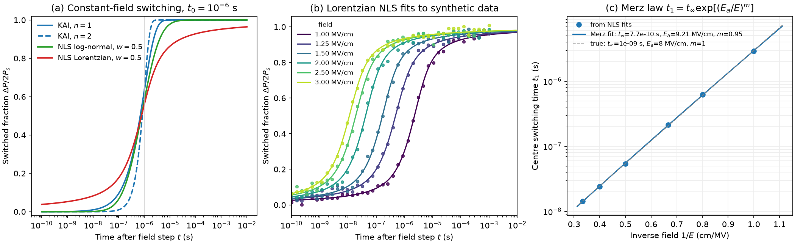
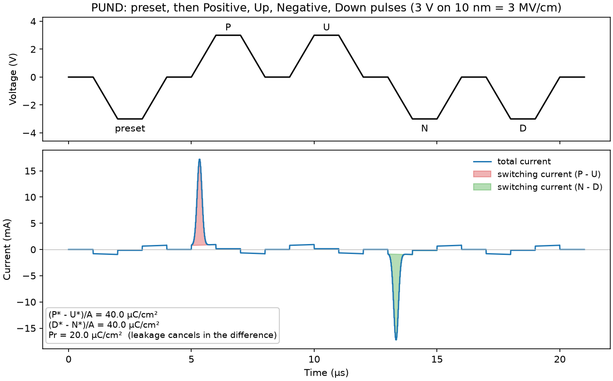
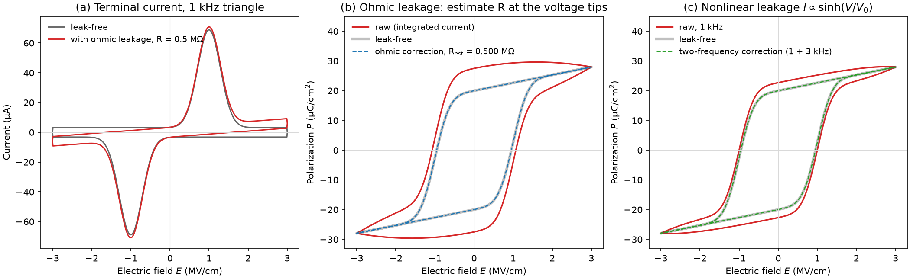

# 鐵電切換與遲滯模型 · Ferroelectric Switching Models

一套小而有測試的 Python 函式庫，收錄文獻中標準的鐵電切換與遲滯模型，以 HfO₂ 系薄膜電容為設定：Landau–Devonshire 自由能與 Landau–Khalatnikov 動力學、Preisach 模型與 FORC 分布、KAI／NLS／Merz 切換動力學與參數擬合，以及 PUND、三角波 P–E 量測與漏電補償的模擬和分析。所有參數都是示意用的合成數值，不含任何量測資料。

A small, tested Python library of standard ferroelectric switching and hysteresis models, set up for HfO₂-based thin-film capacitors: Landau–Devonshire free energy with Landau–Khalatnikov dynamics, a scalar Preisach model with FORC analysis, KAI / NLS / Merz switching kinetics with fitting helpers, and simulated PUND and triangular-wave P–E measurements with leakage compensation and loop-parameter extraction. All parameters are illustrative synthetic values; no measured data are included.

| Landau 自由能與 S 曲線 | Landau–Khalatnikov 動態遲滯 |
|---|---|
|  |  |

| Preisach 主迴線、次迴線與 FORC 分布 |
|---|
|  |

| KAI／NLS 切換曲線、Merz 定律擬合 |
|---|
|  |

| PUND 脈衝與電流 | 漏電補償 |
|---|---|
|  |  |

## 安裝

需要 Python ≥ 3.10，相依套件只有 NumPy、SciPy、Matplotlib。

```bash
pip install -e .
```

## 快速使用

所有函式內部用 SI 單位（C/m²、V/m、s）；`fe_models.units` 提供 µC/cm²、MV/cm 的換算。

```python
import numpy as np
from fe_models import landau, kinetics, PreisachModel
from fe_models.measurement import extract_loop_parameters
from fe_models.units import from_uC_cm2, from_MV_cm, to_uC_cm2, to_MV_cm

# Landau-Khalatnikov loop at 100 kHz
alpha, beta = landau.coefficients_from_pr_ec(Pr=from_uC_cm2(20), Ec=from_MV_cm(1.0))
rho = landau.rho_from_time_constant(10e-9, alpha, beta)          # tau = 10 ns
t, E, P = landau.lk_loop(1e5, from_MV_cm(2.0), alpha, beta, rho)
r = extract_loop_parameters(E, P)
print(f"Ec = {to_MV_cm(r['Ec']):.2f} MV/cm, Pr = {to_uC_cm2(r['Pr']):.1f} uC/cm^2")
# Ec = 1.16 MV/cm, Pr = 20.0 uC/cm^2

# Preisach model with history
m = PreisachModel(bias=from_MV_cm(0.2))                            # imprinted film
E_major, P_up, P_down = m.major_loop()
P_path = m.apply(from_MV_cm(np.r_[np.linspace(0, 3, 50), np.linspace(3, -0.8, 50)]))

# NLS fit to noisy synthetic switching data
t = np.logspace(-9, -4, 60)
rng = np.random.default_rng(0)
frac = kinetics.nls_fraction(t, log10_t1=-6.5, width=0.5) + rng.normal(0, 0.01, t.size)
fit = kinetics.fit_nls(t, frac)
print(f"log10 t1 = {fit['log10_t1']:.2f}, width = {fit['width']:.2f} decades")
# log10 t1 = -6.50, width = 0.49 decades
```

重新產生所有圖（輸出到 `docs/`）：

```bash
python examples/make_all_figures.py
```

## 模組

| 模組 | 內容 |
|---|---|
| `fe_models.landau` | 自由能 $F = \alpha P^2 + \beta P^4 + \gamma P^6 - EP$、S 曲線（含負電容分支）、由自由能求本徵矯頑場、由 $(P_r, E_c)$ 反推 $(\alpha, \beta)$、Landau–Khalatnikov 方程 $\rho\,dP/dt = -\partial F/\partial P$（任意 $E(t)$，`solve_ivp`） |
| `fe_models.preisach` | 離散 hysteron 網格的純量 Preisach 模型（Gaussian／Lorentzian 矯頑場與偏壓場分布、imprint）、主迴線與次迴線、FORC 模擬與 FORC 分布 $-\tfrac12 \partial^2 P/\partial E_r \partial E$ |
| `fe_models.kinetics` | KAI $1-\exp[-(t/t_0)^n]$、NLS（log-normal 或 Lorentzian 的 $\log t_0$ 分布）、Merz 定律 $t_0 = t_\infty \exp[(E_a/E)^m]$，以及 `fit_kai`、`fit_nls`、`fit_merz` |
| `fe_models.measurement` | 三角波與 PUND 波形、電容電流 $I = A\,dD/dt + I_\text{leak}(V)$、電流積分成 P–E 迴線、PUND 分析、歐姆漏電與雙頻率漏電補償、$P_r$、$\pm E_c$、imprint 萃取、喚醒／疲勞的唯象曲線 |
| `fe_models.units` | 常數與單位換算（1 µC/cm² = 10⁻² C/m²，1 MV/cm = 10⁸ V/m），以及示意用的 HfO₂ 預設值 |

2-4 Landau 模型中 $(\alpha, \beta)$ 與 $(P_r, E_c)$ 的關係（推導見 `landau.py` 的模組說明）：

$$P_r = \sqrt{-\alpha/2\beta}, \qquad E_c = \frac{4}{3\sqrt{3}}\,(-\alpha)\,P_r .$$

## 測試

測試只用標準函式庫 `unittest`，在 repo 根目錄執行：

```bash
PYTHONPATH=src python -m unittest discover -s tests
```

（Windows PowerShell：`$env:PYTHONPATH="src"; python -m unittest discover -s tests`）

測試涵蓋：解析輔助式與數值 $P_r$、$E_c$ 一致；LK 慢掃趨近靜態 $E_c$、快掃 $E_c$ 變大；Preisach 對稱性、飽和於 $\pm P_s$、次迴線在主迴線內、return-point memory 與 wiping-out；FORC 分布還原 hysteron 分布；KAI 在 $t_0$ 等於 $1-1/e$；窄分布 NLS 退化為 KAI；固定亂數種子下擬合能取回參數；線性電容的 PUND 切換電荷為零；漏電補償還原無漏電迴線；平移迴線的 $E_c$、$P_r$、imprint 萃取。

## 限制

- **參數是示意值。** $P_r \approx 20$ µC/cm²、$E_c \approx 1$ MV/cm、膜厚 10 nm、$\varepsilon_r \approx 30$ 等預設值是 HfO₂ 薄膜常見的量級，沒有擬合任何元件。
- **純量、一維模型。** 不含去極化場、介面層與電壓分配、晶粒與多相結構、domain wall 的細節、空間不均勻，也不含串聯電阻與量測系統的 RC 時間常數。
- **Landau 的 $E_c$ 是本徵矯頑場**（亞穩極小值消失的場），在這裡是決定迴線寬度的參數，不是對實際薄膜矯頑場的預測；LK 的黏滯係數 $\rho$ 是唯象參數。
- **KAI、NLS（以及類似模型）與 Merz 定律都假設切換期間外加電場固定**（場階躍後保持不變）。把它們擬合到斜坡或三角波電場下取得的資料（例如 P–E 迴線的切換電流），超出了模型所述的假設。
- Preisach 模型與速率無關；雙頻率漏電補償依賴這個性質，用在實際薄膜時兩個頻率應該相近。
- 喚醒／疲勞函式只是曲線形狀（唯象），不代表任何機制。

## Related work

The Python package Ferro by JAnderson419 ([PyPI `ferro`](https://pypi.org/project/ferro/)) handles reading PV, PUND and IV test data and includes a simple Preisach model. This repository focuses instead on switching-kinetics models (KAI / NLS / Merz) and their fitting, plus Landau–Khalatnikov and Preisach / FORC simulation.

## References

- A. F. Devonshire, Phil. Mag. 40, 1040 (1949).
- L. D. Landau and I. M. Khalatnikov, Dokl. Akad. Nauk SSSR 96, 469 (1954).
- F. Preisach, Z. Phys. 94, 277 (1935).
- I. D. Mayergoyz, *Mathematical Models of Hysteresis* (Springer, 1991).
- C. R. Pike, A. P. Roberts and K. L. Verosub, J. Appl. Phys. 85, 6660 (1999).
- Y. Ishibashi and Y. Takagi, J. Phys. Soc. Jpn. 31, 506 (1971).
- A. K. Tagantsev et al., Phys. Rev. B 66, 214109 (2002).
- J. Y. Jo et al., Phys. Rev. Lett. 99, 267602 (2007).
- W. J. Merz, Phys. Rev. 95, 690 (1954).
- T. S. Böscke et al., Appl. Phys. Lett. 99, 102903 (2011) — ferroelectricity in HfO₂ thin films.

## 授權

以 [MIT License](LICENSE) 釋出。
