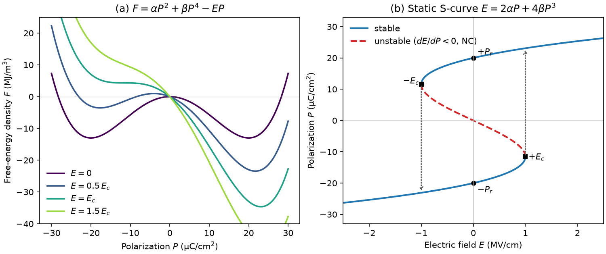
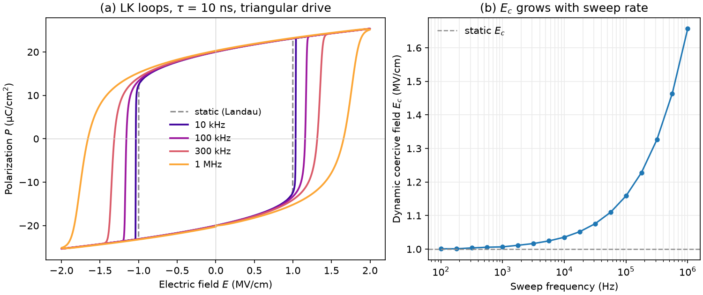
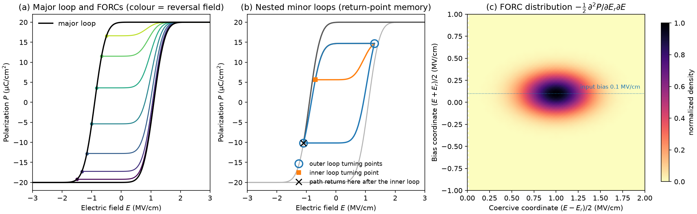
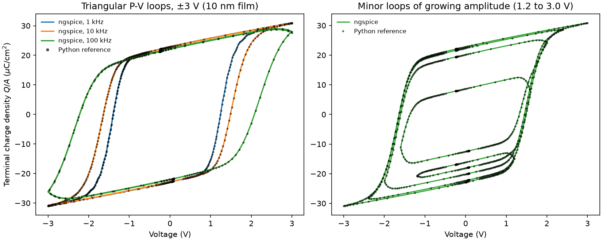
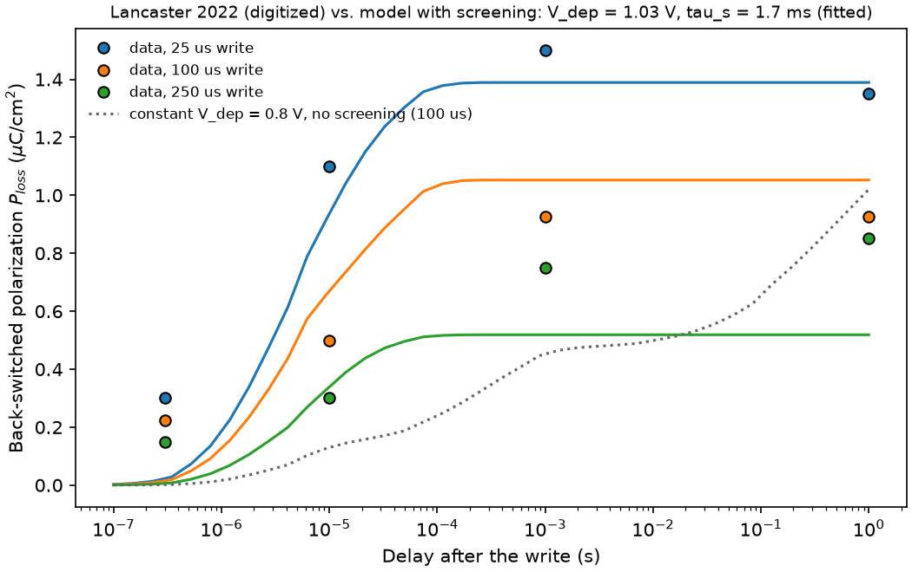
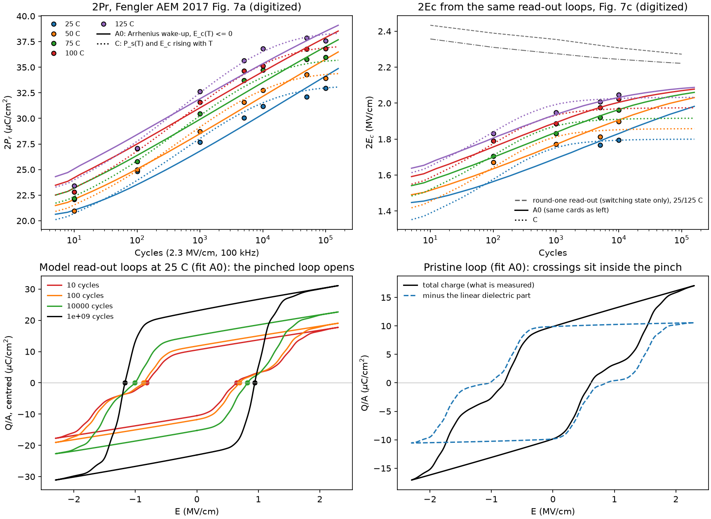

**English** | [繁體中文](README.zh-TW.md)

# Ferroelectric Switching Models

A small, tested Python library of standard ferroelectric switching and hysteresis models, set up for HfO₂-based thin-film capacitors, plus a compact **Verilog-A capacitor model for circuit simulation** that has been compiled with OpenVAF-Reloaded and verified in ngspice against its Python reference.

- **Landau–Devonshire** free energy and **Landau–Khalatnikov** dynamics
- a scalar **Preisach** model with first-order reversal curves (**FORC**)
- **KAI / NLS / Merz** switching kinetics with fitting helpers
- simulated **PUND** and triangular-wave P–E measurements, **leakage compensation** and loop-parameter extraction
- a **dynamic multi-domain NLS** capacitor model (`fe_models.nls_multidomain`) and its Verilog-A version [`spice/fecap_nls.va`](spice/fecap_nls.va): finite-pulse switching, accumulation under repeated sub-coercive pulses without artificial drift under small symmetric signals, a state-dependent (butterfly) reversible response, imprint, optional back-switching with screening, leakage and temperature coefficients; plus optional cycling and storage history (wake-up, fatigue, logarithmic-time imprint, leakage growth with fatigue), all off by default

The Landau, Preisach, kinetics and measurement modules use illustrative synthetic parameters. The multi-domain model uses a generic card built from published fits (every value with its source), and one device card fitted to a published C–V and loop (`spice/params/mukherjee2023.inc`). No measured data of any device are included; comparisons with the literature use numbers taken from published papers ([`data/literature/`](data/literature/)).

## Figure gallery

| Landau free energy and S-curve | Landau–Khalatnikov dynamic loops |
|---|---|
|  |  |

| Preisach major and minor loops, FORC distribution |
|---|
|  |

| KAI / NLS switching curves and a Merz-law fit |
|---|
|  |

| PUND pulses and currents | Leakage compensation |
|---|---|
|  |  |

**Verilog-A model in ngspice (lines) vs. the Python reference (dots)**

| P–V loops at 1 / 10 / 100 kHz and minor loops | PUND currents |
|---|---|
|  |  |
| **Switching kinetics** | **Small-signal stability vs. genuine slow switching** |
|  |  |

**Multi-domain model vs. values from published papers** (see [Comparison with published data](spice/README.md#comparison-with-published-data))

| Switching kinetics (published NLS fits) | C–V branches (digitized) |
|---|---|
|  |  |
| **Read endurance (digitized)** | **Back-switching (digitized)** |
|  |  |

**Cycling and storage history against published data** (see [Sections 4 and 7 of the derivation article](docs/model-derivation.md#4-cycling-and-storage-history-optional) and [`docs/research/`](docs/research/))

| $2P_r$ and $2E_c$ during wake-up, five temperatures | Pulse-width dependence of wake-up |
|---|---|
|  |  |
| **Read endurance: dynamic imprint against both states** | **Imprint versus time and temperature** |
|  |  |

## Install

Python ≥ 3.10; the only dependencies are NumPy, SciPy and Matplotlib.

```bash
pip install -e .
```

The SPICE part additionally needs [OpenVAF-Reloaded](https://github.com/arpadbuermen/OpenVAF) (or OpenVAF) to compile the Verilog-A file and ngspice ≥ 39 with OSDI support to run it; see [spice/README.md](spice/README.md#quick-start-ngspice).

## Quick start

All functions use SI units internally (C/m², V/m, s); `fe_models.units` converts to µC/cm² and MV/cm.

```python
import numpy as np
from fe_models import landau, kinetics, PreisachModel
from fe_models.measurement import extract_loop_parameters
from fe_models.units import from_uC_cm2, from_MV_cm, to_uC_cm2, to_MV_cm

# Landau-Khalatnikov loop at 100 kHz
alpha, beta = landau.coefficients_from_pr_ec(Pr=from_uC_cm2(20), Ec=from_MV_cm(1.0))
rho = landau.rho_from_time_constant(10e-9, alpha, beta)          # tau = 10 ns
t, E, P = landau.lk_loop(1e5, from_MV_cm(2.0), alpha, beta, rho)
r = extract_loop_parameters(E, P)
print(f"Ec = {to_MV_cm(r['Ec']):.2f} MV/cm, Pr = {to_uC_cm2(r['Pr']):.1f} uC/cm^2")
# Ec = 1.16 MV/cm, Pr = 20.0 uC/cm^2

# Preisach model with history
m = PreisachModel(bias=from_MV_cm(0.2))                            # imprinted film
E_major, P_up, P_down = m.major_loop()
P_path = m.apply(from_MV_cm(np.r_[np.linspace(0, 3, 50), np.linspace(3, -0.8, 50)]))

# NLS fit to noisy synthetic switching data
t = np.logspace(-9, -4, 60)
rng = np.random.default_rng(0)
frac = kinetics.nls_fraction(t, log10_t1=-6.5, width=0.5) + rng.normal(0, 0.01, t.size)
fit = kinetics.fit_nls(t, frac)
print(f"log10 t1 = {fit['log10_t1']:.2f}, width = {fit['width']:.2f} decades")
# log10 t1 = -6.50, width = 0.49 decades
```

The multi-domain capacitor model:

```python
from fe_models import nls_multidomain as nm

p = nm.generic_card()                                  # generic card from published fits
print(f"switched by 2 V / 1 us: {nm.switched_fraction(p, 2.0, 1e-6):.3f}")
# switched by 2 V / 1 us: 0.754

vf, breaks = nm.pwl([0, 0.1e-6, 10.1e-6, 10.2e-6, 20e-6], [0, 3, 3, 0, 0])
r = nm.simulate(p, vf, 20e-6, s0=-1, breaks=breaks)    # arbitrary V(t), Radau
print(f"Q/A at the end: {r['qd'][-1] / 1e-2:.2f} uC/cm^2")
# Q/A at the end: 22.87 uC/cm^2

# 10^6 cycles of a +-0.3 V triangle: the state does not move
print(nm.repeat_waveform(p, [0, 0.25e-6, 0.75e-6, 1e-6], [0, -0.3, 0.3, 0], 1e6, 1.0))
# 1.0
# 10^6 pairs of +-0.9 V, 40 ns reads: genuine tail switching
print(f"{1 - nm.bipolar_pairs(p, 0.9, 40e-9, 100e-9, 1e6, nd=64):.3f}")
# 0.101
```

Regenerate the figures (written to `docs/`; the SPICE figures are skipped when ngspice is not found):

```bash
python examples/make_all_figures.py
```

## Modules

### `fe_models.landau` — Landau–Devonshire and Landau–Khalatnikov

Free energy $F = \alpha P^2 + \beta P^4 + \gamma P^6 - EP$, the static S-curve $E(P) = \partial F/\partial P$ including the negative-capacitance branch, the intrinsic coercive field from the free energy, $(\alpha, \beta)$ from $(P_r, E_c)$, and the Landau–Khalatnikov equation $\rho\,\mathrm{d}P/\mathrm{d}t = -\partial F/\partial P$ for any $E(t)$ (`solve_ivp`). For the 2–4 model (derivation in the docstring of `landau.py`):

$$P_r = \sqrt{-\alpha/2\beta}, \qquad E_c = \frac{4}{3\sqrt{3}}\,(-\alpha)\,P_r .$$

Main functions: `coefficients_from_pr_ec`, `free_energy`, `field_from_polarization`, `s_curve`, `static_loop`, `remanent_polarization`, `coercive_field`, `rho_from_time_constant`, `lk_simulate(t, E_func, ...)`, `lk_loop(frequency, E_amp, ...)`.

### `fe_models.preisach` — Preisach model and FORC

A scalar Preisach model on a discrete hysteron grid with Gaussian or Lorentzian coercive- and bias-field distributions (a non-zero bias centre gives imprint); major and minor loops with history; FORC simulation and the FORC distribution

$$\rho(E_r, E) = -\frac12\,\frac{\partial^2 P}{\partial E_r\,\partial E}.$$

```python
from fe_models.preisach import PreisachModel, simulate_forcs, forc_distribution
m = PreisachModel(Ec=1e8, sigma_c=0.25e8, distribution="lorentzian")
Er, E, P = simulate_forcs(m)          # P[i, j] = P(Er[i], E[j])
rho = forc_distribution(Er, E, P)
```

### `fe_models.kinetics` — KAI, NLS, Merz

KAI $f(t) = 1 - \exp[-(t/t_0)^n]$; NLS with a Lorentzian or log-normal distribution of $\log_{10} t_0$, $f(t) = \int\{1 - \exp[-(t/10^u)^n]\}F(u)\,\mathrm{d}u$; the Merz law $t_0 = t_\infty\exp[(E_a/E)^m]$; and `fit_kai`, `fit_nls`, `fit_merz`. These models assume a field that is switched on and then held constant (see [Limitations](#limitations)).

### `fe_models.measurement` — PUND, P–E loops, leakage

Triangular and PUND waveforms (`triangle_wave`, `pund_waveform`); the capacitor current $I = A\,\mathrm{d}D/\mathrm{d}t + I_{leak}(V)$ with $D = \varepsilon_0\varepsilon_r E + P_{sw}$ (`capacitor_current`, any callable for $P_{sw}$, for example `PreisachModel.apply`); P–E loops by current integration (`polarization_from_current`); PUND analysis (`analyze_pund`); ohmic leakage estimation and subtraction (`estimate_leakage_resistance`, `compensate_leakage_ohmic`); two-frequency leakage compensation $I_{leak} = (f_2 I_1 - f_1 I_2)/(f_2 - f_1)$ (`compensate_leakage_two_frequency`); $P_r$, $\pm E_c$ and imprint extraction (`extract_loop_parameters`); a phenomenological wake-up / fatigue curve (`wakeup_fatigue_form`, `cycling_pr`).

### `fe_models.nls_multidomain` — dynamic multi-domain NLS capacitor model

The film is split into $N_d$ classes of domains (quantiles of a Dagum activation-field distribution sampled on a logit grid). Class $k$ has a weight $w_k$, a state $s_k \in [-1, 1]$ and a signed nucleation progress $h_k$:

$$\bar x = \sum_k w_k s_k,\qquad R_k^{\pm} = \tau_0^{-1}\exp\left[-\left(V_{a,k}/|u_k|\right)^{\alpha}\right],\qquad \frac{\mathrm{d}s_k}{\mathrm{d}t} = \beta R_k^{+}(h_k^{+})^{\beta-1}(1 - s_k) - \beta R_k^{-}(h_k^{-})^{\beta-1}(1 + s_k),$$

with $u_k = \rho V - V_{dep}(\bar x - \sigma) - V_{imp} - \delta_k$, a progress variable that grows with $R$, relaxes only near 0 V and is reset when the drive reverses, a two-branch reversible charge, a screening state $\sigma$ and leakage. Under a constant field it reduces to the single-pulse NLS form $f = \sum_k w_k\{1 - \exp[-(R_k t)^\beta]\}$. The full equation set of the core model (E1–E12), the optional history terms (E13–E20) and every parameter are in [spice/README.md](spice/README.md#equations); the reasoning behind each equation is in [docs/model-derivation.md](docs/model-derivation.md).

Main functions: `generic_card(**overrides)`, `simulate(p, v_of_t, t_end, s0, breaks=...)` (Radau), `switched_fraction`, `train_fraction`, `bipolar_pairs`, `pund`, `repeat_waveform`, `step` (closed-form constant-voltage update), `march` (fixed-grid θ-method), `q_rev`, `q_term`, `j_leak`, `rhs`, `pwl`, `spice_model_card`.

**Cycling and storage history (optional, off by default).** Fatigue is not written as "smaller $P_s$": pinned domains go into a pool that keeps their polarization and reversible charge, so a stored state does not lose charge as fatigue grows (E13). On top of that:

- wake-up driven by the amount of switching, with the disappearance of a pristine bias split (E14);
- a reversible pool, depinned under field and re-pinned at each reversal, that explains the pulse-width dependence of wake-up (E18);
- fatigue with two drivers (E15), a build-up time of the fatigue stress (E19) and leakage growing with fatigue (E20);
- imprint from 12 trapping states with logarithmically spaced time constants (E17), with branch asymmetry (E17a) and field acceleration (E17b).

Related functions: `cycle_history` (10¹² cycles in about 0.1 s; the result can be handed to SPICE through `nw0`, `af0`, `si0`, `zq0`), `loop_figures` (reads $P_r$ and $E_c$ the way the experiment does), `aged_card`; read sequences are in `fe_models.read_disturb`. Why each term is written this way, and how it compares with published data: Sections 4 and 7 of the derivation article.

### `fe_models.units`

Constants and conversions (1 µC/cm² = 10⁻² C/m², 1 MV/cm = 10⁸ V/m) and the illustrative HfO₂ defaults used by the first four modules.

## SPICE model (Verilog-A)

[`spice/fecap_nls.va`](spice/fecap_nls.va) (module `fecap_nls`) implements the same equations as `fe_models.nls_multidomain`. Terminals `p`, `n` and a monitor output `qm` whose voltage is the terminal charge density in µC/cm²; instance parameters `s0`, `area`, `sg0`, plus `nw0`, `af0`, `si0`, `zq0` for a prior history; 16 domain classes by default (`-D FE_ND=64` for more).

```bash
python spice/build_osdi.py                        # needs OPENVAF (and on Windows LLD + MINGW_LIBDIR)
NGSPICE=/path/to/ngspice_con python spice/compare_ngspice.py
```

```spice
.include params/generic.inc
N1 p 0 qm fecap_generic s0=-1 area=1e-10
.control
pre_osdi build/fecap_nls.osdi
...
```

**Status.** Compiled with OpenVAF-Reloaded 24.0.2 and run in ngspice 47 (Windows). Twelve testbenches — PUND, triangular P–V loops at three frequencies, minor loops, switched fraction versus pulse width and amplitude, 1000 cycles of ±0.3 V, slow accumulation at ±0.8 V, low-pass reversible response, back-switching, 85 °C with temperature coefficients, leakage I–V — agree with the Python reference (switched fraction within 2×10⁻⁴, charges within 0.01 µC/cm², coercive voltages within 6.4 mV, no drift above 10⁻¹³ after 1000 small-signal cycles). The real simulator required one change: the initial-state condition now also tests `$abstime`, because ngspice's OSDI interface does not report `analysis("static")` at the transient operating point. The history terms added later have seven more testbenches (wake-up, fatigue, imprint, starting from an existing history, depinning, stress build-up with leakage, and the two imprint extensions); all 92 checks in the 19 testbenches pass, with charges within 0.042 µC/cm². HSPICE and Spectre were **not** tested. Full documentation — equations, parameter table with sources, numerical notes, verification table, comparison with published data, limitations: **[spice/README.md](spice/README.md)**. How the model was derived: [docs/model-derivation.md](docs/model-derivation.md) · [繁體中文](docs/model-derivation.zh-TW.md).

## Project structure

```
ferroelectric-models/
├── src/fe_models/
│   ├── landau.py            Landau-Devonshire, Landau-Khalatnikov
│   ├── preisach.py          Preisach model, FORC
│   ├── kinetics.py          KAI, NLS, Merz, fitting
│   ├── measurement.py       PUND, P-E loops, leakage compensation
│   ├── nls_multidomain.py   dynamic multi-domain NLS (Python reference of the Verilog-A model) and history terms
│   ├── read_disturb.py      read sequences (up to 10^11 reads) and loop calibration
│   └── units.py             constants, unit conversions
├── spice/
│   ├── fecap_nls.va         Verilog-A model
│   ├── params/generic.inc   generic parameter card with sources
│   ├── params/mukherjee2023.inc  C–V and loop fit of a published device
│   ├── tests/*.cir          ngspice testbenches
│   ├── build_osdi.py        compile with OpenVAF (and link with lld on Windows)
│   ├── compare_ngspice.py   run the testbenches, compare with Python
│   └── README.md            model documentation
├── data/literature/         values from published papers (CSV with citation headers)
├── examples/                one script per figure; make_all_figures.py runs them all
├── docs/                    figures, model-derivation.md, model-derivation.zh-TW.md
│   └── research/            research notes (English and Chinese): read disturb, wake-up and fatigue, imprint
└── tests/                   unittest suites
```

## Testing

The tests use only the standard-library `unittest`. From the repository root:

```bash
PYTHONPATH=src python -m unittest discover -s tests
```

(Windows PowerShell: `$env:PYTHONPATH="src"; python -m unittest discover -s tests`)

Without ngspice this runs 148 tests (two test classes skipped). With ngspice and the compiled model available (`NGSPICE`, and `OPENVAF` or an existing `spice/build/fecap_nls.osdi`), the skipped classes run all 19 testbenches and the loop of the device card as well: 153 tests in about 12 minutes.

The original 43 tests cover: analytic helpers vs. numerical $P_r$, $E_c$; slow LK sweeps approach the static $E_c$ and fast sweeps widen it; Preisach symmetry, saturation at $\pm P_s$, minor loops inside the major loop, return-point memory and wiping-out; the FORC distribution recovers the hysteron distribution; KAI equals $1 - 1/e$ at $t_0$; a narrow NLS reduces to KAI; fits recover parameters with a fixed random seed; a linear capacitor gives zero PUND switching charge; leakage compensation recovers the leak-free loop; $E_c$, $P_r$ and imprint of a shifted loop.

The 34 tests of `test_nls_multidomain.py` cover the multi-domain model: grid weights and ordering; one-directional rates; bounded states; reduction to the single-pulse NLS form (ODE vs. closed form within 2×10⁻⁴) and to the continuous NLS integral; closed forms vs. ODE for pulse trains, PUND and bipolar cycles; step-size convergence; no drift for ±26 mV and ±0.3 V over 10⁶ cycles; genuine accumulation converging with $N_d$; butterfly branches and the $f_{rev}$ split; passivity; charge conservation in a series-resistor circuit; three deliberately broken model versions that the checks must catch; the closed-form `step()` across a sub-threshold reversal; and consistency of the Verilog-A defaults, the parameter card and the testbenches with the Python module. The history terms are covered by `test_history.py` (23 tests), `test_cycling_r2.py` (18), `test_read_disturb.py` (13), `test_read_imprint_r2.py` (13) and `test_card_mukherjee.py` (6): bit-for-bit unchanged when off, terminal charge constant at fixed bias while damage grows, the log slope of imprint, cycle averaging against direct integration, passivity with every term on, and more.

## Limitations

- **Illustrative parameters.** The defaults of the Landau, Preisach, kinetics and measurement modules ($P_r \approx 20$ µC/cm², $E_c \approx 1$ MV/cm, 10 nm, $\varepsilon_r \approx 30$) are typical magnitudes for HfO₂ films and are not fitted to any device. The multi-domain card is taken from published fits of particular devices and is not a fit to any device of yours.
- **Scalar, one-dimensional models.** No depolarization field (except the optional term of the multi-domain model), interface layer and voltage division (except the multi-domain $\rho$, not validated), grain or phase structure, domain-wall detail, spatial non-uniformity, series resistance or RC time constant of the measurement setup.
- **The Landau $E_c$ is the intrinsic coercive field** (where the metastable minimum disappears). Here it is a parameter that sets the loop width, not a prediction of the coercive field of real films; the LK viscosity $\rho$ is phenomenological.
- **KAI, NLS (and similar models) and the Merz law assume a constant applied field during switching** (a field step that is then held). Fitting them to data taken under ramped or triangular fields (for example the switching current of a P–E loop) is outside the assumptions of the models. The multi-domain model removes this restriction by integrating the rates along the waveform.
- The Preisach model is rate independent; the two-frequency leakage compensation relies on that and, for real films, the two frequencies should be close.
- The wake-up / fatigue functions of `measurement` are curve shapes only (phenomenological), not a mechanism; the mechanistic version is the history terms of the multi-domain model.
- **Multi-domain model:** the history terms have no fatigue recovery or breakdown and miss the early steep leakage rise; the drop after 10⁸ reads has two explanations the data cannot separate; mean-field only (no single-grain stochastics), rates below about 0.8 V and switching faster than 200 ns are extrapolations of the cited data, temperature coefficients are placeholders, and HSPICE / Spectre were not tested. Comparisons with published read-endurance data show that sub-coercive read disturb depends on the distribution, the kinetics and the imprint built up between write and read, and must be measured on the device of interest. Full list: [spice/README.md](spice/README.md#limitations).

## Related work

The Python package Ferro by JAnderson419 ([PyPI `ferro`](https://pypi.org/project/ferro/)) handles reading PV, PUND and IV test data and includes a simple Preisach model. This repository focuses instead on switching-kinetics models (KAI / NLS / Merz) and their fitting, Landau–Khalatnikov and Preisach / FORC simulation, and a dynamic multi-domain NLS capacitor model with a verified Verilog-A implementation.

## References

- A. F. Devonshire, Phil. Mag. 40, 1040 (1949).
- L. D. Landau and I. M. Khalatnikov, Dokl. Akad. Nauk SSSR 96, 469 (1954).
- F. Preisach, Z. Phys. 94, 277 (1935).
- I. D. Mayergoyz, *Mathematical Models of Hysteresis* (Springer, 1991).
- C. R. Pike, A. P. Roberts and K. L. Verosub, J. Appl. Phys. 85, 6660 (1999).
- Y. Ishibashi and Y. Takagi, J. Phys. Soc. Jpn. 31, 506 (1971).
- A. K. Tagantsev et al., Phys. Rev. B 66, 214109 (2002).
- J. Y. Jo et al., Phys. Rev. Lett. 99, 267602 (2007).
- W. J. Merz, Phys. Rev. 95, 690 (1954).
- T. S. Böscke et al., Appl. Phys. Lett. 99, 102903 (2011) — ferroelectricity in HfO₂ thin films.
- Alessandri et al., IEEE Electron Device Lett. 39, 1780 (2018); Alessandri, Pandey, Seabaugh, IEDM 2018; Alessandri et al., IEEE Trans. Electron Devices 66, 3527 (2019) — the dynamic NLS model and the switching parameters of the generic card.
- Further references of the multi-domain model (C–V, leakage, back-switching, read endurance, wake-up, fatigue, imprint): [spice/README.md](spice/README.md#references).

## License

Released under the [MIT License](LICENSE).
