[English](README.md) | **繁體中文**

# 鐵電切換與遲滯模型

[](LICENSE) [](https://github.com/Celivem/ferroelectric-models/releases) 

一套小而有測試的 Python 函式庫，收錄文獻中標準的鐵電切換與遲滯模型，以 HfO₂ 系薄膜電容為設定；另外附一個**給電路模擬用的 Verilog-A 電容模型**，已經用 OpenVAF-Reloaded 編譯、在 ngspice 中執行，並與它的 Python 參考實作逐點比對。

- **Landau–Devonshire** 自由能與 **Landau–Khalatnikov** 動力學
- 純量 **Preisach** 模型與 first-order reversal curve（**FORC**，一階反轉曲線）分布
- **KAI／NLS／Merz** 切換動力學與參數擬合
- 模擬的 **PUND** 與三角波 P–E 量測、**漏電補償**、迴線參數萃取
- **動態多域 NLS** 電容模型（`fe_models.nls_multidomain`）與它的 Verilog-A 版本 [`spice/fecap_nls.va`](spice/fecap_nls.va)：有限脈寬下的翻轉、低於矯頑電壓的重複脈衝累積（而對稱小訊號不會人為漂移）、與狀態相關的蝴蝶形可逆響應、imprint、可選的回切與屏蔽、漏電與溫度係數；另有選用的循環與存放歷史（喚醒、疲勞、對數時間 imprint、漏電隨疲勞上升），預設全部關閉

Landau、Preisach、kinetics、measurement 四個模組的參數都是示意用的合成數值。多域模型使用一組由已發表擬合整理出的通用參數卡，每個數字都附出處；另有一張依已發表 C–V 與迴線擬合的元件卡（`spice/params/mukherjee2023.inc`）。本 repo 不含任何元件的量測資料；與文獻的比較使用的是論文中的數字（[`data/literature/`](data/literature/)）。

## 圖庫

| Landau 自由能與 S 曲線 | Landau–Khalatnikov 動態遲滯 |
|---|---|
| 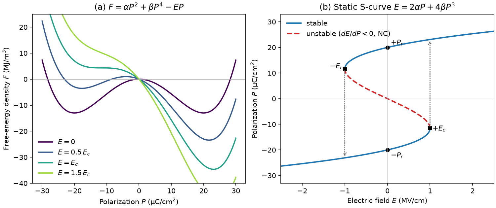 | 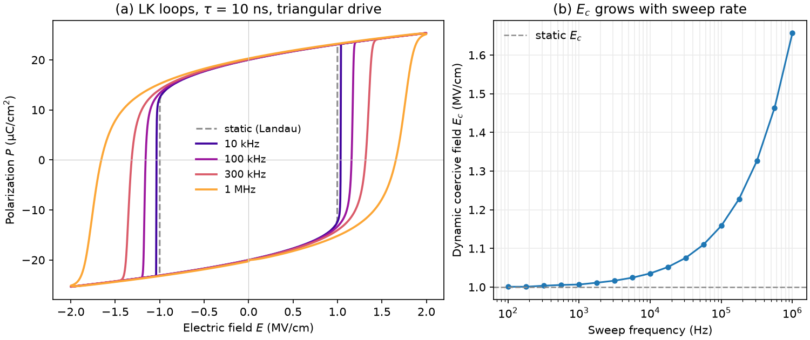 |

| Preisach 主迴線、次迴線與 FORC 分布 |
|---|
| 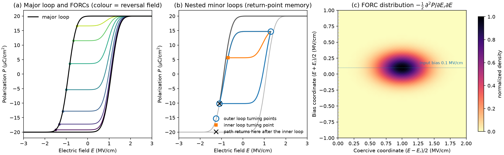 |

| KAI／NLS 切換曲線、Merz 定律擬合 |
|---|
| 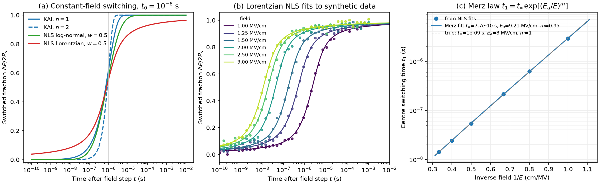 |

| PUND 脈衝與電流 | 漏電補償 |
|---|---|
| 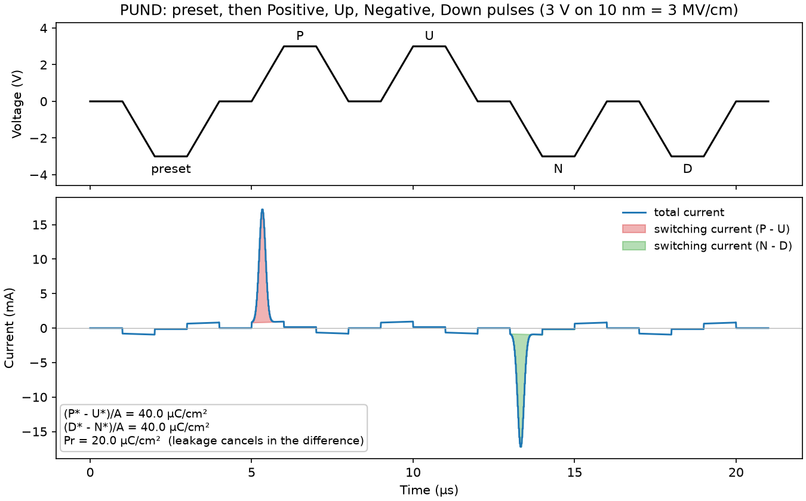 | 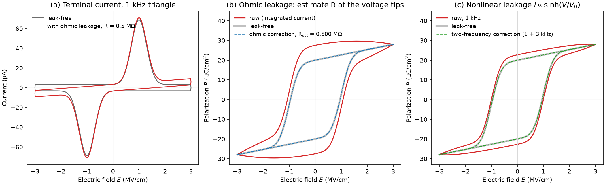 |

**Verilog-A 模型在 ngspice 的結果（線）對 Python 參考實作（點）**

| 1／10／100 kHz 的 P–V 迴線與次迴線 | PUND 電流 |
|---|---|
| 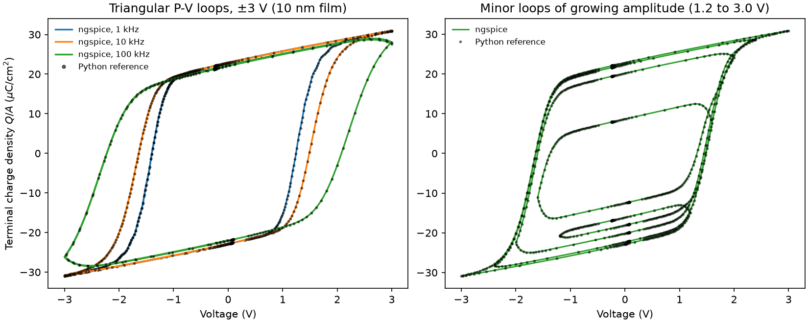 | 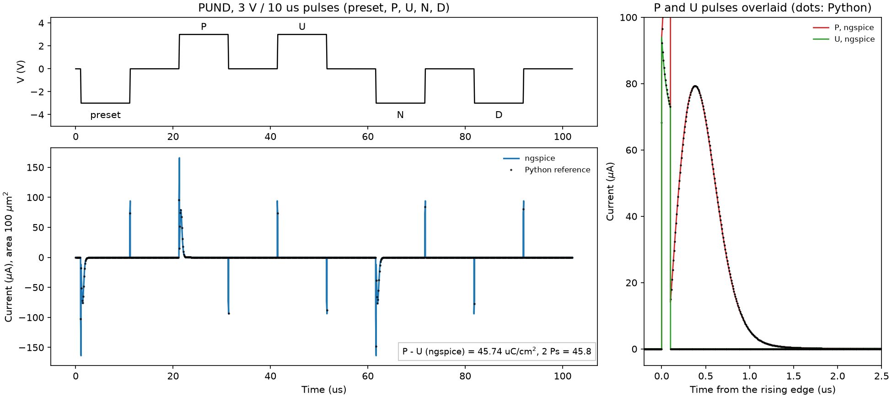 |
| **切換動力學** | **小訊號不漂移與真實的緩慢翻轉** |
| 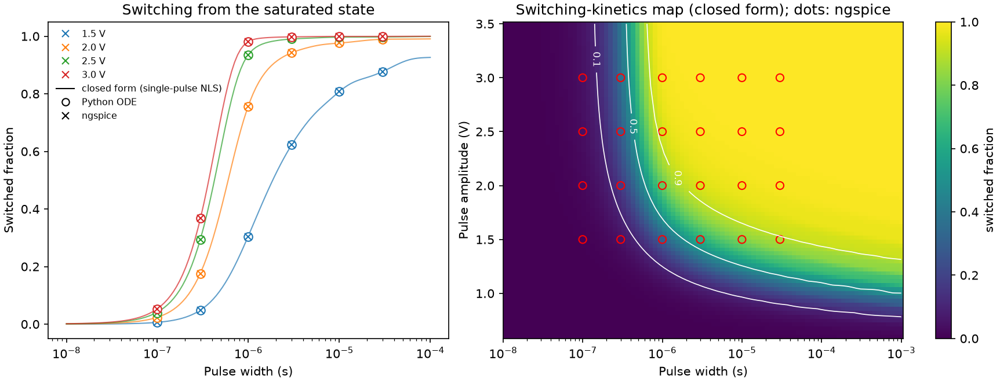 | 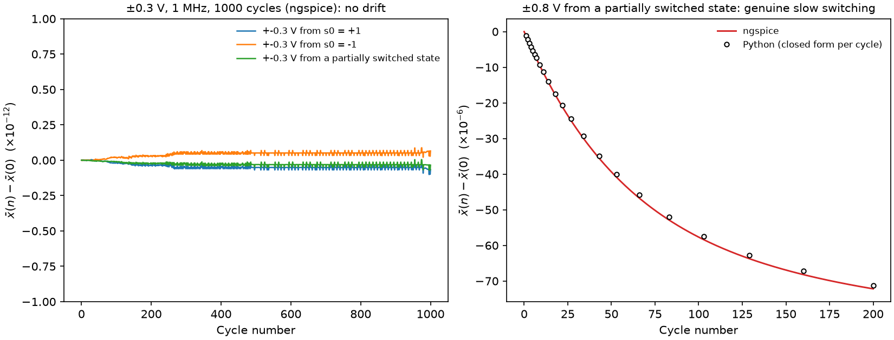 |

**多域模型對已發表論文中的數字**（說明見[與已發表資料的比較](spice/README.md#comparison-with-published-data)）

| 切換動力學（論文發表的 NLS 擬合） | C–V 兩支（讀圖） |
|---|---|
| 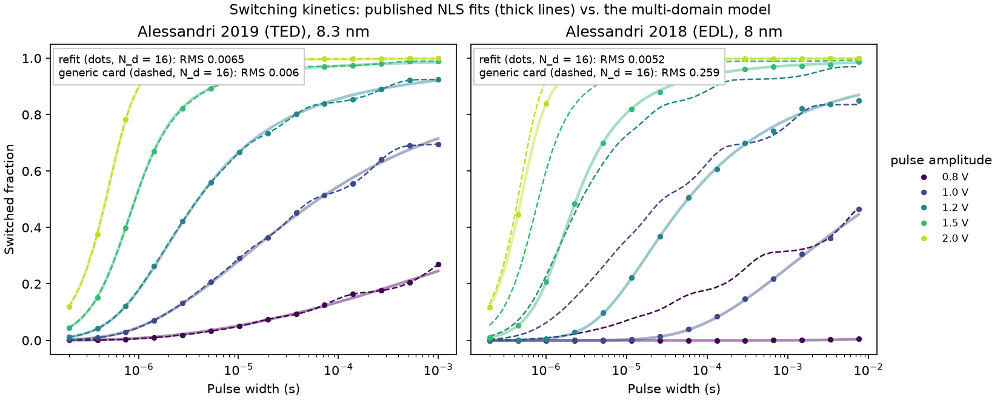 | 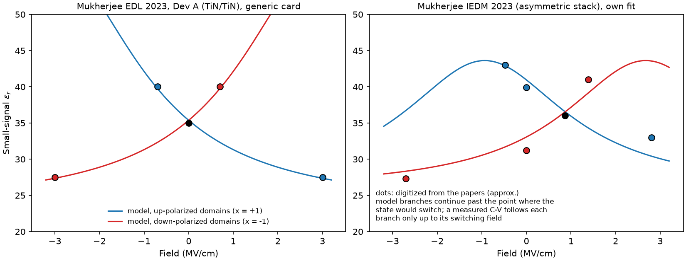 |
| **讀取耐久（讀圖）** | **回切（讀圖）** |
| 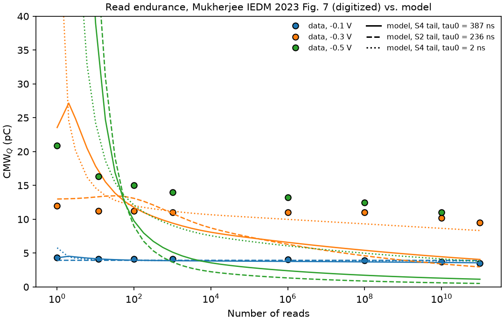 | 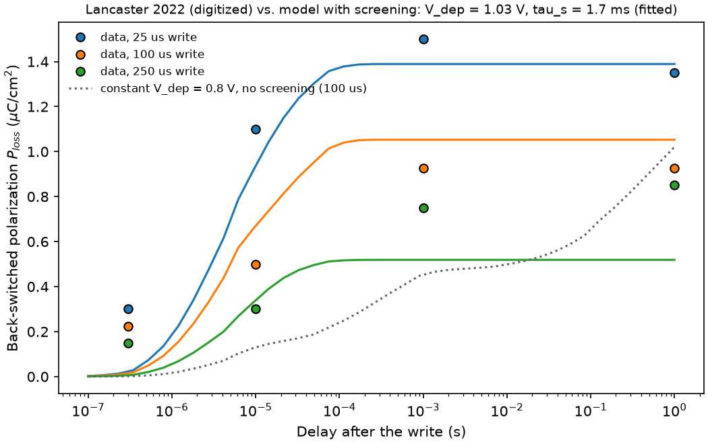 |

**循環與存放歷史對已發表數據**（說明見[推導文章第 4、7 節](docs/model-derivation.zh-TW.md#4-循環與存放歷史選用)與 [`docs/research/`](docs/research/)）

| 喚醒中的 $`2P_r`$ 與 $`2E_c`$，五個溫度 | 喚醒對脈寬的依賴 |
|---|---|
|  |  |
| **讀取耐久：動態 imprint 對兩態電荷** | **imprint 隨時間與溫度** |
| 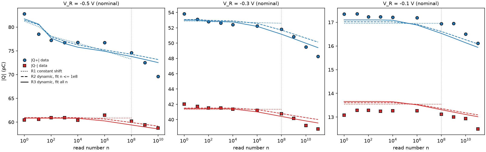 | 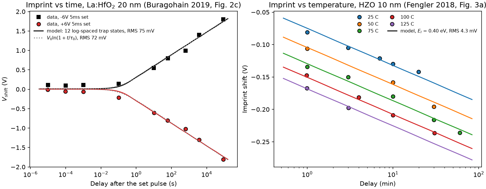 |

## 安裝

需要 Python ≥ 3.10，相依套件只有 NumPy、SciPy、Matplotlib。

```bash
git clone https://github.com/Celivem/ferroelectric-models.git
cd ferroelectric-models
pip install -e .
```

不 clone、直接安裝某個發布版本：`pip install "fe-models @ git+https://github.com/Celivem/ferroelectric-models@v0.3.0"`。各版本與變更內容見 [CHANGELOG.md](CHANGELOG.md)（英文）與 [Releases 頁面](https://github.com/Celivem/ferroelectric-models/releases)。

SPICE 部分另外需要 [OpenVAF-Reloaded](https://github.com/arpadbuermen/OpenVAF)（或 OpenVAF）把 Verilog-A 編譯成 OSDI 函式庫，以及支援 OSDI 的 ngspice（≥ 39）；步驟見 [spice/README.md](spice/README.md#quick-start-ngspice)。

## 快速使用

所有函式內部用 SI 單位（C/m²、V/m、s）；`fe_models.units` 提供 µC/cm²、MV/cm 的換算。

```python
import numpy as np
from fe_models import landau, kinetics, PreisachModel
from fe_models.measurement import extract_loop_parameters
from fe_models.units import from_uC_cm2, from_MV_cm, to_uC_cm2, to_MV_cm

# Landau-Khalatnikov loop at 100 kHz
alpha, beta = landau.coefficients_from_pr_ec(Pr=from_uC_cm2(20), Ec=from_MV_cm(1.0))
rho = landau.rho_from_time_constant(10e-9, alpha, beta)          # tau = 10 ns
t, E, P = landau.lk_loop(1e5, from_MV_cm(2.0), alpha, beta, rho)
r = extract_loop_parameters(E, P)
print(f"Ec = {to_MV_cm(r['Ec']):.2f} MV/cm, Pr = {to_uC_cm2(r['Pr']):.1f} uC/cm^2")
# Ec = 1.16 MV/cm, Pr = 20.0 uC/cm^2

# Preisach model with history
m = PreisachModel(bias=from_MV_cm(0.2))                            # imprinted film
E_major, P_up, P_down = m.major_loop()
P_path = m.apply(from_MV_cm(np.r_[np.linspace(0, 3, 50), np.linspace(3, -0.8, 50)]))

# NLS fit to noisy synthetic switching data
t = np.logspace(-9, -4, 60)
rng = np.random.default_rng(0)
frac = kinetics.nls_fraction(t, log10_t1=-6.5, width=0.5) + rng.normal(0, 0.01, t.size)
fit = kinetics.fit_nls(t, frac)
print(f"log10 t1 = {fit['log10_t1']:.2f}, width = {fit['width']:.2f} decades")
# log10 t1 = -6.50, width = 0.49 decades
```

多域電容模型：

```python
from fe_models import nls_multidomain as nm

p = nm.generic_card()                                  # 由已發表擬合整理的通用參數卡
print(f"switched by 2 V / 1 us: {nm.switched_fraction(p, 2.0, 1e-6):.3f}")
# switched by 2 V / 1 us: 0.754

vf, breaks = nm.pwl([0, 0.1e-6, 10.1e-6, 10.2e-6, 20e-6], [0, 3, 3, 0, 0])
r = nm.simulate(p, vf, 20e-6, s0=-1, breaks=breaks)    # 任意 V(t)，Radau 積分
print(f"Q/A at the end: {r['qd'][-1] / 1e-2:.2f} uC/cm^2")
# Q/A at the end: 22.87 uC/cm^2

# ±0.3 V 三角波 10^6 圈：狀態不動
print(nm.repeat_waveform(p, [0, 0.25e-6, 0.75e-6, 1e-6], [0, -0.3, 0.3, 0], 1e6, 1.0))
# 1.0
# ±0.9 V、40 ns 成對讀取 10^6 次：尾巴真的翻轉
print(f"{1 - nm.bipolar_pairs(p, 0.9, 40e-9, 100e-9, 1e6, nd=64):.3f}")
# 0.101
```

重新產生所有圖（輸出到 `docs/`；找不到 ngspice 時會略過 SPICE 的圖）：

```bash
python examples/make_all_figures.py
```

## 模組

### `fe_models.landau`：Landau–Devonshire 與 Landau–Khalatnikov

自由能 $`F = \alpha P^2 + \beta P^4 + \gamma P^6 - EP`$；靜態 S 曲線 $`E(P) = \partial F/\partial P`$（含負電容分支）；由自由能求本徵矯頑場；由 $`(P_r, E_c)`$ 反推 $`(\alpha, \beta)`$；Landau–Khalatnikov 方程 $`\rho\,\mathrm{d}P/\mathrm{d}t = -\partial F/\partial P`$，任意 $`E(t)`$，用 `solve_ivp` 求解。2–4 模型中 $`(\alpha, \beta)`$ 與 $`(P_r, E_c)`$ 的關係（推導見 `landau.py` 的模組說明）：

```math
P_r = \sqrt{-\alpha/2\beta}, \qquad E_c = \frac{4}{3\sqrt{3}}\,(-\alpha)\,P_r .
```

主要函式：`coefficients_from_pr_ec`、`free_energy`、`field_from_polarization`、`s_curve`、`static_loop`、`remanent_polarization`、`coercive_field`、`rho_from_time_constant`、`lk_simulate(t, E_func, ...)`、`lk_loop(frequency, E_amp, ...)`。

### `fe_models.preisach`：Preisach 模型與 FORC

離散 hysteron（遲滯子）網格上的純量 Preisach 模型，矯頑場與偏壓場分布可選 Gaussian 或 Lorentzian（偏壓中心不為零時就有 imprint）；主迴線與帶歷史的次迴線；FORC 模擬與 FORC 分布

```math
\rho(E_r, E) = -\frac12\,\frac{\partial^2 P}{\partial E_r\,\partial E}.
```

```python
from fe_models.preisach import PreisachModel, simulate_forcs, forc_distribution
m = PreisachModel(Ec=1e8, sigma_c=0.25e8, distribution="lorentzian")
Er, E, P = simulate_forcs(m)          # P[i, j] = P(Er[i], E[j])
rho = forc_distribution(Er, E, P)
```

### `fe_models.kinetics`：KAI、NLS、Merz

KAI $`f(t) = 1 - \exp[-(t/t_0)^n]`$；NLS，$`\log_{10} t_0`$ 的分布可選 Lorentzian 或 log-normal，$`f(t) = \int\{1 - \exp[-(t/10^u)^n]\}F(u)\,\mathrm{d}u`$；Merz 定律 $`t_0 = t_\infty\exp[(E_a/E)^m]`$；以及 `fit_kai`、`fit_nls`、`fit_merz`。這些模型假設電場在切換期間固定（見[限制](#限制)）。

### `fe_models.measurement`：PUND、P–E 迴線、漏電

三角波與 PUND 波形（`triangle_wave`、`pund_waveform`）；電容電流 $`I = A\,\mathrm{d}D/\mathrm{d}t + I_{leak}(V)`$，$`D = \varepsilon_0\varepsilon_r E + P_{sw}`$（`capacitor_current`，$`P_{sw}`$ 可用任何可呼叫物件，例如 `PreisachModel.apply`）；電流積分成 P–E 迴線（`polarization_from_current`）；PUND 分析（`analyze_pund`）；歐姆漏電的估計與扣除（`estimate_leakage_resistance`、`compensate_leakage_ohmic`）；雙頻率漏電補償 $`I_{leak} = (f_2 I_1 - f_1 I_2)/(f_2 - f_1)`$（`compensate_leakage_two_frequency`）；$`P_r`$、$`\pm E_c`$、imprint 萃取（`extract_loop_parameters`）；喚醒／疲勞的唯象曲線（`wakeup_fatigue_form`、`cycling_pr`）。

### `fe_models.nls_multidomain`：動態多域 NLS 電容模型

把薄膜依「難翻的程度」分成 $`N_d`$ 類域（Dagum 活化場分布的分位數，在 logit 軸上取樣）。第 $`k`$ 類有權重 $`w_k`$、狀態 $`s_k \in [-1, 1]`$ 與帶正負號的成核進度 $`h_k`$：

```math
\bar x = \sum_k w_k s_k,\qquad R_k^{\pm} = \tau_0^{-1}\exp\left[-\left(V_{a,k}/|u_k|\right)^{\alpha}\right],\qquad \frac{\mathrm{d}s_k}{\mathrm{d}t} = \beta R_k^{+}(h_k^{+})^{\beta-1}(1 - s_k) - \beta R_k^{-}(h_k^{-})^{\beta-1}(1 + s_k).
```

其中 $`u_k = \rho V - V_{dep}(\bar x - \sigma) - V_{imp} - \delta_k`$。進度變數隨 $`R`$ 增加、只在 0 V 附近鬆弛、驅動方向反轉時歸零；另外有兩支的可逆電荷、屏蔽狀態 $`\sigma`$ 與漏電。固定電場下，它退化成 NLS 的單脈衝式 $`f = \sum_k w_k\{1 - \exp[-(R_k t)^\beta]\}`$。第 3 節的完整方程（E1–E12）、選用的歷史項（E13–E20）與每個參數見 [spice/README.md](spice/README.md#equations)；每條方程的理由見 [docs/model-derivation.zh-TW.md](docs/model-derivation.zh-TW.md)。

主要函式：`generic_card(**overrides)`、`simulate(p, v_of_t, t_end, s0, breaks=...)`（Radau）、`switched_fraction`、`train_fraction`、`bipolar_pairs`、`pund`、`repeat_waveform`、`step`（定電壓的閉式更新）、`march`（固定格點的 θ 法）、`q_rev`、`q_term`、`j_leak`、`rhs`、`pwl`、`spice_model_card`。

**循環與存放歷史（選用，預設關閉）。** 疲勞不寫成「$`P_s`$ 變小」，而是把 domain 放進一個釘扎池，被釘住的部分保留自己的極化與可逆電荷，所以存好的狀態不會因疲勞而掉電荷（E13）。在這之上有：

- 由切換量驅動的喚醒，以及原始偏壓分裂的消失（E14）；
- 加場時去釘扎、每次反轉再釘扎的可逆池，解釋喚醒對脈寬的依賴（E18）；
- 兩種驅動的疲勞（E15）、疲勞應力的建立時間（E19）與漏電隨疲勞上升（E20）；
- 12 個對數分布時間常數的 imprint（E17），以及兩支不對稱（E17a）與場加速（E17b）。

相關函式：`cycle_history`（$`10^{12}`$ 次循環約 0.1 秒，結果可交給 SPICE 的 `nw0`、`af0`、`si0`、`zq0`）、`loop_figures`（照實驗的方式讀 $`P_r`$、$`E_c`$）、`aged_card`；讀取序列在 `fe_models.read_disturb`。為什麼這樣寫、與文獻數據的比較，見推導文章第 4、7 節。

### `fe_models.units`

常數與單位換算（1 µC/cm² = 10⁻² C/m²，1 MV/cm = 10⁸ V/m），以及前四個模組使用的示意 HfO₂ 預設值。

## SPICE 模型（Verilog-A）

[`spice/fecap_nls.va`](spice/fecap_nls.va)（模組 `fecap_nls`）實作與 `fe_models.nls_multidomain` 相同的方程。端點是 `p`、`n` 與監看輸出 `qm`（電壓等於端點電荷密度，單位 µC/cm²）；instance 參數為 `s0`、`area`、`sg0`，以及設定先前歷史的 `nw0`、`af0`、`si0`、`zq0`；預設 16 類域（`-D FE_ND=64` 可以加多）。

```bash
python spice/build_osdi.py                        # 需要 OPENVAF（Windows 另需 LLD 與 MINGW_LIBDIR）
NGSPICE=/path/to/ngspice_con python spice/compare_ngspice.py
```

```spice
.include params/generic.inc
N1 p 0 qm fecap_generic s0=-1 area=1e-10
.control
pre_osdi build/fecap_nls.osdi
...
```

**狀態。** 已用 OpenVAF-Reloaded 24.0.2 編譯，在 ngspice 47（Windows）執行。十二個測試電路——PUND、三種頻率的三角波 P–V 迴線、次迴線、翻轉比例對脈寬與振幅、±0.3 V 1000 圈、±0.8 V 的緩慢累積、低通的可逆響應、回切、85 °C 加溫度係數、漏電 I–V——都與 Python 參考實作一致（翻轉比例差 2×10⁻⁴ 以內、電荷差 0.01 µC/cm² 以內、矯頑電壓差 6.4 mV 以內，小訊號 1000 圈後的漂移小於 10⁻¹³）。真正的模擬器要求了一處修改：初始狀態的條件多檢查 `$abstime`，因為 ngspice 的 OSDI 介面在暫態分析的工作點不回報 `analysis("static")`。之後加入的歷史項另有七個測試電路（喚醒、疲勞、imprint、從既有歷史出發、去釘扎、應力建立時間與漏電、imprint 的兩個延伸）；19 個電路共 92 項檢查全部通過，電荷差在 0.042 µC/cm² 以內。HSPICE 與 Spectre **沒有測試**。完整文件（方程、附出處的參數表、數值注意事項、驗證表、與已發表資料的比較、限制）：**[spice/README.md](spice/README.md)**（英文）。模型怎麼推出來的：[docs/model-derivation.zh-TW.md](docs/model-derivation.zh-TW.md) · [English](docs/model-derivation.md)。

## 專案結構

```
ferroelectric-models/
├── src/fe_models/
│   ├── landau.py            Landau-Devonshire、Landau-Khalatnikov
│   ├── preisach.py          Preisach 模型、FORC
│   ├── kinetics.py          KAI、NLS、Merz、擬合
│   ├── measurement.py       PUND、P-E 迴線、漏電補償
│   ├── nls_multidomain.py   動態多域 NLS（Verilog-A 模型的 Python 參考實作）與歷史項
│   ├── read_disturb.py      讀取序列（到 10^11 次）與迴線校正
│   └── units.py             常數、單位換算
├── spice/
│   ├── fecap_nls.va         Verilog-A 模型
│   ├── params/generic.inc   附出處的通用參數卡
│   ├── params/mukherjee2023.inc  已發表元件的 C–V 與迴線擬合卡
│   ├── tests/*.cir          ngspice 測試電路
│   ├── build_osdi.py        用 OpenVAF 編譯（Windows 上用 lld 連結）
│   ├── compare_ngspice.py   執行測試電路並與 Python 比較
│   └── README.md            模型文件
├── data/literature/         論文中的數值（CSV，檔頭有完整引用）
├── examples/                每張圖一個腳本；make_all_figures.py 全部執行
├── docs/                    圖、model-derivation.md、model-derivation.zh-TW.md
│   └── research/            研究筆記（中英）：讀取擾動、喚醒與疲勞、imprint
└── tests/                   unittest 測試
```

## 測試

測試只用標準函式庫 `unittest`，在 repo 根目錄執行：

```bash
PYTHONPATH=src python -m unittest discover -s tests
```

（Windows PowerShell：`$env:PYTHONPATH="src"; python -m unittest discover -s tests`）

沒有 ngspice 時執行 148 項測試（兩個測試類別略過）。有 ngspice 與編譯好的模型時（設定 `NGSPICE`，以及 `OPENVAF` 或已存在的 `spice/build/fecap_nls.osdi`），被略過的類別會執行全部 19 個測試電路與元件卡的迴線：共 153 項，約 12 分鐘。

原有的 43 項測試涵蓋：解析輔助式與數值 $`P_r`$、$`E_c`$ 一致；LK 慢掃趨近靜態 $`E_c`$、快掃 $`E_c`$ 變大；Preisach 對稱性、飽和於 $`\pm P_s`$、次迴線在主迴線內、return-point memory 與 wiping-out；FORC 分布還原 hysteron 分布；KAI 在 $`t_0`$ 等於 $`1-1/e`$；窄分布 NLS 退化為 KAI；固定亂數種子下擬合能取回參數；線性電容的 PUND 切換電荷為零；漏電補償還原無漏電迴線；平移迴線的 $`E_c`$、$`P_r`$、imprint 萃取。

`test_nls_multidomain.py` 的 34 項測試涵蓋多域模型：取樣權重與排序；單方向速率；狀態有界；退化成 NLS 單脈衝式（ODE 對閉式差 2×10⁻⁴ 以內）與連續 NLS 積分；脈衝串、PUND、雙極性週期的閉式對 ODE；步長收斂；±26 mV 與 ±0.3 V 在 10⁶ 圈下不漂移；真實累積隨 $`N_d`$ 收斂；蝴蝶形兩支與 $`f_{rev}`$ 的分配；被動性；串聯電阻電路的電荷守恆；三個故意改壞的版本必須被抓到；閉式 `step()` 跨越低於門檻的反轉；以及 Verilog-A 預設值、參數卡、測試電路與 Python 模組一致。歷史項由 `test_history.py`（23 項）、`test_cycling_r2.py`（18）、`test_read_disturb.py`（13）、`test_read_imprint_r2.py`（13）與 `test_card_mukherjee.py`（6）涵蓋：預設關閉時逐位元不變、固定偏壓下損傷增加時端點電荷不動、對數 imprint 的斜率、週期平均對直接積分、所有項打開時的被動性等。

## 限制

- **參數是示意值。** Landau、Preisach、kinetics、measurement 的預設值（$`P_r \approx 20`$ µC/cm²、$`E_c \approx 1`$ MV/cm、膜厚 10 nm、$`\varepsilon_r \approx 30`$）是 HfO₂ 薄膜常見的量級，沒有擬合任何元件。多域模型的參數卡取自特定元件的已發表擬合，也不是你手上元件的擬合。
- **純量、一維模型。** 不含去極化場（多域模型的可選項除外）、介面層與電壓分配（多域模型的 $`\rho`$ 除外，且未驗證）、晶粒與多相結構、domain wall 的細節、空間不均勻，也不含串聯電阻與量測系統的 RC 時間常數。
- **Landau 的 $`E_c`$ 是本徵矯頑場**（亞穩極小值消失的場），在這裡是決定迴線寬度的參數，不是對實際薄膜矯頑場的預測；LK 的黏滯係數 $`\rho`$ 是唯象參數。
- **KAI、NLS（以及類似模型）與 Merz 定律都假設切換期間外加電場固定**（場階躍後保持不變）。把它們擬合到斜坡或三角波電場下取得的資料（例如 P–E 迴線的切換電流），超出了模型所述的假設。多域模型沿波形積分速率，因此沒有這個限制。
- Preisach 模型與速率無關；雙頻率漏電補償依賴這個性質，用在實際薄膜時兩個頻率應該相近。
- `measurement` 模組的喚醒／疲勞函式只是曲線形狀（唯象），不代表任何機制；有機制的版本是多域模型的歷史項。
- **多域模型：** 歷史項沒有疲勞恢復與崩潰，也做不出漏電的早期陡升；讀取 $`10^8`$ 次後的下降有兩種解釋，數據分不出來；只有平均場（沒有單一晶粒的隨機性）；低於約 0.8 V 的速率與快於 200 ns 的切換都是引用數據的外推；溫度係數是占位值；HSPICE／Spectre 沒有測試。與已發表讀取耐久數據的比較顯示，低於矯頑電壓的讀取擾動取決於分布、動力學與寫入到讀取之間的 imprint，必須在目標元件上量測。完整清單見 [spice/README.md](spice/README.md#limitations)。

## 相關工作

The Python package Ferro by JAnderson419 ([PyPI `ferro`](https://pypi.org/project/ferro/)) handles reading PV, PUND and IV test data and includes a simple Preisach model. This repository focuses instead on switching-kinetics models (KAI / NLS / Merz) and their fitting, Landau–Khalatnikov and Preisach / FORC simulation, and a dynamic multi-domain NLS capacitor model with a verified Verilog-A implementation.

（中文說明：JAnderson419 的 Python 套件 Ferro 處理 PV、PUND、IV 測試資料的讀取，並附一個簡單的 Preisach 模型。本 repo 的重點則是切換動力學模型（KAI／NLS／Merz）與擬合、Landau–Khalatnikov 與 Preisach／FORC 模擬，以及一個有驗證過的 Verilog-A 實作的動態多域 NLS 電容模型。）

## 參考文獻

- A. F. Devonshire, Phil. Mag. 40, 1040 (1949).
- L. D. Landau and I. M. Khalatnikov, Dokl. Akad. Nauk SSSR 96, 469 (1954).
- F. Preisach, Z. Phys. 94, 277 (1935).
- I. D. Mayergoyz, *Mathematical Models of Hysteresis* (Springer, 1991).
- C. R. Pike, A. P. Roberts and K. L. Verosub, J. Appl. Phys. 85, 6660 (1999).
- Y. Ishibashi and Y. Takagi, J. Phys. Soc. Jpn. 31, 506 (1971).
- A. K. Tagantsev et al., Phys. Rev. B 66, 214109 (2002).
- J. Y. Jo et al., Phys. Rev. Lett. 99, 267602 (2007).
- W. J. Merz, Phys. Rev. 95, 690 (1954).
- T. S. Böscke et al., Appl. Phys. Lett. 99, 102903 (2011) — HfO₂ 薄膜的鐵電性。
- Alessandri et al., IEEE Electron Device Lett. 39, 1780 (2018)；Alessandri, Pandey, Seabaugh, IEDM 2018；Alessandri et al., IEEE Trans. Electron Devices 66, 3527 (2019)——動態 NLS 模型，以及通用參數卡的切換參數。
- 多域模型的其他文獻（C–V、漏電、回切、讀取耐久、喚醒、疲勞、imprint）：[spice/README.md](spice/README.md#references)。

## 引用

如果這份程式或 Verilog-A 模型對你的工作有幫助，請引用本 repo。GitHub 頁面右側的 **Cite this repository**（由 [CITATION.cff](CITATION.cff) 產生）提供 APA 與 BibTeX 格式。BibTeX：

```bibtex
@software{celivem_ferroelectric_models,
  author  = {Celivem},
  title   = {ferroelectric-models: ferroelectric switching and hysteresis models with a Verilog-A multi-domain NLS capacitor model},
  version = {0.3.0},
  year    = {2026},
  url     = {https://github.com/Celivem/ferroelectric-models}
}
```

也請一併引用你用到的部分所依據的論文：參數卡與 `data/literature/` 的每個檔案都寫明出處，推導文章列出每一項模型所根據的文獻。

## 授權

- **程式**（Python 套件、Verilog-A 模型、腳本、測試）：[MIT License](LICENSE)。
- **文件與圖**（`docs/`）：在本 repo 撰寫與產生，同樣以 MIT License 釋出。
- **文獻數據**（`data/literature/`）：取自已發表論文的數字，是論文公布的擬合公式，或從圖上讀出的近似值。每個檔案的開頭寫明論文、圖號與取得方式。這些數字供比較與驗證使用；使用時請引用原始論文。本 repo 不含那些論文的圖、文字或 PDF。
- **第三方工具**沒有隨附：NumPy、SciPy、Matplotlib 由 pip 安裝；OpenVAF-Reloaded 與 ngspice 需另外安裝，各自適用原本的授權。
