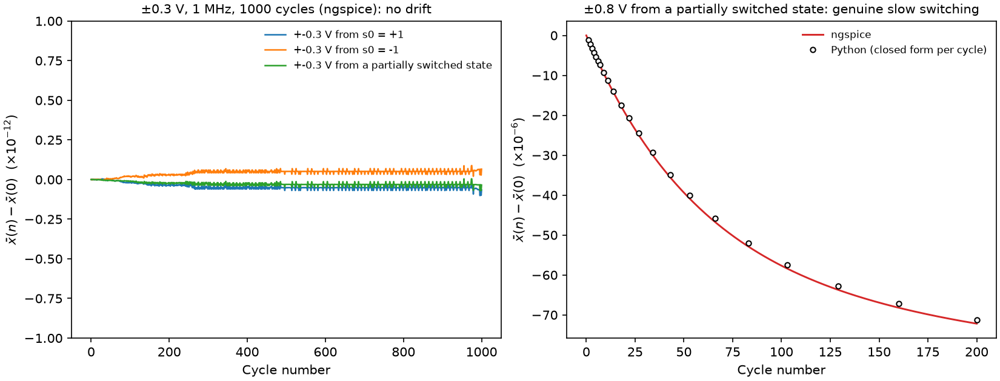

**English** | [繁體中文](model-derivation.zh-TW.md)

# How this model was derived: a dynamic multi-domain NLS model of a ferroelectric capacitor

This article explains, step by step, how [`spice/fecap_nls.va`](../spice/fecap_nls.va) and its Python reference [`src/fe_models/nls_multidomain.py`](../src/fe_models/nls_multidomain.py) came about. It is written for a reader who meets ferroelectric switching models for the first time. We follow the order of the reasoning: first, which phenomena the model must describe; then a comparison of existing frameworks; then each equation with its physical reason; then where the parameters come from, how the model was verified, how it compares with published data, and finally what it cannot do.

Section 3 is a model of a film in one fixed cycling state. Section 4 adds what changes slowly in use: wake-up, fatigue, imprint during storage, and the leakage increase that comes with them. All of these terms are optional and off by default.

The complete list of equations and the parameter table are in [spice/README.md](../spice/README.md); this article concentrates on *why* each piece is written the way it is. The mechanism analysis, fits and failed attempts behind Section 4 are in the four research notes in [`docs/research/`](research/).

## Contents

1. [What the model has to describe](#1-what-the-model-has-to-describe)
2. [Comparing candidate frameworks](#2-comparing-candidate-frameworks)
3. [The equations, one step at a time](#3-the-equations-one-step-at-a-time)
4. [Cycling and storage history (optional)](#4-cycling-and-storage-history-optional)
5. [Where the parameters come from](#5-where-the-parameters-come-from)
6. [How the model was verified](#6-how-the-model-was-verified)
7. [Comparison with published data](#7-comparison-with-published-data)
8. [Known limitations](#8-known-limitations)
9. [References](#9-references)

## 1. What the model has to describe

The polarization $`P`$ of a ferroelectric has two stable directions. A large enough voltage flips it into the other direction, and it stays there after the voltage is removed. HfO₂-based films (for example HZO, Hf₀.₅Zr₀.₅O₂) are polycrystalline, and their grains differ in how easily they switch. "How much has switched" is therefore a continuous quantity, and it depends on both voltage and time.

A ferroelectric capacitor model for circuit simulation has to describe at least the following:

- **Partial switching by finite pulses.** At a given voltage a longer pulse switches more; at a given width a higher voltage switches more.
- **Accumulation below the coercive voltage.** A single small pulse switches almost nothing, but after many repetitions the easy-to-switch grains slowly flip. This is a real physical effect.
- **No artificial drift under small signals.** Small symmetric excursions (reads, noise) must not move the state toward zero cycle after cycle. Some models update the state from the voltage path alone and lose a little on every cycle; that drift is a defect of the model, not physics.
- **A state-dependent reversible response.** Without switching, the up and down states have different small-signal capacitance at the same voltage; the measured C–V curve is butterfly-shaped.
- **Imprint.** The hysteresis loop is not centred at 0 V.
- **Leakage**, which depends on polarity, voltage and temperature.
- **Back-switching.** After a write, part of the polarization flips back within microseconds to milliseconds.
- **Scaling with temperature, area and thickness.**
- **Cycling and storage history.** A fresh film often needs cycling before its polarization opens up (wake-up), and too much cycling reduces it again (fatigue); a stored state shifts the loop logarithmically in time. These are the optional terms of Section 4.

The first two items are the ones most easily confused. Accumulation is real; artificial drift is not. A good model must tell them apart: the former is set by the small group of grains that switch easily, the latter must not exist. Much of the design below serves exactly this distinction.

## 2. Comparing candidate frameworks

Several frameworks describe ferroelectric switching in the literature. We introduce them briefly and then compare them against the requirements above.

- **Miller model** (as discussed in [Wong2005]): the saturated loop plus scaling rules gives $`P`$ directly from the voltage path.
- **KAI and NLS** (Kolmogorov–Avrami–Ishibashi; nucleation-limited switching) [Jo2007, Alessandri2018]: the film consists of many regions that each wait for a nucleation event and then switch. The original form only describes switching from saturation under a constant voltage.
- **Dynamic multi-domain NLS** [AlessandriIEDM2018, Alessandri2019, Deng2020]: NLS extended to arbitrary waveforms; each region remembers how much switching progress it has accumulated.
- **Preisach model** [Wong2005]: each hysteron has two thresholds and flips when the voltage crosses one; intrinsically rate-independent.
- **Thermally activated (Heracles-type) models** [Fehlings2024, Fehlings2025b]: one state variable with thermally activated rates; distribution and depolarization arise from the voltage division with interface and depletion layers.
- **LK / LGD** (Landau–Khalatnikov, Landau–Ginzburg–Devonshire): a free-energy surface with viscous dynamics.

| Requirement | Miller | NLS / KAI | Dynamic multi-domain NLS | Preisach | Thermally activated | LK / LGD |
|---|---|---|---|---|---|---|
| Switching by finite pulses | no | yes (constant voltage only) | yes (verified over about 5 decades of pulse width [Alessandri2018]) | no (needs an added time response) | yes | partly |
| Accumulation under repeated pulses | tied to the path, hence to the count | no | yes (pulse trains verified [Alessandri2019]) | no (nothing moves without crossing a threshold) | yes (simulated) | not described |
| No drift under small symmetric signals | no (minor loops drift [Wong2005]) | n/a | yes (see §3.6) | yes (by construction) | yes | not described |
| State-dependent reversible response | no | must be added | must be added (per-domain two branches as in [Clima2022]) | must be added | built in, one state for the whole capacitor | built in |
| Leakage | added | added | added | added | built in | partly |
| Back-switching | not described | not described | can be added (§3.5) | not described | from the voltage division | natural only for volatile devices |
| Parameters from common measurements | yes, but cannot express the requirements | yes | yes | yes | partly (interface parameters need TCAD or extra measurements) | difficult |
| SPICE form | simple | needs an integral | original is Monte Carlo, must be rewritten | thresholds must be managed | Verilog-A exists | simple |

**We chose dynamic multi-domain NLS, written as a deterministic mean-field model.** There are three reasons. First, it is the only candidate validated on HZO with constant-voltage switching, minor loops and pulse trains together [AlessandriIEDM2018, Alessandri2019]. Second, its state variables correspond directly to measured quantities (switched fractions). Third, the original Monte Carlo becomes indistinguishable from the analytic NLS at about 5000 grains [Alessandri2019], so for large capacitors an equation for the expectation value can replace the random simulation — the form a circuit simulator needs.

The reversible response, the leakage and the back-switching are added on top of this framework. Thermally activated models are the closest alternative; we did not choose one because its distribution is set by interface parameters that are hard to measure directly. The mechanism of the reversible response is still debated in the literature, so the model only describes the terminal $`C(V, \text{state})`$ and **does not claim any particular mechanism**.

## 3. The equations, one step at a time

### 3.1 Split the film into N<sub>d</sub> classes of domains

As noted above, grains differ in how easily they switch. We sort them into $`N_d`$ classes by how hard they are to switch. Class $`k`$ is a fraction $`w_k`$ of the film ($`\sum_k w_k = 1`$) and has a state $`s_k \in [-1, +1]`$: $`+1`$ means the whole class points up, $`-1`$ down, $`0`$ half and half.

The polarization of the capacitor is the weighted mean of the states times the saturation polarization:

```math
\bar x = \sum_k w_k s_k, \qquad P = P_s\,\bar x .
```

$`\bar x`$ is the mean state and $`P_s`$ the saturation polarization.

### 3.2 The voltage each class sees

Next we need the drive acting on each class. In the simplest case $`u_k = V - V_{imp}`$: the applied voltage minus a built-in voltage $`V_{imp}`$, which moves the loop centre away from 0 V (imprint).

Three corrections are added, all off by default:

```math
u_k = \rho V - V_{dep}(\bar x - \sigma) - V_{imp} - \delta_k .
```

- $`\rho`$ is the voltage division by a series interface layer; $`\rho = 1`$ without one.
- $`V_{dep}(\bar x - \sigma)`$ is a depolarization voltage, and $`\sigma`$ a screening state (§3.5).
- $`\delta_k`$ is a per-class offset (the $`E_{off,i}`$ of [Deng2020]).

### 3.3 Switching rates: Merz-type and one-directional

A Merz-type law says that the switching time changes exponentially with the field [Alessandri2018]: a stronger field switches faster, and dramatically so. We write it as a rate. Because the voltage only pushes grains toward its own direction, there are two one-directional rates:

```math
R_k^{+} = \frac{1}{\tau_0}\exp\left[-\left(\frac{V_{a,k}}{u_k}\right)^{\alpha}\right]\quad (u_k > 0), \qquad R_k^{-} = \frac{1}{\tau_0}\exp\left[-\left(\frac{V_{a,k}}{|u_k|}\right)^{\alpha}\right]\quad (u_k < 0),
```

and the rate in the other direction is zero. $`V_{a,k} = E_k t_{fe}`$ is the activation voltage of class $`k`$ ($`E_k`$ its activation field, $`t_{fe}`$ the thickness), $`\tau_0`$ is the attempt time and $`\alpha`$ an exponent.

This function has an important property: as $`u \to 0`$ the rate and all its derivatives go smoothly to zero, and the exponent is always negative, so it cannot overflow. Numerically it is enough to set the rate to zero when the exponent is below $`-60`$.

### 3.4 Weibull switching and the progress variable h

Measurements show Weibull switching probabilities $`1 - \exp[-(t/\tau)^\beta]`$ with $`\beta \approx 2`$ in HfO₂-based films [Jo2007, Alessandri2018, Alessandri2019]. $`\beta > 1`$ means that nucleation has an incubation period: switching is slow right after the voltage is applied and then speeds up.

This raises a problem. If the rate depended only on the present voltage, the model would have no memory of how long it has already waited. Each class therefore also keeps an accumulated progress $`h_k`$ [Alessandri2019, Deng2020]. We use a signed $`h_k`$ — positive for progress toward +, negative toward − — and write $`h_k^{+} = \max(h_k, 0)`$, $`h_k^{-} = \max(-h_k, 0)`$. The state equation is

```math
\frac{\mathrm{d}s_k}{\mathrm{d}t} = r_k^{+}(1 - s_k) - r_k^{-}(1 + s_k), \qquad r_k^{\pm} = \beta R_k^{\pm}\,(h_k^{\pm})^{\beta - 1}.
```

The factors $`(1 \mp s_k)`$ make $`s_k = \pm 1`$ stable fixed points: a class that has fully switched cannot "over-switch".

**Constant voltage recovers the single-pulse NLS form.** To check that this is right, take the simplest case: start from $`s_k = -1`$, $`h_k = 0`$ and apply a constant voltage. Then $`h_k = R_k t`$, and the equation gives

```math
\frac{\mathrm{d}}{\mathrm{d}t}\ln(1 - s_k) = -\beta R_k^{\beta} t^{\beta - 1} \quad\Longrightarrow\quad \frac{1 + s_k}{2} = 1 - \exp\left[-(R_k t)^{\beta}\right].
```

The switched fraction is $`f(t) = \sum_k w_k\{1 - \exp[-(R_k t)^\beta]\}`$, exactly the single-pulse NLS form of [Alessandri2018]. In other words, under the conditions where the original NLS applies, the dynamic model reduces to it.

**The equation for $`h`$.** Next we decide how $`h`$ evolves under a general waveform. It has four parts, each with its own reason:

```math
\frac{\mathrm{d}h_k}{\mathrm{d}t} = \underbrace{R_k^{+}\left[1 - \left(\frac{h_k^{+}}{h_m}\right)^{4}\right] - R_k^{-}\left[1 - \left(\frac{h_k^{-}}{h_m}\right)^{4}\right]}_{\text{growth and saturation}} \;\underbrace{-\;\frac{h_k}{\tau_h^{eff}}}_{\text{relaxation without drive}} \;+\; \underbrace{\frac{1}{\tau_x}\left[G(u_k - u_x)\,h_k^{-} - G(-u_k - u_x)\,h_k^{+}\right]}_{\text{reset on reversal}} .
```

- **Growth and saturation.** Under a constant voltage $`h`$ grows at the rate $`R`$, so the derivation above holds. $`h_m = 5`$ only keeps $`h`$ bounded; the unswitched fraction there is already below $`10^{-10}`$.
- **Relaxation.** [Alessandri2019] observed that the off time between pulses erases part of the progress and described it by $`h \leftarrow \gamma(t_{off})\,h`$. We write this as first-order relaxation. The original applies $`\gamma`$ only during the off time, so the relaxation is gated to voltages close to $`V_{imp}`$: $`\tau_h^{eff} = \tau_h[1 + ((V - V_{imp})/0.1\,\text{V})^4]`$. Without the gate, $`h`$ would also relax during long pulses and the model would no longer reduce to the single-pulse form.
- **Reset on reversal.** When the drive reverses, progress accumulated toward − does not help switching toward +. The reason: grains that are not aligned now were aligned during the previous segment, so they had no progress toward this direction. A fast term ($`\tau_x`$ = 0.1 ns) therefore clears the opposite $`h`$. $`G(z) = \tfrac12[1 + \tanh(z/10\,\text{mV})]`$ is a smooth switch and $`u_x = |V_{imp}| + 0.1`$ V a threshold, so resting at 0 V ($`u = -V_{imp}`$) does not count as a reversal. This is an assumption: [Alessandri2019] found that *not* resetting matched periodic stimulation better, while calling that an extreme case.

**Decide "reversal" from the field direction, not from the rate.** This is a bug fixed during development. An earlier version decided whether the drive had reversed from the magnitude of the rate. The consequence: grains in the low-field tail had reverse rates too small to count as reversed, so their $`h`$ was never reset. In the development records this made the ODE and the closed form differ by 28% for 10⁴ pairs of ±0.67 V reads. Deciding from the field direction brought the difference below 0.5%. The tests in this repository keep the check: with the reset made rate-dependent again, the loss after 300 bipolar ±0.67 V pairs becomes about 2.5 times the closed-form value, and the test fails.

Another development bug was the sign of the reversal term in (E3b): with the wrong sign $`h`$ diverges exponentially, which the saturated-loop test caught immediately.

The closed-form update `step()` in Python, which advances the state over an interval of constant voltage, once had a bug of the same family; the read-disturb study found it. When the drive reverses but stays below the threshold $`u_x`$, $`h`$ is not cleared, so in (E3b) the old progress must first count down to zero before the new direction has any hazard. The old `step()` instead reused the old direction's $`|h|`$ as progress toward the new direction. In the reproduction case (write at 1.5 V for 20 µs, then hold at −0.05 V for 1 µs, $`V_{imp}`$ = 0.3 V) it switched 7.8% where the ODE switches nothing. After the fix the two agree, and the case is kept as a test.

**Numerical details.** $`h^{\beta - 1}`$ is made linear below $`h = 10^{-6}`$ so that its slope at $`h = 0`$ stays finite for $`\beta < 2`$. The reset term is stiff, so the simulator should use Gear integration; in addition the model uses `$bound_step` to keep the time step below 0.2 ns while a reset is in progress (§6).

### 3.5 Back-switching and the screening state σ

Back-switching after a write comes from the depolarization field pushing domains back [Fehlings2025a, Tian2025]. The simplest form is a constant $`V_{dep}\bar x`$ in $`u_k`$. That has a problem: after the write, it keeps pushing forever. The back-switching measured by [Lancaster2022] saturates after about 100 ms, and longer write pulses lose less; the authors attribute this to screening by injected and trapped charge.

We therefore add a screening state, one per capacitor:

```math
\tau_s\frac{\mathrm{d}\sigma}{\mathrm{d}t} = \bar x - \sigma ,
```

and write the depolarization term as $`V_{dep}(\bar x - \sigma)`$. This has three consequences:

- After a long time in one state $`\sigma \to \bar x`$ and the depolarization term vanishes, so **repeated small-signal reads are not affected**.
- Right after switching $`\sigma`$ lags behind and back-switching occurs; the longer the write, the more $`\sigma`$ catches up and the less back-switching.
- Writing to − after a long time in + gives the largest $`\bar x - \sigma`$ and the strongest push back, which is also the direction of imprint.

$`V_{dep}`$ is 0 (off) by default. §7 fits $`V_{dep}`$ and $`\tau_s`$ to the data of [Lancaster2022].

### 3.6 The activation-field distribution, its sampling, and why small voltages do not accumulate

**Distribution.** [Alessandri2018, Alessandri2019] describe the activation fields by a generalized beta distribution of the second kind (GB2). We use its special case, the Dagum distribution, because its quantile has a closed form that a circuit simulator can evaluate directly:

```math
G(E) = \left[1 + (E/b)^{-a}\right]^{-p} \quad\Longleftrightarrow\quad E(q) = b\left[q^{-1/p} - 1\right]^{-1/a}.
```

$`b`$ is a scale and $`a`$ sets the width of the core. The low-field tail is $`G \approx (E/b)^{ap}`$, so $`ap`$ determines how many grains are particularly easy to switch. This tail is exactly what repeated reads consume. §7 shows that the devices of [Alessandri2018] and [Alessandri2019] have $`ap`$ of about 87 and 9.9 — very different.

**Sampling.** If the quantile axis were cut into $`N_d`$ equal parts, the softest part would contain every grain with $`q < 1/N_d`$ and the tail would not be resolved at all. We therefore place the points on the logit axis $`y = \ln[q/(1-q)]`$: $`y_j = y_m \sinh(a_g\xi_j)/\sinh a_g`$ with $`\xi_j`$ uniform on $`[-1, 1]`$, $`y_m = 9`$ and $`a_g = 1.5`$. The grid is dense in the middle and reaches deep into both tails: with $`N_d = 16`$ the softest class sits at $`q \approx 3\times10^{-4}`$ with a weight of about $`7\times10^{-4}`$. Both directions use the same $`q_k`$, which assumes that a domain that is hard to switch is hard in both directions.

**Why small voltages do not accumulate.** We can now answer the question from §1. Accumulation is set by the exponent of (E2). For a ±26 mV signal, $`u \approx 0.106`$ V including the built-in voltage. With $`N_d = 16`$ the softest class has an activation voltage of 0.78 V, so the exponent is $`(0.78/0.106)^{4.11} \approx 3600`$ and the rate is numerically zero. Even at ±0.3 V the exponent is about 19 and the rate about $`e^{-19}/\tau_0 \approx 0.02\ \text{s}^{-1}`$; since $`h`$ is reset at every reversal, each half cycle contributes only $`(Rt)^\beta \sim 10^{-18}`$.

This is fundamentally different from a model that updates the state from the voltage path: such a model updates on every cycle and therefore drifts. Here the update is proportional to the time under voltage times an exponentially small rate, and there is no path-driven drift mechanism. The tests keep a counter-example: a state equation that pulls the state toward zero whenever a voltage is applied drifts by more than $`10^{-6}`$ in five ±0.3 V cycles, and the test fails.

With $`N_d = 16`$ the part of the tail below the smallest sampled $`q`$ is merged into the softest class, so the zeros above partly come from the sampling. The model's own bound needs the continuous distribution ($`y_m = 40`$, $`N_d = 4000`$). For unipolar 100 ns pulses with 1 µs off, repeated $`10^9`$ times, the switched fraction is $`3\times10^{-10}`$ at 30 mV, $`4\times10^{-8}`$ at 100 mV, $`6\times10^{-6}`$ at 220 mV and $`7\times10^{-5}`$ at 300 mV. These bounds extrapolate the shape of the tail (§8).

**Genuine accumulation.** When a read voltage reaches into the tail, the soft domains slowly switch and the loss grows roughly logarithmically with the count. This is not artificial drift: under a unipolar drive it saturates once the soft classes have switched, its size is set by the distribution, and it does not vanish as $`N_d \to \infty`$ (test: for 10⁴ pairs at ±0.9 V the losses with $`N_d`$ = 64 and 256 agree within 5%). For small $`N_d`$ the tail switches class by class, so the loss is a staircase in the count; use $`N_d \ge 64`$ for slopes.

### 3.7 Reversible charge: four separate terms

The charge that returns when the voltage is removed is split into four terms because their time scales and the ways they are measured differ.

**(1) Linear dielectric:** $`q_1 = C_d V`$. It does not depend on the state and cancels exactly in a difference between the two states.

**(2) Reversible stretching of the polarization.** Up-polarized domains approach switching when the voltage goes negative: their potential well softens and the susceptibility rises; toward positive voltage they stiffen [Clima2022, Mukherjee2023EDL]. Each domain class therefore follows one of two curves depending on its own state. We use integrated Lorentzians (arctan) for the two branches:

```math
g_{\uparrow}(V) = \Delta C\, V_w\left[\arctan\frac{V - V_i + V_s}{V_w} - \arctan\frac{-V_i + V_s}{V_w}\right], \qquad g_{\downarrow}(V) = \Delta C\, V_w\left[\arctan\frac{V - V_i - V_s}{V_w} - \arctan\frac{-V_i - V_s}{V_w}\right].
```

Summed over the classes:

```math
q_2 = \sum_k w_k\left[\frac{1 + s_k}{2} g_{\uparrow} + \frac{1 - s_k}{2} g_{\downarrow}\right] = \bar g(V) + \bar x\, g_d(V), \qquad \bar g = \tfrac12(g_\uparrow + g_\downarrow),\ g_d = \tfrac12(g_\uparrow - g_\downarrow).
```

When a domain switches, its reversible contribution moves to the other branch. Because the expression is linear in $`s_k`$, the sum only needs $`\bar x`$ and adds no nodes.

This, too, was corrected during development. The first version used one curve $`C(V, \bar x)`$ for the whole capacitor, with a peak position that moved with $`\bar x`$. Half-switched, that gives a single high peak at 0 V ($`\varepsilon_r \approx 44.8`$), whereas the correct per-domain sum is the mean of the two branches ($`\approx 34.1`$).

$`V_i`$ is the crossing voltage $`V_{CROSS}`$ of the two branches. It is a different quantity from the loop centre $`V_{imp}`$: [Mukherjee2023IEDM] measured the crossing at +0.87 MV/cm while the switching-current peaks are centred near +0.45 MV/cm. A measured C–V "peak" is where a branch, still rising, is cut off by switching; the Lorentzian centre $`V_s`$ therefore lies beyond the switching point and is never reached by a sweep (see the figure in §7).

**Time scale of (2) and $`f_{rev}`$.** Term (2) may not be instantaneous. The small-signal window of [Baigol2026] disappears above 2 MHz, but [Mukherjee2023IEDM] still reads a difference with 500 ns pulses. A parameter $`f_{rev}`$ gives the instantaneous fraction; the rest follows a low-pass filtered voltage $`y`$:

```math
q_2 \;\longrightarrow\; f_{rev}\left[\bar g(V) + \bar x\, g_d(V)\right] + (1 - f_{rev})\left[\bar g(y) + \bar x\, g_d(y)\right], \qquad \tau_r\frac{\mathrm{d}y}{\mathrm{d}t} = V - y .
```

**Why split the whole of (2), not only $`\bar x\,g_d`$?** If only the state-dependent part is low-pass filtered, the low-pass part has a negative capacitance in one of the states. A square-wave cycle then delivers negative electrical work — the device gives energy back — which violates passivity. Splitting the whole term makes both the instantaneous and the low-pass part positive capacitances, so the device is always passive. The tests check both sides: the correct form gives positive work per cycle for $`f_{rev}`$ = 0.5 and 0.2; the form that splits only $`\bar x\,g_d`$ gives negative work, and the test fails. A charge-conservation check cannot catch this error because both forms conserve charge.

**(3) Reversible small motion of domain walls:** $`q_3 = C_w(1 - \bar x^2)\,y`$. Saturated states have almost no domain walls, hence the factor $`(1 - \bar x^2)`$; the term does not contribute to the difference between the two saturated states but does for partial states. It follows $`y`$ because walls are slower than the lattice. A state-independent slow dielectric term $`C_r y`$ is also kept. Both are off by default.

**(4) Back-switching** is not a separate charge term. It enters through $`V_{dep}(\bar x - \sigma)`$ of §3.5 and the state equations.

Together:

```math
q_{rev} = C_d V + f_{rev}\left[\bar g(V) + \bar x\, g_d(V)\right] + (1 - f_{rev})\left[\bar g(y) + \bar x\, g_d(y)\right] + \left[C_w(1 - \bar x^2) + C_r\right] y .
```

At 0 V with $`y = 0`$, $`q_{rev} = 0`$, so the charge left at 0 V is the polarization alone. This lets us read $`\bar x`$ directly from the charge at 0 V.

### 3.8 Terminal current and leakage

The terminal current is the time derivative of a charge function plus the leakage:

```math
I = A\frac{\mathrm{d}}{\mathrm{d}t}\left[P + q_{rev}\right] + A\,J_L(V, T).
```

Writing the charge first and differentiating it has an advantage: charge is conserved automatically.

The leakage consists of mechanisms in parallel, with one parameter set per polarity. The Poole–Frenkel (PF) form follows [Fehlings2024]; Schottky and an effective trap-assisted-tunnelling (TAT) term are also available. One I–V curve at one temperature cannot separate the mechanisms, so only PF and an ohmic term are on by default. The full expression is in [spice/README.md](../spice/README.md#equations).

**A Verilog-A rule: no `ddt` inside a conditional branch.** The model pins the states to their initial values during static analyses and lets them evolve afterwards. An earlier version placed `ddt` inside a "not static" branch; if the simulator takes the history of `ddt` from the DC solution, the initial state is then lost. `ddt` is therefore always written unconditionally, and only the right-hand terms are multiplied by 0 or 1.

## 4. Cycling and storage history (optional)

So far the model describes a capacitor in a fixed cycling state: the parameter card stands for the film after some particular number of cycles. Real HfO₂ films change in use:

- a fresh film often has a pinched loop and a small polarization that opens up only after $`10^3`$–$`10^5`$ cycles (wake-up);
- further cycling reduces the polarization again (fatigue), often together with rising leakage;
- a written state left alone shifts the loop in one direction, logarithmically in time (long-term imprint).

These changes are many orders of magnitude slower than switching, so a few slow states describe them. Every term in this section is off by default: Python then takes the original code path and its output is bit-for-bit unchanged, and the corresponding Verilog-A nodes stay at 0. The comparison of mechanisms, the fits and the attempts that failed are in four research notes: [fatigue-imprint](research/fatigue-imprint.md), [cycling-r2](research/cycling-r2.md), [tail-fit](research/tail-fit.md) and [read-imprint-r2](research/read-imprint-r2.md).

### 4.1 A pinned pool: fatigue is not "smaller P<sub>s</sub>" (E13)

The most direct way to describe fatigue is to multiply $`P_s`$ by a factor that shrinks with cycling. That is wrong: a written state resting at 0 V would then lose terminal charge as fatigue grows, which would look like a retention loss. Physically, a domain pinned by defects simply stops switching; its polarization does not disappear.

We therefore use a pinned pool. A fraction $`f`$ of the domains is pinned; the remaining $`1-f`$ switch as in Section 3. The pinned part remembers its state at the moment of pinning through two quantities: its polarization $`\pi`$ (in units of $`P_s`$) and the reversible charge $`r`$ frozen at that moment. The terminal charge becomes

```math
\frac{Q}{A} = P_s\left[(1-f)\bar x + \pi\right] + C_d V + (1-f)\,q_2(V, \bar x) + r + \dots,
```

where $`q_2`$ is term (2) of §3.7. When $`f`$ grows, the newly pinned part takes the present mean state and reversible charge with it:

```math
\dot\pi = \dot f^{+}\,\bar x, \qquad \dot r = \dot f^{+}\,q_2(V, \bar x).
```

When $`f`$ shrinks, the released part returns to the classes carrying the pool's mean state $`\pi/f`$: $`\dot s_k \mathrel{+}= \dot f^{-}(\pi/f - s_k)/(1-f)`$, $`\dot\pi = -\dot f^{-}\pi/f`$, $`\dot r = -\dot f^{-} r/f`$. Substituting into $`Q`$ shows that pinning and release by themselves never change the terminal charge, so no current flows at constant bias even while damage grows. This is one of the tests.

The reversible term is multiplied by $`(1-f)`$ because pinned domains no longer soften near their switching field. The C–V butterfly therefore grows during wake-up and shrinks during fatigue.

### 4.2 Wake-up, and how the loop must be read (E14)

Wake-up is driven by switching itself: the literature needs repeated switching for it, and reads below the coercive voltage should not wake the film up. The wake-up age therefore counts equivalent full switching cycles:

```math
\dot a_w = A_w(T)\,\frac{\sum_k w_k |\dot s_k|}{4N_w}, \qquad A_w(T) = \exp\left[-\frac{E_w}{k_B}\left(\frac{1}{T} - \frac{1}{T_0}\right)\right].
```

A full bipolar cycle moves each class by $`|\Delta s| = 4`$, so $`a_w`$ grows by $`1/N_w`$ per cycle. The degree of wake-up is $`W = 1 - \exp[-g(a_w)]`$ with a stretched exponent $`g \approx a^{\kappa_w}`$ (shifted slightly so that the derivative at $`a = 0`$ is finite). $`\kappa_w < 1`$ assumes a broad distribution of local wake-up rates, which is why $`2P_r`$ grows linearly in $`\log N`$ over several decades. $`W`$ controls two things:

- the pristine pinned fraction $`f_w = f_{p0}(1 - W)`$, standing for regions pinned by defect clusters or not yet ferroelectric;
- the pristine internal bias split: odd classes get $`+V_{sp}(1-W)`$ and even classes $`-V_{sp}(1-W)`$, standing for the two populations of oppositely biased hysterons seen in FORC [Fengler2017].

**Read the loop the way the experiment does.** [Fengler2017] also measured $`2E_c`$ rising during wake-up. The first research round took $`E_c`$ from the midpoint of the switching state, and $`2E_c`$ then *fell* as the bias split disappeared — the wrong direction. The equations were not the problem; the measured quantity was. An experiment measures the voltage at which the **total** charge (polarization plus dielectric plus reversible parts) is zero. When two populations switch at $`E_{c0} \mp E_b`$, the total charge on the rising branch crosses zero through the dielectric term while the first population has switched and the second has not yet started, so the zero sits near $`E_{c0} - E_b`$. Once the split disappears the zero returns to $`E_{c0}`$, and the measured $`2E_c`$ increases. This needs no new parameter, only a function that reads the loop like the experiment, `loop_figures`. With it one parameter set fits $`2P_r`$ and $`2E_c`$ together, with an RMS of 0.022 MV/cm in $`2E_c`$ (§7).

### 4.3 Reversible depinning: why wake-up depends on pulse width (E18)

[Lenox2023] varied the pulse width (2–50 µs, all at 10 kHz): wider pulses wake the film up more. The natural guess is a dose, for example cycles times a power of the width, $`N w^m`$. But in the same paper the 2 µs pulses stay at about 1.07 times the pristine $`P_r`$ from $`10^5`$ to $`10^8`$ cycles; measured as a dose, they pass the dose of the 50 µs pulses at $`10^5`$ cycles long before $`10^8`$ and should reach 1.26 or more. **No single-dose form can work**, whatever the exponent $`m`$.

A plateau ordered by pulse width comes from competition: under field, defects move away and domains are depinned, while re-pinning pulls them back. $`N_Q`$ states $`z_j \in [0, 1]`$ (the depinned fraction) with time constants spaced logarithmically in $`[\tau_{q1}, \tau_{q2}]`$ describe this:

```math
\tau_j\,\dot z_j = A_w(T)\left[\phi(V)\,(1 - z_j) - \left(\rho_q + t_r\,\frac{a(t)}{4}\right) z_j\right], \qquad \phi(V) = \left(\frac{E_s}{1\ \mathrm{MV/cm}}\right)^{n_q} - \phi_{fl}.
```

$`a(t) = \sum_k w_k |\dot s_k|`$ is the switching rate and $`\phi_{fl}`$ makes $`\phi(0) = 0`$. Re-pinning has two channels: $`\rho_q`$ acts at all times (re-pinning at rest) and $`t_r`$ only at each reversal. Under a pulse train the plateau is $`Z_{ss} = \phi D_c/(\phi D_c + \rho_q + t_r f)`$ with duty cycle $`D_c`$, so the plateaus are naturally ordered by pulse width. Both channels fit the Lenox data equally well, but the rest channel predicts that a woken film relaxes back within a minute at 0 V, which contradicts [Pesic2016] and [Fengler2017]; the reversal channel is therefore recommended.

This pool coexists with the pristine pinning; together the total pinned fraction is

```math
f = 1 - (1 - f_w)\left[1 - f_q(1 - Z)\right](1 - D), \qquad Z = \frac{1}{N_Q}\sum_j z_j ,
```

with $`D`$ the fatigue damage of the next subsection. $`f_w`$ describes the irreversible part tied to the number of switching events; $`f_q`$ the reversible part tied to the time under field. Pinning and release both pass through the pool of §4.1, so re-pinning produces no terminal current either.

### 4.4 Fatigue and leakage growth (E15, E16, E19, E20)

The fatigue age $`a_F`$ has two optional drivers:

```math
\dot a_F = A_F(T)\left(\frac{E_s}{1\ \mathrm{MV/cm}}\right)^{n_F}\left[\frac{1}{t_F} + \frac{\sum_k w_k |\dot s_k|}{4N_F}\right].
```

- The first term is time under field: charge injection and defect generation accumulate with the time a field is applied.
- The second term is field during switching: it accumulates only while switching, matching the observation that unipolar stress does not fatigue the film [Book9.2].

The damage $`D = D_{max}[1 - e^{-g(a_F)}]`$ does two things: it pins domains (it enters $`f`$ above), and it multiplies the activation fields of the domains that still switch by $`(1 + k_E D)`$, so the switching peak broadens and moves to higher fields.

**Build-up time of the stress (E19).** In [Lenox2023] the onset of rising leakage, converted to accumulated time under field, is about 40 s for 5–50 µs pulses but 200 s for 2 µs. The beginning of each pulse therefore contributes little to defect generation: the field may not be established during switching, or the high field in the interface layer may appear only after the displacement field has reversed; these data cannot tell which. We write it as a build-up time $`t_L`$:

```math
t_L\,\dot V_L = V - V_L, \qquad E_s^2 = \max\left(\frac{\rho^2 V V_L}{t_{fe}^2},\ 0\right) + E_{fl}^2 .
```

The stress needs both the present field and a slowly built-up condition of the same sign, so there is no stress at 0 V, and after a reversal it waits for $`V_L`$ to cross zero. With this term the spread of the leakage-onset dose over Lenox's five pulse widths drops from a factor of 6.7 to 2–3, comparable to the spacing of the measurement checkpoints.

**Leakage grows with fatigue (E20).** Newly generated defects provide traps for trap-assisted tunnelling, so the whole leakage is multiplied by a factor:

```math
J \to J\left[1 + k_L\,a_F^{\,m_L}\right].
```

It multiplies the whole leakage because in [Pesic2016] the increase factor of one device is nearly independent of field between 0.2 and 3 MV/cm.

### 4.5 Logarithmic-time imprint (E17, E17a, E17b)

The screening state $`\sigma`$ of §3.5 has a single time constant and can only describe one exponential process. Long-term imprint, however, grows as $`\ln t`$ over many decades [Buragohain2019, Fengler2018]. A logarithmic law typically comes from traps with a broad distribution of capture or emission times. We therefore use $`N_I`$ trapping states with time constants spaced logarithmically in $`[\tau_{I1}, \tau_{I2}]`$, thermally activated:

```math
\tau_j\,\dot\sigma_j = x_t - \sigma_j, \qquad \sigma_I = \frac{1}{N_I}\sum_j \sigma_j, \qquad x_t = (1 - f)\bar x + \pi .
```

The built-in voltage becomes the dynamic $`V_{imp} - V_I\sigma_I`$. It enters the drive of every class, both gates of $`h`$, and the centre of the two reversible branches (imprint shifts the whole C–V butterfly, which is a common way to measure it). Starting from $`\sigma_j = 0`$ with $`x_t`$ held at 1,

```math
\sigma_I(t) \approx \frac{\ln(t/\tau_{I1}) + \gamma}{\ln(\tau_{I2}/\tau_{I1})}, \qquad \tau_{I1} \ll t \ll \tau_{I2},
```

so the coercive voltage moves with a logarithmic slope of $`V_I/\ln(\tau_{I2}/\tau_{I1})`$. The structure gives two more things for free: after rewriting, the imprint recovers logarithmically; and the "new same state" shift is smaller than the "same state" shift, because the fast states are overwritten while the slow ones still remember the old state. Twelve states over twelve decades keep the local slope within ±11%.

Two extensions are also off by default:

- **Branch asymmetry (E17a).** In [Buragohain2019] the branch leaving the stored state moves about 1.5 times as far as the other, and the loop widens. Besides the common shift, each switching field moves outward by $`w = \kappa V_I|\sigma_I|`$ (a smoothed absolute value in the implementation), so the escape branch moves by $`(1+\kappa)`$ and the other by $`(1-\kappa)`$ times the centre shift. The fit gives $`\kappa = 0.18 \pm 0.02`$, reducing the RMS of the two branch coercive voltages from 125 mV to 43 mV.
- **Field acceleration (E17b).** Charge injection during write pulses grows exponentially with field, so every trapping rate can be multiplied by $`\cosh(\rho V/V_a)`$. This is a symmetric phenomenological form.

### 4.6 Computing very long cycling

Cycling beyond $`10^8`$ times cannot be integrated cycle by cycle. The slow states barely change within one cycle, so `cycle_history` uses two time scales:

1. With the slow states frozen, the closed-form `step` walks through one cycle and yields that cycle's switching, pinning and release, and an exact affine map $`X \to aX + b`$ over one cycle for every imprint and depinning state;
2. these increments are repeated $`m`$ cycles at once, using the closed form of the $`m`$-th power of the affine map; $`m`$ is limited by the allowed change of the pinned fraction and of $`\sigma_I`$ per step.

$`10^{12}`$ cycles take about 0.1 s. Against a direct ODE solution, the switched charge per cycle over the first 12 cycles differs by about 1.1%. The resulting history can be handed to a circuit simulation: the instance parameters `nw0`, `af0`, `si0` and `zq0` set the initial wake-up age, fatigue age, imprint states and depinning states.

## 5. Where the parameters come from

Every default value comes from a published paper or is derived from one; the source of each number is in the [parameter table](../spice/README.md#parameters) and in [`spice/params/generic.inc`](../spice/params/generic.inc). The card is not fitted to any particular device.

- **Switching.** $`P_s`$, $`\alpha`$, $`\beta`$, $`\tau_0`$ and $`V_{imp}`$ are from Table I and the text of [Alessandri2019] (W/HZO 8.3 nm/W). The Dagum parameters of the activation field are a fit to switching curves computed from the GB2 distribution published in the same paper (0.8–2.0 V, 200 ns–1 ms). $`\tau_h`$ is the geometric mean of 1.7 µs and 8.3 µs, the single-exponential times implied by the two relaxation factors of [Alessandri2019] (γ = 0.55 after 1 µs off, 0.3 after 10 µs off); one exponential cannot match both, a known compromise.
- **The choice of $`\tau_0`$.** An earlier draft combined $`\tau_0`$ = 2 ns with this distribution. On re-examination, that combination does not reproduce the paper's own switching curves: refitting the distribution with $`\tau_0`$ fixed at 1–3 ns leaves an RMS error of about 0.09 in switched fraction, against 0.002 with the published 387 ns. Likewise $`\beta = 1`$ cannot fit (RMS 0.036). The public card therefore uses 387 ns. Devices that switch much faster (for example the 1 ns switching of [Baigol2026]) need their own $`\tau_0`$ and distribution.
- **Reversible response.** $`C_d`$, $`\Delta C`$ and $`V_s`$ are fitted to C–V values digitized from Fig. 2 (Dev A, symmetric TiN/TiN electrodes) of [Mukherjee2023EDL]; the width $`V_w`$ is from a fit to Fig. 5a of [Mukherjee2023IEDM] (§7). For symmetric electrodes $`V_i \approx 0`$.
- **Leakage.** The PF trap depth of 0.68 eV and $`\varepsilon`$ = 70 are from Table 1 of [Fehlings2024]; the magnitude is scaled to the range digitized from Fig. 6a of [Fehlings2025b] (0.1 A/m² at 2 V).
- **Numbers without a source:** all temperature coefficients (set to 0), the Schottky and TAT defaults (off), the area and thickness (illustrative). They are labelled as such in the parameter table.
- **History terms of Section 4:** all off in the generic card. Their values vary strongly between devices (how many cycles wake-up needs, where fatigue starts, how fast imprint grows), so there is no "generic" set. The research notes list fitted values for each published device; they are starting points, fitted to those devices, not defaults.
- **Mukherjee device card** [`spice/params/mukherjee2023.inc`](../spice/params/mukherjee2023.inc): the reversible branches are fitted to that device's C–V, the activation-field scales to the two switching-current peaks of its 50 µs loop, and the kinetics and distribution shape are taken from [Alessandri2019]. It reproduces the C–V and the loop; reproducing the read endurance also needs the stored-state imprint discussed in §7.

## 6. How the model was verified

Verification has three layers. Every number can be reproduced with the commands in the repository.

**Layer 1: unit tests of the Python reference** (`tests/test_nls_multidomain.py`, 34 tests, about 20 s). Highlights:

- Under a constant field the ODE and the single-pulse NLS closed form differ by less than $`2\times10^{-4}`$; the sampled sum converges to the continuous NLS integral (within $`10^{-4}`$).
- Closed forms for pulse trains, PUND and bipolar cycles agree with the ODE; a fixed-step integrator converges with the step size.
- Symmetric ±26 mV and ±0.3 V signals do not drift over 10⁶ cycles (closed form) and 20 cycles (ODE); genuine accumulation near the tail converges with $`N_d`$.
- The butterfly branches, the per-domain sum and the $`f_{rev}`$ split; passivity for $`f_{rev} < 1`$.
- Charge conservation in a series-resistor circuit: source charge = change of terminal charge + leakage integral, within $`10^{-4}`$ of $`2P_sA`$. The partial derivatives of the charge are written out independently in the test rather than taken from the model, so a missing term in the model makes the check fail.
- **Deliberately broken versions.** The three development bugs mentioned above (low-pass of only $`\bar x\,g_d`$, a path-driven update, a rate-based reversal) are each implemented as a broken version, and the tests confirm that the corresponding check fails. A check that passes on a broken model is worthless, so this step is necessary. The `step()` bug across a sub-threshold reversal is also kept as a test.

The history terms of Section 4 have their own tests, each designed to fail for a physical error:

- `tests/test_history.py` (23 tests): bit-for-bit unchanged when off; monotonic damage; switching-driven fatigue absent under unipolar stress; terminal charge constant at fixed bias while damage grows; imprint log slope equal to $`V_I/\ln(\tau_{I2}/\tau_{I1})`$; recovery after rewriting; every loop absorbs energy with all terms on. Mutation checks confirm that removing $`\pi`$ or $`r`$ from the pool, letting imprint not move the coercive voltage, or replacing the logarithmic spread by one time constant is caught.
- `tests/test_cycling_r2.py` (18 tests): E18 plateaus equal the closed form; re-pinning at rest produces no terminal current; the E19 square-pulse dose equals the closed form; cycle averaging agrees with the direct ODE; `loop_figures` agrees with the directly simulated loop.
- `tests/test_read_disturb.py`, `tests/test_read_imprint_r2.py`, `tests/test_card_mukherjee.py` (13, 13 and 6 tests): read sequences against step-by-step integration, E17a/E17b and the unchanged default path, and the loop peaks of the Mukherjee card.

All 153 tests, including the ngspice comparison below, pass.

**Layer 2: a real compiler and simulator.** Before this release the model had only been checked by a hand-written parser and solver. It was now compiled to an OSDI library with OpenVAF-Reloaded 24.0.2 and run in ngspice 47 through 12 testbenches, each compared point by point with the Python reference. The real simulator found one problem:

- The draft pinned the states with `analysis("static")`. The OSDI interface of ngspice does not report `static` during the operating point of a transient analysis. The state equations were then left without a DC condition: ngspice reported "singular matrix", gmin and source stepping failed, and the states started near 0 instead of `s0`. A probe module that only outputs the analysis flags confirmed this (`.op`: static = 1; transient operating point: static = 0, tran = 1). The condition was changed to `analysis("static") || $abstime <= 0`; afterwards every testbench starts from `s0` without warnings.

Everything else (`genvar` loops over electrical arrays, `$bound_step`, unconditional `ddt`) needed no change. The main results (charges in µC/cm², $`2P_s`$ = 45.8):

| Testbench | Quantity | ngspice vs. Python |
|---|---|---|
| PUND (3 V, 10 µs) | charge at 0 V after each segment | ≤ $`1.2\times10^{-5}`$ |
| PUND | charge over the whole waveform | ≤ 0.010 |
| PUND | charge conservation inside ngspice (current integral vs. charge change) | $`4.1\times10^{-4}`$ of $`2P_sA`$ |
| ±3 V triangles at 1 / 10 / 100 kHz | coercive voltages | ≤ 6.4 mV |
| 24 pulses (1.5–3 V × 0.1–30 µs) | switched fraction | ≤ $`1.8\times10^{-4}`$ |
| ±0.3 V, 1 MHz, 1000 cycles | change of the mean state | ngspice ≤ $`6.5\times10^{-14}`$ (round-off), Python 0 |
| ±0.8 V, 1 MHz, 200 cycles (partial state) | genuine slow switching | $`-7.22\times10^{-5}`$ vs. $`-7.12\times10^{-5}`$ (1.4%) |
| $`f_{rev}`$ = 0.5, $`C_w`$, $`C_r`$ on | charge over the whole waveform | ≤ 0.0054 |
| back-switching ($`V_{dep}`$ = 1 V, $`\tau_s`$ = 100 µs) | back-switched charge within 1 ms | 0.2616 vs. 0.2614 |
| 85 °C, all temperature coefficients non-zero | charge over the whole waveform | ≤ 0.0033 |
| leakage DC sweep (25 and 85 °C) | relative current difference | $`7\times10^{-10}`$ |




When the history terms of Section 4 were added to the Verilog-A, seven more testbenches followed (wake-up, fatigue, imprint, starting from an existing history, depinning, stress build-up with leakage, and the two imprint extensions), 19 in total. The new testbenches differ from Python by 0.001–0.042 µC/cm² in charge; the largest difference occurs during fast switching on 0.1 µs edges and comes from the time step. With every history term off, the new build matches the previous one on the existing testbenches to a relative $`8\times10^{-7}`$: the extra nodes change the pivot order of the sparse solver, which is round-off; the equations are unchanged.

**Layer 3: comparison with published data**, next section.

## 7. Comparison with published data

We found no downloadable raw data of HZO switching kinetics, PUND or P–V, so the comparisons use numbers from the papers: published fit formulas, or points digitized from figures (approximate). They are in [`data/literature/`](../data/literature/); each file starts with the full citation, the figure, and whether the values are a formula or digitized. The figures are produced by [`examples/literature_comparison.py`](../examples/literature_comparison.py) and the numbers stored in `docs/literature_comparison.json`. The figures use the Python reference; the previous section showed that ngspice matches it to within $`2\times10^{-4}`$ in switched fraction.

**What was fitted, and what was not:** the switching distribution (Dagum parameters) and the two C–V branches are fits; $`V_{dep}`$ and $`\tau_s`$ for back-switching are fits; for read endurance we first fit **no** switching parameter, look at the result as it is, and then find where it differs; the series-capacitor comparison is qualitative. Each history term of Section 4 is fitted to its own published device; the results are in the table at the end of this section.

**Switching kinetics** [Alessandri2019, Alessandri2018]. Curves computed from the published GB2 fits of both papers (0.8–2.0 V). The Dagum form represents the GB2 of [Alessandri2019] with an RMS error of 0.0022 in switched fraction (continuous distribution) and 0.0065 with $`N_d`$ = 16; the same refit for [Alessandri2018] gives 0.0003 and 0.0052. So the Dagum form is adequate, and 16 classes are enough. Applying the [Alessandri2019] card unchanged to the [Alessandri2018] device, however, gives an RMS error of 0.26. The two devices differ mainly in the low-field tail ($`ap`$ about 10 vs. about 87) — precisely the part that sets accumulation under repeated reads.


**The two C–V branches** [Mukherjee2023EDL, Mukherjee2023IEDM]. Three parameters fitted to the digitized points of the symmetric Dev A (width from the IEDM fit) give an RMS of 0.23 in $`\varepsilon_r`$; these are the card values. Four parameters fitted to the seven points of the asymmetric stack give an RMS of 1.5. The two-branch form reproduces the crossing point and the asymmetric butterfly. It does not reproduce the steep switching-side flank of the measured peaks, because each measured branch ends where that state switches, while the model curve continues.


**Read endurance** [Mukherjee2023IEDM Fig. 7]. No switching parameter is fitted; only the activation-field scale is set so that the model's 50 µs P–V loop has the device's coercive voltage, and the tail shape is taken from [Alessandri2019] or [Alessandri2018]. Results:

- At −0.1 V the model is within 0.2 pC (RMS) of the data; this is mainly the C–V fit.
- At −0.3 and −0.5 V the model switches much more than the device during the first reads (−0.5 V, first read: 124 pC with the [Alessandri2019] tail vs. 20.9 pC measured) and then falls too low. The steep [Alessandri2018] tail is closer (RMS 3.5 pC at −0.3 V and 17 pC at −0.5 V for $`n \le 10^8`$).
- With an illustrative $`\tau_0`$ = 2 ns the −0.3 V values for $`n \ge 10^2`$ come within about 2 pC of the data, but the first read gets much worse (−0.5 V: 407 pC).
- After about $`10^8`$ reads at −0.1 and −0.3 V both states drop together in the data; the model of Section 3 has no such mechanism.


**Why the first read switches too much.** We first suspected the low-field tail. A follow-up study ([tail-fit](research/tail-fit.md)) decomposed the first read: in the data it is almost entirely reversible charge, leaving room for at most about 1 pC of switching; the excess in the model is all switching charge, and it comes from the core of the distribution, not from the tail. The reason is that the read field is close to the field at which the loop switches: only 4.4% apart in internal drive. The kinetics of [Alessandri2019] are already near their maximum rate on the microsecond scale, so the rate barely depends on field, and a distribution that switches half-way in the loop loses about a third of the stored state in a 1.5 µs read. Changing the tail shape, the kinetics or the relaxation rule of $`h`$ leaves the read RMS at 113–167 pC.

What fixes it is a stored state that is harder to switch than the state in the loop: a stabilizing shift of 0.41–0.44 V for the read state brings the read RMS from 131 pC down to 0.8–3.6 pC. Physically this is imprint during storage. The second round ([read-imprint-r2](research/read-imprint-r2.md)) replaced it with the dynamic imprint of §4.5, with three results:

- **The shift comes from storage time, not from the write.** The state in the loop goes through the same high field, so fast imprint during the write cancels between the two. The shift must build up during storage after the loop age (about 21 µs): the fit gives about 0.1–0.6 s from write to first read and a logarithmic growth to about 0.34 V, fitting slightly better than a constant shift (χ²/point 1.78 vs. 2.03). This requires imprint to start growing at about 1 µs; that delay is a fitted value the paper does not give, so it is not a validation.
- **The actual read amplitude is below nominal.** The paper in fact plots the charges of the two states separately; the − state is not switched by negative reads and serves as a control for the reversible response. The ratio of the two states agrees with the C–V; what differs is a common factor of both states, 0.87, 0.90 and 0.80 at −0.1, −0.3 and −0.5 V. The −0.1 V value agrees with the paper's oscilloscope trace (nominal −100 mV, actual about −90 mV). With this factor the C–V and the reads no longer conflict, and the required shift drops from 0.41–0.44 V to 0.34 V. Why the −0.5 V factor is lower is not yet confirmed.
- **The drop during the first 12 reads at −0.5 V is in the + state only**: the first read carries about 5 pC of extra switching charge (about 0.3% of the polarization), which then disappears. The model matches the size and the decay (about 100 reads), but its largest step comes at the second read where the data show it at the first.


For the drop after $`10^8`$ reads two explanations fit: pinning by read stress (§4.4) and imprint continuing to grow during the read sequence (§4.5). The data cannot tell them apart; experiments that can are changing the read period at a fixed number of reads, and rewriting after $`10^{11}`$ reads (imprint recovers, pinning does not).

Conclusion: read disturb below the coercive voltage depends on the distribution, the kinetics and the storage history between write and read, none of which pulse-switching data above 0.8 V determine. Predicting read disturb requires measurements on the device of interest, with the delay from write to read recorded.

**Back-switching** [Lancaster2022]. 11 nm HZO written at 3.5 V for 25, 100 and 250 µs; digitized values. The fit gives $`V_{dep}`$ = 1.03 V and $`\tau_s`$ = 1.7 ms (two parameters, twelve points, RMS 0.19 µC/cm²). With screening the loss saturates and is smaller after longer writes, as in the data; with a constant $`V_{dep}`$ and no screening the loss keeps growing with delay. The model saturates about a decade earlier than the data and underestimates the loss after 250 µs writes (0.52 vs. 0.75–0.85 µC/cm²).


**Repeated reads through a series capacitor** [Duan2025 Fig. 9]. A qualitative comparison; nothing is fitted. We use the paper's area ratio of 0.83, a 10 nm gate dielectric ($`\varepsilon_r`$ = 20 assumed) and 2.5 V, 10 µs reads. When the floating node is discharged after every read, the model's state difference shrinks steadily (0.97 → 0.57 after 300 reads); when the node is left floating, it hardly changes (0.97 → 0.966). This is the same ordering as the measured read currents. The mechanism in the model: without discharge, the charge left on the node by the previous switching lowers the voltage across the capacitor in the next read, so switching limits itself.


**Cycling history and imprint.** Every term of Section 4 was fitted to digitized published data. The data files are in [`data/literature/`](../data/literature/) and the fits in the research notes:

| Data | Term tested | Result |
|---|---|---|
| [Fengler2017] wake-up, $`2P_r`$ and $`2E_c`$ at 5 temperatures | E14, `loop_figures` | One parameter set fits both: $`2E_c`$ RMS 0.022 MV/cm (data standard deviation 0.11). The temperature effect is attributed to thermally activated wake-up (0.34–0.45 eV; the authors find 0.54 eV); "$`P_s`$ rising with temperature" would need the coercive field to rise with temperature too, which is unphysical. The 3–4 µC/cm² higher $`2P_r`$ plateau at high temperature is not explained |
| [Pesic2016] wake-up then fatigue | E13–E16 | RMS 0.35 µC/cm² (11 points, 7 parameters: shows the model can describe it, not a prediction) |
| [Park2020] two cycling fields | E15 | RMS 0.29 µC/cm²; pinning alone and pinning plus a coercive-field rise fit equally well, because the 3.0 MV/cm device breaks down too early |
| [Lenox2023] five pulse widths | E18 | 23 points, RMS 0.012 (digitizing error ±0.015); the best single-dose form reaches only 0.025 and needs an unphysical exponent of 7.5 |
| [Lenox2023] onset of leakage growth | E19 | the spread of the onset dose over five pulse widths drops from 6.7× to 2–3× |
| [Pesic2016] leakage vs. cycling | E20 | the increase factors at $`10^4`$–$`10^6`$ cycles match; the steep rise from $`10^3`$ to $`10^4`$ is not reproduced |
| [Buragohain2019] imprint vs. time | E17 | RMS 75 mV, equivalent to the authors' own logarithmic fit (72 mV) |
| [Buragohain2019] branch coercive voltages | E17a | $`\kappa = 0.18 \pm 0.02`$; RMS from 125 mV to 43 mV |
| [Fengler2018] imprint at 5 temperatures | E17 | RMS 4.3 mV with thermal activation (0.40 eV); 32 mV without |
| [Mukherjee2023IEDM] read endurance | E17, E17a, read amplitude | see read endurance above |


## 8. Known limitations

| Not described | Consequence |
|---|---|
| Fatigue recovery | Fatigue damage only grows. The literature shows partial recovery after rest or baking, with fatigue returning earlier afterwards [Pesic2016, Book9.2]; the only usable public figure has no axis scale and a different device for each waiting time, so it is not modelled. Describing it needs the damage split into reversible trapping and permanent defects. |
| Breakdown | Not modelled. The public data have one device per condition, which does not determine a distribution of breakdown cycles. |
| Early steep leakage rise | E20 describes the leakage factors at $`10^4`$–$`10^6`$ cycles but not the steep rise from $`10^3`$ to $`10^4`$, nor the superlinear growth near breakdown. |
| High-temperature wake-up plateau | In [Fengler2017] the $`2P_r`$ plateau is 3–4 µC/cm² higher at high temperature; a wakeable fraction growing with temperature is a candidate explanation, not tested. |
| Drop after $`10^8`$ reads | Pinning by read stress and imprint during reading both fit; the data cannot distinguish them. Experiments with a different read period, or a rewrite after reading, would. |
| Onset time of imprint | The read endurance requires imprint to start growing logarithmically about 1 µs after the write; this is fitted. Fully poled samples of [Buragohain2019] show no growth before 0.1 s. Devices may differ widely. |
| Permittivity change with cycling | The capacitance drops by about 5% during cycling [Pesic2016], from phase changes and interface layers; not described. |
| Mechanism of the reversible response | Only the terminal $`C(V, \text{state})`$ is described; dielectric softening, electrode depletion, interface traps and domain walls are not separated. Extrapolation to other thicknesses, electrodes or frequencies is not guaranteed. |
| Off-time dependence of accumulation | [Alessandri2019] leaves the functional form open; one exponential cannot match both of its points. |
| Stochastic switching of single grains | The model gives expectation values. Small capacitors hold few grains (about 20 in 40 × 40 nm² [AlessandriIEDM2018, Alessandri2019]); the spread of tail switching can exceed the mean signal and needs a Monte Carlo version. |
| Extrapolation | The cited switching data start at 200 ns and 0.8 V. Rates below about 0.8 V and switching faster than 200 ns are extrapolations; measurements there should validate the model rather than be fitted. |
| Polarization-dependent resistance | The sub-300 ps response of [Baigol2026] is not included. |
| Phase changes, antiferroelectric-like pinching | Thin films at elevated temperature can show double-peaked loops [Afroze2026]; the model does not apply then. |
| Temperature coefficients | No quantitative source was found for the linear coefficients, so they default to 0; only the leakage has an Arrhenius dependence. |
| Back-switching after long storage in the opposite state | With $`V_{dep}`$ on and $`\sigma`$ starting from $`s_0`$, the model predicts a large loss within 1 ms after the write, which no data support. $`\sigma`$ therefore starts at 0 (a cycled film) by default and is meant for short-term back-switching only. |
| Small $`\beta`$ | The linearization of $`h^{\beta-1}`$ is negligible for $`\beta \gtrsim 1.8`$; near $`\beta = 1`$ it underestimates tail accumulation. |

## 9. References

Only papers whose content was read (full text or the parts indicated) are listed; for the papers behind Section 4, the parts actually read are listed in the last section of each research note.

- [Jo2007] J. Y. Jo et al., Phys. Rev. Lett. 99, 267602 (2007).
- [Wong2005] Wong, Tsang, Shin, J. Appl. Phys. 98, 074101 (2005), doi:10.1063/1.2060950.
- [Alessandri2018] Alessandri et al., IEEE Electron Device Lett. 39, 1780 (2018), doi:10.1109/LED.2018.2872124.
- [AlessandriIEDM2018] Alessandri, Pandey, Seabaugh, IEDM 2018, doi:10.1109/IEDM.2018.8614607.
- [Alessandri2019] Alessandri et al., IEEE Trans. Electron Devices 66, 3527 (2019), doi:10.1109/TED.2019.2922268.
- [Buragohain2019] Buragohain et al., ACS Appl. Mater. Interfaces 11, 35115 (2019), doi:10.1021/acsami.9b11146.
- [Deng2020] Deng et al., VLSI Technology 2020, doi:10.1109/VLSITechnology18217.2020.9265014.
- [Clima2022] Clima et al., IEEE Trans. Electron Devices 69, 5345 (2022), doi:10.1109/TED.2022.3194822.
- [Lancaster2022] Lancaster et al., Front. Nanotechnol. 4, 939822 (2022), doi:10.3389/fnano.2022.939822.
- [Mukherjee2023EDL] Mukherjee et al., IEEE Electron Device Lett. 44, 1092 (2023), doi:10.1109/LED.2023.3278599.
- [Mukherjee2023IEDM] Mukherjee et al., IEDM 2023, doi:10.1109/IEDM45741.2023.10413879.
- [Fehlings2024] Fehlings et al., arXiv:2410.07791 (v2).
- [Fehlings2025a] Fehlings et al., arXiv:2508.08973.
- [Fehlings2025b] Fehlings et al., arXiv:2511.21267 (v2).
- [Tian2025] Tian, Yang, Liu, arXiv:2512.13748.
- [Duan2025] Duan et al., "Towards Scalable 3D Integration of 2T-nC FeRAM with Hundreds of Layer Stacking", IEDM 2025.
- [Afroze2026] Afroze et al., arXiv:2604.20698.
- [Baigol2026] Baigol et al., arXiv:2606.03677.
- [Pesic2016] Pešić et al., Adv. Funct. Mater. 26, 4601 (2016), doi:10.1002/adfm.201600590.
- [Fengler2017] Fengler et al., Adv. Electron. Mater. 3, 1600505 (2017), doi:10.1002/aelm.201600505.
- [Fengler2018] Fengler et al., J. Appl. Phys. 123, 204101 (2018), doi:10.1063/1.5026424.
- [Book9.2] Fengler et al., ch. 9.2 in U. Schroeder, C. S. Hwang, H. Funakubo (eds.), *Ferroelectricity in Doped Hafnium Oxide* (Woodhead, 2019), doi:10.1016/B978-0-08-102430-0.00017-6.
- [Park2020] Park et al., J. Mater. Chem. C 8, 10526 (2020), doi:10.1039/D0TC01695K.
- [Lenox2023] Lenox et al., Phys. Status Solidi A (2023), doi:10.1002/pssa.202300566.
