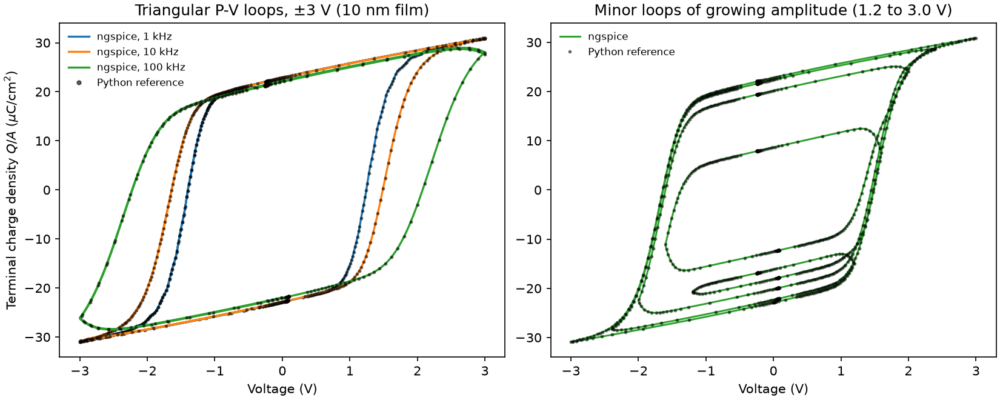
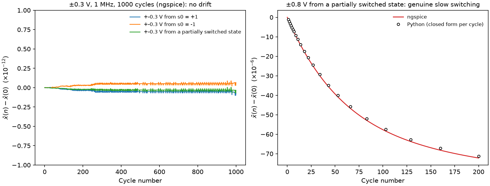
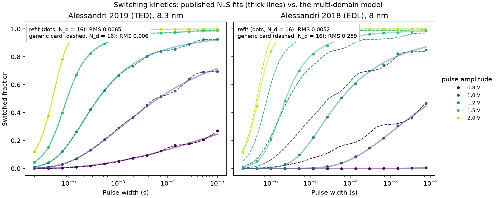
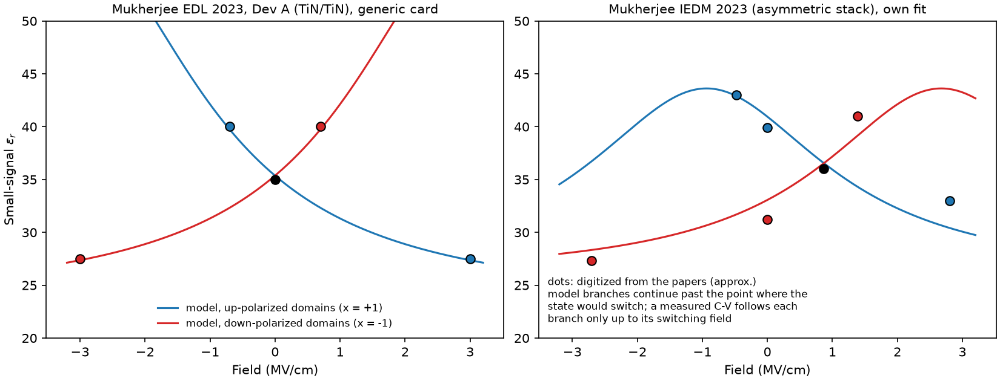
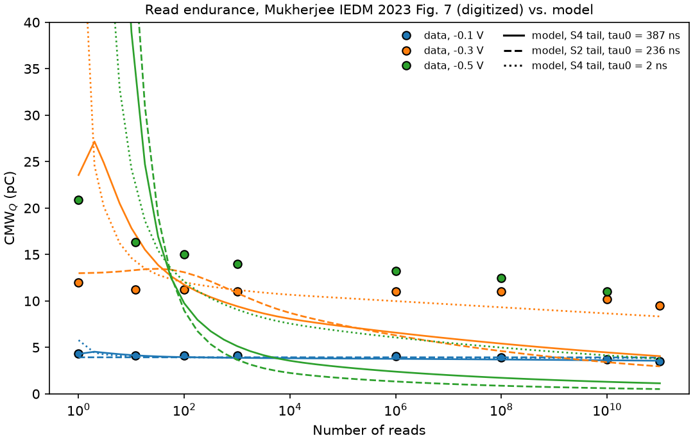
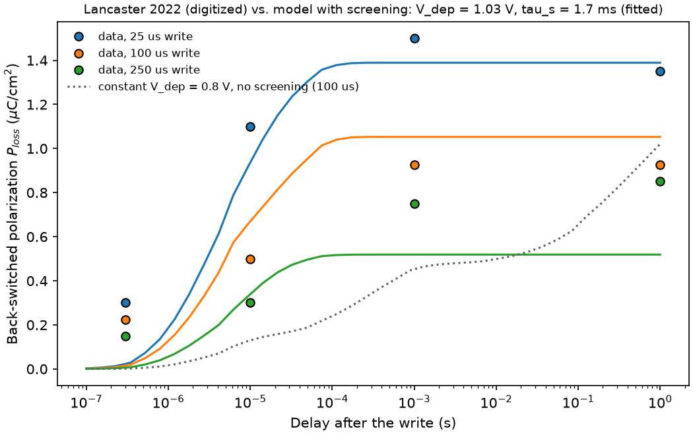
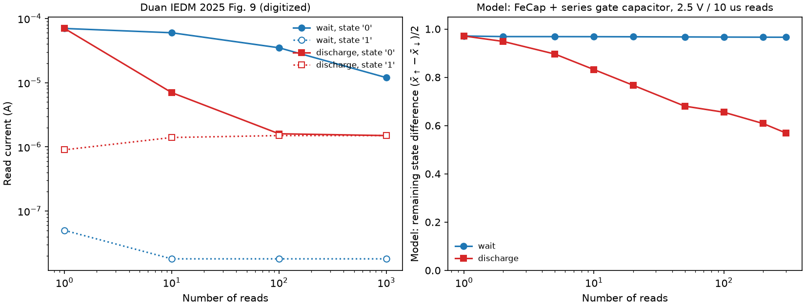

[English](model-derivation.md) | **繁體中文**

# 這個模型是怎麼來的：鐵電電容的動態多域 NLS 模型

這篇文章說明 [`spice/fecap_nls.va`](../spice/fecap_nls.va) 與它的 Python 參考實作 [`src/fe_models/nls_multidomain.py`](../src/fe_models/nls_multidomain.py) 是怎麼一步一步推出來的。讀者設定為第一次接觸鐵電切換模型的人。我們依照思考的順序走：先問模型必須描述哪些現象，再比較幾種現成的框架，接著逐條寫出方程並說明每一步的物理理由，然後交代參數從哪裡來、怎麼驗證、和已發表的資料比起來如何，最後列出它做不到的事。

第 3 節是一個固定循環狀態下的模型。第 4 節再加上使用中會慢慢改變的部分：喚醒、疲勞、存放時的 imprint，以及它們造成的漏電上升。這些項都是選用的，預設關閉。

方程的完整清單與參數表在 [spice/README.md](../spice/README.md)；本文著重「為什麼這樣寫」。第 4 節各項的機制分析、擬合過程與失敗的嘗試，在 [`docs/research/`](research/) 的四份研究筆記。

## 目錄

1. [模型要描述什麼](#1-模型要描述什麼)
2. [候選框架的比較](#2-候選框架的比較)
3. [方程，一步一步來](#3-方程一步一步來)
4. [循環與存放歷史（選用）](#4-循環與存放歷史選用)
5. [參數從哪裡來](#5-參數從哪裡來)
6. [怎麼驗證](#6-怎麼驗證)
7. [和已發表資料的比較](#7-和已發表資料的比較)
8. [已知限制](#8-已知限制)
9. [參考文獻](#9-參考文獻)

## 1. 模型要描述什麼

Ferroelectric（鐵電）材料的 polarization（極化）$P$ 有兩個穩定方向。外加電壓夠大時，極化會翻到另一個方向；電壓移除後，極化留在新的方向。HfO₂ 系（例如 HZO，Hf₀.₅Zr₀.₅O₂）薄膜是多晶的，每顆晶粒翻轉的難易程度不同。因此「翻了多少」是一個連續的量，而且同時取決於電壓與時間。

一個要放進電路模擬的鐵電電容模型，至少要描述下面這些現象：

- **有限脈寬下的部分翻轉**：同樣的電壓，脈衝越長翻得越多；同樣的脈寬，電壓越高翻得越多。
- **低於 coercive voltage（矯頑電壓）的累積**：單一個小脈衝幾乎不翻，但重複很多次之後，容易翻的晶粒會慢慢翻過去。這是真實的物理效應。
- **小訊號下不可以有人為的漂移**：對稱、很小的來回電壓（例如讀取或雜訊）不應該讓狀態一圈一圈地往零移動。有些模型的更新只看電壓路徑，每走一圈就掉一點；這種漂移是模型的缺陷，不是物理。
- **與狀態相關的可逆響應**：極化沒有翻轉時，朝上與朝下的狀態對同一個小電壓的電容不同，量出來是「蝴蝶形」的 C–V 曲線。
- **imprint（印記）**：遲滯迴線的中心不在 0 V。
- **漏電**：與極性、電壓、溫度有關。
- **back-switching（回切）**：寫入之後，一部分極化在幾微秒到幾毫秒內又翻回去。
- **溫度、面積、膜厚的縮放**。
- **循環與存放歷史**：新的薄膜要先循環一段時間極化才會變大（wake-up，喚醒），循環太多次又會變小（fatigue，疲勞）；存放時迴線會隨時間的對數慢慢移動。這些放在第 4 節，作為選用項。

前兩項最容易被搞混。累積是真的，人為漂移是假的。一個好的模型必須能分辨它們：前者由材料中「容易翻的那一小群晶粒」決定，後者不應該存在。後面的方程設計，很大一部分是為了這一點。

## 2. 候選框架的比較

文獻中描述鐵電切換的框架有好幾種。我們先簡單介紹，再用一張表比較它們對上面需求的能力。

- **Miller 模型** [Wong2005 中的討論]：用飽和迴線加上縮放規則，直接由電壓路徑算出 $P$。
- **KAI 與 NLS**（Kolmogorov–Avrami–Ishibashi；nucleation-limited switching，成核限制切換）[Jo2007, Alessandri2018]：薄膜分成許多區域，各自等待成核再翻轉。原始形式只描述「從飽和態出發、固定電壓」的切換。
- **動態多域 NLS** [AlessandriIEDM2018, Alessandri2019, Deng2020]：把 NLS 推廣到任意波形，每個區域記住自己已經累積了多少切換進度。
- **Preisach 模型** [Wong2005]：每個 hysteron（遲滯子）有兩個門檻，電壓跨過門檻就翻；本質上與時間無關。
- **熱活化型（Heracles 類）** [Fehlings2024, Fehlings2025b]：單一狀態變數，切換速率由熱活化給出，分布與去極化來自介面層與空乏層的串聯分壓。
- **LK／LGD**（Landau–Khalatnikov、Landau–Ginzburg–Devonshire）：自由能曲面加上黏滯動力學。

| 需求 | Miller | NLS／KAI | 動態多域 NLS | Preisach | 熱活化型 | LK／LGD |
|---|---|---|---|---|---|---|
| 有限脈寬下的翻轉 | 不能 | 能（只限固定電壓） | 能（跨約 5 個數量級的脈寬驗證過 [Alessandri2018]） | 不能（要另外加時間響應） | 能 | 部分 |
| 重複脈衝的累積 | 由路徑決定，與次數綁在一起 | 不能 | 能（脈衝串驗證過 [Alessandri2019]） | 不能（沒跨門檻就不動） | 能（模擬） | 不描述 |
| 對稱小訊號不漂移 | 不能（minor loop 會漂 [Wong2005]） | 不適用 | 能（見 §3.6） | 能（結構保證） | 能 | 不描述 |
| 可逆響應隨狀態變化 | 不能 | 要另外加 | 要另外加（逐域兩支的作法見 [Clima2022]） | 要另外加 | 內建，但整顆電容只有一個狀態 | 內建 |
| 漏電 | 另加 | 另加 | 另加 | 另加 | 內建 | 部分 |
| 回切 | 不描述 | 不描述 | 可加（§3.5） | 不描述 | 由分壓自然產生 | 揮發元件才自然 |
| 參數能否由常見量測決定 | 能，但表達不了上面的需求 | 能 | 能 | 能 | 部分（介面參數需要 TCAD 或另外量） | 不容易 |
| SPICE 形式 | 簡單 | 需要積分 | 原文是 Monte Carlo，要改寫 | 要管理門檻 | 已有 Verilog-A | 簡單 |

**我們選擇動態多域 NLS，並把它寫成 mean-field（平均場）的確定性方程。** 理由有三個。第一，它是候選中唯一在 HZO 上同時用固定電壓切換、minor loop 與脈衝串驗證過的框架 [AlessandriIEDM2018, Alessandri2019]。第二，它的狀態變數直接對應量得到的量（翻轉比例）。第三，原文的 Monte Carlo 在大約 5000 顆晶粒時已經和解析的 NLS 無法區分 [Alessandri2019]，所以大面積電容可以用期望值的方程取代隨機模擬，這正是 SPICE 需要的形式。

可逆響應、漏電與回切則是在這個框架上另外加的。熱活化型模型是最接近的替代方案；我們沒有選它，因為它的分布由難以直接量測的介面參數決定。可逆響應的真正機制在文獻中還沒有定論，所以我們只描述端點的 $C(V, \text{狀態})$，**不宣稱哪一個機制是對的**。

## 3. 方程，一步一步來

### 3.1 把薄膜分成 $N_d$ 類域

前面提到，晶粒翻轉的難易程度各不相同。我們依「難翻的程度」把晶粒分成 $N_d$ 類。第 $k$ 類佔全部的比例是 $w_k$（$\sum_k w_k = 1$），它的狀態 $s_k \in [-1, +1]$：$+1$ 表示這一類全部朝上，$-1$ 表示全部朝下，$0$ 表示一半一半。

整顆電容的極化，就是各類狀態依比例加權的平均，再乘上飽和極化：

$$\bar x = \sum_k w_k s_k, \qquad P = P_s\,\bar x .$$

這裡的 $\bar x$ 是平均狀態（mean state），$P_s$ 是 saturation polarization（飽和極化）。

### 3.2 每一類感受到的電壓

接下來要決定每一類感受到的驅動電壓。最簡單的情形是 $u_k = V - V_{imp}$：外加電壓減去內建偏壓 $V_{imp}$。$V_{imp}$ 讓遲滯迴線的中心偏離 0 V，這就是 imprint。

我們再加上三個修正，預設都關閉：

$$u_k = \rho V - V_{dep}(\bar x - \sigma) - V_{imp} - \delta_k .$$

- $\rho$ 是串聯介面層造成的分壓比例；沒有介面層時 $\rho = 1$。
- $V_{dep}(\bar x - \sigma)$ 是 depolarization（去極化）電壓，$\sigma$ 是屏蔽狀態（§3.5）。
- $\delta_k$ 是每一類的局部偏移 [Deng2020 的 $E_{off,i}$]。

### 3.3 切換速率：Merz 型、單方向

Merz 型定律說，切換時間隨電場呈指數變化 [Alessandri2018]：電場越強，切換越快，而且快得非常劇烈。我們把它寫成速率。因為電壓只會把晶粒推向「自己的方向」，所以分成兩個單方向的速率：

$$R_k^{+} = \frac{1}{\tau_0}\exp\left[-\left(\frac{V_{a,k}}{u_k}\right)^{\alpha}\right]\quad (u_k > 0), \qquad R_k^{-} = \frac{1}{\tau_0}\exp\left[-\left(\frac{V_{a,k}}{|u_k|}\right)^{\alpha}\right]\quad (u_k < 0).$$

另一個方向的速率是 0。$V_{a,k} = E_k t_{fe}$ 是第 $k$ 類的 activation voltage（活化電壓），$E_k$ 是它的活化電場，$t_{fe}$ 是膜厚，$\tau_0$ 是 attempt time（嘗試時間），$\alpha$ 是指數。

這個函數有一個很重要的性質：當 $u \to 0$ 時，速率連同所有導數都平滑地趨近 0，而且指數永遠是負的，不會溢位。數值上，我們只要在指數小於 $-60$ 時把速率設成 0 即可。

### 3.4 Weibull 切換與進度變數 $h$

量測顯示，HfO₂ 系薄膜的切換機率是 Weibull 形式 $1 - \exp[-(t/\tau)^\beta]$，而且 $\beta \approx 2$ [Jo2007, Alessandri2018, Alessandri2019]。$\beta > 1$ 的意思是：成核有一段潛伏期（incubation），剛加上電壓時切換得很慢，之後才加速。

這帶來一個問題。如果速率只取決於當下的電壓，模型就沒有「已經等了多久」的記憶。所以每一類還要記住累積的進度 $h_k$ [Alessandri2019, Deng2020]。我們用帶正負號的 $h_k$，正值表示往 + 方向累積，負值表示往 − 方向累積，並記 $h_k^{+} = \max(h_k, 0)$、$h_k^{-} = \max(-h_k, 0)$。狀態方程是：

$$\frac{\mathrm{d}s_k}{\mathrm{d}t} = r_k^{+}(1 - s_k) - r_k^{-}(1 + s_k), \qquad r_k^{\pm} = \beta R_k^{\pm}\,(h_k^{\pm})^{\beta - 1}.$$

$(1 \mp s_k)$ 這兩個因子讓 $s_k = \pm 1$ 成為穩定點：已經全部翻過去的類別不會再「多翻」。

**定電壓下回到 NLS 的單脈衝式。** 為了確認這樣寫是對的，我們看最簡單的情形。從 $s_k = -1$、$h_k = 0$ 出發，加一個固定電壓。這時 $h_k = R_k t$，代入上式得到

$$\frac{\mathrm{d}}{\mathrm{d}t}\ln(1 - s_k) = -\beta R_k^{\beta} t^{\beta - 1} \quad\Longrightarrow\quad \frac{1 + s_k}{2} = 1 - \exp\left[-(R_k t)^{\beta}\right].$$

所以翻轉比例是 $f(t) = \sum_k w_k\{1 - \exp[-(R_k t)^\beta]\}$，正好是 [Alessandri2018] 的 NLS 單脈衝式。換句話說，動態模型在原始 NLS 適用的條件下，會退化成原始 NLS。

**$h$ 的方程。** 接下來要決定 $h$ 在一般波形下怎麼變化。它有四個部分，每一部分都有自己的理由：

$$\frac{\mathrm{d}h_k}{\mathrm{d}t} = \underbrace{R_k^{+}\left[1 - \left(\frac{h_k^{+}}{h_m}\right)^{4}\right] - R_k^{-}\left[1 - \left(\frac{h_k^{-}}{h_m}\right)^{4}\right]}_{\text{累積與飽和}} \;\underbrace{-\;\frac{h_k}{\tau_h^{eff}}}_{\text{沒有驅動時鬆弛}} \;+\; \underbrace{\frac{1}{\tau_x}\left[G(u_k - u_x)\,h_k^{-} - G(-u_k - u_x)\,h_k^{+}\right]}_{\text{反向驅動時歸零}} .$$

- **累積與飽和**：定電壓下 $h$ 以 $R$ 的速率增加，所以上一段的推導成立。$h_m = 5$ 只是讓 $h$ 有界；在那裡未翻的比例已經小於 $10^{-10}$。
- **鬆弛**：[Alessandri2019] 觀察到，脈衝之間的 off time 會讓進度部分消失，他們用 $h \leftarrow \gamma(t_{off})\,h$ 描述。我們把它寫成一階鬆弛。但原文只在 off time 乘上 $\gamma$，所以我們讓鬆弛只在電壓接近 $V_{imp}$ 時發生：$\tau_h^{eff} = \tau_h[1 + ((V - V_{imp})/0.1\,\text{V})^4]$。如果沒有這個門控，長脈衝期間 $h$ 也會鬆弛，模型就回不到上一段的單脈衝式。
- **反向驅動時歸零**：當驅動方向反轉，原本往 − 累積的進度對往 + 的翻轉沒有幫助。理由是：現在沒有對齊的晶粒，在上一段是對齊的，它本來就沒有在累積往這個方向翻的進度。所以我們用一個很快的項（$\tau_x$ = 0.1 ns）把反方向的 $h$ 清掉。$G(z) = \tfrac12[1 + \tanh(z/10\,\text{mV})]$ 是平滑的開關，$u_x = |V_{imp}| + 0.1$ V 是門檻，所以靜置在 0 V（$u = -V_{imp}$）不算反轉。這是一個假設；[Alessandri2019] 指出，在週期性刺激下「不歸零」反而與實驗相符，但作者也說那是極端情形。

**「反轉」要用電場方向判斷，而不是用速率大小判斷。** 這是開發過程中修正過的錯。較早的版本用速率的大小判斷是否在反向驅動。這樣做的後果是：低電場尾巴的晶粒反向速率太小，就不會被當成反轉，它們的 $h$ 因此沒有歸零。在開發紀錄中，這讓 ODE 與閉式解在 ±0.67 V、10⁴ 對讀取時相差 28%。改成依電場方向判斷之後，兩者相差小於 0.5%。本 repo 的測試保留了這個檢查：把重設改回依速率判斷時，±0.67 V、300 對雙極性脈衝的損失變成閉式解的約 2.5 倍，測試會失敗。

另一個開發中修正過的錯是 (E3b) 反轉項的符號：符號寫反時，$h$ 會指數發散，飽和迴線的測試立刻抓到。

Python 裡定電壓區間的閉式更新 `step()` 也有過同一類的錯，是讀取擾動研究時發現的。驅動反向、但還沒越過門檻 $u_x$ 時，$h$ 不會被清掉，(E3b) 裡的舊進度要先倒數到零，新方向才開始有危險率；舊版的 `step()` 卻直接把舊方向的 $|h|$ 當成新方向的進度。重現例（1.5 V 寫入 20 µs 後停在 −0.05 V 1 µs，$V_{imp}$ = 0.3 V）中，舊版翻了 7.8%，ODE 是 0。修正後兩者一致，這個例子保留為測試。

**數值細節。** $h^{\beta - 1}$ 在 $h < 10^{-6}$ 改成線性，讓 $\beta < 2$ 時在 $h = 0$ 的斜率仍然有限。反轉歸零項很「硬」（stiff），所以模擬時要用 Gear 法；模型另外用 `$bound_step` 在歸零進行中把時間步壓到 0.2 ns 以下（§6）。

### 3.5 回切與屏蔽狀態 $\sigma$

寫入後一部分極化又翻回去，來源是去極化場把域往回推 [Fehlings2025a, Tian2025]。最簡單的寫法是在 $u_k$ 裡放一個固定的 $V_{dep}\bar x$。但這樣有一個問題：寫完之後，這個電壓會永遠推下去。[Lancaster2022] 量到的回切大約在 100 ms 後飽和，而且寫入脈衝越長，損失越少；作者把這歸因於電荷注入與捕捉造成的屏蔽。

所以我們加一個屏蔽狀態，每顆電容一個：

$$\tau_s\frac{\mathrm{d}\sigma}{\mathrm{d}t} = \bar x - \sigma .$$

去極化項寫成 $V_{dep}(\bar x - \sigma)$。這樣寫的結果有三個：

- 長時間停在同一態時，$\sigma \to \bar x$，去極化項消失，所以**反覆的小訊號讀取不受影響**。
- 剛翻完時，$\sigma$ 跟不上，就產生回切；寫得越久，$\sigma$ 跟得越多，回切越少。
- 長時間停在 + 態後再寫到 − 態時，$\bar x - \sigma$ 最大，往回推也最大，這也是 imprint 的方向。

$V_{dep}$ 預設為 0（關閉）。§7 用 [Lancaster2022] 的數據擬合出 $V_{dep}$ 與 $\tau_s$。

### 3.6 活化場分布、取樣，以及小電壓為什麼不累積

**分布。** [Alessandri2018, Alessandri2019] 用 generalized beta distribution of the second kind（GB2，第二類廣義 beta 分布）描述活化場的分布。我們用它的特例 Dagum 分布，因為 Dagum 的分位數有閉式解，SPICE 裡可以直接算：

$$G(E) = \left[1 + (E/b)^{-a}\right]^{-p} \quad\Longleftrightarrow\quad E(q) = b\left[q^{-1/p} - 1\right]^{-1/a}.$$

$b$ 是尺度，$a$ 決定分布核心的寬度。低電場的尾巴是 $G \approx (E/b)^{ap}$，所以 $ap$ 決定「有多少晶粒特別容易翻」。這個尾巴正是重複讀取時會被消耗的部分。§7 會看到，[Alessandri2018] 與 [Alessandri2019] 兩個元件的 $ap$ 分別約為 87 與 9.9，差別很大。

**取樣。** 如果把分位數軸等比例切成 $N_d$ 段，最軟的一段就涵蓋了 $q < 1/N_d$ 的全部晶粒，尾巴完全解析不了。所以我們在 logit 軸 $y = \ln[q/(1-q)]$ 上取點：$y_j = y_m \sinh(a_g\xi_j)/\sinh a_g$，$\xi_j$ 在 $[-1, 1]$ 均勻分布，$y_m = 9$、$a_g = 1.5$。這樣中間較密，兩端深入尾巴：$N_d = 16$ 時最軟的一類在 $q \approx 3\times10^{-4}$，權重約 $7\times10^{-4}$。正、負方向用同一個 $q_k$，也就是假設「難翻的域往兩個方向都難翻」。

**小電壓為什麼不累積。** 現在可以回答 §1 的問題了。累積的大小取決於 (E2) 的指數。以 ±26 mV 的訊號為例，加上內建偏壓後 $u \approx 0.106$ V。$N_d = 16$ 時最軟一類的活化電壓是 0.78 V，指數 $(0.78/0.106)^{4.11} \approx 3600$，速率在數值上就是 0。即使是 ±0.3 V，指數也有約 19，速率約 $e^{-19}/\tau_0 \approx 0.02\ \text{s}^{-1}$；再加上每次反轉 $h$ 都歸零，每半個週期的累積只有 $(Rt)^\beta \sim 10^{-18}$ 的量級。

這和「只看電壓路徑」的模型根本不同。那種模型每走一圈都更新一次狀態，所以會漂移。這裡的更新正比於通電時間乘上一個指數級小的速率，沒有路徑漂移的機制。本 repo 的測試保留了一個反例：把狀態方程改成「只要有電壓就往零拉一點」，±0.3 V、5 圈就漂移超過 $10^{-6}$，測試會失敗。

$N_d = 16$ 的取樣會把 $q$ 很小的尾巴併進最軟的一類，所以上面的 0 有一部分來自取樣。要知道模型本身的上限，要用連續分布（$y_m = 40$、$N_d = 4000$）。以單極性 100 ns 脈衝、off 1 µs、重複 $10^9$ 次計算，翻轉比例是：30 mV $3\times10^{-10}$、100 mV $4\times10^{-8}$、220 mV $6\times10^{-6}$、300 mV $7\times10^{-5}$。這些上限是尾巴形狀的外推（§8）。

**真的累積。** 讀取電壓接近尾巴時，軟的域會慢慢翻過去，損失隨次數近似對數增加。這不是人為漂移：它在單極性下翻完就飽和，它的大小由分布決定，而且不會隨 $N_d \to \infty$ 消失（測試：±0.9 V、10⁴ 對時，$N_d$ = 64 與 256 的損失相差小於 5%）。$N_d$ 小時，尾巴是一類一類翻完的，所以損失對次數呈階梯狀；要看斜率，請用 $N_d \ge 64$。

### 3.7 可逆電荷：四項分開寫

電壓一拿掉就回來的電荷，我們分成四項。分開的理由是：它們的時間尺度與量測方式不同。

**① 純介電**：$q_1 = C_d V$。它和狀態無關，所以在兩態相減時完全消掉。

**② 極化的可逆伸縮。** 朝上的域往負電壓走時接近翻轉，能井變軟，susceptibility（極化率）變大；往正電壓走則變硬 [Clima2022, Mukherjee2023EDL]。所以每一類域依自己的狀態，走兩條曲線之一。我們用積分後的 Lorentzian（也就是 arctan）表示這兩支：

$$g_{\uparrow}(V) = \Delta C\, V_w\left[\arctan\frac{V - V_i + V_s}{V_w} - \arctan\frac{-V_i + V_s}{V_w}\right], \qquad g_{\downarrow}(V) = \Delta C\, V_w\left[\arctan\frac{V - V_i - V_s}{V_w} - \arctan\frac{-V_i - V_s}{V_w}\right].$$

對所有類別加總：

$$q_2 = \sum_k w_k\left[\frac{1 + s_k}{2} g_{\uparrow} + \frac{1 - s_k}{2} g_{\downarrow}\right] = \bar g(V) + \bar x\, g_d(V), \qquad \bar g = \tfrac12(g_\uparrow + g_\downarrow),\ g_d = \tfrac12(g_\uparrow - g_\downarrow).$$

一個域翻轉時，它的可逆貢獻就換到另一支。因為式子對 $s_k$ 是線性的，逐域加總只需要 $\bar x$，不增加節點。

這也是開發過程中修正過的地方。第一版用「整顆電容一條 $C(V, \bar x)$、峰的位置隨 $\bar x$ 移動」。這樣在半翻轉時會在 0 V 得到單一個高峰（$\varepsilon_r$ 約 44.8），但逐域加總的正確答案是兩支的平均（約 34.1）。

$V_i$ 是兩支的交叉點 $V_{CROSS}$。它和翻轉迴線的中心 $V_{imp}$ 是兩個不同的量；[Mukherjee2023IEDM] 量到交叉點在 +0.87 MV/cm，而翻轉電流峰的中心約在 +0.45 MV/cm。量到的 C–V「峰」其實是這一支在爬升途中被翻轉截斷的位置，所以 Lorentzian 的中心 $V_s$ 在翻轉點之外，實際掃描到不了（§7 的圖可以看到）。

**② 的時間尺度與 $f_{rev}$。** ② 不一定是瞬時的。[Baigol2026] 的小訊號窗在 2 MHz 以上消失，但 [Mukherjee2023IEDM] 用 500 ns 的脈衝仍讀得到差異。我們用一個參數 $f_{rev}$ 表示瞬時的比例，其餘部分走一個低通後的電壓 $y$：

$$q_2 \;\longrightarrow\; f_{rev}\left[\bar g(V) + \bar x\, g_d(V)\right] + (1 - f_{rev})\left[\bar g(y) + \bar x\, g_d(y)\right], \qquad \tau_r\frac{\mathrm{d}y}{\mathrm{d}t} = V - y .$$

**為什麼整個 ② 一起分，而不是只分 $\bar x\,g_d$？** 只分狀態相依的部分時，低通那一份的電容在某一個狀態下是負的。這時方波走一圈，電功是負的，元件會「吐出」能量，違反 passivity（被動性）。整個 ② 一起分時，瞬時與低通兩份的電容都是正的，元件一定是被動的。本 repo 的測試同時檢查這兩件事：正確的寫法在 $f_{rev}$ = 0.5 與 0.2 時一圈的功都是正的；把它改成只分 $\bar x\,g_d$ 時，一圈的功變成負的，測試會失敗。電荷守恆的檢查抓不到這個錯，因為兩種寫法的電荷都守恆。

**③ 可逆的 domain wall（域壁）小幅移動**：$q_3 = C_w(1 - \bar x^2)\,y$。飽和態幾乎沒有域壁，所以乘上 $(1 - \bar x^2)$；它對兩態差沒有貢獻，但部分翻轉時有。它走 $y$，是因為域壁比晶格慢。另外留一個與狀態無關的慢介電 $C_r y$。預設兩者都關閉。

**④ 翻過去又回切**：不是獨立的電荷項。它由 §3.5 的 $V_{dep}(\bar x - \sigma)$ 經狀態方程進來。

合起來：

$$q_{rev} = C_d V + f_{rev}\left[\bar g(V) + \bar x\, g_d(V)\right] + (1 - f_{rev})\left[\bar g(y) + \bar x\, g_d(y)\right] + \left[C_w(1 - \bar x^2) + C_r\right] y .$$

回到 0 V 且 $y = 0$ 時 $q_{rev} = 0$，所以回零之後的電荷只來自極化。這讓我們可以直接用 0 V 時的電荷讀出 $\bar x$。

### 3.8 端點電流與漏電

端點電流寫成電荷函數對時間的微分，再加上漏電：

$$I = A\frac{\mathrm{d}}{\mathrm{d}t}\left[P + q_{rev}\right] + A\,J_L(V, T).$$

先寫電荷、再微分，有一個好處：電荷自動守恆，不必另外保證。

漏電由幾個機制並聯，正、負極性各有一組參數。Poole–Frenkel（PF）的形式取自 [Fehlings2024]，另外留了 Schottky 與一個有效形式的 trap-assisted tunnelling（TAT，陷阱輔助穿隧）。單一溫度的 I–V 無法分辨機制，所以預設只開 PF 與歐姆項。完整的式子在 [spice/README.md](../spice/README.md#equations)。

**Verilog-A 的一個寫法規則：`ddt` 不可以放在條件分支裡。** 模型在靜態分析時把狀態固定在初始值，之後才讓狀態依方程演化。較早的版本把 `ddt` 寫在「非靜態才執行」的分支裡；如果模擬器的 `ddt` 歷史值取自 DC 解，初始狀態就會被洗掉。所以 `ddt` 一律無條件寫出，只有右端的項乘上 0 或 1。

## 4. 循環與存放歷史（選用）

到這裡為止，模型描述的是一顆「循環狀態固定」的電容：參數卡代表某一個循環次數下的薄膜。真實的 HfO₂ 薄膜在使用中會改變：

- 新的薄膜迴線常常是收窄的（pinched），極化偏小，循環 $10^3$–$10^5$ 次後才打開，這叫 wake-up（喚醒）；
- 再循環下去極化又變小，這是 fatigue（疲勞），常伴隨漏電上升；
- 寫好的狀態放著不動，迴線會隨時間的對數往同一個方向移動，這是長時間的 imprint。

這些變化比切換慢好幾個數量級，所以我們用少數幾個慢狀態描述它們。這一節的每一項都預設關閉：關閉時 Python 走原本的程式路徑、輸出逐位元相同，Verilog-A 裡對應的節點恆為 0。各項的機制比較、擬合與試過但失敗的做法，在 [fatigue-imprint](research/fatigue-imprint.zh-TW.md)、[cycling-r2](research/cycling-r2.zh-TW.md)、[tail-fit](research/tail-fit.zh-TW.md) 與 [read-imprint-r2](research/read-imprint-r2.zh-TW.md) 四份研究筆記。

### 4.1 釘扎池：疲勞不能寫成「$P_s$ 變小」（E13）

描述疲勞最直接的寫法，是把 $P_s$ 乘上一個隨循環變小的係數。這樣寫有一個錯：一個寫好、放在 0 V 的狀態，會隨著疲勞增加而在端點掉電荷，看起來像保持力損失。但物理上，一個被缺陷釘住的 domain 只是不再翻轉，它的極化並沒有消失。

所以我們改用「釘扎池」。薄膜中比例 $f$ 的 domain 被釘住，其餘 $1-f$ 照第 3 節切換。被釘住的部分用兩個量記住它被釘住時的樣子：極化 $\pi$（以 $P_s$ 為單位），以及當時凍結的可逆電荷 $r$。端點電荷因此寫成

$$\frac{Q}{A} = P_s\left[(1-f)\bar x + \pi\right] + C_d V + (1-f)\,q_2(V, \bar x) + r + \dots,$$

$q_2$ 是第 3.7 節第 ② 項。$f$ 增加時，新被釘住的部分帶走當下的平均狀態與可逆電荷：

$$\dot\pi = \dot f^{+}\,\bar x, \qquad \dot r = \dot f^{+}\,q_2(V, \bar x).$$

$f$ 減少時，被釋放的部分帶著池子的平均狀態 $\pi/f$ 回到各類：$\dot s_k \mathrel{+}= \dot f^{-}(\pi/f - s_k)/(1-f)$，$\dot\pi = -\dot f^{-}\pi/f$，$\dot r = -\dot f^{-} r/f$。代回 $Q$ 就可以驗證：釘住與釋放本身都不改變端點電荷，所以固定偏壓下即使損傷在增加，也沒有電流。這是測試之一。

可逆項乘上 $(1-f)$，表示被釘住的 domain 不會隨電壓「軟化」（它們不會接近自己的切換場）。所以喚醒時 C–V 的蝴蝶峰變高，疲勞時變低。

### 4.2 喚醒，以及迴線要怎麼讀（E14）

喚醒的驅動是切換本身：文獻的喚醒需要反覆翻轉，而小於矯頑電壓的讀取不應該喚醒薄膜。所以我們用一個「等效完整切換週期數」當作喚醒年齡：

$$\dot a_w = A_w(T)\,\frac{\sum_k w_k |\dot s_k|}{4N_w}, \qquad A_w(T) = \exp\left[-\frac{E_w}{k_B}\left(\frac{1}{T} - \frac{1}{T_0}\right)\right].$$

一個完整的雙極性週期讓每類走過 $|\Delta s| = 4$，所以 $a_w$ 每週期增加 $1/N_w$。喚醒度 $W = 1 - \exp[-g(a_w)]$，$g$ 是拉伸指數 $a^{\kappa_w}$（加一個小的平移，讓 $a = 0$ 的導數有限）。$\kappa_w < 1$ 等於假設各區域的喚醒速率分布很寬，這就是 $2P_r$ 隨 $\log N$ 線性增加好幾個十倍的原因。$W$ 控制兩件事：

- 原始被釘住的比例 $f_w = f_{p0}(1 - W)$，對應被缺陷團簇釘住、或還不是鐵電相的區域；
- 原始的內部偏壓分裂：奇數類加 $+V_{sp}(1-W)$、偶數類加 $-V_{sp}(1-W)$，對應 FORC 上兩群偏壓相反的 hysteron [Fengler2017]。

**迴線要照實驗的方式讀。** [Fengler2017] 量到喚醒期間 $2E_c$ 也跟著上升。第一輪研究用「切換狀態的中點」定 $E_c$，結果偏壓分裂消失時 $2E_c$ 反而下降，方向相反。問題不在方程，而在量的是什麼：實驗量的是**總電荷**（極化加介電加可逆部分）為零的電壓。兩群 domain 分別在 $E_{c0} \mp E_b$ 切換時，上升支的總電荷在先翻的那一群翻完、後翻的那一群還沒開始時，就已經因為介電項越過零，所以零點落在 $E_{c0} - E_b$ 附近。偏壓分裂消失後，零點回到 $E_{c0}$，量到的 $2E_c$ 就變大了。所以這一項不加任何參數，只加一個照實驗方式讀迴線的函數 `loop_figures`。用它同一組參數同時擬合 $2P_r$ 與 $2E_c$，$2E_c$ 的 RMS 是 0.022 MV/cm（§7）。

### 4.3 可逆的去釘扎：喚醒為什麼依賴脈寬（E18）

[Lenox2023] 改變每個脈衝的寬度（2–50 µs，同樣 10 kHz）：脈衝越寬，喚醒越多。最自然的猜測是「劑量」，例如次數乘上脈寬的某個次方 $N w^m$。但同一篇的 2 µs 從 $10^5$ 循環到 $10^8$ 次，$P_r$ 一直停在原始值的約 1.07 倍；以劑量計，它在 $10^8$ 次時早已超過 50 µs 在 $10^5$ 次的劑量，應該要到 1.26 以上。所以**任何「單一劑量」的形式都不對**，與指數 $m$ 是多少無關。

能給出「依脈寬排序的平台」的是競爭：加場時缺陷移開、domain 被解除釘扎，同時又有再釘扎把它們拉回來。我們用 $N_Q$ 個狀態 $z_j \in [0, 1]$（已解除釘扎的比例）描述，時間常數在 $[\tau_{q1}, \tau_{q2}]$ 之間對數等距：

$$\tau_j\,\dot z_j = A_w(T)\left[\phi(V)\,(1 - z_j) - \left(\rho_q + t_r\,\frac{a(t)}{4}\right) z_j\right], \qquad \phi(V) = \left(\frac{E_s}{1\ \mathrm{MV/cm}}\right)^{n_q} - \phi_{fl}.$$

$a(t) = \sum_k w_k |\dot s_k|$ 是切換速率，$\phi_{fl}$ 讓 $\phi(0) = 0$。再釘扎有兩個通道：$\rho_q$ 在任何時候都作用（休息時再釘扎），$t_r$ 只在每次翻轉時作用。脈衝串下的平台是 $Z_{ss} = \phi D_c/(\phi D_c + \rho_q + t_r f)$，$D_c$ 是佔空比，所以平台自然依脈寬排序。兩個通道對 Lenox 的數據擬合得一樣好，但休息通道會預測：喚醒後的薄膜在 0 V 放一分鐘就退回去，這與 [Pesic2016]、[Fengler2017] 的觀察不符，所以建議用反轉通道。

這個池子和原始釘扎並存，合起來的總釘扎比例是

$$f = 1 - (1 - f_w)\left[1 - f_q(1 - Z)\right](1 - D), \qquad Z = \frac{1}{N_Q}\sum_j z_j ,$$

$D$ 是下一小節的疲勞損傷。$f_w$ 描述與切換次數綁在一起、不可逆的部分；$f_q$ 描述與通電時間綁在一起、可逆的部分。釘住與釋放都經過 §4.1 的釘扎池，所以再釘扎也不會在端點產生電流。

### 4.4 疲勞與漏電上升（E15、E16、E19、E20）

疲勞年齡 $a_F$ 有兩個可選的驅動：

$$\dot a_F = A_F(T)\left(\frac{E_s}{1\ \mathrm{MV/cm}}\right)^{n_F}\left[\frac{1}{t_F} + \frac{\sum_k w_k |\dot s_k|}{4N_F}\right].$$

- 第一項是「有電場的時間」：電荷注入與缺陷生成隨加場時間累積。
- 第二項是「切換時的電場」：只在翻轉時累積，對應「單極性應力不造成疲勞」的觀察 [Book9.2]。

損傷 $D = D_{max}[1 - e^{-g(a_F)}]$ 做兩件事：把 domain 釘住（併入上面的 $f$），以及讓還能切換的 domain 活化場乘上 $(1 + k_E D)$，代表切換峰變寬、往高場移動。

**應力的建立時間（E19）。** [Lenox2023] 的漏電上升起點，換算成「起點時的通電時間」，在 5–50 µs 脈衝都約 40 s，只有 2 µs 是 200 s。這表示每個脈衝開頭有一段時間對產生缺陷沒有貢獻：可能是切換期間電場還沒建立，也可能是介面層的高場要等位移場翻轉後才出現，這筆數據分不出來。我們把它寫成一個建立時間 $t_L$：

$$t_L\,\dot V_L = V - V_L, \qquad E_s^2 = \max\left(\frac{\rho^2 V V_L}{t_{fe}^2},\ 0\right) + E_{fl}^2 .$$

應力需要「現在的電場」與「慢慢建立、方向相同的條件」同時存在，所以 0 V 時沒有應力，電壓反向時要等 $V_L$ 越過零。加了這一項，Lenox 五個脈寬的漏電起點劑量，分散從 6.7 倍降到 2–3 倍，和量測檢查點的間隔相當。

**漏電隨疲勞上升（E20）。** 新生成的缺陷提供陷阱輔助穿隧的陷阱，所以漏電整體乘上一個倍數：

$$J \to J\left[1 + k_L\,a_F^{\,m_L}\right].$$

乘在整個漏電上，是因為 [Pesic2016] 同一顆元件的漏電倍數在 0.2–3 MV/cm 幾乎與電場無關。

### 4.5 對數時間的 imprint（E17、E17a、E17b）

第 3.5 節的屏蔽狀態 $\sigma$ 只有一個時間常數，只能描述一個指數過程。但長時間存放的 imprint 隨 $\ln t$ 增加，跨好幾個十倍 [Buragohain2019, Fengler2018]。對數律的典型來源，是一群捕獲或釋放時間分布很廣的陷阱。所以我們用 $N_I$ 個捕獲狀態，時間常數在 $[\tau_{I1}, \tau_{I2}]$ 之間對數等距，並且熱活化：

$$\tau_j\,\dot\sigma_j = x_t - \sigma_j, \qquad \sigma_I = \frac{1}{N_I}\sum_j \sigma_j, \qquad x_t = (1 - f)\bar x + \pi .$$

內建電壓變成動態的 $V_{imp} - V_I\sigma_I$，進入每一類的驅動、$h$ 的兩個閘門，以及可逆兩支的中心（imprint 讓 C–V 蝴蝶整個平移，這正是量 imprint 的常用方法）。從 $\sigma_j = 0$ 開始、$x_t$ 固定為 1 時，

$$\sigma_I(t) \approx \frac{\ln(t/\tau_{I1}) + \gamma}{\ln(\tau_{I2}/\tau_{I1})}, \qquad \tau_{I1} \ll t \ll \tau_{I2},$$

所以矯頑電壓的對數斜率是 $V_I/\ln(\tau_{I2}/\tau_{I1})$。這個結構另外自動給出兩件事：重寫之後 imprint 以對數方式恢復；「新同狀態」的平移比「同狀態」小，因為快的狀態被重寫抹掉了，慢的還記得舊的狀態。12 個狀態涵蓋 12 個十倍時，局部斜率的起伏小於 ±11%。

這一項有兩個延伸，也都預設關閉：

- **兩支不對稱（E17a）。** [Buragohain2019] 的數據中，離開所存狀態的那一支，移動量約是另一支的 1.5 倍，迴線同時變寬。我們讓兩個切換場除了共同平移，再各自往外移 $w = \kappa V_I|\sigma_I|$（實作上用平滑的絕對值）。這樣逃逸支移動 $(1+\kappa)$ 倍、回切支 $(1-\kappa)$ 倍的中心平移。擬合得 $\kappa = 0.18 \pm 0.02$，兩支矯頑電壓的 RMS 從 125 mV 降到 43 mV。
- **場加速（E17b）。** 寫入脈衝期間的電荷注入隨電場指數增加，所以每個捕獲狀態的速率可以乘上 $\cosh(\rho V/V_a)$。這是對稱的唯象形式。

### 4.6 很長的循環怎麼算

$10^8$ 次以上的循環不可能逐週期積分。慢狀態在一個週期內幾乎不變，所以 `cycle_history` 用兩個時間尺度處理：

1. 慢狀態凍結，用閉式的 `step` 走過一個週期，得到這個週期的切換量、釘住與釋放，以及每個 imprint 與去釘扎狀態在一個週期內的精確仿射映射 $X \to aX + b$；
2. 把這些增量一次重複 $m$ 個週期，仿射映射的 $m$ 次方有閉式；$m$ 的大小由釘扎比例與 $\sigma_I$ 每一步的變化上限決定。

$10^{12}$ 個週期約 0.1 秒。和直接解 ODE 比較，前 12 個週期的每週期切換電荷相差約 1.1%。算完的歷史可以交給電路模擬：實例參數 `nw0`、`af0`、`si0`、`zq0` 分別設定喚醒年齡、疲勞年齡、imprint 狀態與去釘扎狀態的初值。

## 5. 參數從哪裡來

所有預設值都來自已發表的論文，或是由它們推導；每個數字的出處列在 [spice/README.md 的參數表](../spice/README.md#parameters) 與 [`spice/params/generic.inc`](../spice/params/generic.inc)。這組參數不是任何特定元件的擬合結果。

- **切換**：$P_s$、$\alpha$、$\beta$、$\tau_0$、$V_{imp}$ 取自 [Alessandri2019] Table I 與內文（W/HZO 8.3 nm/W）。活化場的 Dagum 參數，是把 Dagum 擬合到由同一篇論文發表的 GB2 分布算出的切換曲線（0.8–2.0 V、200 ns–1 ms）。$\tau_h$ 取 [Alessandri2019] 兩個鬆弛因子（1 µs off 時 γ = 0.55、10 µs off 時 0.3）各自對應的單一指數時間 1.7 µs 與 8.3 µs 的幾何平均；單一指數無法同時符合兩點，這是已知的妥協。
- **$\tau_0$ 的選擇。** 較早的草稿用 $\tau_0$ = 2 ns 搭配上述分布。我們重新檢查後發現，這個組合重現不了該論文自己的切換曲線：固定 $\tau_0$ 在 1–3 ns 重新擬合分布，切換比例的 RMS 誤差約 0.09；用發表的 387 ns 時是 0.002。同樣地，$\beta = 1$ 也擬合不了（RMS 0.036）。所以公開的參數卡用 387 ns。切換明顯更快的元件（例如 [Baigol2026] 的 1 ns 切換）需要自己的 $\tau_0$ 與分布。
- **可逆響應**：$C_d$、$\Delta C$、$V_s$ 由 [Mukherjee2023EDL] Fig. 2（Dev A，TiN/TiN 對稱電極）讀圖的 C–V 值擬合，寬度 $V_w$ 取自 [Mukherjee2023IEDM] Fig. 5a 的擬合（§7）。對稱電極時 $V_i \approx 0$。
- **漏電**：PF 的陷阱深度 0.68 eV 與 $\varepsilon$ = 70 取自 [Fehlings2024] Table 1；大小校到 [Fehlings2025b] Fig. 6a 讀圖的範圍（2 V 時 0.1 A/m²）。
- **沒有來源的數字**：所有溫度係數（設為 0）、Schottky 與 TAT 的預設值（關閉）、面積與膜厚（示意值）。它們在參數表中都標明了。
- **第 4 節的歷史項**：通用參數卡裡全部關閉。它們的值依元件差很多（喚醒需要幾次循環、疲勞從哪裡開始、imprint 的速率），沒有一組「通用」的數字。研究筆記列出對各篇文獻元件的擬合值，可以當作起點，但那些是各自元件的擬合，不是預設值。
- **Mukherjee 元件卡** [`spice/params/mukherjee2023.inc`](../spice/params/mukherjee2023.inc)：可逆兩支擬合該元件的 C–V，活化場尺度擬合 50 µs 迴線的兩個切換電流峰，動力學與分布形狀沿用 [Alessandri2019]。它重現 C–V 與迴線；要重現讀取耐久，還需要 §7 說明的儲存態 imprint。

## 6. 怎麼驗證

驗證分三層。每一層的數字都可以用 repo 內的指令重現。

**第一層：Python 參考實作的單元測試**（`tests/test_nls_multidomain.py`，34 項，約 20 秒）。重點包括：

- 固定電場下，ODE 與 NLS 單脈衝閉式解相差小於 $2\times10^{-4}$；取樣加總收斂到連續 NLS 積分（差小於 $10^{-4}$）。
- 脈衝串、PUND、雙極性週期的閉式解與 ODE 一致；固定時間格點的積分器隨步長收斂。
- ±26 mV 與 ±0.3 V 的對稱訊號，10⁶ 圈（閉式）與 20 圈（ODE）都不漂移；接近尾巴的真實累積隨 $N_d$ 收斂。
- 蝴蝶形兩支、逐域加總、$f_{rev}$ 的分配；$f_{rev} < 1$ 時的被動性。
- 串聯電阻電路的電荷守恆：來源電荷等於端點電荷變化加漏電積分，誤差小於 $2P_sA$ 的 $10^{-4}$。電荷的偏導數在測試中獨立寫出，不由模型的函數微分而來，所以模型若漏掉某一項，這個檢查會失敗。
- **故意改壞的版本**：前面提到的三個開發中的錯誤（只分 $\bar x\,g_d$ 的低通、依電壓路徑漂移的更新、依速率判斷反轉），各自寫成一個改壞的版本，測試確認對應的檢查會失敗。一個「改壞了也通過」的檢查沒有意義，所以這一步是必要的。`step()` 跨越低於門檻的反轉的錯，也保留為一項測試。

第 4 節的歷史項另有自己的測試，每一項都設計成在物理錯誤時會失敗：

- `tests/test_history.py`（23 項）：預設關閉時逐位元不變；損傷單調；單極性應力不造成切換驅動的疲勞；固定偏壓下損傷增加時端點電荷不動；imprint 的對數斜率等於 $V_I/\ln(\tau_{I2}/\tau_{I1})$；重寫後恢復；所有項打開時每一個迴線都吸收能量。突變檢查確認：拿掉釘扎池的 $\pi$ 或 $r$、讓 imprint 不移動矯頑電壓、把對數分布換成單一時間常數，都會被抓到。
- `tests/test_cycling_r2.py`（18 項）：E18 的平台等於閉式；休息時再釘扎不產生端點電流；E19 的方波劑量等於閉式；週期平均與直接解 ODE 一致；`loop_figures` 與直接模擬的迴線一致。
- `tests/test_read_disturb.py`、`tests/test_read_imprint_r2.py`、`tests/test_card_mukherjee.py`（13、13、6 項）：讀取序列對逐步積分、E17a/E17b 與 Python 預設路徑不變、Mukherjee 元件卡的迴線峰。

全部 153 項（含下面的 ngspice 比對）都通過。

**第二層：真正的編譯器與模擬器。** 這個模型在公開前只用自己寫的解析器與解算器檢查過。這次用 OpenVAF-Reloaded 24.0.2 把 `.va` 編譯成 OSDI 函式庫，在 ngspice 47 中執行了 12 個測試電路，並與 Python 參考實作逐點比較。真正的模擬器找到一個問題：

- 草稿用 `analysis("static")` 在靜態分析時固定狀態。但 ngspice 的 OSDI 介面在暫態分析的工作點（transient operating point）時並不回報 `static`。結果狀態方程在 DC 時沒有條件，ngspice 報出「singular matrix」，gmin 與 source stepping 都失敗，狀態從 0 附近而不是從 `s0` 出發。我們用一個只輸出旗標的探測模組確認了這件事（`.op` 時 static = 1；暫態工作點時 static = 0、tran = 1），然後把條件改成 `analysis("static") || $abstime <= 0`。修正後所有電路都從 `s0` 出發，沒有警告。

其餘的寫法（`genvar` 迴圈與電氣陣列、`$bound_step`、無條件的 `ddt`）都不需要修改。下表是主要的比較結果（電荷單位 µC/cm²，$2P_s$ = 45.8）：

| 測試電路 | 比較的量 | ngspice 與 Python 的差 |
|---|---|---|
| PUND（3 V、10 µs） | 每段回零後的電荷 | ≤ $1.2\times10^{-5}$ |
| PUND | 整條波形的電荷 | ≤ 0.010 |
| PUND | ngspice 內的電荷守恆（電流積分對電荷變化） | $4.1\times10^{-4}$ × $2P_sA$ |
| ±3 V 三角波，1／10／100 kHz | 矯頑電壓 | ≤ 6.4 mV |
| 24 個脈衝（1.5–3 V × 0.1–30 µs） | 翻轉比例 | ≤ $1.8\times10^{-4}$ |
| ±0.3 V、1 MHz、1000 圈 | 平均狀態的變化 | ngspice ≤ $6.5\times10^{-14}$（捨入誤差），Python 0 |
| ±0.8 V、1 MHz、200 圈（部分翻轉態） | 真實的緩慢翻轉 | $-7.22\times10^{-5}$ 對 $-7.12\times10^{-5}$（1.4%） |
| $f_{rev}$ = 0.5、$C_w$、$C_r$ 開啟 | 整條波形的電荷 | ≤ 0.0054 |
| 回切（$V_{dep}$ = 1 V、$\tau_s$ = 100 µs） | 1 ms 內的回切電荷 | 0.2616 對 0.2614 |
| 85 °C、溫度係數全部非零 | 整條波形的電荷 | ≤ 0.0033 |
| 漏電 DC 掃描（25、85 °C） | 電流的相對差 | $7\times10^{-10}$ |

第 4 節的歷史項加入 Verilog-A 後，另外增加 7 個測試電路（喚醒、疲勞、imprint、從既有歷史出發、去釘扎、應力建立時間與漏電、imprint 的兩個延伸），共 19 個。新電路與 Python 的電荷差在 0.001–0.042 µC/cm² 之間，最大的出現在 0.1 µs 邊緣的快速切換期間，是時間步的差異。歷史項全部關閉時，新的編譯結果在原有電路上和加入前的版本相比，相對差最多 $8\times10^{-7}$：矩陣多了節點，稀疏求解器的樞軸順序改變，屬於捨入誤差，方程本身沒有變。

**第三層：與已發表的資料比較**，見下一節。

## 7. 和已發表資料的比較

我們沒有找到可下載的 HZO 切換動力學、PUND 或 P–V 原始數據，所以比較用的是論文中的數字：發表的擬合公式，或從圖上讀出的點（近似值）。這些數字放在 [`data/literature/`](../data/literature/)，每個檔案的開頭寫明完整引用、圖號，以及數字是公式還是讀圖。圖由 [`examples/literature_comparison.py`](../examples/literature_comparison.py) 產生，數字存在 `docs/literature_comparison.json`。圖用的是 Python 參考實作；前一節已經確認 ngspice 與它的翻轉比例相差小於 $2\times10^{-4}$。

**哪些有擬合、哪些沒有**，先說清楚：切換分布（Dagum 參數）與 C–V 兩支是擬合的；回切的 $V_{dep}$、$\tau_s$ 是擬合的；讀取耐久先**不**擬合任何切換參數，看直接套用的結果，再找出差在哪裡；串聯電容讀取只做定性比較。第 4 節的歷史項，每一項都對各自的文獻元件擬合，結果在本節最後的表。

**切換動力學** [Alessandri2019, Alessandri2018]。曲線由兩篇論文發表的 GB2 擬合算出（0.8–2.0 V）。Dagum 形式代表 [Alessandri2019] 的 GB2，翻轉比例的 RMS 誤差是 0.0022（連續分布）與 0.0065（$N_d$ = 16）；用同樣方法擬合 [Alessandri2018]，誤差是 0.0003 與 0.0052。所以 Dagum 足以代表 GB2，16 類取樣也夠用。但是，把 [Alessandri2019] 的參數卡直接套到 [Alessandri2018] 的元件上，RMS 誤差是 0.26。兩個元件主要差在低電場尾巴（$ap$ 約 10 對約 87），而這正是決定重複讀取累積的部分。

**C–V 的兩支** [Mukherjee2023EDL, Mukherjee2023IEDM]。對稱電極 Dev A 的讀圖點用三個參數擬合（寬度取自 IEDM 的擬合），RMS 是 0.23（以 $\varepsilon_r$ 計），這就是參數卡的值。非對稱堆疊的七個點用四個參數擬合，RMS 是 1.5。兩支的形式可以重現交叉點與不對稱的蝴蝶形；它重現不了量測峰在切換側的陡峭邊緣，因為量測的每一支在該狀態翻轉的地方就結束了，而模型的曲線會繼續延伸。

**讀取耐久** [Mukherjee2023IEDM Fig. 7]。這裡沒有擬合任何切換參數，只把活化場的尺度調到讓模型的 50 µs P–V 迴線有該元件的矯頑電壓；尾巴形狀來自 [Alessandri2019] 或 [Alessandri2018]。結果：

- −0.1 V：模型與數據相差 0.2 pC（RMS），這主要是 C–V 擬合的結果。
- −0.3 V 與 −0.5 V：模型在最初幾次讀取時翻得比元件多很多（−0.5 V 第一次讀取：[Alessandri2019] 的尾巴給 124 pC，數據是 20.9 pC），之後又掉得太低。陡的 [Alessandri2018] 尾巴較接近（$n \le 10^8$ 時 RMS 為 −0.3 V 3.5 pC、−0.5 V 17 pC）。
- 把 $\tau_0$ 換成示意的 2 ns 時，−0.3 V 在 $n \ge 10^2$ 的值落在數據 2 pC 以內，但第一次讀取變得更糟（−0.5 V：407 pC）。
- 數據在 −0.1 V 與 −0.3 V 於約 $10^8$ 次後兩態同時下降，第 3 節的模型沒有這個機制。

**為什麼第一次讀取翻太多。** 我們原本以為問題在低電場尾巴。後續研究（[tail-fit](research/tail-fit.zh-TW.md)）把第一次讀取拆開，發現數據的第一次讀取幾乎全是可逆電荷，最多容許約 1 pC 的切換；模型多出來的全是切換電荷，而且翻掉的是分布的中心，不是尾巴。原因是讀取場離迴線上的翻轉場太近：在內部驅動上只差 4.4%。[Alessandri2019] 的動力學在微秒尺度已經接近最大速率，速率幾乎不隨電場變，所以迴線上翻一半的分布，在 1.5 µs 的讀取裡就會翻掉三成。改尾巴形狀、改動力學、改 $h$ 的鬆弛規則，讀取的 RMS 都還在 113–167 pC。

能修好的是「儲存態比迴線裡的狀態難翻」：讓被讀取的狀態多 0.41–0.44 V 的穩定化偏移，讀取 RMS 從 131 pC 降到 0.8–3.6 pC。物理上這就是儲存期間的 imprint。第二輪（[read-imprint-r2](research/read-imprint-r2.zh-TW.md)）把它換成第 4.5 節的動態 imprint，得到三個結果：

- **偏移來自存放時間，不是寫入當下。** 迴線裡的狀態也經過同樣的高場，寫入當下的快速 imprint 在兩者之間相消。偏移要在迴線年齡（約 21 µs）之後的存放時間裡建立：擬合得寫入到第一次讀取約 0.1–0.6 s，偏移以對數增長到約 0.34 V，擬合比常數偏移略好（χ²/點 1.78 對 2.03）。前提是 imprint 從約 1 µs 就開始增長；這個延遲是擬合值，論文沒有給，所以不算驗證。
- **讀取的實際振幅低於標稱值。** 論文其實分開畫了兩態的電荷，− 態不會被負讀取翻轉，可以當可逆響應的對照組。兩態之比和 C–V 一致，差別是兩態一起少掉的比例：−0.1、−0.3、−0.5 V 依序是 0.87、0.90、0.80。−0.1 V 的值與論文的示波波形相符（標稱 −100 mV，實際約 −90 mV）。放進這個比例後，C–V 與讀取不再矛盾，需要的偏移也從 0.41–0.44 V 降到 0.34 V。−0.5 V 的 0.80 為什麼特別低，還沒確認。
- **−0.5 V 前 12 次的下降只發生在 + 態**，是第一次讀取多了約 5 pC 的切換電荷（翻轉約 0.3% 的極化），之後消失。模型對上了量級與衰減時間（約 100 次），但模型最大的一次落在第 2 次讀取，數據是第 1 次。

$10^8$ 次以後的下降有兩個解釋都對得上：讀取應力的釘住（§4.4），與讀取期間 imprint 繼續增長（§4.5）。數據分不出來；能分辨它們的實驗是：固定讀取次數、改變讀取週期；讀取 $10^{11}$ 次後重寫再讀（imprint 會恢復，釘住不會）。

結論是：低於矯頑電壓的讀取擾動，同時取決於分布、動力學，以及寫入後到讀取前的存放歷史，而 0.8 V 以上的脈衝切換數據決定不了這些。要預測讀取擾動，必須在目標元件上量，而且要記錄寫入到讀取的延遲。

**回切** [Lancaster2022]。11 nm HZO，3.5 V 寫入 25、100、250 µs，讀圖值。擬合得到 $V_{dep}$ = 1.03 V、$\tau_s$ = 1.7 ms（兩個參數、十二個點，RMS 0.19 µC/cm²）。有屏蔽時，損失會飽和，而且寫得越久損失越少，與數據一致；固定 $V_{dep}$、沒有屏蔽時，損失隨延遲一直增加。模型飽和得比數據早約一個數量級，而且低估了 250 µs 寫入後的損失（0.52 對 0.75–0.85 µC/cm²）。

**串聯電容的重複讀取** [Duan2025 Fig. 9]。這只是定性比較，沒有擬合。使用論文的面積比 0.83、10 nm 閘極介電層（$\varepsilon_r$ 假設為 20）與 2.5 V、10 µs 的讀取。每次讀完把浮接節點放電時，模型的兩態差持續變小（300 次後 0.97 → 0.57）；不放電、讓節點浮接時，兩態差幾乎不變（0.97 → 0.966）。這與量測到的讀取電流排序相同。模型給出的機制是：不放電時，上一次翻轉留在節點上的電荷壓低了下一次讀取時電容上的電壓，翻轉因此自我限制。

**循環歷史與 imprint。** 第 4 節的每一項都對已發表的讀圖數據擬合過。數據檔在 [`data/literature/`](../data/literature/)，擬合在研究筆記裡：

| 數據 | 檢驗的項 | 結果 |
|---|---|---|
| [Fengler2017] 喚醒，5 個溫度的 $2P_r$ 與 $2E_c$ | E14、`loop_figures` | 同一組參數同時對上：$2E_c$ RMS 0.022 MV/cm（數據的標準差 0.11）。溫度效應歸給喚醒的熱活化（0.34–0.45 eV，作者得 0.54 eV）；「$P_s$ 隨溫度增加」要成立，矯頑場得跟著上升，方向不合物理。高溫時 $2P_r$ 平台高 3–4 µC/cm² 沒有解釋 |
| [Pesic2016] 喚醒後疲勞 | E13–E16 | RMS 0.35 µC/cm²（11 點、7 個參數：說明模型能描述，不是預測） |
| [Park2020] 兩個循環電場 | E15 | RMS 0.29 µC/cm²；只用釘扎、或釘扎加矯頑場上升都一樣好，3.0 MV/cm 的元件太早崩潰，分不出來 |
| [Lenox2023] 5 種脈寬 | E18 | 23 點 RMS 0.012（讀圖誤差 ±0.015）；最好的單一劑量形式只到 0.025，而且要不合物理的指數 7.5 |
| [Lenox2023] 漏電上升起點 | E19 | 5 種脈寬的起點劑量分散從 6.7 倍降到 2–3 倍 |
| [Pesic2016] 漏電隨循環 | E20 | $10^4$–$10^6$ 次的漏電倍數對上；$10^3 \to 10^4$ 的陡升做不出來 |
| [Buragohain2019] imprint 對時間 | E17 | RMS 75 mV，與作者自己的對數律擬合（72 mV）相當 |
| [Buragohain2019] 兩支矯頑電壓 | E17a | $\kappa = 0.18 \pm 0.02$，RMS 從 125 mV 降到 43 mV |
| [Fengler2018] imprint，5 個溫度 | E17 | 加熱活化（0.40 eV）時 RMS 4.3 mV；不加時 32 mV |
| [Mukherjee2023IEDM] 讀取耐久 | E17、E17a、讀取振幅 | 見上面的讀取耐久 |

## 8. 已知限制

| 不描述的事 | 影響 |
|---|---|
| 疲勞的恢復 | 疲勞損傷只增不減。文獻顯示休息或烘烤可以部分恢復，恢復後疲勞更早再出現 [Pesic2016, Book9.2]；唯一可用的公開圖縱軸沒有刻度、每個等待時間是不同元件，所以沒有建模。要描述它，需要把損傷拆成可逆的捕獲與永久的缺陷。 |
| 崩潰 | 沒有建模。公開數據每個條件只有一顆元件，定不出崩潰次數的分布。 |
| 漏電的早期陡升 | E20 描述 $10^4$–$10^6$ 次的漏電倍數，做不出 $10^3 \to 10^4$ 次的陡升，也沒有接近崩潰時的超線性增長。 |
| 高溫的喚醒平台 | [Fengler2017] 高溫時 $2P_r$ 的平台高 3–4 µC/cm²，候選解釋是可喚醒的比例隨溫度增加，沒有檢驗。 |
| $10^8$ 次讀取後的下降 | 讀取應力的釘住與讀取期間的 imprint 都對得上，數據分不出來；需要改變讀取週期、或讀取後重寫的實驗。 |
| imprint 的起始時間 | 讀取耐久要求 imprint 在寫入後約 1 µs 就開始對數增長，這是擬合出來的；[Buragohain2019] 完全極化的樣品在 0.1 s 之前看不到增長。不同元件可能差很多。 |
| 介電常數隨循環的變化 | 循環時電容約下降 5% [Pesic2016]，來自相變與介面層，沒有描述。 |
| 可逆響應的機制 | 只描述端點的 $C(V, \text{狀態})$，不分辨介電軟化、電極空乏、介面陷阱與域壁。外推到其他膜厚、電極或頻率沒有保證。 |
| 累積與 off time 的關係 | [Alessandri2019] 沒有決定函數形式；單一指數配不了兩個點。 |
| 單一晶粒的隨機切換 | 模型只給期望值。小電容只有很少的晶粒（約 40 × 40 nm² 只有 20 顆 [AlessandriIEDM2018, Alessandri2019]），尾巴翻轉的散布可能大於平均訊號，需要 Monte Carlo 版本。 |
| 外推 | 引用的切換數據從 200 ns、0.8 V 開始。低於約 0.8 V 的速率與快於 200 ns 的切換都是外推，在那裡的量測應該當成驗證，而不是擬合資料。 |
| 極化相依的電阻 | [Baigol2026] 在 300 ps 以下觀察到的響應沒有包含。 |
| 相變、類反鐵電的夾腰 | 高溫的薄膜可能出現雙峰迴線 [Afroze2026]，這時模型不適用。 |
| 溫度係數 | 線性溫度係數沒有找到定量來源，預設為 0；只有漏電有 Arrhenius 相依。 |
| 長期停在反向態後的回切 | $V_{dep}$ 開啟且 $\sigma$ 從 $s_0$ 起算時，模型預測寫入後 1 ms 內有很大的損失，這沒有數據支持。所以 $\sigma$ 預設從 0 起算（循環過的薄膜），只用於短期回切。 |
| 小的 $\beta$ | $h^{\beta-1}$ 的線性化在 $\beta \gtrsim 1.8$ 時可以忽略；$\beta$ 接近 1 時會低估尾巴的累積。 |

## 9. 參考文獻

只列出實際讀過（全文或標明的部分）的論文；第 4 節各篇實際讀過的範圍，列在各研究筆記的最後一節。

- [Jo2007] J. Y. Jo et al., Phys. Rev. Lett. 99, 267602 (2007).
- [Wong2005] Wong, Tsang, Shin, J. Appl. Phys. 98, 074101 (2005), doi:10.1063/1.2060950.
- [Alessandri2018] Alessandri et al., IEEE Electron Device Lett. 39, 1780 (2018), doi:10.1109/LED.2018.2872124.
- [AlessandriIEDM2018] Alessandri, Pandey, Seabaugh, IEDM 2018, doi:10.1109/IEDM.2018.8614607.
- [Alessandri2019] Alessandri et al., IEEE Trans. Electron Devices 66, 3527 (2019), doi:10.1109/TED.2019.2922268.
- [Buragohain2019] Buragohain et al., ACS Appl. Mater. Interfaces 11, 35115 (2019), doi:10.1021/acsami.9b11146.
- [Deng2020] Deng et al., VLSI Technology 2020, doi:10.1109/VLSITechnology18217.2020.9265014.
- [Clima2022] Clima et al., IEEE Trans. Electron Devices 69, 5345 (2022), doi:10.1109/TED.2022.3194822.
- [Lancaster2022] Lancaster et al., Front. Nanotechnol. 4, 939822 (2022), doi:10.3389/fnano.2022.939822.
- [Mukherjee2023EDL] Mukherjee et al., IEEE Electron Device Lett. 44, 1092 (2023), doi:10.1109/LED.2023.3278599.
- [Mukherjee2023IEDM] Mukherjee et al., IEDM 2023, doi:10.1109/IEDM45741.2023.10413879.
- [Fehlings2024] Fehlings et al., arXiv:2410.07791 (v2).
- [Fehlings2025a] Fehlings et al., arXiv:2508.08973.
- [Fehlings2025b] Fehlings et al., arXiv:2511.21267 (v2).
- [Tian2025] Tian, Yang, Liu, arXiv:2512.13748.
- [Duan2025] Duan et al., "Towards Scalable 3D Integration of 2T-nC FeRAM with Hundreds of Layer Stacking", IEDM 2025.
- [Afroze2026] Afroze et al., arXiv:2604.20698.
- [Baigol2026] Baigol et al., arXiv:2606.03677.
- [Pesic2016] Pešić et al., Adv. Funct. Mater. 26, 4601 (2016), doi:10.1002/adfm.201600590.
- [Fengler2017] Fengler et al., Adv. Electron. Mater. 3, 1600505 (2017), doi:10.1002/aelm.201600505.
- [Fengler2018] Fengler et al., J. Appl. Phys. 123, 204101 (2018), doi:10.1063/1.5026424.
- [Book9.2] Fengler et al., ch. 9.2 in U. Schroeder, C. S. Hwang, H. Funakubo (eds.), *Ferroelectricity in Doped Hafnium Oxide* (Woodhead, 2019), doi:10.1016/B978-0-08-102430-0.00017-6.
- [Park2020] Park et al., J. Mater. Chem. C 8, 10526 (2020), doi:10.1039/D0TC01695K.
- [Lenox2023] Lenox et al., Phys. Status Solidi A (2023), doi:10.1002/pssa.202300566.
