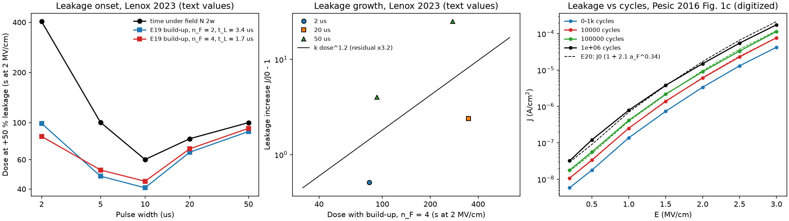
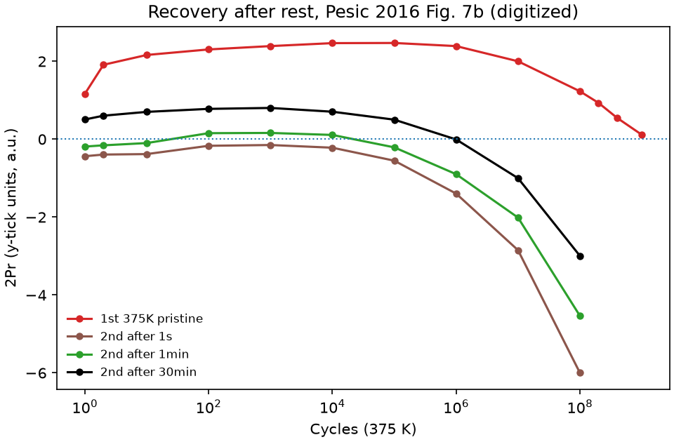

**English** | [繁體中文](cycling-r2.zh-TW.md)

# Cycling mechanisms, round two: coercive field during wake-up, pulse width, temperature, leakage and recovery

Research note. It continues [fatigue-imprint.md](fatigue-imprint.md) (round one, E13–E17) and takes up four things round one did not match or did not model:

1. the rise of $2E_c$ during wake-up (Fengler 2017 Fig. 7c);
2. the pulse-width dependence of wake-up (Lenox 2023);
3. what temperature does: does $P_s$ rise with temperature, or does wake-up speed up (Fengler 2017 Fig. 7a)?
4. the leakage increase and breakdown that come with fatigue, and recovery from fatigue.

For each question we first list candidate mechanisms, the literature behind them and the predictions that tell them apart (Section 1), then choose the model form (Section 2), and only then test against data (Section 4). Every new term is optional and off by default; the default behaviour is unchanged (Section 3).

**Summary of results**

| Question | Mechanism | Model | Matched? |
|---|---|---|---|
| $2E_c$ rising during wake-up | how a pinched loop is read: when the bias split disappears, the zero of the total charge moves out | no new parameter; `loop_figures` reads loops the way the experiment does | **yes**: $2E_c$ RMS 0.022 MV/cm (data std 0.11), same parameters as $2P_r$. Round one failed because of the read-out |
| Pulse-width dependence | competition between depinning under field and re-pinning at every reversal; Lenox Fig. 5b (2 µs still at 1.07 after $10^8$ cycles) rules out every single-dose law $N\,g(w)$ | E18 reversible depinning pool | **yes**: 23 points, RMS 0.012 (digitizing ±0.015); best single-dose law 0.025 ($m=7.5$, unphysical) |
| Temperature | $2E_c$ supports thermally activated wake-up ($E_w=0.45$ eV; authors 0.54 eV); "$P_s$ rises with $T$" works only if the intrinsic $E_c$ also rises with $T$ (unphysical sign); leakage would need four orders of magnitude more current | round one's `wk_ea` | **partly**: $2E_c$ matched; the high-temperature $2P_r$ plateau is 3–4 µC/cm² higher and unexplained (candidate: a temperature-dependent woken fraction) |
| Leakage increase, breakdown | newly generated defects add TAT (field-independent factor); Lenox's 2 µs outlier means the start of each pulse adds little stress | E19 stress build-up time, E20 leakage factor | **partly**: the spread of onset doses drops from ×6.7 to ×2–3 (the resolution of the measurement); Pesic's leakage factor follows $m_L=0.34$ for $10^4$–$10^6$ cycles but not the steep step from $10^3$ to $10^4$; breakdown and the superlinear growth near it are not modelled |
| Recovery | de-trapping (recoverable) plus permanent damage | not modelled | **qualitative only**: the one public figure is a.u. and uses different devices; ~30 % recovery after 30 min |

## Contents

1. [Mechanism notes](#1-mechanism-notes)
2. [Model form](#2-model-form)
3. [Implementation, default behaviour and tests](#3-implementation-default-behaviour-and-tests)
4. [Comparison with data](#4-comparison-with-data)
5. [What was tried and failed](#5-what-was-tried-and-failed)
6. [Data still missing](#6-data-still-missing)
7. [References and data files](#7-references-and-data-files)

## 1. Mechanism notes

Only sources we actually read are cited; Section 7 lists what was read. Second-hand statements are marked "via".

### 1.1 Why does $2E_c$ rise during wake-up?

**Observation.** Fengler 2017, TiN/7 nm HZO/TiN, cycled at 2.3 MV/cm and 100 kHz, P–V loops read with a 10 kHz triangle. $2E_c$ rises from 1.67–1.83 MV/cm at 100 cycles to 1.80–2.05 MV/cm at $10^4$, about 0.1 MV/cm per decade; at the same cycle count it is larger at higher temperature. The pristine loop is pinched: $P_r\approx7$ µC/cm² in Fig. 2a, and the FORC shows two hysteron populations with opposite internal bias (about +1.1 and −0.9 MV/cm). The authors themselves say $2E_c$ is "sensitive particularly to the depinching of the constricted pristine hysteresis" and use it instead of $2P_r$ for the activation energy [Fengler2017, pp. 6–7].

Round one described the two populations by a pristine bias split $\pm V_{sp}$, and got the $2E_c$ trend backwards. Candidates:

| Candidate | Mechanism | Distinguishing prediction |
|---|---|---|
| (a) How a pinched loop is read | Two populations with opposite bias switch at $E_{c0}\mp E_b$. The measured loop is the **total charge** (polarization plus linear dielectric plus reversible part). On the rising branch the total charge crosses zero once the early population has switched and before the late one starts, because the dielectric term $\varepsilon E$ is already positive; the crossing sits near $E_{c0}-E_b$. Once the bias is gone the crossing returns to $E_{c0}$. | $2E_c$ and $2P_r$ rise and saturate together, both tied to the removal of the split; the size of the rise depends on the permittivity and the read amplitude; the FORC $E_c$ distribution itself need not move. |
| (b) Released domains have a higher intrinsic $E_c$ | Formerly pinned or non-ferroelectric regions (e.g. interface regions converted t→o) start to switch, with a higher coercive field than average. | The FORC $E_c$ distribution shifts up; $E_c$ keeps rising after the double peak has merged; no link to the bias. |
| (c) Thinner interface dead layer | A series low-k layer takes part of the voltage. | At the zero of the total charge $D=0$ and the dead layer carries no voltage, so the crossing does not move to first order; thinning mainly squares the loop and raises $2P_r$. Pesic2016 measured a ~5 % capacitance *decrease* with cycling, which does not support thinning as the main effect. |
| (d) t→o transformation (field-induced, antiferroelectric-like part) | Part of the pristine film carries no polarization near zero field and is induced at moderate field (double loop). | Mathematically case (a) with $E_b>E_{c0}$; additionally predicts that the change is irreversible (no re-pinching after rest). |
| (e) Oxygen-vacancy redistribution | The microscopic origin of the split in (a): charged defects move away and the local bias disappears [Pesic2016; Fengler2017]. | Thermally activated; the split can be re-created by DC stress (Fengler2017's two-step waveform, 300 s plateaus near $E_c$, brings back a split bias). |

(a) and (e) are two levels of the same thing: (e) says why the split disappears, (a) says why its disappearance makes the measured $2E_c$ larger. The model already contains (e) (the $\pm V_{sp}$ split removed by wake-up); what was missing is (a): **round one read $E_c$ from the mid-crossing of the switching state, without the dielectric charge.** That is a question of what is measured, not of the model equations. So this item adds no parameter, only a function that reads loops the way the experiment does (`loop_figures`), and fits $2P_r$ and $2E_c$ together with it.

### 1.2 Why does wake-up depend on the pulse width?

**Observation.** Lenox 2023: W/10 nm HZO/W, ±2 MV/cm bipolar pulses at 10 kHz, pulse width per polarity 2, 5, 10, 20, 50 µs, 0 V for the rest of the period; $P_r$ from PUND at 2.5 MV/cm, normalized to the pristine value.

- At $10^4$ and $10^5$ cycles (Fig. 5a) longer pulses give more wake-up.
- At $10^6$ cycles (text): +7, 15, 18, 25, 30 %.
- **The 2 µs series stays at 1.06–1.08 from $10^5$ to $10^8$ cycles** (Fig. 5b): a thousand times more cycles add no wake-up.
- Between 10 and 1000 cycles the five series overlap (±0.03) and cannot be separated.
- The authors' explanation: time under field lets charged oxygen vacancies move and unpin domains; short pulses only allow a little movement per pulse [Lenox2023, Fig. 7].

Round one used $N\,w^m$ as the driver and found $m\approx2.4$ in a free fit. Candidate mechanisms and the pulse-width dependence each predicts:

| Candidate | Effect per period | Prediction |
|---|---|---|
| Switching count (round-one driver) | independent of $w$ | $m=0$ |
| Time under field (thermochemical bond breaking, ion drift) | $\propto w$ | $m=1$ |
| Rare switching of pinned domains | Weibull hazard of NLS: probability to switch within a pulse $\approx(Rw)^\beta$, $\beta\approx2$ ($\beta=2.07$ for W/HZO/W [Alessandri2019]) | $m=\beta\approx2$ |
| Dispersive drift | zero net drift under bipolar pulses, but displacements in a disordered local field are uncorrelated: mean-square displacement $\propto N(\mu E w)^2$ | $m=2$ |
| Dead time per pulse | the first part of each pulse (switching transient, charge build-up) does not count | $N(w-t_d)$, apparent $m>1$ at short $w$ |
| Joule heating (leakage or switching loss) | temperature rise speeds things up | Order of magnitude: switching loss per cycle $\approx4E_cP_rt\approx8\times10^{-5}$ J/cm², 0.8 W/cm² at 10 kHz; spreading thermal resistance of a 100 µm pad on Si ~30 K/W, i.e. ~2 mK. Leakage power is smaller still. **Ruled out.** |
| Depinning under field, re-pinning (competition) | depins at $k_d$ while the field is on, re-pins at $k_r$ | a **plateau** set by the duty cycle $D_c$: $Z_{ss}=D_c/(D_c+\rho)$, $\rho=k_r/k_d$; approach rate $\propto D_c+\rho$ |

The first five candidates are "single dose" laws: $P_r$ depends on $N\,g(w)$ only. All of them predict that short pulses eventually catch up with long ones. The dose of 2 µs at $10^8$ cycles (with $m=2.4$) exceeds that of 50 µs at $10^5$, so the 2 µs series should reach 1.26 or more; Fig. 5b shows 1.07. **Fig. 5b rules out every single-dose law**, whatever $m$ is.

The competition model gives plateaus ordered by duty cycle. A rough check with the $10^6$ text values: for $\rho\approx0.16$, $A\,D_c/(D_c+\rho)$ at the five duty cycles (4, 10, 20, 40, 100 %) gives 0.07, 0.13, 0.19, 0.25, 0.30, against 0.07, 0.15, 0.18, 0.25, 0.30.

Independent support in the literature:

- static (non-switching) regions accumulate defects and switching regions lose them [Schenk2014, Fig. 4 and text];
- holding at a DC plateau near $E_c$ for 300 s brings a woken film back to a pristine-like split [Fengler2017], so re-pinning does happen;
- Lenox2023's own picture (Fig. 7c): with short pulses the vacancies move only a little per pulse.

So the competition model is the form chosen (Section 2.1).

### 1.3 Temperature: $P_s(T)$ or faster wake-up?

$2P_r$ in Fengler 2017 Fig. 7a rises with temperature. In round one, with $2P_r$ alone, "$P_s$ increases with $T$" (RMS 0.46) beat "Arrhenius wake-up" (RMS 0.83); the two could not be told apart. Candidates:

| Candidate | Prediction for $2P_r$ | Prediction for $2E_c$ |
|---|---|---|
| (i) $P_s$ increases with $T$ | whole curve moves up | unchanged ($P_s$ does not change switching fields). HZO has a high Curie temperature and $P_s$ normally falls with $T$, so this direction is unusual to begin with |
| (ii) thermally activated wake-up | shift along $\log N$ | the same shift along $\log N$: higher $T$ gives larger $2E_c$ at the same $N$ |
| (iii) uncompensated leakage | larger apparent $2P_r$ at high $T$ | larger apparent $2E_c$ too; but as an offset independent of $N$, and leakage does not change during wake-up [Pesic2016] |
| (iv) intrinsic coercive field falling with $T$ | — | smaller $2E_c$ at higher $T$: opposite to the data |

The key is $2E_c$: (i) cannot make $2E_c$ rise with temperature. So 7a and 7c are fitted **together, from the same read-out loops**.

### 1.4 Leakage increase, breakdown and recovery that come with fatigue

**Leakage increase.** Public data:

- Pesic2016 Fig. 1c: DC leakage of the same Sr:HfO₂ device after 0–1k, 10k, 100k and 1M cycles. Digitized here: relative to 0–1k the leakage grows by 1.84, 2.87 and 5.1, **almost the same factor at every field from 0.2 to 3 MV/cm** (at 1M cycles from 5.5 at 0.2 MV/cm to 4.2 at 3 MV/cm). The $P_r$ of the same device peaks at $10^4$ cycles and only then falls (Fig. 1a), so the leakage starts to rise before $P_r$ fatigues.
- Lenox2023 text: +50 % leakage at $10^8$, $10^7$, $3\times10^6$, $2\times10^6$, $10^6$ cycles (2–50 µs); the authors' "time under field at onset" is about 40 s for all widths except 2 µs (200 s); breakdown at $2\times10^8$ (2 µs), $10^7$ (20 µs), $3\times10^6$ (50 µs); a few percentages of leakage increase.

Candidates:

| Candidate | Prediction |
|---|---|
| Newly generated oxygen vacancies raise the trap density $N_t$ of trap-assisted tunnelling (TAT) [Pesic2016; Book9.3] | leakage $\propto N_t$, factor roughly independent of field (Fig. 1c agrees); $N_t$ grows with stress dose |
| Trapped charge bends the bands | field-dependent factor; recovers at rest |
| Percolation paths (close to breakdown) | superlinear growth with dose, ending in breakdown |

Lenox's "time under field at onset" is five times larger at 2 µs, which means **the first part of every pulse does not contribute to defect generation**. Candidates: (1) the field across the film is not yet established during the switching transient; (2) the high field in the interface layer appears only after the polarization, and with it the displacement field $D$, has reversed (the interface-layer field is $\propto D$); (3) injected charge needs time to build up. These data cannot separate the three; all can be written as "the stress needs a build-up time $t_L$ after a voltage change".

**Recovery.** Pesic2016 Fig. 7b (375 K, re-cycling 1 s, 1 min or 30 min after $10^9$ cycles): the longer the wait, the more $2P_r$ comes back, but the second run fatigues earlier in every case. The authors' explanation is de-trapping of electrons (recoverable) plus permanent defect generation [Pesic2016; Book9.2]; another proposal is recombination of interstitial oxygen and vacancies (Mannequin, via Book9.2). The y axis of that figure has no numbers (a.u.) and **a different device** is used for each waiting time. We digitized it in tick units (Section 4.4); it supports a qualitative comparison only.

## 2. Model form

### 2.1 E18: reversible depinning pool

A fraction $f_q$ of the film is pinned by mobile defects. It is described by $N_Q$ states $z_j\in[0,1]$ (depinned fraction) with log-spaced time constants in $[\tau_{q1},\tau_{q2}]$:

$$
\tau_j\,\dot z_j=A_w(T)\left[\phi(V)\,(1-z_j)-\Bigl(\rho_q+t_r\,\tfrac{a(t)}{4}\Bigr)z_j\right],\qquad \phi(V)=\left(\frac{E_s}{1\ \mathrm{MV/cm}}\right)^{n_q}-\phi_{fl},\qquad Z=\frac1{N_Q}\sum_j z_j,
$$

with $a(t)=\sum_k w_k|\dot s_k|$ the switching rate (a full cycle switches 4) and $\phi_{fl}$ the value of the first term at 0 V, so that $\phi(0)=0$.

- The field depins at a rate set by $\phi(V)$.
- Re-pinning has two optional channels: at rest ($\rho_q$, all the time) and per reversal ($t_r$, at every switching event, in seconds of depinning at 1 MV/cm per full cycle). Section 4.2 explains why the per-reversal channel is the recommended one.
- The still-pinned part of the pool is $f_q(1-Z)$, merged into round one's pinned fraction:

$$
f=1-(1-f_w)\,\bigl[1-f_q(1-Z)\bigr]\,(1-D).
$$

  With $f_q=0$ this is bit-for-bit round one. Pinning and release go through round one's pinned pool ($\pi$, $r$), so charge conservation still holds: re-pinning at rest causes no terminal current (tested).
- Under a pulse train with duty $D_c$ and $f$ full cycles per second the plateau is $Z_{ss}=\phi D_c/(\phi D_c+\rho_q+t_rf)$. Temperature only changes the rates (depinning and re-pinning share the activation energy `wk_ea`); the plateau does not depend on it.
- The log-spaced time constants, as for round one's imprint, make $Z$ grow with $\log N$ over a wide range.

This pool coexists with round one's $f_w$ (pristine pinning, only ever released): $f_w$ is the irreversible part tied to the number of switching cycles, $f_q$ the reversible part tied to the time under field.

### 2.2 E19: build-up time of the fatigue stress

Round one's field-time driver is $\dot a_F\propto(E_s/E_{ref})^{n_F}/t_F$. This round adds an optional build-up time $t_L$:

$$
t_L\,\dot V_L=V-V_L,\qquad E_s^2=\max\!\left(\frac{\rho^2\,V\,V_L}{t_{fe}^2},\,0\right)+E_{fl}^2 .
$$

The stress needs both the present field and a slowly established condition pointing the same way (geometric mean):

- no stress at 0 V;
- after a reversal $V_L$ must first cross zero, so the first ~$t_L$ of every pulse contributes little;
- for $n_F=2$ and a square pulse after a long 0 V gap, the dose per pulse is proportional to $w-t_L(1-e^{-w/t_L})$ (tested).

The first attempt, "the stress uses the low-passed field $V_L$", failed: a linear low-pass preserves $\int V\,dt$, so with $n_F=1$ it does nothing, and $V_L$ keeps stressing after the pulse has ended (Section 5).

### 2.3 E20: leakage rising with the fatigue age

$$
J\to J\,\bigl[1+k_L\,a_F^{\,m_L}\bigr],
$$

where $a_F$, round one's fatigue age, stands for the generated defect density. It multiplies the whole leakage because the factor in Pesic2016 Fig. 1c hardly depends on field. With $k_L>0$ the fatigue age accumulates even when $D_{max}=0$ (it then only affects the leakage).

### 2.4 Loop read-out: `loop_figures`

Not a model equation but a measurement function: slow states frozen, start from negative saturation, run $n_{pre}+1$ periods of a triangle, take the last period's total charge $P+q_{rev}$ (optionally plus the integrated leakage charge), centre it vertically, and read $P_r^\pm$ at $V=0$ and $V_c^\pm$ at zero total charge. This is what a dynamic hysteresis measurement records.

### 2.5 Parameters

All new parameters are appended at the end of the parameter table:

| Parameter | Symbol | Meaning | Default |
|---|---|---|---|
| `wk_fq` | $f_q$ | fraction in the reversible depinning pool (0 = off) | 0 |
| `wk_rho` | $\rho_q$ | re-pinning at rest / depinning at 1 MV/cm | 0 |
| `wk_tr` | $t_r$ | re-pinning per full switching cycle (s of depinning at 1 MV/cm) | 0 |
| `wk_q1`, `wk_q2` | $\tau_{q1},\tau_{q2}$ | range of depinning time constants (1 MV/cm, $T_0$) | 10 ms, 100 s |
| `wk_nq` | $n_q$ | field exponent of the depinning drive | 2 |
| `wk_ns` / `FE_NQ` | $N_Q$ | number of depinning states (Verilog-A compile-time macro) | 8 |
| `fat_tl` | $t_L$ | build-up time of the fatigue stress (0 = off) | 0 |
| `fat_lk` | $k_L$ | leakage increase with the fatigue age (0 = off) | 0 |
| `fat_lm` | $m_L$ | exponent of the leakage increase | 1 |
| instance `zq0` | | initial value of every depinning state | 0 |

## 3. Implementation, default behaviour and tests

### 3.1 Python and Verilog-A

Both implement the same equations.

**Python** ([`nls_multidomain.py`](../../src/fe_models/nls_multidomain.py)):

- Changes are confined to the wake-up, fatigue and leakage code; the imprint code is untouched.
- The state vector gains $N_Q$ states $z_j$ only when E18 is on, and one $V_L$ only when E19 is on. With both off, `rhs_aged` returns exactly round one's output (tested).
- `cycle_history` (cycle averaging): $z_j$ uses its exact one-period affine map, as round one's imprint states do; E19 uses the periodic steady state of the lagged voltage. Within a constant-voltage piece the switching happens at the start, so per-reversal re-pinning is applied first and the field then acts for the whole piece; this brings the difference from a direct ODE solution from 0.010 down to $<2\times10^{-3}$ (the first implementation averaged both together, Section 5).
- `loop_figures`: the read-out of Section 2.4.
- New outputs: `Z`, `zq`, `leak` from `cycle_history`; `Z`, `zq`, `v_lag` from `simulate`, whose `i_leak` carries the E20 factor.

**Verilog-A** ([`fecap_nls.va`](../../spice/fecap_nls.va)):

- New nodes `dqn[1:FE_NQ]` ($z_j$) and `fln` ($V_L$), a new compile-time macro `FE_NQ` (default 8), instance parameter `zq0`.
- Nodes of terms that are off stay at exactly 0.
- The depinning drive is exactly 0 at 0 V (the field-floor contribution is subtracted).

### 3.2 Tests

[`tests/test_cycling_r2.py`](../../tests/test_cycling_r2.py), 18 tests:

| Group | What is checked |
|---|---|
| Off by default | all three terms off in the generic card; round one's state vector and expressions unchanged; `History.zq` has no effect when off; leakage factor 1 |
| E18 | plateau equals $\phi D_c/(\phi D_c+\rho_q)$ (rest channel) and $\phi D_c/(\phi D_c+t_rf)$ (per-reversal channel); cycle averaging agrees with the direct ODE ($2\times10^{-3}$); the rest channel re-pins at 0 V without moving the terminal charge ($<10^{-9}$ C/m²); the per-reversal channel keeps $Z$ at 0 V; one activation energy for both directions, plateau independent of $T$; every loop absorbs energy with all terms on |
| E19, E20 | dose of a square pulse equals the closed form $E^2[w-t_L(1-e^{-w/t_L})]$ (0.2 %); dose per unit time under field grows with pulse width; cycle-averaged and direct $a_F$ agree (3 %); `i_leak` equals $J(1+k_La_F^{m_L})$ |
| Loop read-out | agrees with a loop from direct simulation (0.02 V); with a $\pm V_{sp}$ split, $2E_c$ and $2P_r$ rise monotonically with wake-up; without the dielectric charge the rise is smaller; uncompensated leakage enlarges the apparent $2P_r$ and $2E_c$ |

Two new ngspice decks:

- `depin`: E18 with both re-pinning channels, 85 °C, pulses, 200 µs rest, pulses again; two instances (pristine and `zq0 = 0.5`).
- `fatlag`: E19 and E20, bipolar pulses of three widths, then a 1.5 V hold where the leakage current is read.

Results:

- ngspice: 18 decks, 87 checks, all pass. `depin`: terminal charges agree to $\le3\times10^{-4}$ µC/cm²; the largest waveform difference, 0.042 µC/cm² (tolerance 0.05), occurs during the fast switching on 0.1 µs edges and is a time-step difference. `fatlag`: leakage current within 0.33 %, final charge within $8\times10^{-5}$ µC/cm².
- The 16 existing decks pass as before: with the new terms off their nodes stay at exactly 0.
- Whole suite including ngspice: `Ran 140 tests in 761 s — OK` (the 122 existing tests plus 18 new ones, none skipped).

The first version of `fatlag` used ±3 V square pulses with 0.1 µs edges and differed by 0.05 µC/cm² during the first switching (a ~0.6 ns timing difference), unrelated to the new terms; with 0.5 µs edges the difference is 0.038.

## 4. Comparison with data

Scripts: [`cycling_r2_fengler_fits.py`](../../examples/cycling_r2_fengler_fits.py) (Section 4.1) and [`cycling_r2_study.py`](../../examples/cycling_r2_study.py) (the rest); numbers in [`cycling_r2.json`](cycling_r2.json) and `r2_fengler_fit_*.json`. All data are values read from figures (approximate) or stated in the text; the number of fitted parameters is given for every fit.

### 4.1 $2P_r$ and $2E_c$ during wake-up, and temperature: Fengler 2017

**Read-out.** 10 kHz triangle at ±2.3 MV/cm (the conditions of the paper's Fig. 2 and Fig. 4), zeros of the total charge, loop centred; cycling 2.3 MV/cm, 100 kHz rectangular; read at the cycling temperature (assumed; the paper does not say). Permittivity 32 as in the paper.

**Data and weights.** Fig. 7a, $2P_r$, 35 points (digitizing ±0.3 µC/cm², data std 5.0); Fig. 7c, $2E_c$, 18 points (±0.005 MV/cm, std 0.11). Residual weights 0.5 µC/cm² and 0.03 MV/cm; the latter is larger than the digitizing error because the read-out conditions are assumed. Each hypothesis is fitted from two starting points and the better result kept.

| Hypothesis | Free | RMS $2P_r$ (µC/cm²) | RMS $2E_c$ (MV/cm) | Main parameters |
|---|---|---|---|---|
| A: all free | 9 | 0.46 | 0.033 | converges to C ($E_w=0$) |
| B: Arrhenius wake-up, no $P_s(T)$ | 8 | 0.84 | 0.031 | $E_w=0.32$ eV; `tc_ea` $=+0.86\times10^{-3}$/K |
| C: $P_s(T)$, no activated wake-up | 8 | 0.46 | 0.033 | `tc_ps` $=+1.6\times10^{-3}$/K; `tc_ea` $=+1.45\times10^{-3}$/K |
| D: no bias split | 8 | 0.46 | 0.076 | |
| E: split only, no pinned fraction | 8 | 3.16 | 0.044 | |
| **A0: all free, `tc_ea` ≤ 0** | 9 | 0.97 | **0.022** | $E_w=0.45$ eV; `tc_ps` $=-0.57\times10^{-3}$/K; `tc_ea` $=0$ |
| B0: B with `tc_ea` ≤ 0 | 8 | 0.93 | 0.035 | $E_w=0.34$ eV |
| C0: C with `tc_ea` ≤ 0 | 8 | 0.46 | 0.078 | |
| F / F0: uncompensated leakage instead of $P_s(T)$ and $E_c(T)$ | 9 / 8 | 0.65 | 0.061 | needs $J(2.3\ \mathrm{MV/cm})\approx0.1$ A/cm² at 25 °C |

(`tc_ea` is the temperature coefficient of the intrinsic activation field. Thermally activated nucleation makes the coercive field at a fixed frequency **fall** with temperature, so physically `tc_ea` ≤ 0.)

**The rise of $2E_c$: matched.**

- Reading the loop at the zero of the total charge, the removal of the bias split makes $2E_c$ rise during wake-up by the measured amount (A0: RMS 0.022 MV/cm against a data std of 0.11).
- Without the split (D, C0) the $2E_c$ RMS goes back to 0.076–0.078: only part of the trend is described.
- Round one's read-out (mid-crossing of the switching state, no dielectric charge) gives 2.43 → 2.27 MV/cm with the same parameters: it **falls** during wake-up and sits 0.4 MV/cm too high (grey lines in the figure). Round one's failure was the read-out, not the model.
- The fitted split $V_{sp}=0.34$–0.38 V, i.e. 0.5 MV/cm at 7 nm, is of the same order as the FORC biases +1.1/−0.9 MV/cm; the pristine pinned fraction is $f_{p0}=0.48$–0.59. Both are needed: without the pinned fraction (E) the size of the $2P_r$ rise cannot be reached (RMS 3.2).

**Temperature: $2E_c$ supports activated wake-up; part of $2P_r$ remains unexplained.**

- With the physical sign (`tc_ea` ≤ 0), only a thermally activated wake-up orders $2E_c$ by temperature: A0 gives $E_w=0.45$ eV, B0 0.34 eV. The authors obtain 0.54 eV from $2E_c$, and ESSDERC 2016 0.32 eV from $2P_r$ read at room temperature (via Fengler2017).
- $P_s(T)$ alone does not change $2E_c$ (C0: $2E_c$ RMS 0.078). C reaches its good RMS only through an intrinsic coercive field rising by 0.15 % per K, opposite to thermally activated switching, so it is not adopted.
- Leakage (F) would need about 0.1 A/cm² at 2.3 MV/cm already at room temperature to produce the same temperature trend: four orders of magnitude above Pesic2016's Sr:HfO₂ (about $10^{-5}$ A/cm² at 2 MV/cm), at odds with Fengler2017's "no strong leakage", and it does not fit better. Ruled out.
- A0's $2P_r$ residual, 0.97 µC/cm² (about three times the digitizing error), sits mostly on the high-temperature plateau: near saturation $2P_r$ at 100–125 °C is 3–4 µC/cm² higher than at 25 °C. Activated wake-up only shifts the curve along $\log N$ and cannot make that difference; A0 picks a slightly negative `tc_ps`, i.e. the $2E_c$ data do not allow $P_s(T)$ to fill the gap.
- An untested candidate: **the fraction that can be woken grows with temperature** (e.g. a thermally assisted t→o transformation, or defects that move only at high temperature). It raises the plateau without changing the intrinsic coercive field. Telling it from $P_s(T)$ needs data cycled at temperature and read back at room temperature (Section 6).

Note: each hypothesis has only two starting points; a fit may end in a local minimum. The RMS values are the best found, not a guaranteed global minimum.

### 4.2 Pulse width and duty cycle: Lenox 2023

**Data.** Fig. 5a ($10^4$ and $10^5$ cycles, 9 points), text values at $10^6$ (5 points), and the 2 µs long-run series of Fig. 5b ($10^6$–$10^8$ cycles, 9 points, without the point the authors flag as an outlier): 23 points, digitizing error about ±0.015.

| Model | Parameters | RMS (Fig. 5a only, 9 points) | RMS (23 points) |
|---|---|---|---|
| single dose, $m=0$ (switching count) | 3 | 0.061 | 0.074 |
| single dose, $m=1$ (time under field) | 3 | 0.028 | 0.072 |
| single dose, $m=\beta=2.07$ (rare switching) | 3 | 0.0071 | 0.068 |
| single dose, $m$ free | 4 | 0.0055 ($m=2.4\pm0.2$) | 0.025 ($m=7.5\pm2.0$, unphysical) |
| E18, depinning only ($\rho=0$) | 3 | 0.030 | 0.072 |
| **E18, depinning plus re-pinning** | 4 | 0.0067 | **0.012** |

- From Fig. 5a alone, $m\approx2.4$ and $m=\beta$ both work; that was round one's conclusion.
- With the long 2 µs data every single-dose law fails: a free $m$ runs to 7.5 and still gives 0.025. The reason is in Section 1.2: a single dose always lets short pulses catch up eventually.
- E18 with depinning and re-pinning, 4 parameters ($f_q=0.26$; $\rho_{eff}=0.17$ at 2 MV/cm; time constants 0.07–130 s at 1 MV/cm), gives 0.012, comparable to the digitizing error.
- Plateaus: $Z_{ss}$ = 0.19, 0.37, 0.54, 0.70, 0.85 at 2, 5, 10, 20, 50 µs, i.e. a $P_r$ increase of 0.067, 0.129, 0.188, 0.245, 0.298 against the text values 0.07, 0.15, 0.18, 0.25, 0.30 at $10^6$ cycles.
- The 4 parameters come from a closed form; put into the full model (`cycle_history`, per-reversal channel) and evaluated at the 23 data points they give RMS 0.014. The full model differs from the closed form by up to 0.010 (2 µs), because re-pinning at a reversal happens at the start of the pulse while the closed form averages it over the period.

**The two re-pinning channels.** Under Lenox's waveform every pulse switches the film fully, so "re-pinning at rest" and "re-pinning at every reversal" give identical curves ($t_r=\rho/f$, $t_r=68$ µs at 1 MV/cm). They differ only **at rest**: after reaching the plateau (50 µs, $10^8$ cycles) and holding at 0 V,

| Rest at 0 V | 1 s | 60 s | 1 h | 1 day |
|---|---|---|---|---|
| $P_r/P_r^0$, rest channel | 1.19 | 1.03 | 1.00 | 1.00 |
| $P_r/P_r^0$, per-reversal channel | 1.30 | 1.30 | 1.30 | 1.30 |

The rest channel predicts that wake-up is almost gone within a minute. That contradicts two public observations:

- Pesic2016 Fig. 7b: after 30 min at 375 K the second run starts from the woken level (Section 4.4);
- Fengler2017: room temperature is too low to activate field-free vacancy motion (their 25 °C bake point was excluded for that reason).

So the per-reversal channel (`wk_tr`) is the recommended one. Its picture: at every polarization reversal, charged defects regroup near the domain boundaries (local re-pinning); the time under field after the reversal pushes them away (depinning). This agrees with Schenk2014: cycling at a lower amplitude (reversals with a weaker field) splits a merged switching peak again. Section 6 lists experiments that would separate the two channels directly.

### 4.3 Leakage increase and breakdown

**Leakage onset in Lenox 2023.** The pulse widths are compared by the dose at onset; the more uniform the dose, the better the driver:

| Driver | $t_L$ | Onset dose (2, 5, 10, 20, 50 µs; s) | max/min | Breakdown dose (2, 20, 50 µs; s) |
|---|---|---|---|---|
| time under field (round one) | — | 404, 100, 60, 80, 100 | 6.7 | 808, 400, 300 |
| E19, $n_F=1$ | 13 µs | 99, 37, 30, 50, 66 | 3.3 | 199, 249, 199 |
| E19, $n_F=2$ | 3.4 µs | 99, 48, 41, 66, 88 | 2.4 | 198, 332, 265 |
| E19, $n_F=4$ | 1.7 µs | 83, 52, 45, 70, 92 | 2.1 | 165, 348, 277 |

(Doses in seconds at 2 MV/cm, both pulse polarities included.)

- The build-up time reduces the spread of the onset doses from ×6.7 to ×2–3, and that of the breakdown doses from ×2.7 to ×1.3–2.1.
- The remaining ×2–3 is comparable with the resolution of the measurement: onsets are only checked at decade or linear checkpoints; for 50 µs, for example, the onset is known only to lie between $10^5$ and $10^6$ cycles.
- $t_L$ and $n_F$ move together; data at a single field cannot separate them (Section 6).

**Growth of the leakage (E20).**

- Pesic2016 Fig. 1c: with the fatigue age $a_F$ of round one's Pesic fit (proportional to $N$), $J/J_0=1+k_La_F^{m_L}$ with 2 parameters on 3 ratios gives $k_L=2.1$, $m_L=0.34$, RMS of the ln ratio 0.004. But it predicts +38 % already at $10^3$ cycles, while 0 and 1000 cycles are the same curve in the data. The data actually step up steeply between $10^3$ and $10^4$ cycles (the excess leakage grows at least eightfold) and then grow roughly as $N^{0.35}$; a single power cannot describe that onset.
- The four percentages of Lenox2023: fitting $J/J_0-1=k\,(\text{dose})^m$ with the $n_F=4$ dose gives $m=1.2$ but residuals of ×3.2: 50 µs rises by 2500 % at a dose of 277 s, 20 µs by only 240 % at 348 s. This may be device-to-device variation, or trapped charge that cannot escape at 100 % duty (no 0 V gaps); four points cannot tell.
- Conclusion: E20 describes "leakage rises with the defect dose by a field-independent factor", but neither the steep onset nor the superlinear growth near breakdown (percolation).
- Breakdown is not modelled: it is a stochastic event of individual devices, and the public data have one device per condition. The breakdown doses in the table only show that, with the build-up time, the three pulse widths break down at similar doses (165–348 s).

### 4.4 Recovery from fatigue: Pesic 2016 Fig. 7b (qualitative only)

In tick units (the y axis has no numbers), the first run loses 2.36 ticks to fatigue:

| Wait | 2nd-run start − end of 1st run | 2nd-run maximum − end of 1st run | Recovered fraction | Cycles to fall 1 tick below own maximum |
|---|---|---|---|---|
| 1 s | −0.55 | −0.26 | −0.11 | $5.1\times10^5$ |
| 1 min | −0.30 | +0.05 | 0.02 | $8.2\times10^5$ |
| 30 min | +0.39 | +0.69 | 0.29 | $1.6\times10^6$ |
| (first run) | | | | $4.9\times10^7$ |

- Recovery grows with the waiting time: about 30 % after 30 min. The 1 s device sits 0.3–0.5 tick below the end of the first run, so device-to-device differences are about that large and the difference between 1 s and 1 min is not significant.
- The second runs lose 1 tick 30–100 times sooner than the first run, a little later the longer the wait. This supports "recoverable part (trapped charge) plus permanent damage".
- Without an absolute scale, with a different device per waiting time and only three times, **recovery is not modelled**. A model would have the same structure as E18: part of the fatigue damage held in reversible states with log-distributed time constants that de-trap at 0 V. The data needed are listed in Section 6.

## 5. What was tried and failed

- **Reading $E_c$ from the mid-crossing of the switching state (round one).** Without the dielectric charge the bias split makes the pristine loop wider and the trend is backwards. With the zero of the total charge the direction is right (Section 4.1).
- **Single-dose laws $N\,g(w)$ ($m=0$, 1, 2, $\beta$ or free).** With the 9 points of Fig. 5a alone, $m=2.4$ fits well; with the long 2 µs data of Fig. 5b every single-dose law fails (Section 4.2).
- **Depinning without re-pinning ($\rho=0$).** Equivalent to a time-under-field driver ($m=1$); it cannot produce plateaus ordered by duty cycle.
- **Re-pinning at rest.** Fits Lenox equally well, but predicts that a woken film loses most of its wake-up within a minute at 0 V, contrary to Pesic2016 Fig. 7b (the woken level survives 30 min at 375 K) and to Fengler2017's remark that room temperature is too low for field-free vacancy motion. Both channels are kept, but the per-reversal one is recommended (Section 4.2).
- **Fatigue stress from the low-passed field alone.** A linear low-pass preserves $\int V\,dt$: no effect at $n_F=1$, and stress continues after the pulse. Replaced by the geometric mean with the present field (Section 2.2).
- **Averaging per-reversal re-pinning and depinning within one piece of the cycle average.** 0.01 off the direct ODE; replaced by re-pinning first, then depinning.
- **Heating.** Order-of-magnitude estimate ~2 mK, ruled out (Section 1.2).

## 6. Data still missing

| Question | Data needed | What it separates |
|---|---|---|
| Origin of the $2E_c$ rise | FORC during wake-up of the same devices, or rising/falling-branch $E_c$ together with the permittivity | (a) read-out vs (b) released domains with a higher $E_c$ |
| Temperature | $2P_r$ and $2E_c$ cycled at different temperatures but all read at room temperature (reportedly done in Fengler ESSDERC 2016, 0.32 eV; not read by us); leakage at temperature | activated wake-up vs $P_s(T)$ and leakage |
| Pulse width | wake-up at fixed pulse width but different period (duty), or fixed duty and different frequency | re-pinning at rest (duty matters) vs per reversal (width and frequency matter) |
| Re-pinning | woken film held at 0 V for seconds to days, then $P_r$ | same; the per-reversal channel predicts no change |
| Field dependence of depinning | Lenox-type experiments at several cycling fields | $n_q$ |
| Build-up time of leakage onset | leakage onset at several fields; square waves (no 0 V gap) vs pulses with gaps | $n_F$ together with $t_L$ |
| Recovery | recovery curves of one device, with a calibrated y axis, several waiting times and temperatures; leakage after recovery | electron de-trapping (leakage also recovers) vs ion recombination; distribution of recovery times |
| Breakdown | distributions (Weibull) of cycles to breakdown, several devices per condition | how the breakdown criterion relates to the dose |

## 7. References and data files

Only what was read; for round one see [fatigue-imprint.md](fatigue-imprint.md), Section 7.

| Key | Reference | Read in this round |
|---|---|---|
| Fengler2017 | F. P. G. Fengler et al., Adv. Electron. Mater. 3, 1600505 (2017), doi:10.1002/aelm.201600505 | main text (P–V conditions; discussion of Figs. 2, 4–9, in particular pp. 6–7 on $2E_c$ and the Fig. 8 bakes) |
| Lenox2023 | M. K. Lenox et al., Phys. Status Solidi A (2023), doi:10.1002/pssa.202300566 | accepted manuscript, full text (Secs. 2.2–2.3, discussion of Figs. 3–7); Figs. 5a, 5b |
| Pesic2016 | M. Pešić et al., Adv. Funct. Mater. 26, 4601 (2016), doi:10.1002/adfm.201600590 | fatigue, leakage and recovery paragraphs; Figs. 1c and 7b viewed and digitized |
| Book9.2 | F. Fengler et al., ch. 9.2 in *Ferroelectricity in Doped Hafnium Oxide* (Elsevier 2019) | Sec. 9.2.4 (fatigue, unipolar stress, recovery) |
| Schenk2014 | T. Schenk et al., ACS Appl. Mater. Interfaces 6, 19744 (2014), doi:10.1021/am504837r | Fig. 4 and the concluding paragraphs (static regions accumulate defects; re-created split) |
| Alessandri2019 | C. Alessandri et al., IEEE TED 66, 3527 (2019) | $\beta=2.07$ (W/HZO/W) as in this project's generic card |

**Second-hand only:** Starschich et al. (50–5000 Hz cycling vs $P_r$ and endurance, via Lenox2023); Mannequin et al. (recovery by interstitial–vacancy recombination, via Book9.2); Huang et al. (recovery by baking, via Book9.2); Fengler ESSDERC 2016 (0.32 eV, via Fengler2017).

**Data files added in this round** ([`data/literature/`](../../data/literature/)):

| File | Content | Type |
|---|---|---|
| `lenox2023_pssa_fig5b_2us_1e6_1e8.csv` | $P_r/P_r^0$ for 2 µs pulses, $10^6$–$10^8$ cycles | digitized, approx. |
| `lenox2023_pssa_text_leakage_failure.csv` | leakage onset, leakage increase, breakdown counts, apparent P(E) $P_r$ | values stated in the text |
| `pesic2016_afm_fig1c_leakage_cycles.csv` | leakage vs field after 0–1k, 10k, 100k, 1M cycles | digitized, approx. |
| `pesic2016_afm_fig7b_recovery_au.csv` | $2P_r$ of the first run and of second runs after 1 s / 1 min / 30 min (tick units, a.u.) | digitized, approx. |

Scripts: [`examples/cycling_r2_fengler_fits.py`](../../examples/cycling_r2_fengler_fits.py) (the fits of Section 4.1, one process per hypothesis) and [`examples/cycling_r2_study.py`](../../examples/cycling_r2_study.py) (the rest, the figures and [`cycling_r2.json`](cycling_r2.json)).
