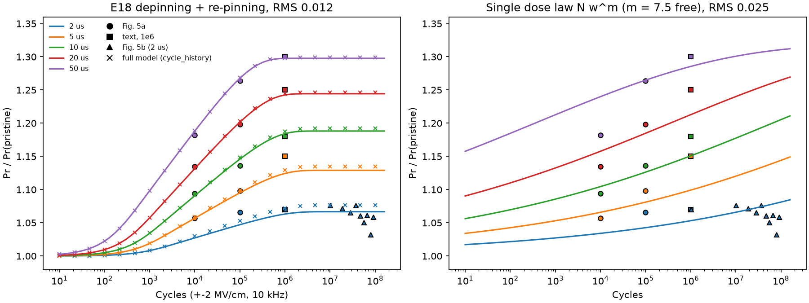
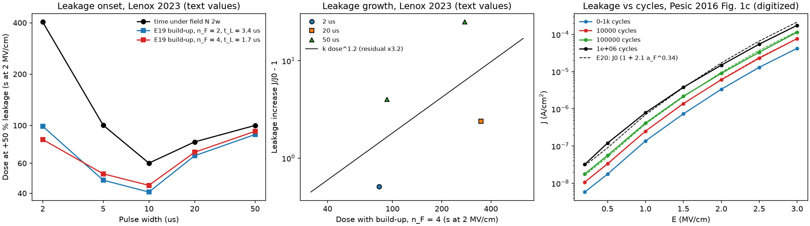
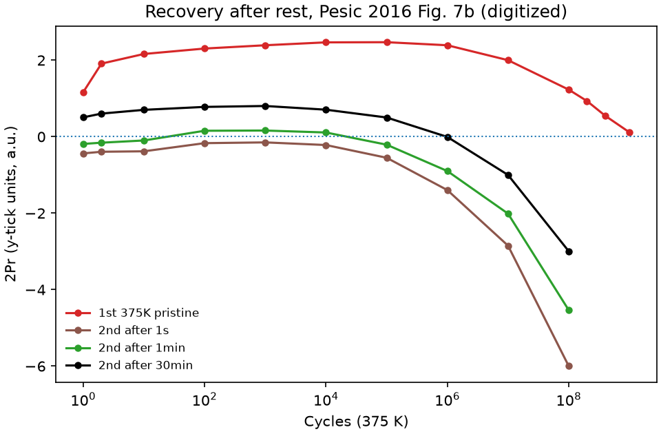

[English](cycling-r2.md) | **繁體中文**

# 循環相關機制（第二輪）：喚醒中的矯頑場、脈寬、溫度、漏電與恢復

研究筆記。接續 [fatigue-imprint.zh-TW.md](fatigue-imprint.zh-TW.md)（第一輪，E13–E17），處理第一輪沒有對上或沒有建模的四件事：

1. 喚醒期間 $`2E_c`$ 上升（Fengler 2017 Fig. 7c）；
2. 喚醒對脈寬的依賴（Lenox 2023）；
3. 溫度的作用：$`P_s`$ 隨溫度上升，還是喚醒變快（Fengler 2017 Fig. 7a）；
4. 疲勞伴隨的漏電上升、崩潰與疲勞恢復。

做法是先列出每個問題的候選機制、文獻依據與各自能區分的預測（第 1 節），再決定模型形式（第 2 節），最後才用數據檢驗（第 4 節）。所有新項都是選用的，預設關閉，預設行為不變（第 3 節）。

**結果摘要**

| 問題 | 機制判斷 | 模型 | 對上了嗎 |
|---|---|---|---|
| 喚醒中 $`2E_c`$ 上升 | 收窄迴線的讀法：偏壓分裂消失後，總電荷的零點往外移 | 不加參數；新增照實驗方式讀迴線的 `loop_figures` | **對上**：$`2E_c`$ RMS 0.022 MV/cm（數據標準差 0.11），與 $`2P_r`$ 同一組參數。第一輪的失敗來自讀法 |
| 脈寬依賴 | 加場時去釘扎、每次反轉再釘扎的競爭；Lenox Fig. 5b（2 µs 到 $`10^8`$ 次仍停在 1.07）否定所有「單一劑量 $`N\,g(w)`$」 | E18 可逆去釘扎池 | **對上**：23 點 RMS 0.012（讀圖誤差 ±0.015）；最好的單一劑量 0.025（$`m=7.5`$，不合物理） |
| 溫度 | $`2E_c`$ 支持喚醒熱活化（$`E_w=0.45`$ eV，作者 0.54 eV）；「$`P_s`$ 隨溫度增加」只有在本徵 $`E_c`$ 隨溫度上升（方向不合物理）時才行；漏電需要大 4 個數量級的電流 | 沿用第一輪的 `wk_ea` | **部分**：$`2E_c`$ 對上，高溫的 $`2P_r`$ 平台高 3–4 µC/cm² 沒有解釋（候選：可喚醒比例隨溫度增加） |
| 漏電上升、崩潰 | 新生成缺陷增加 TAT（倍數與電場無關）；Lenox 的 2 µs 例外代表每個脈衝開頭的應力很小 | E19 應力建立時間、E20 漏電倍數 | **部分**：起點劑量的分散從 6.7 倍降到 2–3 倍（與量測解析度相當）；Pesic 的漏電倍數用 $`m_L=0.34`$ 可描述 $`10^4`$–$`10^6`$ 次，但做不出 $`10^3`$→$`10^4`$ 的陡升；崩潰與接近崩潰的超線性增長沒有建模 |
| 疲勞恢復 | 捕獲電荷脫困（可恢復）加永久損傷 | 沒有建模 | **只做定性**：唯一的公開圖是 a.u.、不同元件；30 min 恢復約三成 |

## 目錄

1. [機制筆記](#1-機制筆記)
2. [模型形式](#2-模型形式)
3. [實作、預設行為與測試](#3-實作預設行為與測試)
4. [與數據比較](#4-與數據比較)
5. [試過但失敗的方案](#5-試過但失敗的方案)
6. [還缺什麼數據](#6-還缺什麼數據)
7. [參考文獻與資料檔](#7-參考文獻與資料檔)

## 1. 機制筆記

只寫實際讀過的文獻；讀過的範圍列在第 7 節。間接得知的說法標明「轉引」。

### 1.1 喚醒期間 2E<sub>c</sub> 為什麼上升

**觀察。** Fengler 2017 的 TiN/7 nm HZO/TiN，在 2.3 MV/cm、100 kHz 循環，用 10 kHz 三角波量 P–V 迴線。$`2E_c`$ 從 100 次的 1.67–1.83 MV/cm 升到 $`10^4`$ 次的 1.80–2.05 MV/cm，每十倍約 0.1 MV/cm；溫度越高，同樣次數下 $`2E_c`$ 越大。原始迴線是收窄的（pinched）：Fig. 2a 的 $`P_r`$ 約 7 µC/cm²，FORC 上有兩群內部偏壓相反的 hysteron（約 +1.1 與 −0.9 MV/cm）。作者自己的說法是 $`2E_c`$「對收窄迴線的打開（depinching）特別敏感」，並用它取代 $`2P_r`$ 求活化能 [Fengler2017, p. 6–7]。

第一輪的模型用原始偏壓分裂 $`\pm V_{sp}`$ 描述兩群 hysteron，結果 $`2E_c`$ 的趨勢方向相反。候選機制：

| 候選 | 機制 | 預測（可區分的部分） |
|---|---|---|
| (a) 收窄迴線的讀法 | 兩群偏壓相反的 domain 各在 $`E_{c0}\mp E_b`$ 切換。量到的迴線是**總電荷**（極化加線性介電加可逆部分）。上升支的總電荷，在先切換的那一群切完、後切換的那一群還沒開始時就已經因為介電項 $`\varepsilon E`$ 越過零，所以零點落在 $`E_{c0}-E_b`$ 附近。偏壓消失後，零點回到 $`E_{c0}`$。 | $`2E_c`$ 與 $`2P_r`$ 一起上升、一起飽和，都綁在偏壓分裂的消失上；上升量依賴介電常數與讀取振幅；FORC 上的 $`E_c`$ 分布本身不必移動。 |
| (b) 被釋放的 domain 本身 $`E_c`$ 較高 | 原本釘住或非鐵電的區域（例如介面附近 t→o 轉變的區域）轉為可切換，且矯頑場比平均高。 | FORC 的 $`E_c`$ 分布整體往上移；雙峰合併之後 $`E_c`$ 仍會繼續上升；與偏壓無關。 |
| (c) 介面死層變薄 | 串聯的低介電層分走電壓。 | 在總電荷為零的點，位移場 $`D=0`$，死層上沒有電壓，所以零點位置一階不變；死層變薄主要讓迴線變方、$`2P_r`$ 上升。Pesic2016 量到循環中電容下降約 5 %，不支持死層變薄是主因。 |
| (d) t→o 相變（場誘發的類反鐵電成分） | 原始薄膜中有一部分在零場附近不帶極化、在中等場被誘發成極化（雙迴線）。 | 數學上就是 (a) 中 $`E_b>E_{c0}`$ 的情況；額外預測是相變不可逆，休息後不會再收窄。 |
| (e) 氧空缺重新分布 | (a) 中偏壓分裂的微觀來源：帶電缺陷移走，局部偏壓消失 [Pesic2016; Fengler2017]。 | 熱活化；可以用直流應力重新製造分裂（Fengler2017 的兩段式波形在接近 $`E_c`$ 的平台停留 300 s，重新出現偏壓分裂）。 |

(a) 與 (e) 是同一件事的兩個層次：(e) 是偏壓分裂為什麼消失，(a) 是偏壓分裂消失為什麼讓量到的 $`2E_c`$ 變大。模型已經有 (e) 的表示法（$`\pm V_{sp}`$ 隨喚醒消失），缺的是 (a)：**第一輪是用切換狀態的中點來定 $`E_c`$，沒有把介電電荷算進去**。這不是模型方程的問題，而是「量什麼」的問題。所以這一項不加新參數，只加一個照實驗方式讀迴線的函數（`loop_figures`），再用它同時擬合 $`2P_r`$ 與 $`2E_c`$。

### 1.2 喚醒為什麼依賴脈寬

**觀察。** Lenox 2023：W/10 nm HZO/W，±2 MV/cm、10 kHz 雙極性脈衝，每個極性的脈寬 2、5、10、20、50 µs，其餘時間 0 V；PUND（2.5 MV/cm）量的 $`P_r`$ 對原始值的比例。

- $`10^4`$ 與 $`10^5`$ 次（Fig. 5a）：脈寬越長，$`P_r`$ 增加越多。
- $`10^6`$ 次（正文）：增加 7、15、18、25、30 %。
- **2 µs 從 $`10^5`$ 到 $`10^8`$ 次停在 1.06–1.08**（Fig. 5b），多循環 1000 倍也沒有繼續喚醒。
- 10–1000 次之間五種脈寬的點互相重疊（±0.03），分不開。
- 作者的解釋：通電時間讓帶電氧空缺移動，解除 domain 釘扎；短脈衝下每個脈衝只能移動一點點 [Lenox2023, Fig. 7]。

第一輪的分析用 $`N\,w^m`$ 當驅動量，自由擬合得 $`m\approx2.4`$。候選機制與各自預測的脈寬依賴：

| 候選 | 每個週期的效果 | 預測 |
|---|---|---|
| 切換次數（第一輪的驅動） | 與 $`w`$ 無關 | $`m=0`$ |
| 通電時間（熱化學斷鍵、離子漂移） | $`\propto w`$ | $`m=1`$ |
| 被釘住 domain 的罕見切換 | NLS 的韋伯（Weibull）危害：一個脈衝內切換的機率 $`\approx(Rw)^\beta`$，$`\beta\approx2`$（W/HZO/W 的 $`\beta=2.07`$ [Alessandri2019]） | $`m=\beta\approx2`$ |
| 色散式漂移 | 雙極性下淨漂移為零，但各脈衝的位移在無序的局部場中不相關，均方位移 $`\propto N(\mu E w)^2`$ | $`m=2`$ |
| 每個脈衝的死時間 | 脈衝開始的一段時間（切換暫態、電荷建立）不算 | $`N(w-t_d)`$，短脈衝處表觀 $`m>1`$ |
| 漏電或切換損耗的焦耳加熱 | 溫升加速 | 數量級估計：切換損耗每週期約 $`4E_cP_r t\approx8\times10^{-5}`$ J/cm²，10 kHz 下 0.8 W/cm²；100 µm 電極在矽基板上的展開熱阻約 30 K/W，溫升約 2 mK。漏電功率更小。**可以排除。** |
| 通電去釘扎、休息時再釘扎（競爭） | 加場時以速率 $`k_d`$ 去釘扎，任何時候以 $`k_r`$ 再釘扎 | **平台**依佔空比 $`D_c`$：$`Z_{ss}=D_c/(D_c+\rho)`$，$`\rho=k_r/k_d`$；趨近平台的速率 $`\propto D_c+\rho`$ |

前五個候選都是「單一劑量」：$`P_r`$ 只是 $`N\,g(w)`$ 的函數。這類模型有一個共同的預測：只要循環夠多次，短脈衝終究會追上長脈衝。2 µs 在 $`10^8`$ 次的劑量（以 $`m=2.4`$ 計）已超過 50 µs 在 $`10^5`$ 次的劑量，應該達到 1.26 以上，但 Fig. 5b 停在 1.07。所以 **Fig. 5b 否定了所有單一劑量的形式**，與指數 $`m`$ 是多少無關。

競爭模型則自然給出依佔空比排序的平台。用正文 $`10^6`$ 次的數字粗估：$`\rho\approx0.16`$ 時，$`A\,D_c/(D_c+\rho)`$ 在五個佔空比（4、10、20、40、100 %）給 0.07、0.13、0.19、0.25、0.30，對照 0.07、0.15、0.18、0.25、0.30。

文獻上有獨立的支持：

- 不切換（靜止）的區域會累積缺陷、切換的區域會失去缺陷 [Schenk2014, Fig. 4 與正文]；
- 在接近 $`E_c`$ 的直流平台停留 300 s，可以把喚醒過的薄膜打回類似原始的偏壓分裂 [Fengler2017]，也就是再釘扎確實存在；
- Lenox2023 自己的圖像（Fig. 7c）：短脈衝下每個脈衝只能讓氧空缺移動一點。

所以這一項的模型形式選競爭模型（第 2.1 節）。

### 1.3 溫度的作用：P<sub>s</sub>(T) 還是喚醒變快

Fengler 2017 Fig. 7a 的 $`2P_r`$ 隨溫度上升；第一輪只用 $`2P_r`$ 時，「$`P_s`$ 隨溫度增加」（RMS 0.46）比「Arrhenius 喚醒」（RMS 0.83）好，兩者無法分辨。候選：

| 候選 | 對 $`2P_r`$ 的預測 | 對 $`2E_c`$ 的預測 |
|---|---|---|
| (i) $`P_s`$ 隨溫度增加 | 整條曲線上移 | 不變（$`P_s`$ 不改變切換場）。HZO 的居禮溫度很高，$`P_s`$ 一般隨溫度下降，所以這個方向本身就不尋常 |
| (ii) 喚醒熱活化 | 沿 $`\log N`$ 平移 | 同樣沿 $`\log N`$ 平移：同次數下溫度越高 $`2E_c`$ 越大 |
| (iii) 漏電沒有補償 | 高溫時的表觀 $`2P_r`$ 變大 | 表觀 $`2E_c`$ 也變大；但這是與 $`N`$ 無關的位移，而且喚醒期間漏電不變 [Pesic2016] |
| (iv) 本徵矯頑場隨溫度下降 | — | 溫度越高 $`2E_c`$ 越小，與數據方向相反 |

關鍵是 $`2E_c`$：(i) 無法讓 $`2E_c`$ 隨溫度增加。所以把 7a 與 7c **用同一組讀取迴線一起擬合**，才能判斷。

### 1.4 疲勞伴隨的漏電上升、崩潰與恢復

**漏電上升。** 公開數據：

- Pesic2016 Fig. 1c：同一顆 Sr:HfO₂ 元件在 0–1k、10k、100k、1M 次後的直流漏電。本輪數位化：相對於 0–1k，漏電倍數 1.84、2.87、5.1，**在 0.2–3 MV/cm 的每個電場幾乎相同**（1M 次時從 0.2 MV/cm 的 5.5 降到 3 MV/cm 的 4.2）。同一元件的 $`P_r`$ 在 $`10^4`$ 次達到最大、之後才下降（Fig. 1a），所以漏電在 $`P_r`$ 疲勞之前就開始上升。
- Lenox2023 正文：漏電 +50 % 的起點在 $`10^8`$、$`10^7`$、$`3\times10^6`$、$`2\times10^6`$、$`10^6`$ 次（2–50 µs）；作者算出「起點時的通電時間」除了 2 µs（200 s）之外都約 40 s；崩潰在 $`2\times10^8`$（2 µs）、$`10^7`$（20 µs）、$`3\times10^6`$（50 µs）。另有幾個漏電增加的百分比。

候選機制：

| 候選 | 預測 |
|---|---|
| 新生成的氧空缺增加陷阱輔助穿隧（TAT）的陷阱密度 $`N_t`$ [Pesic2016; Book9.3] | 漏電 $`\propto N_t`$，倍數與電場大致無關（Fig. 1c 支持）；$`N_t`$ 隨應力劑量增加 |
| 被捕獲電荷改變能帶 | 倍數與電場有關；休息後可恢復 |
| 滲流路徑形成（接近崩潰） | 漏電隨劑量超線性增加，最後崩潰 |

Lenox 的「起點時的通電時間」在 2 µs 偏大 5 倍，代表**每個脈衝開頭的一段時間對產生缺陷沒有貢獻**。候選：(1) 切換暫態期間薄膜上的電場還沒建立；(2) 介面層的高電場要等極化翻轉、位移場 $`D`$ 跟著翻轉後才出現（介面層場 $`\propto D`$）；(3) 注入電荷需要時間建立。這三者在本數據中無法分辨，都可以寫成「應力在電壓改變後需要一段建立時間 $`t_L`$」。

**疲勞恢復。** Pesic2016 Fig. 7b（375 K，$`10^9`$ 次後等待 1 s、1 min、30 min 再循環）：等越久，$`2P_r`$ 恢復越多；但第二輪的疲勞起點都更早。作者的解釋是捕獲電子脫困（可恢復）加上永久的缺陷生成 [Pesic2016; Book9.2]；另一個說法是間隙氧與氧空缺復合（轉引 Mannequin，經 Book9.2）。這張圖的縱軸沒有數字（a.u.），而且每個等待時間用的是**不同的元件**。本輪把它數位化成「刻度單位」（第 4.4 節），只能做定性比較。

## 2. 模型形式

### 2.1 E18：可逆的去釘扎池

薄膜中比例 $`f_q`$ 的 domain 被可移動的缺陷釘住。用 $`N_Q`$ 個狀態 $`z_j\in[0,1]`$（已去釘扎的比例）描述，時間常數在 $`[\tau_{q1},\tau_{q2}]`$ 之間對數等距：

```math
\tau_j\,\dot z_j=A_w(T)\left[\phi(V)\,(1-z_j)-\Bigl(\rho_q+t_r\,\tfrac{a(t)}{4}\Bigr)z_j\right],\qquad \phi(V)=\left(\frac{E_s}{1\ \mathrm{MV/cm}}\right)^{n_q}-\phi_{fl},\qquad Z=\frac1{N_Q}\sum_j z_j ,
```

其中 $`a(t)=\sum_k w_k|\dot s_k|`$ 是切換速率（一個完整週期切換量為 4），$`\phi_{fl}`$ 是第一項在 0 V 的值，讓 $`\phi(0)=0`$。

- 電場去釘扎，速率隨 $`\phi(V)`$。
- 再釘扎有兩個選用通道：休息通道（$`\rho_q`$，任何時候都在作用）與反轉通道（$`t_r`$，每次切換時作用；單位是「每個完整週期相當於 1 MV/cm 下幾秒的去釘扎」）。第 4.2 節說明為什麼建議用反轉通道。
- 池子中仍被釘住的比例是 $`f_q(1-Z)`$。它併入第一輪的總釘扎比例：

```math
f=1-(1-f_w)\,\bigl[1-f_q(1-Z)\bigr]\,(1-D).
```

  $`f_q=0`$ 時與第一輪逐位元相同。釘住與釋放都經過第一輪的釘扎池（$`\pi`$, $`r`$），所以電荷守恆照舊成立：休息時再釘扎不會在端點產生電流（有測試）。
- 在佔空比 $`D_c`$、每秒 $`f`$ 個完整週期的脈衝串下，平台是 $`Z_{ss}=\phi D_c/(\phi D_c+\rho_q+t_rf)`$；不同溫度只改變速率（去釘扎與再釘扎用同一個活化能 `wk_ea`），平台與溫度無關。
- 對數等距的時間常數，就像第一輪的 imprint，讓 $`Z`$ 在一段很寬的次數範圍內隨 $`\log N`$ 增加。

這個池子與第一輪的 $`f_w`$（原始釘扎、只減不增）並存：$`f_w`$ 描述與切換次數綁定、不可逆的部分，$`f_q`$ 描述與通電時間綁定、可逆的部分。

### 2.2 E19：疲勞應力的建立時間

第一輪的通電時間驅動 $`\dot a_F\propto(E_s/E_{ref})^{n_F}/t_F`$。本輪加一個選用的建立時間 $`t_L`$：

```math
t_L\,\dot V_L=V-V_L,\qquad E_s^2=\max\!\left(\frac{\rho^2\,V\,V_L}{t_{fe}^2},\,0\right)+E_{fl}^2 .
```

應力需要「現在的電場」與「緩慢建立、方向相同的條件」同時存在（幾何平均）：

- 0 V 時沒有應力；
- 電壓反向時 $`V_L`$ 先要越過零，所以每個脈衝開頭約 $`t_L`$ 的時間貢獻很小；
- $`n_F=2`$、長時間 0 V 之後的方波脈衝：每個脈衝的劑量正比於 $`w-t_L(1-e^{-w/t_L})`$（有測試）。

最先試的是「應力用低通後的電場 $`V_L`$」，失敗了：線性低通保留 $`\int V\,dt`$，$`n_F=1`$ 時完全沒有效果，而且脈衝結束後 $`V_L`$ 還在衰減，繼續施加應力（第 5 節）。

### 2.3 E20：漏電隨疲勞年齡上升

```math
J\to J\,\bigl[1+k_L\,a_F^{\,m_L}\bigr],
```

$`a_F`$ 是第一輪的疲勞年齡，代表生成的缺陷密度。乘在整個漏電上，因為 Pesic2016 Fig. 1c 的倍數幾乎與電場無關。$`k_L>0`$ 時，即使 $`D_{max}=0`$，疲勞年齡也會累積（只影響漏電）。

### 2.4 讀取迴線：`loop_figures`

不是模型方程，而是一個量測函數：慢狀態凍結，從負飽和開始，用三角波走 $`n_{pre}+1`$ 個週期，取最後一個週期的總電荷 $`P+q_{rev}`$（可選加上漏電電荷的積分），垂直置中，讀出 $`V=0`$ 時的 $`P_r^\pm`$ 與總電荷為零時的 $`V_c^\pm`$。這就是動態遲滯量測實際量到的量。

### 2.5 參數

新參數都加在參數表尾端：

| 參數 | 符號 | 意義 | 預設 |
|---|---|---|---|
| `wk_fq` | $`f_q`$ | 可逆去釘扎池的比例（0 = 關） | 0 |
| `wk_rho` | $`\rho_q`$ | 休息時的再釘扎／1 MV/cm 下的去釘扎速率比 | 0 |
| `wk_tr` | $`t_r`$ | 每個完整切換週期的再釘扎（1 MV/cm 下的去釘扎秒數） | 0 |
| `wk_q1`, `wk_q2` | $`\tau_{q1},\tau_{q2}`$ | 去釘扎時間常數範圍（1 MV/cm、$`T_0`$） | 10 ms, 100 s |
| `wk_nq` | $`n_q`$ | 去釘扎驅動的電場指數 | 2 |
| `wk_ns` / `FE_NQ` | $`N_Q`$ | 去釘扎狀態數（Verilog-A 編譯巨集） | 8 |
| `fat_tl` | $`t_L`$ | 疲勞應力的建立時間（0 = 關） | 0 |
| `fat_lk` | $`k_L`$ | 漏電隨疲勞年齡的增加（0 = 關） | 0 |
| `fat_lm` | $`m_L`$ | 漏電增加的指數 | 1 |
| 實例參數 `zq0` | | 每個去釘扎狀態的初值 | 0 |

## 3. 實作、預設行為與測試

### 3.1 Python 與 Verilog-A

兩份實作寫的是同一組方程。

**Python**（[`nls_multidomain.py`](../../src/fe_models/nls_multidomain.py)）：

- 修改集中在喚醒、疲勞、漏電的程式區段；imprint 的程式碼沒有動。
- 只有 E18 打開時，狀態向量才在尾端多 $`N_Q`$ 個 $`z_j`$；只有 E19 打開時才多一個 $`V_L`$。都關閉時，`rhs_aged` 的輸出與第一輪逐位元相同（有測試）。
- `cycle_history`（週期平均）：$`z_j`$ 用每個週期精確的仿射映射，與第一輪的 imprint 狀態相同；E19 用延遲電壓的週期穩態。每段電壓固定的區間中，切換發生在區間開頭，所以「每次反轉的再釘扎」先套用，電場的去釘扎再作用整段時間；這樣與直接解 ODE 的差從 0.010 降到 $`<2\times10^{-3}`$（第一次實作把兩者平均在一起，見第 5 節）。
- `loop_figures`：第 2.4 節的讀取迴線。
- 新的輸出：`cycle_history` 的 `Z`、`zq`、`leak`；`simulate` 的 `Z`、`zq`、`v_lag`，`i_leak` 乘上 E20 的倍數。

**Verilog-A**（[`fecap_nls.va`](../../spice/fecap_nls.va)）：

- 新增節點 `dqn[1:FE_NQ]`（$`z_j`$）與 `fln`（$`V_L`$），新的編譯巨集 `FE_NQ`（預設 8），實例參數 `zq0`。
- 關閉時節點恆為 0。
- 去釘扎驅動在 0 V 時恰為 0（減掉電場下限的貢獻）。

### 3.2 測試

[`tests/test_cycling_r2.py`](../../tests/test_cycling_r2.py) 有 18 項：

| 類別 | 檢查什麼 |
|---|---|
| 預設關閉 | 通用參數下三項都關；第一輪的狀態向量與式子不變；`History.zq` 在關閉時不影響結果；漏電倍數為 1 |
| E18 | 平台等於 $`\phi D_c/(\phi D_c+\rho_q)`$（休息通道）與 $`\phi D_c/(\phi D_c+t_rf)`$（反轉通道）；週期平均與直接 ODE 一致（$`2\times10^{-3}`$）；休息通道在 0 V 再釘扎、端點電荷不動（$`<10^{-9}`$ C/m²）；反轉通道在 0 V 保持 $`Z`$；兩個方向用同一個活化能，平台與溫度無關；所有項打開時每個迴線都吸收能量 |
| E19、E20 | 方波脈衝的劑量等於閉式 $`E^2[w-t_L(1-e^{-w/t_L})]`$（0.2 %）；單位通電時間的劑量隨脈寬增加；週期平均與直接 ODE 的 $`a_F`$ 一致（3 %）；`i_leak` 等於 $`J(1+k_La_F^{m_L})`$ |
| 讀取迴線 | 與直接模擬的迴線一致（0.02 V）；有 $`\pm V_{sp}`$ 分裂時，$`2E_c`$ 與 $`2P_r`$ 隨喚醒單調上升；去掉介電電荷，上升幅度變小；漏電沒有補償時，表觀 $`2P_r`$ 與 $`2E_c`$ 都變大 |

ngspice 比對新增兩組電路：

- `depin`：E18 兩個再釘扎通道都打開，85 °C，脈衝、200 µs 休息、再脈衝；兩個實例（原始與 `zq0 = 0.5`）。
- `fatlag`：E19 與 E20，三種脈寬的雙極性脈衝之後在 1.5 V 保持，讀漏電電流。

結果：

- ngspice 共 18 組電路、87 項檢查全部通過。`depin` 的端點電荷差 $`\le3\times10^{-4}`$ µC/cm²，波形最大差 0.042 µC/cm²（容許 0.05），出現在 0.1 µs 邊緣的快速切換期間，是時間步的差異；`fatlag` 的漏電電流差 0.33 %，最終電荷差 $`8\times10^{-5}`$ µC/cm²。
- 原有 16 組電路照舊通過：新項關閉時，新增的節點恆為 0。
- 整個測試套件（含 ngspice）：`Ran 140 tests in 761 s — OK`（原有 122 項加上本輪 18 項，沒有略過）。

第一次寫 `fatlag` 時用 0.1 µs 邊緣的 ±3 V 方波，第一次切換期間差了 0.05 µC/cm²（約 0.6 ns 的時間差），與新項無關；改成 0.5 µs 的邊緣後是 0.038。

## 4. 與數據比較

腳本：[`cycling_r2_fengler_fits.py`](../../examples/cycling_r2_fengler_fits.py)（第 4.1 節）、[`cycling_r2_study.py`](../../examples/cycling_r2_study.py)（其餘）；數字在 [`cycling_r2.json`](cycling_r2.json) 與 `r2_fengler_fit_*.json`。所有數據都是讀圖的近似值或論文正文的數字；每組都寫出擬合參數的個數。

### 4.1 喚醒中的 2P<sub>r</sub> 與 2E<sub>c</sub>、溫度的作用：Fengler 2017

**讀取。** 10 kHz 三角波、±2.3 MV/cm（論文 Fig. 2 與 Fig. 4 的條件），取總電荷的零點，迴線置中；循環是 2.3 MV/cm、100 kHz 方波；假設在循環溫度讀取（論文沒有明說）。介電常數取論文的 32。

**數據與權重。** Fig. 7a 的 $`2P_r`$ 35 點（讀圖誤差約 ±0.3 µC/cm²，數據本身的標準差 5.0），Fig. 7c 的 $`2E_c`$ 18 點（±0.005 MV/cm，標準差 0.11）。殘差權重 0.5 µC/cm² 與 0.03 MV/cm；後者大於讀圖誤差，因為讀取條件是假設的。每個假說從兩個起點擬合，取較好的一個。

| 假說 | 自由參數 | RMS $`2P_r`$ (µC/cm²) | RMS $`2E_c`$ (MV/cm) | 主要參數 |
|---|---|---|---|---|
| A：全部自由 | 9 | 0.46 | 0.033 | 收斂到 C（$`E_w=0`$） |
| B：Arrhenius 喚醒，$`P_s`$ 不隨溫度 | 8 | 0.84 | 0.031 | $`E_w=0.32`$ eV；`tc_ea` $`=+0.86\times10^{-3}`$/K |
| C：$`P_s(T)`$，喚醒不熱活化 | 8 | 0.46 | 0.033 | `tc_ps` $`=+1.6\times10^{-3}`$/K；`tc_ea` $`=+1.45\times10^{-3}`$/K |
| D：沒有偏壓分裂 | 8 | 0.46 | 0.076 | |
| E：只有分裂、沒有釘住比例 | 8 | 3.16 | 0.044 | |
| **A0：全部自由，`tc_ea` ≤ 0** | 9 | 0.97 | **0.022** | $`E_w=0.45`$ eV；`tc_ps` $`=-0.57\times10^{-3}`$/K；`tc_ea` $`=0`$ |
| B0：B，`tc_ea` ≤ 0 | 8 | 0.93 | 0.035 | $`E_w=0.34`$ eV |
| C0：C，`tc_ea` ≤ 0 | 8 | 0.46 | 0.078 | |
| F／F0：漏電沒有補償，取代 $`P_s(T)`$ 與 $`E_c(T)`$ | 9／8 | 0.65 | 0.061 | 需要 25 °C 下 $`J(2.3\ \mathrm{MV/cm})\approx0.1`$ A/cm² |

（`tc_ea` 是本徵活化場的溫度係數。熱活化的成核讓固定頻率下的矯頑場隨溫度**下降**，所以物理上 `tc_ea` ≤ 0。）

**$`2E_c`$ 的上升：對上了。**

- 用總電荷的零點讀迴線，偏壓分裂的消失讓 $`2E_c`$ 隨喚醒上升，大小與數據相符（A0 的 RMS 0.022 MV/cm，數據本身的標準差 0.11）。
- 拿掉分裂（D、C0），$`2E_c`$ 的 RMS 回到 0.076–0.078，等於只描述了一部分趨勢。
- 第一輪的讀法（切換狀態的中點、不含介電電荷）在同一組參數下給 2.43 → 2.27 MV/cm，**隨喚醒下降**，而且偏高 0.4 MV/cm（圖中灰線）。所以第一輪的失敗來自讀法，不是模型。
- 擬合的分裂 $`V_{sp}=0.34`$–0.38 V，即 7 nm 下 0.5 MV/cm，與 FORC 上的 +1.1／−0.9 MV/cm 同一個數量級；原始釘住比例 $`f_{p0}=0.48`$–0.59。兩者都需要：沒有釘住比例（E），$`2P_r`$ 的幅度做不出來（RMS 3.2）。

**溫度：$`2E_c`$ 支持喚醒熱活化，$`2P_r`$ 留下一部分沒有解釋。**

- 在物理的符號下（`tc_ea` ≤ 0），能讓 $`2E_c`$ 依溫度排序的只有熱活化的喚醒：A0 得 $`E_w=0.45`$ eV，B0 得 0.34 eV。作者用 $`2E_c`$ 得 0.54 eV，ESSDERC 2016 用室溫讀取的 $`2P_r`$ 得 0.32 eV（轉引）。
- $`P_s(T)`$ 本身不改變 $`2E_c`$（C0 的 $`2E_c`$ RMS 0.078）。C 的好 RMS 是靠「本徵矯頑場每 K 上升 0.15 %」得到的，方向與熱活化切換相反，所以不採用。
- 漏電（F）要做出同樣的溫度趨勢，需要室溫下 2.3 MV/cm 時約 0.1 A/cm² 的漏電。這比 Pesic2016 的 Sr:HfO₂（2 MV/cm 時約 $`10^{-5}`$ A/cm²）大四個數量級，也與 Fengler2017「沒有明顯的漏電」不符，而且擬合沒有比較好。排除。
- A0 的 $`2P_r`$ 殘差 0.97 µC/cm²（約讀圖誤差的 3 倍），主要在高溫的平台：100–125 °C 時接近飽和的 $`2P_r`$ 比 25 °C 高 3–4 µC/cm²。熱活化只把曲線沿 $`\log N`$ 平移，做不出這個高度差；A0 選了略為負的 `tc_ps`，代表 $`2E_c`$ 的約束不容許用 $`P_s(T)`$ 來補。
- 一個沒有測試的候選：**可被喚醒的比例本身隨溫度增加**（例如需要熱活化的 t→o 轉變，或高溫下才能移動的缺陷），它提高平台、但不改變本徵矯頑場。要分辨它與 $`P_s(T)`$，需要在高溫循環、回到室溫讀取的數據（第 6 節）。

注意：每個假說只有兩個起點，擬合可能停在局部最小值；表中的 RMS 是找到的最好值，不是保證的全域最小。


### 4.2 脈寬與佔空比：Lenox 2023

**數據。** Fig. 5a（$`10^4`$、$`10^5`$ 次，9 點）、正文 $`10^6`$ 次（5 點）、Fig. 5b 的 2 µs 長時間序列（$`10^6`$–$`10^8`$ 次，9 點；作者標示的離群點除外），共 23 點，讀圖誤差約 ±0.015。

| 模型 | 參數 | RMS（只用 Fig. 5a，9 點） | RMS（23 點） |
|---|---|---|---|
| 單一劑量，$`m=0`$（切換次數） | 3 | 0.061 | 0.074 |
| 單一劑量，$`m=1`$（通電時間） | 3 | 0.028 | 0.072 |
| 單一劑量，$`m=\beta=2.07`$（罕見切換） | 3 | 0.0071 | 0.068 |
| 單一劑量，$`m`$ 自由 | 4 | 0.0055（$`m=2.4\pm0.2`$） | 0.025（$`m=7.5\pm2.0`$，不合物理） |
| E18，只去釘扎（$`\rho=0`$） | 3 | 0.030 | 0.072 |
| **E18，去釘扎加再釘扎** | 4 | 0.0067 | **0.012** |

- 只看 Fig. 5a，$`m\approx2.4`$ 或 $`m=\beta`$ 都可以，這就是第一輪的結論。
- 加上 2 µs 的長時間數據後，所有單一劑量形式都失敗：自由的 $`m`$ 跑到 7.5，仍然只有 0.025。原因見第 1.2 節：單一劑量一定讓短脈衝最後追上長脈衝。
- E18 的去釘扎加再釘扎用 4 個參數（$`f_q=0.26`$；2 MV/cm 下 $`\rho_{eff}=0.17`$；時間常數 0.07–130 s，以 1 MV/cm 計）得到 0.012，與讀圖誤差相當。
- 平台：$`Z_{ss}`$ 在 2、5、10、20、50 µs 是 0.19、0.37、0.54、0.70、0.85。換算成 $`P_r`$ 的增加，0.067、0.129、0.188、0.245、0.298，對照正文 $`10^6`$ 次的 0.07、0.15、0.18、0.25、0.30。
- 用 4 個參數的閉式擬合，再把參數放進完整模型（`cycle_history`，反轉通道）在 23 個數據點上計算：RMS 0.014。完整模型與閉式最多差 0.010（2 µs），因為反轉再釘扎發生在脈衝開頭，而閉式把它平均在整個週期。

**兩個再釘扎通道。** 在 Lenox 的波形下，每個脈衝都讓薄膜完全切換，所以「休息時再釘扎」與「每次反轉再釘扎」給出完全相同的曲線（$`t_r=\rho/f`$，$`t_r=68`$ µs 以 1 MV/cm 計）。兩者只在**休息**時不同：喚醒到平台（50 µs、$`10^8`$ 次）之後停在 0 V，

| 0 V 休息時間 | 1 s | 60 s | 1 h | 1 天 |
|---|---|---|---|---|
| 休息通道的 $`P_r/P_r^0`$ | 1.19 | 1.03 | 1.00 | 1.00 |
| 反轉通道的 $`P_r/P_r^0`$ | 1.30 | 1.30 | 1.30 | 1.30 |

休息通道預測喚醒在一分鐘內幾乎完全消失。這與兩個公開觀察不符：

- Pesic2016 Fig. 7b：375 K 下休息 30 min 後，第二輪從喚醒後的水準開始（第 4.4 節）；
- Fengler2017：室溫不足以活化無電場的空缺移動，烘烤實驗的 25 °C 點因此被排除。

所以建議用反轉通道（`wk_tr`）。它的物理圖像是：每次極化反轉時，domain 邊界附近的帶電缺陷重新聚集（局部再釘扎）；反轉後持續加場的時間把它們推開（去釘扎）。這與 Schenk2014 的觀察一致：在較低振幅下循環（反轉但加場較弱），已合併的切換峰會重新分裂。第 6 節列出能直接區分兩個通道的實驗。



### 4.3 漏電上升與崩潰

**Lenox 2023 的漏電起點。** 以「起點時的劑量」比較各脈寬，劑量越一致，代表模型的驅動量越對：

| 驅動 | $`t_L`$ | 起點劑量（2、5、10、20、50 µs，s） | 最大／最小 | 崩潰劑量（2、20、50 µs，s） |
|---|---|---|---|---|
| 通電時間（第一輪） | — | 404、100、60、80、100 | 6.7 | 808、400、300 |
| E19，$`n_F=1`$ | 13 µs | 99、37、30、50、66 | 3.3 | 199、249、199 |
| E19，$`n_F=2`$ | 3.4 µs | 99、48、41、66、88 | 2.4 | 198、332、265 |
| E19，$`n_F=4`$ | 1.7 µs | 83、52、45、70、92 | 2.1 | 165、348、277 |

（劑量以 2 MV/cm 下的秒數計，包含正負兩個脈衝。）

- 建立時間把起點劑量的分散從 6.7 倍降到 2–3 倍，崩潰劑量的分散也從 2.7 倍降到 1.3–2.1 倍。
- 剩下的 2–3 倍與量測解析度相當：起點只在十倍或線性間隔的檢查點量，例如 50 µs 的起點只知道在 $`10^5`$ 與 $`10^6`$ 次之間。
- $`t_L`$ 與 $`n_F`$ 一起變，單一電場的數據分不開（第 6 節）。

**漏電的增長（E20）。**

- Pesic2016 Fig. 1c：以第一輪 Pesic 擬合的疲勞年齡 $`a_F`$（與 $`N`$ 成正比）擬合 $`J/J_0=1+k_La_F^{m_L}`$，2 個參數、3 個比值：$`k_L=2.1`$、$`m_L=0.34`$，ln 比值的 RMS 0.004。但它預測 $`10^3`$ 次時已經 +38 %，而數據的 0 與 1000 次是同一條曲線。數據其實是 $`10^3`$ 到 $`10^4`$ 次之間陡升（至少 8 倍的超額漏電），之後約 $`N^{0.35}`$ 增加；單一冪次描述不了這個起點。
- Lenox2023 的四個漏電增加百分比：以 $`n_F=4`$ 的劑量擬合 $`J/J_0-1=k\,(\text{dose})^{m}`$，$`m=1.2`$，但殘差達 3.2 倍：50 µs 在 277 s 劑量時增加 2500 %，20 µs 在 348 s 只增加 240 %。這可能是元件差異，或 100 % 佔空比（沒有 0 V 間隔）下陷阱電荷沒有機會釋放；四個點分不開。
- 結論：E20 能描述「漏電隨缺陷劑量上升、倍數與電場無關」，但起點的陡升與接近崩潰的超線性增長（滲流）都不在它的範圍內。
- 崩潰沒有建模：它是個別元件的隨機事件，公開數據每個條件只有一顆元件。上表的「崩潰劑量」只說明，加上建立時間後，三種脈寬的崩潰落在相近的劑量（165–348 s）。



### 4.4 疲勞恢復：Pesic 2016 Fig. 7b（只做定性比較）

以刻度單位（縱軸無數字）計，第一輪的疲勞下降是 2.36 格：

| 等待時間 | 第二輪起點 − 第一輪終點 | 第二輪最大值 − 第一輪終點 | 恢復比例 | 從自己的最大值降 1 格所需次數 |
|---|---|---|---|---|
| 1 s | −0.55 | −0.26 | −0.11 | $`5.1\times10^5`$ |
| 1 min | −0.30 | +0.05 | 0.02 | $`8.2\times10^5`$ |
| 30 min | +0.39 | +0.69 | 0.29 | $`1.6\times10^6`$ |
| （第一輪） | | | | $`4.9\times10^7`$ |

- 恢復隨等待時間增加：30 min 恢復約三成。1 s 的元件比第一輪終點還低 0.3–0.5 格，代表元件之間的差異約有這麼大，所以 1 s 與 1 min 的差別不顯著。
- 第二輪降 1 格所需的次數比第一輪少 30–100 倍，等越久稍微晚一點：這支持「可恢復部分（捕獲電荷）加上永久損傷」的圖像。
- 這組數據沒有絕對刻度、每個等待時間是不同元件、只有三個時間點，所以**沒有為恢復建模**。若要建模，結構會與 E18 相同：疲勞損傷的一部分放在對數分布時間常數的可逆狀態裡，在 0 V 下脫困。需要的數據列在第 6 節。



## 5. 試過但失敗的方案

- **用切換狀態的中點定 $`E_c`$（第一輪）。** 這個讀法沒有介電電荷，偏壓分裂讓原始迴線變寬，趨勢與數據相反。改用總電荷的零點後方向正確（第 4.1 節）。
- **單一劑量 $`N\,g(w)`$（$`m=0`$、1、2、$`\beta`$ 或自由）。** 只用 Fig. 5a 的 9 點時，$`m=2.4`$ 擬合得很好；加上 Fig. 5b 的 2 µs 長時間數據後，所有單一劑量形式都失敗（第 4.2 節）。
- **只有去釘扎、沒有再釘扎（$`\rho=0`$）。** 等於通電時間驅動（$`m=1`$），無法產生依佔空比排序的平台。
- **在休息時再釘扎的通道。** 擬合 Lenox 一樣好，但預測喚醒後的薄膜在 0 V 下一分鐘內就失去大部分喚醒，與 Pesic2016 Fig. 7b（375 K 休息 30 min 後仍維持喚醒水準）以及 Fengler2017「室溫不足以活化無電場的空缺移動」不符。所以兩個通道都保留，但建議用反轉通道（第 4.2 節）。
- **疲勞應力直接用低通後的電場。** 線性低通保留 $`\int V\,dt`$，$`n_F=1`$ 時沒有任何效果，而且脈衝結束後還在施加應力。改成現在與延遲電場的幾何平均（第 2.2 節）。
- **週期平均中把反轉再釘扎與去釘扎平均在同一段。** 與直接 ODE 差 0.01；改成先再釘扎、後去釘扎。
- **加熱。** 數量級估計的溫升約 2 mK，可以排除（第 1.2 節）。

## 6. 還缺什麼數據

| 問題 | 需要的數據 | 能區分什麼 |
|---|---|---|
| $`2E_c`$ 的來源 | 同一批元件喚醒過程中的 FORC，或分開的上升／下降支 $`E_c`$ 與介電常數 | (a) 讀法 vs (b) 被釋放的 domain 矯頑場較高 |
| 溫度 | 在不同溫度循環、但都在室溫讀取的 $`2P_r`$ 與 $`2E_c`$（據轉引，Fengler ESSDERC 2016 這樣做過，得 0.32 eV；我們沒讀到原文）；高溫時的漏電 | 喚醒熱活化 vs $`P_s(T)`$ 與漏電 |
| 脈寬 | 固定脈寬、改變週期（佔空比）的喚醒；或固定佔空比、改變頻率 | 休息再釘扎（看佔空比）vs 反轉再釘扎（看脈寬與頻率） |
| 再釘扎 | 喚醒到平台後停在 0 V 一段時間（秒到天）再量 $`P_r`$ | 同上；反轉通道預測不變 |
| 去釘扎的電場依賴 | 多個循環電場下的 Lenox 型實驗 | $`n_q`$ |
| 漏電起點的建立時間 | 多個電場的漏電起點；脈衝之間不留 0 V（方波）與留 0 V 的比較 | $`n_F`$ 與 $`t_L`$ 的組合 |
| 疲勞恢復 | 同一元件、縱軸有刻度、多個等待時間與溫度的恢復曲線；恢復後的漏電 | 捕獲電荷脫困（漏電也恢復）vs 離子復合；恢復時間分布 |
| 崩潰 | 每個條件多顆元件的崩潰次數分布（Weibull） | 崩潰判準與劑量的關係 |

## 7. 參考文獻與資料檔

只列出實際讀過的部分；第一輪讀過的範圍見 [fatigue-imprint.zh-TW.md](fatigue-imprint.zh-TW.md) 第 7 節。

| 代號 | 文獻 | 本輪讀過的範圍 |
|---|---|---|
| Fengler2017 | F. P. G. Fengler et al., Adv. Electron. Mater. 3, 1600505 (2017), doi:10.1002/aelm.201600505 | 正文（P–V 量測條件、Fig. 2、4–9 的討論，特別是 p. 6–7 對 $`2E_c`$ 與 Fig. 8 烘烤的說明） |
| Lenox2023 | M. K. Lenox et al., Phys. Status Solidi A (2023), doi:10.1002/pssa.202300566 | 接受稿全文（第 2.2–2.3 節、Fig. 3–7 的討論）；Fig. 5a、5b |
| Pesic2016 | M. Pešić et al., Adv. Funct. Mater. 26, 4601 (2016), doi:10.1002/adfm.201600590 | 正文的疲勞、漏電與恢復段落；Fig. 1c、7b 看圖並數位化 |
| Book9.2 | F. Fengler et al., ch. 9.2 in *Ferroelectricity in Doped Hafnium Oxide* (Elsevier 2019) | 第 9.2.4 節（疲勞、單極性應力、恢復） |
| Schenk2014 | T. Schenk et al., ACS Appl. Mater. Interfaces 6, 19744 (2014), doi:10.1021/am504837r | 正文 Fig. 4 與結論段落（靜止區域累積缺陷、分裂的重新出現） |
| Alessandri2019 | C. Alessandri et al., IEEE TED 66, 3527 (2019) | 沿用本專案通用參數卡的 $`\beta=2.07`$（W/HZO/W） |

**只經轉引：** Starschich et al.（頻率 50–5000 Hz 對 $`P_r`$ 與耐久的影響，經 Lenox2023）；Mannequin et al.（間隙氧與空缺復合的恢復，經 Book9.2）；Huang et al.（烘烤恢復，經 Book9.2）；Fengler ESSDERC 2016（0.32 eV，經 Fengler2017）。

**本輪新增的資料檔**（[`data/literature/`](../../data/literature/)）：

| 檔案 | 內容 | 類型 |
|---|---|---|
| `lenox2023_pssa_fig5b_2us_1e6_1e8.csv` | 2 µs 脈衝在 $`10^6`$–$`10^8`$ 次的 $`P_r/P_r^0`$ | 數位化，近似 |
| `lenox2023_pssa_text_leakage_failure.csv` | 漏電起點、漏電增加、崩潰次數、P(E) 表觀 $`P_r`$ | 正文數值 |
| `pesic2016_afm_fig1c_leakage_cycles.csv` | 0–1k、10k、100k、1M 次後的漏電–電場曲線 | 數位化，近似 |
| `pesic2016_afm_fig7b_recovery_au.csv` | 第一輪與等待 1 s／1 min／30 min 後第二輪的 $`2P_r`$（刻度單位，a.u.） | 數位化，近似 |

腳本：[`examples/cycling_r2_fengler_fits.py`](../../examples/cycling_r2_fengler_fits.py)（第 4.1 節的擬合，每個假說一個程序）與 [`examples/cycling_r2_study.py`](../../examples/cycling_r2_study.py)（其餘、圖、[`cycling_r2.json`](cycling_r2.json)）。
