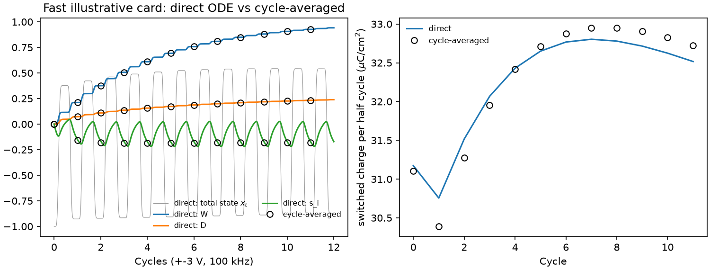
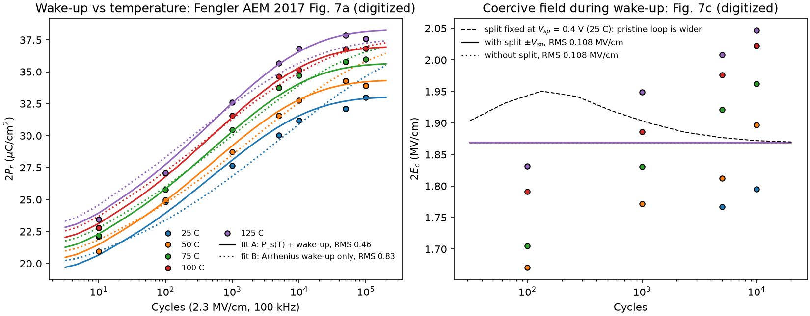
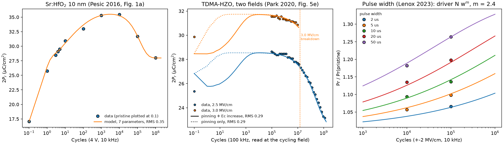
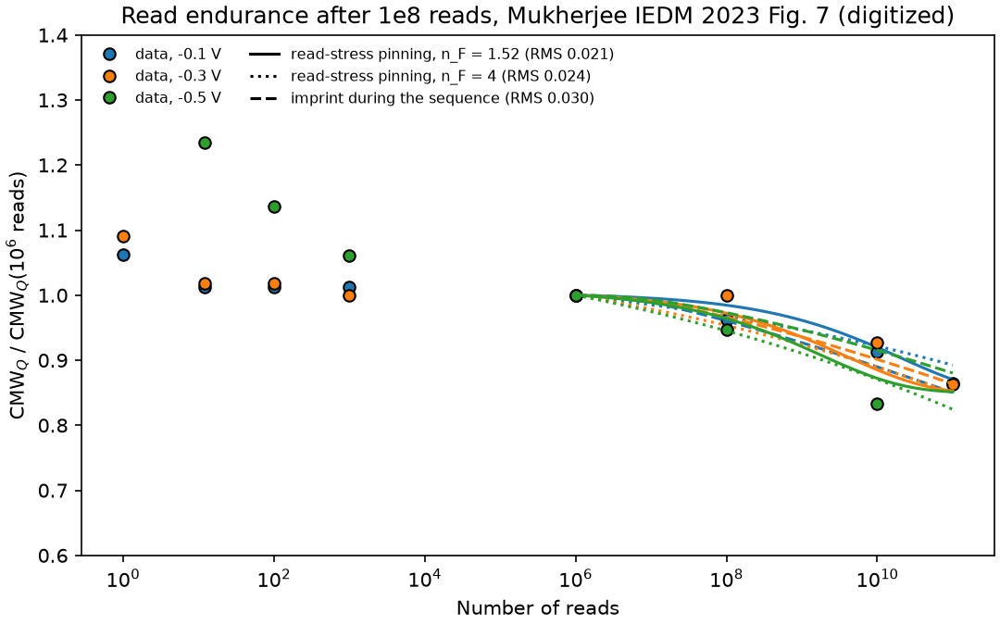
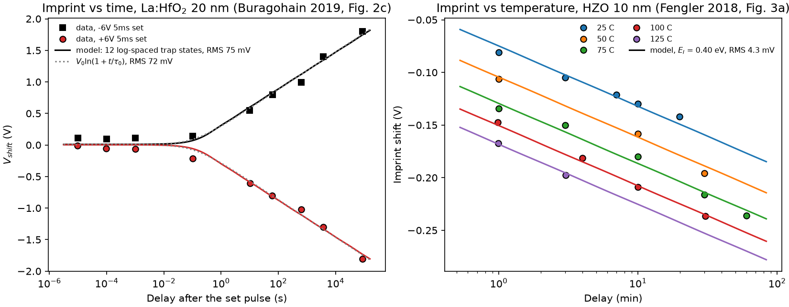

**English** | [繁體中文](fatigue-imprint.zh-TW.md)

# Wake-up, fatigue and logarithmic-time imprint: mechanisms, model and comparison with published data

Research note on the dynamic multi-domain NLS model of [`nls_multidomain.py`](../../src/fe_models/nls_multidomain.py) and [`fecap_nls.va`](../../spice/fecap_nls.va). The model used to represent one fixed cycling state:
- no wake-up;
- no fatigue;
- back-switching and imprint through a single screening state $`\sigma`$ with one time constant.

This note does four things:
1. collects the mechanisms proposed for HfO₂/HZO and the signatures measured;
2. chooses the smallest set of new state variables;
3. implements them in both the Python and the Verilog-A version;
4. compares them with digitized published data and states what is and is not reproduced.

Every new term is optional and off by default. With the default card the Python code runs its unchanged path, so the output is bit-identical. The compiled Verilog-A model matches the previous build on the 12 existing ngspice decks to solver round-off (relative difference 4×10⁻⁹, section 3.2).

## Contents

1. [Literature: mechanisms and signatures](#1-literature-mechanisms-and-signatures)
2. [Model design](#2-model-design)
3. [Implementation and numerics](#3-implementation-and-numerics)
4. [Tests](#4-tests)
5. [Comparison with published data](#5-comparison-with-published-data)
6. [Limitations and open questions](#6-limitations-and-open-questions)
7. [References](#7-references)

## 1. Literature: mechanisms and signatures

Every item names its source; only papers we read are cited (section 7 lists which parts). Statements known only through another paper are marked "via".

### 1.1 Wake-up

**Signature.**
- A pristine film has a small $`2P_r`$, a pinched loop and two switching-current peaks per polarity.
- After hundreds to 10⁵ cycles the peaks merge and $`P_r`$ reaches its maximum.

**Numbers.**
- **Sr:HfO₂ 10 nm, 4 MV/cm, 10 kHz [Pesic2016, Fig. 1a]:** $`P_r`$ goes from 8.6 to about 18 µC/cm² and saturates after about 10³ cycles. Pristine $`2P_r`$ is about 0.49 of the maximum.
- **TiN/HZO 7 nm/TiN, 2.3 MV/cm, 100 kHz [Fengler2017, Fig. 7a]:**
  - $`2P_r`$ rises from 22 µC/cm² at 10 cycles to 33–38 µC/cm² at 10⁵ cycles.
  - Between 10 and 10⁴ cycles it is roughly linear in $`\log N`$, at 3.0–4.6 µC/cm² per decade.
  - Wake-up is faster at higher temperature.
- **Coercive field of the same films [Fengler2017, Figs. 7c, 7d]:** $`2E_c`$ **increases** during wake-up, from 1.67–1.83 to 1.80–2.05 MV/cm, as the pinched loop opens. From it the authors derive a wake-up activation energy of 0.54 eV.
- **FORC [Fengler2017; Pesic2016]:** pristine films show two hysteron populations with opposite internal bias (HZO: about +1.1 and −0.9 MV/cm), which merge towards 0 with cycling.
- **Sub-cycling [Schenk2014]:** 10⁵ cycles at a lower amplitude $`E_{sub}`$ split the merged peak again at $`E_{sub}`$.
- **Pulse width [Lenox2023, Fig. 5a]:** at fixed ±2 MV/cm, 10 kHz, with pulse widths of 2–50 µs, $`P_r`$ rises by 7–26 % after 10⁵ cycles; the longer the pulse, the larger the rise.

**Mechanisms.** The first two have the most evidence.
- **Redistribution of charged defects** (oxygen vacancies or trapped electrons) removes local internal bias fields [Pesic2016; Fengler2017]. Evidence:
  - leakage stays constant during wake-up, so no new defects are generated;
  - the two FORC bias populations merge;
  - wake-up is strongly accelerated by temperature;
  - kinetic Monte Carlo simulations reproduce the peak merging.
- **Local imprint, i.e. domains pinned by trapped charge** [Fengler2018]. The same electron trapping acting on domains of both polarities gives the two opposite bias populations of the pristine film. A two-step waveform returns a woken film to a pristine-like state.
- **Other:** field-induced m/t → o phase transformation, and thinning of a non-ferroelectric interface layer [Pesic2016; Book9.2].

### 1.2 Fatigue

**Signatures and numbers.**
- **Sr:HfO₂, 4 MV/cm, 10 kHz [Pesic2016, Fig. 1a]:** $`P_r`$ falls by 22 % from 10⁴ to 10⁶ cycles.
- **TDMA-HZO [Park2020, Fig. 5e; data reproduced from other authors]:**
  - at 2.5 MV/cm and 100 kHz, fatigue starts near 10⁷ cycles and reaches −19 % by about 10⁹ cycles;
  - at 3.0 MV/cm the same film shows **almost no fatigue** before it breaks down at 1.5×10⁷ cycles, and its $`P_r`$ is higher.
- **Current peaks:** fatigued peaks are broader and lower [Pesic2016; Book9.3].
- **Temperature and frequency:** fatigue starts earlier and steeper at higher temperature [Pesic2016, Fig. 7a]. The activation energy of the onset is 48–103 meV and increases with frequency [Schenk2014].
- **Pulse width [Lenox2023]:** longer pulses bring leakage increase and breakdown earlier. Pulse width × cycles at the leakage onset is roughly constant, at tens of seconds.
- **Polarity:** only bipolar switching fatigues the film; unipolar stress does not [Book9.2; Pesic2016].
- **Recovery:** waiting or baking partly restores $`P_r`$, but fatigue then sets in earlier than before, so part of the damage is permanent [Pesic2016, Fig. 7b; Book9.2].

**Mechanisms.**
- **Bond breakage creating new oxygen vacancies,** mostly in the high-field, low-k interface layers. Leakage increases with it. It is usually written in the thermochemical form $`R_G=\eta\exp[-(E_A-bE)/k_BT]`$ [Pesic2016; Book9.3].
- **Injected charge trapped in the film,** which screens the field and pins domains. Partial recovery supports this [Pesic2016; Book9.3].
- **"Hot-atom damage"** at grain boundaries (via Book9.2).

### 1.3 Imprint

**Signatures and numbers.**
- **Log-time loop shift [Buragohain2019, Fig. 2c]:** after a write, the loop shifts towards stabilizing the stored state as $`V_{shift}=V_0\ln(1+t/\tau_0)`$. In La:HfO₂ 20 nm the shift reaches 1.8 V after 24 h, with no saturation in the measured range.
- **Temperature, in situ [Fengler2018, Fig. 3]:** in TiN/HZO 10 nm/TiN at 25–125 °C, the log slope $`V_0`$ barely changes (0.020–0.027 V); temperature mainly moves $`\tau_0`$. From the 10-min shift the authors obtain 0.08–0.10 eV and conclude that the carriers are electrons.
- **Same state vs new same state [Alcala2022, Fig. 5b]:** in Si:HfO₂ at 85 °C, the same state (SS) is shifted 0.15–0.25 MV/cm more than the new same state (NSS, rewritten to the opposite state and back), and with a larger slope. The positive polarity imprints faster.
- **Asymmetry:**
  - in Buragohain2019's loops, the branch switching out of the stored state moves 1.4–1.5 times more than the other one, and the loop widens;
  - Tian2025 points out that pure interface screening gives a symmetric shift, whereas the shift observed in experiments is asymmetric.

**Mechanisms.**
- **Interface screening** (via Buragohain2019's summary of Grossmann 2002 and Tagantsev–Gerra 2006): a passive layer leaves the polarization incompletely screened, and the strong field across it injects charge that is trapped at the interface. Injection that falls exponentially with the trapped charge gives the logarithmic law.
- **Electron trapping in deep oxygen-vacancy states** [Fengler2018].
- **Fluid imprint:** electron injection already during 50–300 ns write pulses [Buragohain2019, Fig. 3b].
- **Nucleation suppression by charge trapped at grain boundaries** [Tian2025].

### 1.4 Published model forms

| Form | Used for | Source |
|---|---|---|
| Defect generation rate $`R_G=\eta\exp[-(E_{A,G}-bE)/k_BT]`$ | fatigue | Book9.3 Eq. 9.3.1 (used by Pesic2016; no values given) |
| Kinetic Monte Carlo drift–diffusion–recombination of vacancies and ions (1.1 / 0.7 eV) | wake-up, fatigue | Pesic2016; Book9.3 |
| Preisach hysterons: wake-up = interface charge removed, non-ferroelectric grains become ferroelectric; fatigue = trapped interface charge pins domains | wake-up, fatigue | Book9.3 Eq. 9.3.4 |
| $`E_{dep}=\dfrac{P_r}{\varepsilon_{FE}\varepsilon_0}\left(1+\dfrac{\varepsilon_{IF}t_F}{\varepsilon_{FE}t_{IF}}\right)^{-1}`$ | interface-layer thinning | Book9.2 Eq. 9.2.1; Park2020 Eq. 1 |
| Internal-bias charge $`Q_{eff}/A=\varepsilon_0kE_{bias}`$ | wake-up | Fengler2017 Eq. 1 |
| Memcapacitive network $`\dot x=f(x,V,t)`$, $`q=C(x,V,t)V`$ (details in the SI, not read) | peak split/merge | Schenk2014 |
| $`V_{shift}=V_0\ln(1+t/\tau_0)`$ | imprint | Buragohain2019 |
| Interface charge screening $`E_f=(C_iV-P_r+\sigma)/[(C_i+C_f)h_f]`$ with trapping kinetics | imprint | Tian2025 Eqs. 1, 5–6 |

We found no stretched-exponential fit of $`P_r(N)`$ and no fatigue-onset law $`N_f\propto E^{-n}`$ published for HfO₂/HZO.

## 2. Model design

### 2.1 Principles

- **Few states, each tied to a mechanism.** Every new state corresponds to a mechanism of section 1 and can be integrated by a circuit simulator.
- **Off by default.** Each term is switched on by one amplitude ($`f_{p0}`$, $`V_{sp}`$, $`D_{max}`$, $`V_I`$). When it is off, its nodes are identically 0 in Verilog-A.
- **Charge conservation.** A pinned domain keeps its polarization; it only stops switching. Fatigue therefore cannot be a shrinking multiplier on $`P_s`$: that would make a stored state at 0 V lose charge as damage grows, i.e. look like a retention loss. The pinned pool of 2.2 avoids this.
- **Long runs must be feasible.** 10⁸+ cycles cannot be simulated period by period, so a cycle-averaged update is needed (3.3). It is checked against direct simulation for small cycle counts.

### 2.2 Pinned pool (E13)

A fraction $`f`$ of the film does not switch; the rest, $`1-f`$, switches as the $`N_d`$ classes always did. The pinned part is described by two states:
- $`\pi`$, its polarization in units of $`P_s`$;
- $`r`$, the reversible displacement charge frozen at the moment of pinning (C/m²).

The terminal charge is

```math
Q/A=P_s\left[(1-f)\bar x+\pi\right]+C_dV+(1-f)\,g_2(V,\bar x)+r+\dots
```

where $`g_2`$ is term (2) of the reversible charge, the two state-dependent branches. When $`f`$ grows (pinning), the newly pinned part takes the present mean state and displacement with it:

```math
\dot\pi=\dot f^{+}\,\bar x,\qquad \dot r=\dot f^{+}\,g_2(V,\bar x).
```

When $`f`$ shrinks (release), the released part returns the pool's mean state $`\pi/f`$ to every class:

```math
\dot s_k \mathrel{+}= \dot f^{-}\,\frac{\pi/f-s_k}{1-f},\qquad \dot\pi=-\dot f^{-}\,\frac{\pi}{f},\qquad \dot r=-\dot f^{-}\,\frac{r}{f}.
```

Substituting into $`Q`$ shows that pinning and release leave $`P_s[(1-f)\bar x+\pi]`$ unchanged, and pinning also leaves the reversible charge unchanged. At a fixed bias no current flows while damage grows; this is one of the tests in section 4.

Scaling the reversible term by $`(1-f)`$ means that pinned domains no longer soften with voltage, since they never approach their switching field. As a result the C–V butterfly peaks rise during wake-up and fall during fatigue, for both states at once.

### 2.3 Wake-up (E14)

The wake-up age $`a_w`$ counts equivalent full switching cycles in units of $`N_w`$:

```math
\dot a_w=A_w(T)\,\frac{\sum_k w_k\,|\dot s_k|_{sw}}{4N_w},\qquad A_w(T)=\exp\!\left[-\frac{E_w}{k_B}\left(\frac1T-\frac1{T_0}\right)\right].
```

A full bipolar cycle moves each class through $`|\Delta s|=4`$, so $`a_w`$ grows by $`1/N_w`$ per cycle. The driver is switching rather than voltage for two reasons:
- wake-up in the literature needs repeated switching;
- sub-coercive reads should not wake the film.

The wake-up degree is $`W=1-e^{-g(a_w)}`$, with $`g(a)=(a+a_\epsilon)^{\kappa_w}-a_\epsilon^{\kappa_w}`$ ($`a_\epsilon=10^{-4}`$ keeps the derivative finite at $`a=0`$). $`W`$ controls two things:
- **The pristine pinned fraction** $`f_w=f_{p0}(1-W)`$: domains pinned by defect clusters, or not yet ferroelectric.
- **The pristine internal-bias split:** $`+V_{sp}(1-W)`$ on odd classes and $`-V_{sp}(1-W)`$ on even classes, the two FORC populations with opposite bias. The classes are ordered by activation field and interleaved, so each population spans the whole distribution. The grid is symmetric, so both carry equal weight.

A stretch exponent $`\kappa_w<1`$ is a broad distribution of local wake-up rates. That is what makes $`2P_r`$ rise linearly in $`\log N`$ over several decades.

### 2.4 Fatigue (E15)

The fatigue age $`a_F`$ has two optional drivers:

```math
\dot a_F=A_F(T)\left(\frac{E_s}{1\ \mathrm{MV/cm}}\right)^{n_F}\left[\frac{1}{t_F}+\frac{\sum_k w_k|\dot s_k|_{sw}}{4N_F}\right],\qquad E_s=\sqrt{(\rho V/t_{fe})^2+E_{fl}^2}.
```

- **Field-time** ($`1/t_F`$): charge injection and defect generation accumulate while the field is applied. This corresponds to thermochemical bond breakage and to the pulse-width × cycles scaling of Lenox2023.
- **Switching under field** ($`1/N_F`$): accumulates only while domains switch, matching "unipolar stress does not fatigue" [Book9.2].

Either term can be switched off by setting it to 0. The damage $`D=D_{max}[1-e^{-g(a_F)}]`$ does two things:
- it pins domains;
- it multiplies the activation field of the still-switchable domains by $`(1+k_ED)`$, which broadens the switching peak and moves it to higher field.

### 2.5 Combination (E16)

$`f=1-(1-f_w)(1-D)`$: wake-up releases the pristine pinned part and fatigue pins new domains, both through the same pool.

### 2.6 Logarithmic-time imprint (E17)

The existing $`\sigma`$ has a single time constant and can describe at most one exponential. It is replaced by $`N_I`$ trapping states. Their time constants are spaced logarithmically in $`[\tau_{I1},\tau_{I2}]`$, with equal weight per log bin, and are thermally activated:

```math
\tau_j\,\dot\sigma_j=x_t-\sigma_j,\qquad \tau_j(T)=\tau_j(T_0)\exp\!\left[\frac{E_I}{k_B}\left(\frac1T-\frac1{T_0}\right)\right],\qquad \sigma_I=\frac1{N_I}\sum_j\sigma_j,
```

where $`x_t=(1-f)\bar x+\pi`$ is the total polarization state. The built-in voltage becomes the dynamic $`V_{imp}-V_I\sigma_I`$. It enters:
- the class drives $`u_k`$;
- the reversal and relaxation gates of $`h`$;
- the centre of the reversible branches. Imprint shifts the whole C–V butterfly, which is a common way to measure it.

Why a log law? From $`\sigma_j=0`$ with $`x_t`$ held at 1,

```math
\sigma_I(t)=\frac1{N_I}\sum_j\left(1-e^{-t/\tau_j}\right)\approx\frac{\ln(t/\tau_{I1})+\gamma}{\ln(\tau_{I2}/\tau_{I1})},\qquad \tau_{I1}\ll t\ll\tau_{I2},
```

so $`\Delta V_c=V_I\sigma_I`$ has log slope $`V_0=V_I/\ln(\tau_{I2}/\tau_{I1})`$ and $`\tau_0\approx\tau_{I1}`$.

Physically this is a population of traps with broadly distributed capture/emission times. A log-uniform distribution of times is equivalent to a uniform distribution of trap depths or tunnelling distances. The same structure also gives, at no extra cost:
- logarithmic recovery after a rewrite;
- a smaller shift for the new same state than for the same state: the rewrite erases the fast states, while the slow ones still remember the old polarity.

With 12 states over 12 decades the local slope ripples by less than ±11 %.

### 2.7 Parameters and which are fit knobs

| Parameter | Symbol | Meaning | Role |
|---|---|---|---|
| `wk_fp` | $`f_{p0}`$ | pristine pinned fraction | fit (wake-up amplitude) |
| `wk_vsp` | $`V_{sp}`$ | pristine bias split | fit (split peaks, pinched loop) |
| `wk_nw` | $`N_w`$ | wake-up cycle scale | fit |
| `wk_kw` | $`\kappa_w`$ | width of the wake-up rate distribution | fit |
| `wk_ea` | $`E_w`$ | wake-up activation energy | fit (needs several temperatures) |
| `fat_d` | $`D_{max}`$ | largest pinned fraction | fit |
| `fat_tf` | $`t_F`$ | field-time scale at 1 MV/cm | fit; 0 = off |
| `fat_ns` | $`N_F`$ | switching scale at 1 MV/cm | fit; 0 = off |
| `fat_nf` | $`n_F`$ | field exponent | fit (needs several fields) |
| `fat_kf` | $`\kappa_F`$ | width of the fatigue rate distribution | fit |
| `fat_ke` | $`k_E`$ | activation-field increase per unit damage | fit |
| `fat_ea` | $`E_F`$ | fatigue activation energy | fit (needs several temperatures) |
| `imp_v` | $`V_I`$ | imprint voltage with all traps filled | fit |
| `imp_t1`, `imp_t2` | $`\tau_{I1},\tau_{I2}`$ | trap time range | $`\tau_{I1}`$ fit; $`\tau_{I2}`$ put beyond the data |
| `imp_ea` | $`E_I`$ | activation energy of the trap times | fit (several temperatures) |
| `FE_NI` / `imp_n` | $`N_I`$ | number of imprint states (12) | numerical |
| instance `nw0`, `af0`, `si0` | | prior cycling/storage history | computed by the accelerated helper, handed to the circuit |

### 2.8 Alternatives considered and not used

- **Only a multiplier $`m_P(N)`$ on $`P_s`$** (the old hook). A stored state would lose charge as fatigue grows, and charge would not be conserved at fixed bias; hence the pinned pool.
- **One pinned state per class.** This needs $`N_d`$ more nodes, and no data tell which activation fields are preferentially pinned.
- **A vacancy drift–diffusion equation.** It needs a spatial grid, which a compact model cannot carry. Its compact-model effects are the disappearance of the bias split and the change of the pinned fraction, and we describe those two quantities directly.
- **A single state with self-limiting injection** ($`\dot\sigma=j_0e^{-\sigma/\sigma^*}`$). It also gives a log law, but its relaxation and its recovery after a rewrite need extra rules. The log-distributed linear states form a stable, passive linear system that SPICE integrates easily.

## 3. Implementation and numerics

### 3.1 Python and Verilog-A

Both implementations encode the same equations.

**Python.** When any history term is on, [`simulate`](../../src/fe_models/nls_multidomain.py) extends the state to $`[s_k, h_k, y, \sigma, \pi, r, a_w, a_F, \sigma_j]`$, with right-hand side `rhs_aged`. When all terms are off it runs the original `rhs`, bit for bit. `aged_card` freezes the slow states and returns an effective card and domains that the closed-form solvers (`step` etc.) can use directly.

**Verilog-A.** The model has $`N_I+4`$ more internal nodes: `pn`, `prn`, `awn`, `afn`, `imn[1:FE_NI]`, with the compile-time macro `FE_NI` defaulting to 12. The instance parameters `nw0`, `af0` and `si0` start a circuit from a prior cycling or storage history; the values usually come from the accelerated helper of 3.3. A term that is off has $`\dot X=0`$ and initial value 0, so it affects nothing and adds no truncation error.

### 3.2 Default behaviour and numerical identity

**Python.** The default card runs the unchanged code path, and the output is bit-identical (tested).

**ngspice.** Comparing the old and new compiled models on the 12 original decks:
- the largest relative output difference is $`4\times10^{-9}`$;
- `slow_accumulation` takes 5 more time points out of 140,000, and its charge differs by at most $`9\times10^{-5}`$ µC/cm².

These are round-off differences: the extra nodes change the pivot order of the sparse solver, while the equations are unchanged. When repeating this comparison, note that ngspice resolves `pre_osdi` and `.include` relative to the deck file, not the working directory.

**One numerical change.** The original model limits the time step to 0.2 ns while a reset of $`h`$ is "in progress", detected as gate × $`h > 10^{-9}`$. At 0 V the gate tail is about $`2\times10^{-9}`$. With the dynamic imprint on, 0 V is no longer the zero-field point and $`h`$ relaxes slowly there, so this false positive held the step at 0.2 ns for an entire storage interval: a 3 ms deck took 33 s. When imprint is on, gate tails below $`10^{-6}`$ are now ignored. The result is unchanged, the deck runs in 0.6 s, and default behaviour is unaffected.

### 3.3 Accelerated cycling: cycle averaging

Simulating 10⁸+ cycles directly is not feasible. The slow states ($`a_w, a_F, \pi, r, \sigma_j`$) barely change within one period, so [`cycle_history`](../../src/fe_models/nls_multidomain.py) uses two time scales:

1. **One period with the slow states frozen,** using the closed-form `step` on 40–400 pieces. It gives:
   - the switched amount, and the switched amount weighted by the field factor;
   - pinning and release in each piece, each with that piece's mean state;
   - the exact one-period affine map of the imprint states, $`\sigma_j\to a_j\sigma_j+b_j`$.
2. **Repeat these increments for $`m`$ periods:**
   - the field-time part of $`a_F`$ uses the per-period integral $`\int(E_s/E_{ref})^{n_F}dt/t_F`$;
   - $`\sigma_j`$ uses the closed-form $`m`$-th power of its affine map.
3. **Choose $`m`$** so that $`f`$ changes by at most 0.01 per step, and the change of $`\sigma_I`$ over the $`m`$ periods, beyond its change in one period, is at most 0.02. The fast states jump to their fixed point at once, so only the slow ones limit $`m`$.

Against direct ODE integration, with a fast illustrative card on which $`W`$ changes within a few cycles (figure `fi_cycle_average_check.png`), over 12 cycles:

| Quantity | Largest difference |
|---|---|
| $`W`$ | $`8\times10^{-4}`$ |
| $`D`$ | $`4\times10^{-15}`$ |
| $`\sigma_I`$ | 0.013 |
| switched charge per cycle | 0.37 µC/cm² (about 1.1 %) |

The $`\sigma_I`$ difference comes from the first period, where $`W`$ changes by 20 % in one period and the frozen-slow-state assumption fails. 10¹² periods take about 0.1 s.



## 4. Tests

[`tests/test_history.py`](../../tests/test_history.py) has 23 tests, each designed to fail when the physics is wrong. A separate mutation check confirmed that the corresponding tests catch each of these:
- removing $`\pi`$ or $`r`$ from the pinned pool;
- letting imprint leave $`V_c`$ unchanged;
- replacing the log distribution by a single time constant.

| Group | What is checked |
|---|---|
| Default off | **Generic card:** all three terms are off. **`history` argument:** does not change the result (bit for bit). **`rhs_aged` with all terms off:** equals `rhs` to $`10^{-13}`$. **Forced extended state vector:** within $`2\times10^{-3}`$ µC/cm² of the original. **`cycle_history`:** switched charge stays constant. |
| Monotonic damage | **Laws:** $`D(a)`$ and $`1-W`$ are monotonic, reach the right limits, and their analytic derivatives match numerical ones. **Simulation:** $`a_w`$, $`a_F`$ and $`D`$ never decrease, and $`\lvert\pi\rvert\le f`$. **Long cycling:** switched charge falls monotonically and $`V_c`$ rises. |
| Drivers | **Switching driver only:** unipolar stress does not fatigue, bipolar stress does. **Field-time driver:** at the same cycle count, longer pulses do more damage. **Cycle-averaged $`N_{1/2}`$:** scales as $`(V_1/V_2)^{n_F}`$. **Wake-up:** thermally activated. |
| Log-time imprint | **$`\sigma_I(t)`$:** mid-range log slope equals $`1/\ln(\tau_2/\tau_1)`$ within 3 %. **Coercive voltage:** log slope equals $`-V_I/\ln(\tau_2/\tau_1)`$ within 5 %. **ODE:** longer storage reduces opposite switching, and with imprint off the storage time has no effect. **Rewrite:** the shift recovers. **Temperature:** the Arrhenius ratio holds. |
| Charge conservation | **Fixed bias** (0 V and 1 V): $`D`$ grows from 0 to 0.5 while the terminal charge does not move ($`<10^{-9}`$ C/m²). **Release:** $`\frac{d}{dt}[(1-f)\bar x+\pi]`$ minus the switching part is 0 ($`10^{-13}`$ relative). |
| Passivity | **All history terms on:** every full loop absorbs energy. **Aged film under small-signal cycling:** no cycle delivers energy, up to the quadrature noise of the adaptive time points; the generic card passes the same threshold. |
| Cycle averaging | **Against direct simulation:** $`W`$, $`D`$ and $`\sigma_I`$ within 0.015, switched charge per cycle within 3 %. **Long runs:** reach the limits, and the switched charge first rises, then falls. |

The ngspice-vs-Python comparison ([`spice/compare_ngspice.py`](../../spice/compare_ngspice.py)) has 4 new decks with 16 checks in total:
- `wakeup`;
- `fatigue`, with both drivers, at 85 °C;
- `imprint`, at 85 °C with thermal activation;
- `history`, with the instance parameters `nw0`, `af0` and `si0`.

The largest waveform charge difference is 0.0012–0.027 µC/cm², against a tolerance of 0.05.

Full suite (including ngspice): `Ran 102 tests in 288.762s — OK` (23 new tests and all 16 ngspice decks, none skipped).

## 5. Comparison with published data

The script is [`examples/fatigue_imprint_comparison.py`](../../examples/fatigue_imprint_comparison.py), and the numbers are in [`fatigue_imprint_comparison.json`](fatigue_imprint_comparison.json).

All data are approximate values digitized from figures. They are in [`data/literature/`](../../data/literature/), and each file header gives the source, figure, device, conditions and the estimated digitizing error. For every dataset we give the number of fitted parameters. With many parameters and few points, a good fit only shows that the model *can describe* the data, not that it *predicts* them.

### 5.1 Wake-up vs temperature: Fengler 2017

**Data.** TiN/HZO 7 nm/TiN, 2.3 MV/cm, 100 kHz rectangular pulses, 25–125 °C; 35 points of $`2P_r`$.

**Fits.**

| Fit | Parameters | RMS | Main result |
|---|---|---|---|
| A: $`P_s(T)`$ + wake-up | 6 | 0.46 µC/cm² (digitizing error ±0.3) | $`f_{p0}=0.48`$, $`N_w=480`$, $`\kappa_w=0.30`$, $`P_s`$ temperature coefficient $`1.6\times10^{-3}`$/K; $`E_w`$ goes to 0 |
| B: Arrhenius wake-up only | 5 | 0.83 µC/cm² | $`E_w=0.32`$ eV, $`\kappa_w=0.23`$ |

Two observations:
- **Shape:** the stretched law with $`\kappa_w\approx`$ 0.2–0.3 reproduces the four decades of $`2P_r`$ linear in $`\log N`$.
- **Temperature:** these $`2P_r`$ data favour the curves *moving up* with temperature (a larger $`P_s`$) over *moving along* $`\log N`$ (faster wake-up). The authors' 0.54 eV comes from $`2E_c`$, a different quantity. We report both readings because $`2P_r`$ alone cannot decide.

**$`2E_c`$ (Fig. 7c) is not reproduced.** The read-out loop is assumed to be a 10 kHz, ±2.3 MV/cm triangle.
- The model's $`2E_c`$ stays constant during wake-up, RMS 0.108 MV/cm, which equals the spread of the data. The data rise by 0.09–0.13 MV/cm per decade.
- Turning on the pristine bias split $`V_{sp}`$ acts in the opposite direction: it *widens* the pristine loop, which then narrows with wake-up (dashed curve).
- The measured rise may come from how $`E_c`$ is read on pinched loops, or from released domains having a higher coercive field. The model describes neither.



### 5.2 Wake-up and fatigue in one curve: Pesic 2016

**Data.** Sr:HfO₂ 10 nm, 4 V, 10 kHz (rectangular waveform assumed); 11 points.

**Fit.** 7 parameters ($`n_F=4`$ fixed), RMS 0.35 µC/cm² (digitizing error ±0.4):
- wake-up: $`f_{p0}=0.53`$, $`N_w=2.4`$, $`\kappa_w=0.22`$;
- fatigue: $`D_{max}=0.22`$, $`t_F=3.4\times10^3`$ s, $`\kappa_F=1`$ (at its bound).

**Caveats.** There is only one cycling condition, so neither the driver nor the field exponent can be identified. Without a lower bound of 0.15, $`\kappa_w`$ runs to 0.05 to follow the first-cycle jump (pristine 17 → 25.8 µC/cm² after cycle 1). Without an upper bound of 1, $`\kappa_F`$ gives a cliff-like onset.

### 5.3 Two fields, read at the cycling field: Park 2020 (TDMA-HZO)

This is the counter-intuitive dataset of 1.2: no fatigue before breakdown at 3.0 MV/cm, while at 2.5 MV/cm $`P_r`$ starts to fall after 10⁷ cycles.

We expected the activation-field increase $`k_E`$ to be needed in addition to pinning: with a rising activation field, a read at 2.5 MV/cm no longer switches completely, while a read at 3.0 MV/cm still does. Both fits are equally good:

| Fit | Parameters | RMS (53 points) | Main result |
|---|---|---|---|
| Pinning only | 7 | 0.29 µC/cm² | $`n_F\to0`$ |
| Pinning + activation-field increase | 8 | 0.29 µC/cm² | $`n_F=5.9`$, $`k_E=1.4`$ |

The reason is that the 3.0 MV/cm data stop at 1.5×10⁷ cycles (breakdown), just as fatigue begins at 2.5 MV/cm. These data therefore do not constrain $`n_F`$ or $`k_E`$. They only tell us that no field-accelerated fatigue is visible before breakdown. (The thickness is not given and 10 nm is assumed; there are no data between 1 and 10⁵ cycles. The two pristine points are missed by about 1.3 µC/cm²: in the model the pristine-to-woken change at the read field is smaller than measured.)

### 5.4 Pulse width: Lenox 2023

**Data.** ±2 MV/cm, 10 kHz, pulse widths 2–50 µs; $`P_r/P_r`$(pristine) after 10⁴ and 10⁵ cycles, 9 points.

**Analysis.** A stretched law with the driver written as $`N(w/2\,\mu s)^m`$ gives:

| Driver | $`m`$ | RMS |
|---|---|---|
| this model (switching count) | 0 | 0.061 |
| field-time | 1 | 0.028 |
| free fit | $`2.4\pm0.2`$ | 0.0055 |

So lengthening the pulse helps more than adding cycles, and even total time under field does not describe it. For example:
- 10⁴ cycles × 20 µs give +13.5 %;
- 10⁵ cycles × 2 µs give +6.6 %;

both with the same total time under field (0.2 s). Something must build up within each pulse, for instance injection and trapping that has to exceed a threshold before redistribution happens. The model does not capture this.



### 5.5 The drop after 10⁸ reads: Mukherjee 2023

This is the question posed at the start: both states degrade together, which the original model cannot produce.

**Data.** Relative to each curve's value at 10⁶ reads:

| Read voltage | Last point relative to 10⁶ reads |
|---|---|
| −0.1 V | 0.86 |
| −0.3 V | 0.86 |
| −0.5 V | 0.83 |

The drop is almost the same at all three read voltages. The earlier prediction without history ([`literature_read_endurance.png`](../literature_read_endurance.png)) follows only the −0.1 V curve; at −0.3 V and −0.5 V it overestimates the tail switching. We therefore analyse only the late relative drop, comparing two explanations that both degrade the two states together.

**(a) Pinning by read stress.** The pinned fraction neither switches nor keeps its reversible branches, so both states lose $`(1-f)`$.
- **Free fit:** 4 parameters, $`D_{max}=0.16`$, $`\kappa_F=0.39`$, $`n_F=1.5`$; RMS of the ratio 0.021.
- **$`n_F=4`$ fixed** (field-driven injection): RMS 0.024, almost the same.

**(b) Imprint growing during the read sequence.** Each stored state pushes its own C–V branches away from the read voltage. With the C–V parameters of this device (from the derivation article):
- a 0.2 V shift lowers the window by 5.3 %, 4.5 % and 3.7 % at the three read voltages, almost independent of read voltage, as in the data;
- a 2-parameter fit gives $`V_0=0.047`$ V/e-fold, $`\tau_{I1}=8.6`$ s and a 0.48 V shift at $`1.5\times10^5`$ s, with RMS of the ratio 0.030.

This $`V_0`$ lies within the literature range:
- 0.025 V/e-fold for HZO 10 nm [Fengler2018];
- 0.13 V/e-fold for La:HfO₂ 20 nm [Buragohain2019];
- about 0.08–0.12 V per decade for Si:HfO₂ 10 nm [Alcala2022].

**Conclusion.** Both mechanisms describe the shape and size of the drop; these data cannot tell them apart. Experiments that can:
- **Vary the read period at a fixed read count:** imprint depends on time, fatigue on count.
- **Rewrite after 10¹¹ reads:** imprint recovers, pinning does not.
- **Store without reading:** imprint still lowers the window.



### 5.6 Imprint vs time: Buragohain 2019

**Data.** La:HfO₂ 20 nm, ±6 V, 5 ms write; 18 points for both polarities, from 10 µs to 24 h.

**Fit.** 3 parameters (common offset, $`V_I`$, $`\tau_{I1}`$): RMS 75 mV (digitizing error ±20 mV), $`V_0=0.126`$ V/e-fold, $`\tau_{I1}=0.16`$ s.

The authors' form $`V_0\ln(1+t/\tau_0)`$ with the same 3 parameters gives RMS 72 mV ($`V_0=0.129`$ V, $`\tau_0=0.11`$ s). Changing $`\tau_{I2}`$ from 10⁶ to 10¹² s moves the RMS by only 1 mV, because no saturation is visible. At one temperature the 12 log-spaced states are therefore equivalent to the log law. The rest of the error comes from the asymmetry between the two polarities and a small offset between 10 µs and 0.1 s.

### 5.7 Imprint vs temperature: Fengler 2018

**Data.** TiN/HZO 10 nm/TiN, measured in situ at 25–125 °C from 1 to 60 min; 19 points, digitizing error ±2 mV. The quantity is the shift relative to the first loop after the reset cycling.

**Fit.** 4 parameters ($`V_I`$, $`\tau_{I1}`$, $`E_I`$, reference time $`t_{ref}`$), RMS 4.3 mV:
- $`E_I=0.40`$ eV;
- $`\tau_{I1}(25\,°C)=5`$ s;
- $`V_0=0.025`$ V/e-fold;
- $`t_{ref}=14`$ ms.

Without thermal activation ($`E_I=0`$) the RMS is 32 mV. The structure "all time constants thermally activated, log slope unchanged" matches the data: the slope barely depends on temperature, while the onset moves earlier as temperature rises.

Note that 0.40 eV is the activation energy of the trap time constants. It is not the same quantity as the authors' 0.08–0.10 eV, which they derived from the 10-min shift itself. In the log regime the temperature sensitivity of the shift is about $`V_0E_I/k_BT`$ divided by the shift, which is much smaller.



### 5.8 New same state and asymmetry (qualitative only)

**New same state.** In Alcala2022 the SS shift exceeds the NSS shift by 0.15–0.25 MV/cm. The model gives this difference naturally: a rewrite erases only the fast states, while the slow ones keep the old polarity. In the log regime, however, the model gives the same slope for SS and NSS, whereas the measured slope ratio is about 1.5 (0.12 vs 0.08 MV/cm per decade). This is not reproduced.

**Asymmetry.** The model's imprint is a pure loop shift, so it does not reproduce Buragohain2019's observation that the branch leaving the stored state moves 1.4–1.5 times more and the loop widens.

### 5.9 Summary

| Data | Reproduced | Not reproduced |
|---|---|---|
| Fengler2017 Fig. 7a | linear-in-$`\log N`$ rise of $`2P_r`$ and its temperature trend (RMS 0.46) | whether the temperature effect is $`P_s(T)`$ or faster wake-up |
| Fengler2017 Fig. 7c | — | rise of $`2E_c`$ during wake-up |
| Pesic2016 | shape of wake-up followed by fatigue (RMS 0.35, 7 parameters) | driver and field exponent not identifiable |
| Park2020 | both fields (RMS 0.29) | $`n_F`$ and $`k_E`$ not constrained; breakdown |
| Lenox2023 | — | pulse-width dependence ($`m\approx2.4`$ needed; the model has $`m=0`$) |
| Mukherjee2023 | both states dropping together after 10⁸ reads (either mechanism) | which mechanism |
| Buragohain2019 | log law (equivalent to the authors' form) | fluid imprint; branch asymmetry |
| Fengler2018 | log imprint at several temperatures (RMS 4.3 mV) | — |
| Alcala2022 | SS > NSS offset | slope ratio |

## 6. Limitations and open questions

**Not described:**
- **Pulse-width dependence of wake-up.** The driver must scale like $`N w^{2.4}`$. The model has only a switching-count driver, and even a field-time driver ($`m=1`$) would not be enough.
- **Rise of $`2E_c`$ during wake-up.** The bias split acts in the opposite direction.
- **Fatigue recovery and rejuvenation.** $`D`$ only grows, whereas the literature shows partial recovery after waiting or baking, with fatigue then returning earlier. Describing this needs the damage split into a reversible trapping part and a permanent defect part.
- **Leakage increase and breakdown caused by fatigue.** The damage is not tied to the leakage parameters.
- **Permittivity change.** The capacitance falls by about 5 % during cycling, from phase changes and the interface layer.
- **Fluid imprint.** Electron injection during 50–300 ns writes is driven by the field, whereas our trapping states are driven only by the polarization state. Buragohain2019 Fig. 2c shows no shift between 10 µs and 0.1 s and the fit gives $`\tau_{I1}=0.16`$ s, so their fluid imprint is a separate process. A possible extension is to let the rates of the fastest $`\sigma_j`$ grow with the applied field.
- **Imprint branch asymmetry and loop widening; different SS and NSS slopes.**
- **Bias-accelerated imprint.** An opposite bias during storage accelerates imprint [Buragohain2019], but the trapping states ignore the applied field.
- **Temperature and frequency dependence of fatigue.** `fat_ea` exists, but it has not been fitted to Pesic2016 Fig. 7a (unlabelled axis) or to Schenk2014's activation energies.

**Numerical approximations:**
- Pinning acts uniformly on the film, with no preference for any activation field.
- The bias split is approximated by alternating odd and even classes, i.e. two populations of equal weight. Fengler2017's data suggest about 2:1.
- Cycle averaging is inaccurate when a slow state changes a lot within one period, e.g. in the first wake-up cycles.

**Open questions:**
1. Is the Mukherjee2023 drop after 10⁸ reads due to read-stress pinning or to imprint during storage? Section 5.5 lists experiments that would tell them apart.
2. Is the temperature effect on HZO wake-up a larger $`P_s(T)`$ or thermally activated wake-up? This needs films cycled at different temperatures but read at room temperature. Fengler's ESSDERC 2016 paper is reported (via Fengler2017) to have done this and found 0.32 eV; we did not read it.
3. Is fatigue driven by switching count, time under field, or their product? This needs $`P_r(N)`$ of one device type at several fields and frequencies; the open data we found all end in breakdown.

## 7. References

Only the parts actually read are listed.

| Key | Reference | What was read |
|---|---|---|
| Schenk2014 | T. Schenk et al., ACS Appl. Mater. Interfaces 6, 19744 (2014), doi:10.1021/am504837r | main text, Figs. 1–3, Table 1; SI not read |
| Pesic2016 | M. Pešić et al., Adv. Funct. Mater. 26, 4601 (2016), doi:10.1002/adfm.201600590 | main text; Figs. 1, 2, 7 viewed and digitized |
| Fengler2017 | F. P. G. Fengler et al., Adv. Electron. Mater. 3, 1600505 (2017), doi:10.1002/aelm.201600505 | main text; Figs. 4, 6, 7, 8 |
| Fengler2018 | F. P. G. Fengler et al., J. Appl. Phys. 123, 204101 (2018), doi:10.1063/1.5026424 | full text of the authors' self-archived published version; Fig. 3 |
| Buragohain2019 | P. Buragohain et al., ACS Appl. Mater. Interfaces 11, 35115 (2019), doi:10.1021/acsami.9b11146 | accepted manuscript, full text; Figs. 2, 3; SI not read |
| Book9.2 | F. Fengler et al., ch. 9.2 in *Ferroelectricity in Doped Hafnium Oxide* (Elsevier 2019), doi:10.1016/B978-0-08-102430-0.00017-6 | full chapter |
| Book9.3 | M. Pešić, L. Larcher, ch. 9.3, same book, doi:10.1016/B978-0-08-102430-0.00018-8 | full chapter text (figure captions only) |
| Park2020 | M. H. Park et al., J. Mater. Chem. C 8, 10526 (2020), doi:10.1039/D0TC01695K | sections on vacancies, carbon, hydrogen, interface layers and grain boundaries; Fig. 5 |
| Alcala2022 | R. Alcala et al., IEEE J. Electron Devices Soc. 10, 907 (2022), doi:10.1109/JEDS.2022.3198138 | full text; Figs. 4–7 |
| Schroeder2022 | U. Schroeder et al., Nat. Rev. Mater. 7, 653 (2022), doi:10.1038/s41578-022-00431-2 | reliability paragraphs on p. 665 |
| Lenox2023 | M. K. Lenox et al., Phys. Status Solidi A (2023), doi:10.1002/pssa.202300566 | accepted manuscript, full text; Fig. 5 |
| Tian2025 | H. Tian, J. Yang, M. Liu, arXiv:2512.13748 | full text; figures not viewed |
| Mukherjee2023IEDM | Mukherjee et al., IEDM 2023, doi:10.1109/IEDM45741.2023.10413879 | data files of this repository's derivation article (Fig. 7, Fig. 5a) |

**Known only through other papers** (marked "via" in the text):
- Grossmann et al., J. Appl. Phys. 92, 2680/2688 (2002), interface screening model, via Buragohain2019's summary;
- Tagantsev & Gerra, J. Appl. Phys. 100, 051607 (2006), via the same summary;
- Fengler et al., ESSDERC 2016, wake-up activation energy 0.32 eV, via Fengler2017;
- the original sources of Park2020's Fig. 5;
- Masuduzzaman & Alam (hot-atom damage), via Book9.2;
- Vishnumurthy et al., IRPS 2024, via Tian2025.

For Kim, del Alamo, Antoniadis, IEEE TED 71, 6620 (2024) and Takada et al., Adv. Electron. Mater. 7, 2100151 (2021) only the abstracts were read; their content is not used.

**Data files added** ([`data/literature/`](../../data/literature/); all digitized from figures, approximate):

| File | Content |
|---|---|
| `fengler2017_aem_fig7a_wakeup_2pr_T.csv` | $`2P_r`$ vs cycles, 5 temperatures |
| `fengler2017_aem_fig7c_wakeup_2ec_T.csv` | $`2E_c`$ vs cycles, 5 temperatures |
| `pesic2016_afm_fig1a_pr_cycles.csv` | $`P_r`$ vs cycles |
| `park2020_jmcc_fig5e_tdma_pr_field.csv` | 2.5 and 3.0 MV/cm |
| `lenox2023_pssa_fig5a_pulse_width.csv` | 5 pulse widths |
| `buragohain2019_acsami_fig2c_imprint.csv` | shift vs time, both polarities |
| `fengler2018_jap_fig3a_imprint_T.csv` | shift vs time, 5 temperatures |
| `alcala2022_jeds_fig5b_imprint_ss_nss.csv` | SS and NSS at 85 °C |
