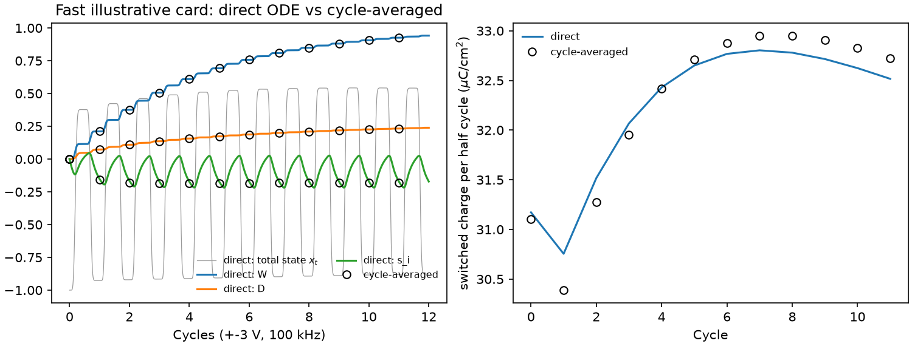
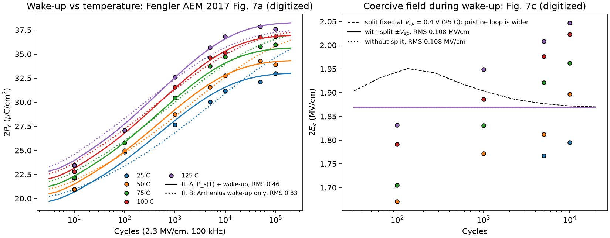
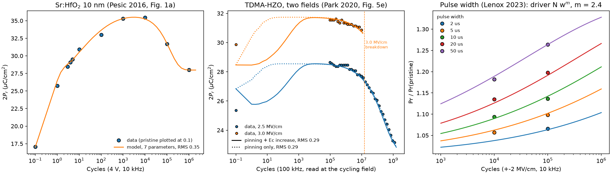
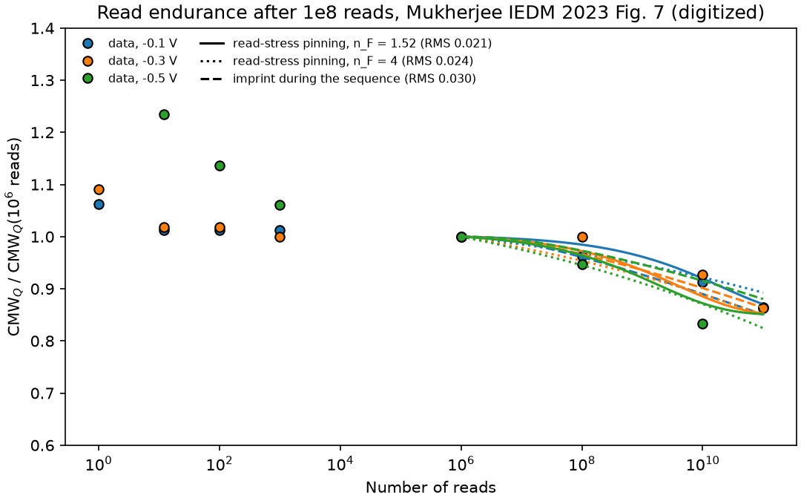
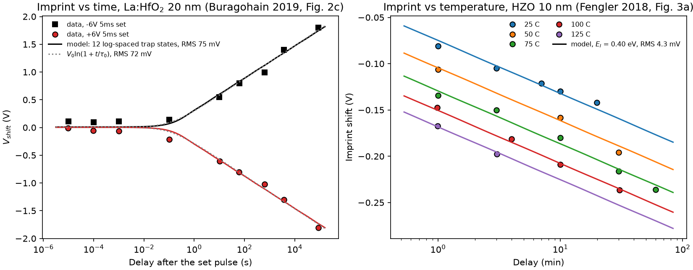

[English](fatigue-imprint.md) | **繁體中文**

# 喚醒、疲勞與對數時間印記：機制、模型與已發表資料的比較

研究筆記。對象是 [`nls_multidomain.py`](../../src/fe_models/nls_multidomain.py) 與 [`fecap_nls.va`](../../spice/fecap_nls.va) 的動態多域 NLS 模型。原本的模型只代表一個固定的循環狀態：沒有 wake-up（喚醒）、沒有 fatigue（疲勞），回切與 imprint（印記）只靠單一時間常數的屏蔽狀態 $\sigma$。這份筆記說明我們怎麼補上這三件事：先整理 HfO₂/HZO 文獻提出的機制與量到的特徵，再選出最少的新狀態變數，寫進 Python 與 Verilog-A 兩份實作，最後拿數位化的文獻資料檢驗哪些現象重現了、哪些沒有。

所有新項都是選用的，預設關閉。預設參數下，Python 走原本的程式路徑，輸出逐位元相同；編譯後的 Verilog-A 模型在原有的 12 組 ngspice 測試電路上，和修改前的版本一致到求解器的捨入誤差（相對差 4×10⁻⁹，第 3.2 節）。

## 目錄

1. [文獻：機制與實驗特徵](#1-文獻機制與實驗特徵)
2. [模型設計](#2-模型設計)
3. [實作與數值方法](#3-實作與數值方法)
4. [測試](#4-測試)
5. [與已發表資料的比較](#5-與已發表資料的比較)
6. [限制與開放問題](#6-限制與開放問題)
7. [參考文獻](#7-參考文獻)

## 1. 文獻：機制與實驗特徵

下面每一條都註明出處；只寫我們實際讀過的文獻（第 7 節列出讀了哪些部分）。間接得知的說法會標明「轉引」。

### 1.1 Wake-up

**現象。** 原始（pristine）薄膜的 $2P_r$ 偏小，遲滯迴線中段收窄（pinched loop），每個極性的切換電流有兩個峰。來回切換數百到數十萬次之後，兩個峰合成一個，$P_r$ 上升到最大值。

**數字。**

- Sr:HfO₂ 10 nm，4 MV/cm、10 kHz：$P_r$ 從 8.6 升到約 18 µC/cm²，約 10³ 次飽和，原始 $2P_r$ 約為最大值的 0.49 [Pesic2016, Fig. 1a]。
- TiN/HZO 7 nm/TiN，2.3 MV/cm、100 kHz：$2P_r$ 從 22 µC/cm²（10 次）到 33–38 µC/cm²（10⁵ 次）。10–10⁴ 次之間 $2P_r$ 大致與 $\log N$ 成正比，斜率每十倍 3.0–4.6 µC/cm²。溫度越高，喚醒越快 [Fengler2017, Fig. 7a]。
- 同一批樣品的 $2E_c$ 在喚醒過程中**變大**（1.67–1.83 → 1.80–2.05 MV/cm），因為收窄的迴線打開了；作者由 $2E_c$ 得到喚醒的活化能 0.54 eV [Fengler2017, Fig. 7c、7d]。
- FORC（一階反轉曲線）顯示原始薄膜有兩群內部偏壓相反的 hysteron（HZO：約 +1.1 與 −0.9 MV/cm），循環後合併到接近 0 [Fengler2017; Pesic2016]。
- 以較低振幅 $E_{sub}$ 循環 10⁵ 次，合併的電流峰會在 $E_{sub}$ 處再分裂 [Schenk2014]。
- 固定 ±2 MV/cm、10 kHz，只改脈寬 2–50 µs：10⁵ 次後 $P_r$ 增加 7–26 %，脈寬越長增加越多 [Lenox2023, Fig. 5a]。

**機制。** 文獻提出的機制如下，前兩項的證據最多：

- **帶電缺陷（氧空缺或被捕獲的電子）重新分布**，消除局部的內部偏壓。證據：喚醒期間漏電不變（沒有產生新缺陷）、FORC 的兩群偏壓合併、強烈的溫度加速、動力學蒙地卡羅模擬能重現峰的合併 [Pesic2016; Fengler2017]。
- **局部 imprint（domain 被捕獲電荷釘住）**。Fengler2018 認為，同一種電子捕獲作用在兩種極性的 domain 上，會產生兩群相反的偏壓，也就是原始薄膜的分裂峰；他們用兩段式波形可以把喚醒過的元件打回類似原始的狀態 [Fengler2018]。
- 電場誘發的相變（單斜或四方相轉為正交相），以及介面非鐵電層變薄 [Pesic2016; Book9.2]。

### 1.2 Fatigue

**現象與數字。**

- Sr:HfO₂，4 MV/cm、10 kHz：10⁴ 到 10⁶ 次，$P_r$ 下降 22 % [Pesic2016, Fig. 1a]。
- TDMA 前驅物的 HZO，2.5 MV/cm、100 kHz：約 10⁷ 次開始下降，到約 10⁹ 次降 19 %。同類元件在 3.0 MV/cm 下，到 1.5×10⁷ 次擊穿之前**幾乎沒有疲勞**，$P_r$ 反而較高 [Park2020, Fig. 5e；資料轉引自原作者]。
- 疲勞後切換電流峰變寬、變低 [Pesic2016; Book9.3]。
- 溫度越高，疲勞越早、越陡 [Pesic2016, Fig. 7a]；疲勞起點的活化能 48–103 meV，隨頻率增加 [Schenk2014]。
- 脈寬越長，漏電上升與擊穿越早：脈寬 × 次數在漏電起點約為常數（數十秒）[Lenox2023]。
- **只有雙極性切換會造成疲勞，單極性應力不會** [Book9.2；Pesic2016]。
- 等待或烘烤可以部分恢復，但再循環時疲勞更早出現，代表有永久損傷 [Pesic2016, Fig. 7b; Book9.2]。

**機制。** 文獻提出的機制：

- 介面低介電常數層中的高電場造成鍵結斷裂，產生新的氧空缺。漏電上升是它的證據，常用 thermochemical 形式 $R_G=\eta\exp[-(E_{A}-bE)/k_BT]$ 描述 [Pesic2016; Book9.3]。
- 注入的電荷被捕獲，屏蔽薄膜內的電場、釘住 domain。可部分恢復這一點支持此說 [Pesic2016; Book9.3]。
- 切換時移動的氧離子在晶界造成損傷（「hot-atom damage」，轉引自 Book9.2）。

### 1.3 Imprint

**現象與數字。**

- 寫入後存放，迴線往穩定所存狀態的方向平移，平移量隨 $\ln t$ 增加：$V_{shift}=V_0\ln(1+t/\tau_0)$。La:HfO₂ 20 nm 在 24 h 達 1.8 V，量到的範圍內看不到飽和 [Buragohain2019, Fig. 2c]。
- TiN/HZO 10 nm/TiN 在 25–125 °C 原位量測：對數斜率 $V_0$ 幾乎不隨溫度變（0.020–0.027 V），溫度主要改變起始時間 $\tau_0$。作者由 10 分鐘的平移量得到活化能 0.08–0.10 eV，判定載子是電子 [Fengler2018, Fig. 3]。
- Si:HfO₂ 在 85 °C：「同狀態」（SS）的平移量比「新同狀態」（NSS，先寫成相反再寫回）大 0.15–0.25 MV/cm，斜率也較大；正極性比負極性快 [Alcala2022, Fig. 5b]。
- Buragohain2019 的 P–V 迴線顯示：離開所存狀態的那一支矯頑電壓，平移量是另一支的 1.4–1.5 倍，迴線同時變寬。
- Tian2025 的模擬也指出實驗上兩支不對稱，而單純的介面屏蔽模型給的是對稱平移。

**機制。**

- **介面屏蔽**：非鐵電的被動層讓極化電荷沒有被電極完全屏蔽，被動層內的強電場把電荷注入並捕獲在介面。若注入電流隨已捕獲的電荷指數下降（自我限制），就得到對數時間律 [Buragohain2019 對 Grossmann 2002 與 Tagantsev–Gerra 2006 的整理，轉引]。
- **電子被氧空缺的深能階捕獲** [Fengler2018]。
- **Fluid imprint**：50–300 ns 的寫入脈衝期間就有電子注入被動層，切換峰隨脈寬移動 [Buragohain2019, Fig. 3b]。
- **晶界上的捕獲電荷抑制成核** [Tian2025]。

### 1.4 已發表的模型形式

| 形式 | 用在 | 出處 |
|---|---|---|
| $R_G=\eta\exp[-(E_{A,G}-bE)/k_BT]$，缺陷生成率 | 疲勞 | Book9.3 Eq. 9.3.1（Pesic2016 使用；書中沒有給數值） |
| 氧空缺與氧離子的漂移、擴散、複合（動力學蒙地卡羅），活化能 1.1 / 0.7 eV | 喚醒、疲勞 | Pesic2016; Book9.3 |
| Preisach hysteron：喚醒＝移除介面電荷、非鐵電晶粒轉為鐵電；疲勞＝介面捕獲電荷釘住 domain | 喚醒、疲勞 | Book9.3 Eq. 9.3.4 |
| $E_{dep}=\dfrac{P_r}{\varepsilon_{FE}\varepsilon_0}\left(1+\dfrac{\varepsilon_{IF}t_F}{\varepsilon_{FE}t_{IF}}\right)^{-1}$ | 介面層變薄 | Book9.2 Eq. 9.2.1; Park2020 Eq. 1 |
| 內部偏壓電荷 $Q_{eff}/A=\varepsilon_0kE_{bias}$ | 喚醒 | Fengler2017 Eq. 1 |
| 憶容網路 $\dot x=f(x,V,t)$, $q=C(x,V,t)V$（細節在 SI，未讀） | 峰的分裂與合併 | Schenk2014 |
| $V_{shift}=V_0\ln(1+t/\tau_0)$ | imprint | Buragohain2019 |
| 介面電荷屏蔽 $E_f=(C_iV-P_r+\sigma)/[(C_i+C_f)h_f]$，配合捕獲動力學 | imprint | Tian2025 Eq. 1, 5–6 |

我們沒有找到 HfO₂/HZO 文獻對 $P_r(N)$ 擬合過拉伸指數（stretched exponential），或對疲勞起點擬合過 $N_f\propto E^{-n}$ 的形式。

## 2. 模型設計

### 2.1 原則

- **狀態越少越好，每一個都有機制。** 新加的每個狀態，都對應第 1 節的一個機制，並且能在電路模擬器裡積分。
- **預設關閉。** 每一項由一個振幅參數打開（$f_{p0}$、$V_{sp}$、$D_{max}$、$V_I$）。關閉時，對應的節點在 Verilog-A 裡恆為 0。
- **電荷守恆。** 一個 domain 被釘住時，它的極化不會消失，只是不再翻轉。所以「疲勞」不能寫成把 $P_s$ 乘上一個變小的係數：那樣做會讓一個寫好、放在 0 V 的狀態隨疲勞而掉電荷，看起來像保持力損失。第 2.2 節的「釘扎池」就是為了避免這個錯誤。
- **長時間要能算。** 10⁸ 次以上的循環不可能逐週期積分，所以要有週期平均的更新（第 3.3 節），並用小次數的直接模擬驗證它。

### 2.2 釘扎池（E13）

薄膜中有比例 $f$ 的 domain 不翻轉，其餘 $1-f$ 照原本的 $N_d$ 類切換。被釘住的部分用兩個狀態描述：

- $\pi$：被釘住部分的極化（以 $P_s$ 為單位）；
- $r$：被釘住部分在被釘住當下凍結的可逆位移電荷（C/m²）。

端點電荷寫成

$$
Q/A=P_s\left[(1-f)\bar x+\pi\right]+C_dV+(1-f)\,g_2(V,\bar x)+r+\dots
$$

其中 $g_2$ 是原本可逆電荷的第 (2) 項（隨狀態變化的兩支）。$f$ 增加時（釘住），新被釘住的部分帶走當下的平均狀態與位移：

$$
\dot\pi=\dot f^{+}\,\bar x,\qquad \dot r=\dot f^{+}\,g_2(V,\bar x).
$$

$f$ 減少時（釋放），釋放出來的部分帶著池子的平均狀態 $\pi/f$ 回到每一類：

$$
\dot s_k \mathrel{+}= \dot f^{-}\,\frac{\pi/f-s_k}{1-f},\qquad \dot\pi=-\dot f^{-}\,\frac{\pi}{f},\qquad \dot r=-\dot f^{-}\,\frac{r}{f}.
$$

代進 $Q$ 可以直接驗證：釘住與釋放本身都不改變 $P_s[(1-f)\bar x+\pi]$；釘住也不改變可逆電荷。所以固定偏壓下，即使損傷在增加，也沒有電流。這是第 4 節的測試之一。

可逆項乘上 $(1-f)$，意思是被釘住的 domain 不再隨電壓「軟化」（它們不會接近自己的切換場）。這讓喚醒時 C–V 的蝴蝶峰變高、疲勞時變低，兩個狀態同時改變。

### 2.3 Wake-up（E14）

喚醒的年齡 $a_w$ 計算「等效完整切換週期數」，以 $N_w$ 為單位：

$$
\dot a_w=A_w(T)\,\frac{\sum_k w_k\,|\dot s_k|_{sw}}{4N_w},\qquad A_w(T)=\exp\!\left[-\frac{E_w}{k_B}\left(\frac1T-\frac1{T_0}\right)\right].
$$

一個完整的雙極性週期使每類走過 $|\Delta s|=4$，所以 $a_w$ 每週期增加 $1/N_w$。驅動量用切換量而不是電壓，原因是：

- 文獻的喚醒需要反覆切換；
- 小於矯頑電壓的讀取不應該喚醒薄膜。

喚醒度 $W=1-e^{-g(a_w)}$，$g(a)=(a+a_\epsilon)^{\kappa_w}-a_\epsilon^{\kappa_w}$（$a_\epsilon=10^{-4}$ 讓 $a=0$ 的導數有限）。它控制兩件事：

- 原始被釘住的比例 $f_w=f_{p0}(1-W)$：被缺陷團簇釘住、或還不是鐵電相的部分；
- 原始的內部偏壓分裂：奇數類加 $+V_{sp}(1-W)$、偶數類加 $-V_{sp}(1-W)$，對應 FORC 上兩群相反偏壓的 hysteron。

類別依活化場排序，奇偶交錯，所以兩群各自涵蓋整個活化場分布；網格對稱，兩群的權重相同。

拉伸指數 $\kappa_w<1$ 等於假設各區域的喚醒速率有一個寬分布，這正是資料裡 $2P_r$ 隨 $\log N$ 線性增加數個十倍的原因。

### 2.4 Fatigue（E15）

疲勞年齡 $a_F$ 有兩個可選的驅動項：

$$
\dot a_F=A_F(T)\left(\frac{E_s}{1\ \mathrm{MV/cm}}\right)^{n_F}\left[\frac{1}{t_F}+\frac{\sum_k w_k|\dot s_k|_{sw}}{4N_F}\right],\qquad E_s=\sqrt{(\rho V/t_{fe})^2+E_{fl}^2}.
$$

- **場與時間**（$1/t_F$）：電荷注入與缺陷生成隨電場存在的時間累積，對應 thermochemical 鍵結斷裂與 Lenox2023 的「脈寬 × 次數」規律。
- **切換中的場**（$1/N_F$）：只在切換時累積，對應「單極性應力不造成疲勞」[Book9.2]。

兩項都可以設 0 關閉。損傷 $D=D_{max}[1-e^{-g(a_F)}]$，它做兩件事：

- 把 domain 釘住；
- 讓還能切換的 domain 活化場乘上 $(1+k_ED)$，代表切換峰變寬、往高場移。

### 2.5 合併（E16）

$$
f=1-(1-f_w)(1-D).
$$

喚醒釋放原始被釘住的部分，疲勞再釘住新的部分；兩者經過同一個釘扎池。

### 2.6 對數時間 imprint（E17）

原本的 $\sigma$ 只有一個時間常數，最多描述一個指數過程。把它換成 $N_I$ 個捕獲狀態，時間常數在 $[\tau_{I1},\tau_{I2}]$ 之間對數等距（每個對數區間權重相同），並且熱活化：

$$
\tau_j\,\dot\sigma_j=x_t-\sigma_j,\qquad \tau_j(T)=\tau_j(T_0)\exp\!\left[\frac{E_I}{k_B}\left(\frac1T-\frac1{T_0}\right)\right],\qquad \sigma_I=\frac1{N_I}\sum_j\sigma_j,
$$

其中 $x_t=(1-f)\bar x+\pi$ 是總極化狀態。內建電壓變成動態的 $V_{imp}-V_I\sigma_I$。它進入：

- 每一類的驅動 $u_k$；
- $h$ 的反轉閘門與鬆弛閘門；
- 可逆電荷兩支的中心（imprint 會讓 C–V 蝴蝶整個平移，這是量 imprint 的常用方法）。

為什麼會出現對數律？從 $\sigma_j=0$ 開始、$x_t$ 固定為 1 時，

$$
\sigma_I(t)=\frac1{N_I}\sum_j\left(1-e^{-t/\tau_j}\right)\approx\frac{\ln(t/\tau_{I1})+\gamma}{\ln(\tau_{I2}/\tau_{I1})},\qquad \tau_{I1}\ll t\ll\tau_{I2},
$$

所以 $\Delta V_c=V_I\sigma_I$ 的對數斜率是 $V_0=V_I/\ln(\tau_{I2}/\tau_{I1})$，$\tau_0\approx\tau_{I1}$。

物理上，這相當於一群捕獲或釋放時間廣泛分布的陷阱；對數均勻的時間分布，等價於陷阱深度或穿隧距離均勻分布。這個結構另外自動給出：

- 重寫後的對數式恢復；
- 「新同狀態」比「同狀態」小：快的狀態被重寫抹掉，慢的還記得舊狀態。

12 個狀態涵蓋 12 個十倍時，局部斜率的起伏小於 ±11 %。

### 2.7 參數：哪些是擬合旋鈕

| 參數 | 符號 | 意義 | 角色 |
|---|---|---|---|
| `wk_fp` | $f_{p0}$ | 原始被釘住比例 | 擬合（喚醒幅度） |
| `wk_vsp` | $V_{sp}$ | 原始偏壓分裂 | 擬合（分裂峰、收窄迴線） |
| `wk_nw` | $N_w$ | 喚醒週期數尺度 | 擬合 |
| `wk_kw` | $\kappa_w$ | 喚醒速率分布的寬度 | 擬合 |
| `wk_ea` | $E_w$ | 喚醒活化能 | 擬合（多溫度資料才定得出來） |
| `fat_d` | $D_{max}$ | 最大釘住比例 | 擬合 |
| `fat_tf` | $t_F$ | 場與時間驅動的尺度（1 MV/cm 下） | 擬合；0＝關 |
| `fat_ns` | $N_F$ | 切換驅動的尺度（1 MV/cm 下） | 擬合；0＝關 |
| `fat_nf` | $n_F$ | 場的指數 | 擬合（需要多個電場） |
| `fat_kf` | $\kappa_F$ | 疲勞速率分布的寬度 | 擬合 |
| `fat_ke` | $k_E$ | 每單位損傷的活化場增加 | 擬合 |
| `fat_ea` | $E_F$ | 疲勞活化能 | 擬合（多溫度資料才定得出來） |
| `imp_v` | $V_I$ | 陷阱全部填滿時的 imprint 電壓 | 擬合 |
| `imp_t1`, `imp_t2` | $\tau_{I1},\tau_{I2}$ | 陷阱時間範圍 | $\tau_{I1}$ 擬合；$\tau_{I2}$ 取在資料範圍之外 |
| `imp_ea` | $E_I$ | 陷阱時間的活化能 | 擬合（多溫度） |
| `FE_NI` / `imp_n` | $N_I$ | imprint 狀態數（12） | 數值 |
| 實例參數 `nw0`, `af0`, `si0` | | 先前的循環與存放歷史 | 由加速循環計算後交給電路 |

### 2.8 考慮過但沒有採用的做法

- **只把 $P_s$ 乘上 $m_P(N)$**：這是原本留的掛鉤。它會讓存好的狀態隨疲勞掉電荷，也無法在固定偏壓下守恆電荷，所以改用釘扎池。
- **每一類各自一個釘扎狀態**：多 $N_d$ 個節點；文獻沒有資料能區分釘扎偏好哪一類活化場。
- **氧空缺的漂移擴散方程**：需要空間網格，不適合精簡模型；它在精簡模型中的效果就是偏壓分裂的消失與釘扎比例的變化，我們直接用這兩個量描述。
- **注入電流隨捕獲電荷指數下降的單一狀態**（$\dot\sigma=j_0e^{-\sigma/\sigma^*}$）：它也給對數律，但它的鬆弛方向與重寫後的恢復需要另寫規則；對數分布的線性狀態本身就是穩定、被動的線性系統，在 SPICE 裡比較好積分。

## 3. 實作與數值方法

### 3.1 Python 與 Verilog-A

兩份實作寫的是同一組方程。

**Python。** 只要有任何一項歷史打開，[`simulate`](../../src/fe_models/nls_multidomain.py) 的狀態向量就延伸為

$$
[s_k,\ h_k,\ y,\ \sigma,\ \pi,\ r,\ a_w,\ a_F,\ \sigma_j],
$$

由 `rhs_aged` 給出右邊。全部關閉時，程式走原本的 `rhs`，結果逐位元相同。`aged_card` 把慢狀態凍結在某個值，傳回有效參數與類別，閉式解（`step` 等）可以直接使用。

**Verilog-A。** 多 $N_I+4$ 個內部節點：`pn`、`prn`、`awn`、`afn`、`imn[1:FE_NI]`，其中 `FE_NI` 是編譯巨集，預設 12。實例參數 `nw0`、`af0`、`si0` 讓電路從一段既有的循環或存放歷史開始，數值通常由第 3.3 節的加速計算得到。

一項關閉時，它的節點方程是 $\dot X=0$，初值為 0。所以它不影響任何其他量，也不貢獻截斷誤差。

### 3.2 預設行為與數值上的一致性

**Python。** 預設參數下走未修改的程式路徑，輸出逐位元相同（有測試）。

**ngspice。** 新舊兩個編譯後的模型，在原有 12 組測試電路上的比較：

- 輸出最大相對差 $4\times10^{-9}$；
- `slow_accumulation` 多了 5 個時間點（共 14 萬點），電荷差最大 $9\times10^{-5}$ µC/cm²。

這些差異來自矩陣多了節點後 Sparse 求解器的樞軸順序改變，屬於捨入誤差；方程本身沒有變。（比較時要注意：ngspice 的 `pre_osdi` 與 `.include` 是相對於電路檔的位置解析，不是工作目錄。）

**一處數值修改。** 原模型在 $h$ 的重設「進行中」時，把步長限制在 0.2 ns。判斷條件是閘門值 $G$ 乘上 $h$ 大於 $10^{-9}$，而 0 V 時 $G$ 的尾巴約 $2\times10^{-9}$。

動態 imprint 打開後，0 V 不再是零場點，$h$ 在 0 V 鬆弛得很慢，這個誤判會把整段存放時間都卡在 0.2 ns 步長：3 ms 的電路要 33 秒。

所以只在 imprint 打開時，忽略小於 $10^{-6}$ 的閘門尾巴。結果不變，時間降為 0.6 秒。預設行為不受影響。

### 3.3 加速循環：週期平均

10⁸ 次以上的循環不能逐週期積分。慢狀態（$a_w, a_F, \pi, r, \sigma_j$）在一個週期內幾乎不變，所以用兩個時間尺度處理（[`cycle_history`](../../src/fe_models/nls_multidomain.py)）：

1. 慢狀態凍結，用閉式的 `step` 走過一個週期（約 40–400 段）。得到：
   - 切換量，以及乘上電場因子的切換量；
   - 每一段的釘住與釋放（各用該段的平均狀態）；
   - imprint 狀態在一個週期內的精確仿射映射 $\sigma_j\to a_j\sigma_j+b_j$。
2. 把這些增量重複 $m$ 個週期：
   - $a_F$ 的場與時間部分用每週期積分 $\int(E_s/E_{ref})^{n_F}dt/t_F$；
   - $\sigma_j$ 用仿射映射的 $m$ 次方閉式。
3. $m$ 的選法：$f$ 每一步最多變 0.01；$\sigma_I$ 在 $m$ 個週期內的變化，扣掉一個週期本身的變化後，最多 0.02。快的 $\sigma_j$ 會一次跳到它的固定點，所以只有慢的狀態限制 $m$。

和直接解 ODE 的比較見圖 `fi_cycle_average_check.png`。用的是變化很快的示意參數：$W$ 在幾個週期內就變化。12 個週期內：

| 量 | 最大差 |
|---|---|
| $W$ | $8\times10^{-4}$ |
| $D$ | $4\times10^{-15}$ |
| $\sigma_I$ | 0.013 |
| 每週期切換電荷 | 0.37 µC/cm²（約 1.1 %） |

$\sigma_I$ 的差來自第一個週期：那時 $W$ 一個週期就變 20 %，慢狀態凍結的假設不成立。$10^{12}$ 個週期約 0.1 秒。

## 4. 測試

[`tests/test_history.py`](../../tests/test_history.py) 有 23 項測試，每一項都設計成在物理錯誤時會失敗。另外用突變檢查確認：拿掉釘扎池的 $\pi$ 或 $r$、讓 imprint 不移動 $V_c$、把對數分布換成單一時間常數，都會被對應的測試抓到。

| 類別 | 檢查什麼 |
|---|---|
| 預設關閉 | 通用參數下三項都關；`history` 引數不改變結果（逐位元）；關閉時 `rhs_aged` 等於 `rhs`（$10^{-13}$）；強制走延伸狀態向量時與原結果相差 $<2\times10^{-3}$ µC/cm²；`cycle_history` 的切換電荷不變 |
| 單調損傷 | $D(a)$、$1-W$ 單調、極限正確、解析導數等於數值導數；模擬中 $a_w$、$a_F$、$D$ 不減少，$\lvert\pi\rvert\le f$；長期循環下切換電荷單調下降、$V_c$ 上升 |
| 驅動 | 只有切換驅動時，單極性應力不造成疲勞、雙極性會；場與時間驅動下，同樣次數時脈寬越長損傷越大；週期平均的 $N_{1/2}$ 依 $(V_1/V_2)^{n_F}$ 變化；喚醒的熱活化 |
| 對數 imprint | $\sigma_I(t)$ 在中段的對數斜率等於 $1/\ln(\tau_2/\tau_1)$（3 % 內）；矯頑電壓的對數斜率等於 $-V_I/\ln(\tau_2/\tau_1)$（5 % 內）；ODE 中存放越久，反向切換越少；關掉 imprint 時與存放時間無關；重寫後恢復；Arrhenius 比例 |
| 電荷守恆 | 固定偏壓（0 V 與 1 V）下 $D$ 從 0 長到 0.5，端點電荷不動（$<10^{-9}$ C/m²）；釋放時 $\frac{d}{dt}[(1-f)\bar x+\pi]$ 扣掉切換部分後為 0（$10^{-13}$ 相對） |
| 被動性 | 所有歷史項打開時，每一個完整迴線都吸收能量；已老化的薄膜在小訊號循環下，沒有一圈輸出能量（扣除取樣積分雜訊；通用參數用同一門檻也通過） |
| 週期平均 | 與直接模擬比較 $W$、$D$、$\sigma_I$（0.015 內）與每週期切換電荷（3 % 內）；長時間到達極限，切換電荷先升後降 |

ngspice 對 Python 的比較（[`spice/compare_ngspice.py`](../../spice/compare_ngspice.py)）新增 4 組電路，共 16 項檢查：`wakeup`、`fatigue`（兩種驅動，85 °C）、`imprint`（85 °C、熱活化）、`history`（實例參數 `nw0`、`af0`、`si0`）。波形最大電荷差為 0.0012–0.027 µC/cm²，容許值 0.05。

整個測試套件（含 ngspice）：`Ran 102 tests in 288.762s — OK`（含 23 項新測試與 16 組 ngspice 電路，沒有略過）。

## 5. 與已發表資料的比較

腳本是 [`examples/fatigue_imprint_comparison.py`](../../examples/fatigue_imprint_comparison.py)，數字寫在 [`fatigue_imprint_comparison.json`](fatigue_imprint_comparison.json)。

資料都是從圖上數位化的近似值；每個檔案的表頭有出處、圖號、元件、條件與估計的讀圖誤差，放在 [`data/literature/`](../../data/literature/)。每一組資料都會寫明用了幾個擬合參數。參數多、點少的情況，只代表「模型有能力描述」，不代表「預測成功」。

### 5.1 喚醒與溫度：Fengler 2017

**資料。** TiN/HZO 7 nm/TiN，2.3 MV/cm、100 kHz 矩形波，25–125 °C，$2P_r$ 共 35 點。

**擬合。**

| 擬合 | 參數 | RMS | 主要結果 |
|---|---|---|---|
| A：$P_s(T)$ 加喚醒 | 6 個 | 0.46 µC/cm²（讀圖誤差約 ±0.3） | $f_{p0}=0.48$、$N_w=480$、$\kappa_w=0.30$、$P_s$ 溫度係數 $1.6\times10^{-3}$/K；$E_w$ 被推到 0 |
| B：只用 Arrhenius 喚醒 | 5 個 | 0.83 µC/cm² | $E_w=0.32$ eV、$\kappa_w=0.23$ |

兩點觀察：

- $\kappa_w\approx0.2$–0.3 的拉伸律，重現了 $2P_r$ 對 $\log N$ 的線性段（四個十倍）。
- 這組 $2P_r$ 資料比較支持「整條曲線往上平移」（$P_s$ 隨溫度增加），而不是「沿 $\log N$ 平移」（喚醒加速）。作者用 $2E_c$ 得到的 0.54 eV 是另一個量。我們把兩種解讀並列，因為單看 $2P_r$ 無法決定。

**$2E_c$（Fig. 7c）沒有重現。** 讀取迴線假設為 10 kHz、±2.3 MV/cm 三角波。

- 模型的 $2E_c$ 在喚醒中保持不變，RMS 0.108 MV/cm，等於資料的散布；資料是每十倍增加 0.09–0.13 MV/cm。
- 把原始偏壓分裂 $V_{sp}$ 打開，效果方向相反：分裂讓原始迴線**變寬**，喚醒後才變窄（圖中虛線）。
- 資料的 $E_c$ 上升，可能來自收窄迴線的 $E_c$ 讀法，或被釋放的 domain 本身矯頑場較高。這兩點模型都沒有描述。

### 5.2 喚醒與疲勞在同一條曲線：Pesic 2016

**資料。** Sr:HfO₂ 10 nm，4 V、10 kHz（假設矩形波），11 點。

**擬合。** 7 個參數（$n_F=4$ 固定），RMS 0.35 µC/cm²（讀圖誤差約 ±0.4）。

- 喚醒：$f_{p0}=0.53$、$N_w=2.4$、$\kappa_w=0.22$；
- 疲勞：$D_{max}=0.22$、$t_F=3.4\times10^3$ s、$\kappa_F=1$（在上限）。

**限制。** 這組資料只有一個條件：驅動方式和場的指數都定不出來。$\kappa_w$ 若不設下限 0.15，會跑到 0.05 去追第一圈的大跳躍（原始 17 → 第 1 圈後 25.8 µC/cm²）。$\kappa_F$ 若不設上限 1，會變成懸崖式的起點。

### 5.3 兩個電場、在循環電場下讀取：Park 2020（TDMA-HZO）

這組資料是第 1.2 節提到的反直覺結果：3.0 MV/cm 下擊穿前沒有疲勞，2.5 MV/cm 下 10⁷ 次後才下降。

我們原本預期，要「釘住」加上「活化場上升」（$k_E$）才能解釋：活化場上升時，在 2.5 MV/cm 讀取會切不完全，在 3.0 MV/cm 讀取則還切得完。結果兩個擬合一樣好：

| 擬合 | 參數 | RMS（53 點） | 主要結果 |
|---|---|---|---|
| 只釘住 | 7 個 | 0.29 µC/cm² | $n_F\to0$ |
| 釘住加活化場上升 | 8 個 | 0.29 µC/cm² | $n_F=5.9$、$k_E=1.4$ |

原因是 3.0 MV/cm 的資料停在 1.5×10⁷ 次（擊穿）；那時 2.5 MV/cm 的疲勞也才剛開始。所以這組資料決定不了 $n_F$ 和 $k_E$，只告訴我們：擊穿之前看不到電場加速的疲勞。

（厚度未知，假設 10 nm；10⁰ 到 10⁵ 次之間沒有資料。兩個原始點偏離約 1.3 µC/cm²：模型在讀取電場下從原始到喚醒的變化比量到的小。）

### 5.4 脈寬：Lenox 2023

**資料。** ±2 MV/cm、10 kHz，脈寬 2–50 µs；在 10⁴ 與 10⁵ 次的 $P_r/P_r$(pristine)，共 9 點。

**分析。** 用拉伸律擬合，驅動量寫成 $N(w/2\,\mu s)^m$：

| 驅動 | $m$ | RMS |
|---|---|---|
| 本模型（切換次數） | 0 | 0.061 |
| 場與時間 | 1 | 0.028 |
| 自由擬合 | $2.4\pm0.2$ | 0.0055 |

也就是說，延長脈寬比增加次數更有效，連「總加場時間」都不足以描述。例如：

- 10⁴ 次 × 20 µs：增加 13.5 %；
- 10⁵ 次 × 2 µs：增加 6.6 %；

兩者的總加場時間相同（0.2 s）。

這表示每個脈衝內有一個需要時間累積的過程。可能的例子是：脈衝期間的電荷注入與捕獲，要先超過某個門檻，才會造成重新分布。這是本模型目前做不到的。

### 5.5 讀取 10⁸ 次以後的下降：Mukherjee 2023

這是原本就提出的問題：兩個狀態一起變差，原模型做不出來。

**資料。** 以每條曲線在 10⁶ 次的值為準：

| 讀取電壓 | 最後一點相對於 10⁶ 次的值 |
|---|---|
| −0.1 V | 0.86 |
| −0.3 V | 0.86 |
| −0.5 V | 0.83 |

三個讀取電壓下降幅度幾乎相同。原本沒有歷史的預測（[`literature_read_endurance.png`](../literature_read_endurance.png)）只在 −0.1 V 跟得上；在 −0.3 V 與 −0.5 V，它高估了尾端切換。所以這裡只分析後段的相對下降。

我們比較兩種都能讓兩個狀態一起變差的解釋：

**(a) 讀取應力造成的釘住。** 被釘住的部分既不切換、也失去可逆分支，兩個狀態一起少掉 $(1-f)$。擬合 4 個參數：$D_{max}=0.16$、$\kappa_F=0.39$、$n_F=1.5$，比例的 RMS 0.021。把 $n_F$ 固定為 4（電場驅動的注入），RMS 是 0.024，幾乎一樣。

**(b) 讀取期間 imprint 持續增加。** 每個存放的狀態，都把自己的 C–V 分支推離讀取電壓。用第 6 節那顆元件的 C–V 參數算：

- 平移 0.2 V，三個讀取電壓的窗口分別降 5.3 %、4.5 %、3.7 %，幾乎和讀取電壓無關，與資料的樣子相符；
- 擬合 2 個參數：$V_0=0.047$ V/e-fold、$\tau_{I1}=8.6$ s，$1.5\times10^5$ s 時平移 0.48 V，比例的 RMS 0.030。

這個 $V_0$ 落在文獻範圍內：

- HZO 10 nm 為 0.025 V/e-fold [Fengler2018]；
- La:HfO₂ 20 nm 為 0.13 V/e-fold [Buragohain2019]；
- Si:HfO₂ 10 nm 約每十倍 0.08–0.12 V [Alcala2022]。

**結論。** 下降的形狀與大小，兩種機制都能描述；這組資料分不出來。能區分的實驗：

- **改變讀取週期、但固定次數**：imprint 依時間，疲勞依次數。
- **讀到 10¹¹ 次後重寫**：imprint 會恢復，釘住不會。
- **只存放、不讀取**：imprint 仍會讓窗口下降。

### 5.6 Imprint 隨時間：Buragohain 2019

**資料。** La:HfO₂ 20 nm，±6 V、5 ms 寫入，兩種極性共 18 點，從 10 µs 到 24 h。

**擬合。** 3 個參數（共同偏移、$V_I$、$\tau_{I1}$），RMS 75 mV（讀圖誤差約 ±20 mV），$V_0=0.126$ V/e-fold、$\tau_{I1}=0.16$ s。

作者的形式 $V_0\ln(1+t/\tau_0)$ 用同樣 3 個參數，RMS 72 mV（$V_0=0.129$ V、$\tau_0=0.11$ s）。$\tau_{I2}$ 從 10⁶ 改到 10¹² s，RMS 只變 1 mV，因為資料裡看不到飽和。

所以在一個溫度下，12 個對數等距狀態和對數律等價；剩下的誤差來自兩種極性的不對稱，以及 10 µs–0.1 s 之間的小偏移。

### 5.7 Imprint 隨溫度：Fengler 2018

**資料。** TiN/HZO 10 nm/TiN，25–125 °C 原位量測，1–60 min，19 點，讀圖誤差約 ±2 mV。量的是相對於「重設循環後第一個迴線」的平移。

**擬合。** 4 個參數（$V_I$、$\tau_{I1}$、$E_I$、參考時間 $t_{ref}$），RMS 4.3 mV：

- $E_I=0.40$ eV；
- $\tau_{I1}(25\,°C)=5$ s；
- $V_0=0.025$ V/e-fold；
- $t_{ref}=14$ ms。

不加熱活化（$E_I=0$）時 RMS 是 32 mV。所以「時間常數整體熱活化、對數斜率不變」這個結構，正好對應資料：斜率幾乎不隨溫度變，起始時間隨溫度提前。

要注意，0.40 eV 是陷阱時間常數的活化能，和作者由「10 分鐘的平移量」得到的 0.08–0.10 eV 不是同一個量。在對數區，平移量對溫度的敏感度大約是 $V_0E_I/k_BT$ 除以平移量本身，所以數值小得多。

### 5.8 新同狀態與不對稱（只做定性比較）

**新同狀態。** Alcala2022 的 SS 比 NSS 大 0.15–0.25 MV/cm。模型自然給出這個差：重寫只抹掉快的狀態，慢的狀態還記得舊的極性。

但模型在對數區給的 SS 與 NSS 斜率相同，資料的斜率比約 1.5（每十倍 0.12 對 0.08 MV/cm）。這一點沒有重現。

**不對稱。** Buragohain2019 的「離開所存狀態的那一支多移 1.4–1.5 倍、迴線變寬」也沒有重現：模型的 imprint 是整個迴線純平移。

### 5.9 小結

| 資料 | 重現了 | 沒有重現 |
|---|---|---|
| Fengler2017 Fig. 7a | $2P_r$ 對 $\log N$ 的線性段與溫度趨勢（RMS 0.46） | 溫度效應該歸給 $P_s(T)$ 還是喚醒加速，無法分辨 |
| Fengler2017 Fig. 7c | — | 喚醒期間 $2E_c$ 上升 |
| Pesic2016 | 喚醒加疲勞的形狀（RMS 0.35，7 個參數） | 驅動方式與場的指數無法辨識 |
| Park2020 | 兩個電場的曲線（RMS 0.29） | $n_F$、$k_E$ 定不出來；擊穿 |
| Lenox2023 | — | 脈寬依賴（需要 $m\approx2.4$，本模型 $m=0$） |
| Mukherjee2023 | 10⁸ 次後兩個狀態一起下降（兩種機制都可以） | 兩種機制分不出來 |
| Buragohain2019 | 對數律（與作者的形式等價） | fluid imprint；兩支不對稱 |
| Fengler2018 | 多溫度的對數 imprint（RMS 4.3 mV） | — |
| Alcala2022 | SS > NSS 的偏移 | 斜率比 |

## 6. 限制與開放問題

**沒有描述的現象：**

- **喚醒的脈寬依賴。** 驅動量要約 $N w^{2.4}$。模型只有切換次數驅動；就算加上場與時間驅動（$m=1$）也不夠。
- **喚醒中 $2E_c$ 上升。** 偏壓分裂給的方向相反。
- **疲勞的恢復與回春。** $D$ 只增不減，可是文獻顯示等待或烘烤可以部分恢復，恢復後疲勞更早再出現。要描述這件事，需要把損傷拆成「可逆的捕獲」與「永久的缺陷」兩部分。
- **疲勞造成的漏電上升與擊穿。** 損傷沒有連到漏電參數。
- **介電常數的變化。** 循環時電容約下降 5 %，來自相變與介面層。
- **Fluid imprint。** 50–300 ns 寫入脈衝期間的電子注入，是由電場驅動的；我們的捕獲狀態只由極化狀態驅動。Buragohain2019 Fig. 2c 在 10 µs–0.1 s 之間沒有平移，擬合得到的 $\tau_{I1}=0.16$ s，所以它的 fluid imprint 是另一個過程。可能的擴充：讓最快幾個 $\sigma_j$ 的速率依電場增加。
- **Imprint 的兩支不對稱與迴線變寬；SS 與 NSS 斜率不同。**
- **偏壓加速的 imprint。** 存放時加反向偏壓會加速 imprint [Buragohain2019]；模型的捕獲狀態不看外加電場。
- **疲勞的溫度與頻率依賴。** 有 `fat_ea`，但沒有拿 Pesic2016 Fig. 7a（無刻度）或 Schenk2014 的活化能去擬合。

**數值上的近似：**

- 釘扎是整個薄膜均勻發生的，沒有偏好某一類活化場。
- 偏壓分裂用奇偶類別交錯近似兩群 domain，兩群各占一半。Fengler2017 的資料是約 2:1。
- 週期平均在慢狀態一個週期就大幅變化時不準（例如喚醒前幾圈）。

**開放問題：**

1. Mukherjee2023 的 10⁸ 次後下降，是讀取應力的釘住，還是存放中的 imprint？第 5.5 節列了能區分的實驗。
2. HZO 喚醒的溫度效應，是 $P_s(T)$，還是熱活化的喚醒？需要在室溫讀取、但在不同溫度循環的資料（Fengler 的 ESSDERC 2016 據轉引是這樣做的，給 0.32 eV；我們沒有讀到原文）。
3. 疲勞的驅動是切換次數、加場時間，還是兩者的乘積？需要同一種元件在多個電場與頻率下的 $P_r(N)$；我們找到的公開資料都以擊穿結束。

## 7. 參考文獻

只列出實際讀過的部分。

| 代號 | 文獻 | 讀過的範圍 |
|---|---|---|
| Schenk2014 | T. Schenk et al., ACS Appl. Mater. Interfaces 6, 19744 (2014), doi:10.1021/am504837r | 正文、Fig. 1–3、Table 1；SI 未讀 |
| Pesic2016 | M. Pešić et al., Adv. Funct. Mater. 26, 4601 (2016), doi:10.1002/adfm.201600590 | 正文；Fig. 1、2、7 看圖並數位化 |
| Fengler2017 | F. P. G. Fengler et al., Adv. Electron. Mater. 3, 1600505 (2017), doi:10.1002/aelm.201600505 | 正文；Fig. 4、6、7、8 |
| Fengler2018 | F. P. G. Fengler et al., J. Appl. Phys. 123, 204101 (2018), doi:10.1063/1.5026424 | 作者自存的出版版本全文；Fig. 3 |
| Buragohain2019 | P. Buragohain et al., ACS Appl. Mater. Interfaces 11, 35115 (2019), doi:10.1021/acsami.9b11146 | 接受稿全文；Fig. 2、3；SI 未讀 |
| Book9.2 | F. Fengler et al., ch. 9.2 in *Ferroelectricity in Doped Hafnium Oxide* (Elsevier 2019), doi:10.1016/B978-0-08-102430-0.00017-6 | 全章 |
| Book9.3 | M. Pešić, L. Larcher, ch. 9.3, 同書, doi:10.1016/B978-0-08-102430-0.00018-8 | 全章文字（圖只讀圖說） |
| Park2020 | M. H. Park et al., J. Mater. Chem. C 8, 10526 (2020), doi:10.1039/D0TC01695K | 氧空缺、碳、氫、介面層與晶界各節；Fig. 5 |
| Alcala2022 | R. Alcala et al., IEEE J. Electron Devices Soc. 10, 907 (2022), doi:10.1109/JEDS.2022.3198138 | 全文；Fig. 4–7 |
| Schroeder2022 | U. Schroeder et al., Nat. Rev. Mater. 7, 653 (2022), doi:10.1038/s41578-022-00431-2 | p. 665 的可靠度段落 |
| Lenox2023 | M. K. Lenox et al., Phys. Status Solidi A (2023), doi:10.1002/pssa.202300566 | 接受稿全文；Fig. 5 |
| Tian2025 | H. Tian, J. Yang, M. Liu, arXiv:2512.13748 | 全文文字；圖未看 |
| Mukherjee2023IEDM | Mukherjee et al., IEDM 2023, doi:10.1109/IEDM45741.2023.10413879 | 沿用本專案推導文章的資料檔（Fig. 7、Fig. 5a） |

**只經轉引、沒有讀到原文**（文中出現時都標明「轉引」）：

- Grossmann et al., J. Appl. Phys. 92, 2680/2688 (2002)：介面屏蔽模型，經 Buragohain2019 的整理；
- Tagantsev & Gerra, J. Appl. Phys. 100, 051607 (2006)：同上；
- Fengler et al., ESSDERC 2016：喚醒活化能 0.32 eV，經 Fengler2017；
- Park2020 Fig. 5 的原始資料來源；
- Masuduzzaman & Alam 的 hot-atom damage，經 Book9.2；
- Vishnumurthy et al., IRPS 2024：經 Tian2025。

Kim, del Alamo, Antoniadis, IEEE TED 71, 6620 (2024) 與 Takada et al., Adv. Electron. Mater. 7, 2100151 (2021) 只讀到摘要，沒有引用其內容。

**本研究新增的資料檔**（[`data/literature/`](../../data/literature/)，全部是從圖上數位化的近似值）：

| 檔案 | 內容 |
|---|---|
| `fengler2017_aem_fig7a_wakeup_2pr_T.csv` | $2P_r$ 對循環次數，5 個溫度 |
| `fengler2017_aem_fig7c_wakeup_2ec_T.csv` | $2E_c$ 對循環次數，5 個溫度 |
| `pesic2016_afm_fig1a_pr_cycles.csv` | $P_r$ 對循環次數 |
| `park2020_jmcc_fig5e_tdma_pr_field.csv` | 2.5 與 3.0 MV/cm |
| `lenox2023_pssa_fig5a_pulse_width.csv` | 5 種脈寬 |
| `buragohain2019_acsami_fig2c_imprint.csv` | 平移量對時間，兩種極性 |
| `fengler2018_jap_fig3a_imprint_T.csv` | 平移量對時間，5 個溫度 |
| `alcala2022_jeds_fig5b_imprint_ss_nss.csv` | 85 °C 下的 SS 與 NSS |
