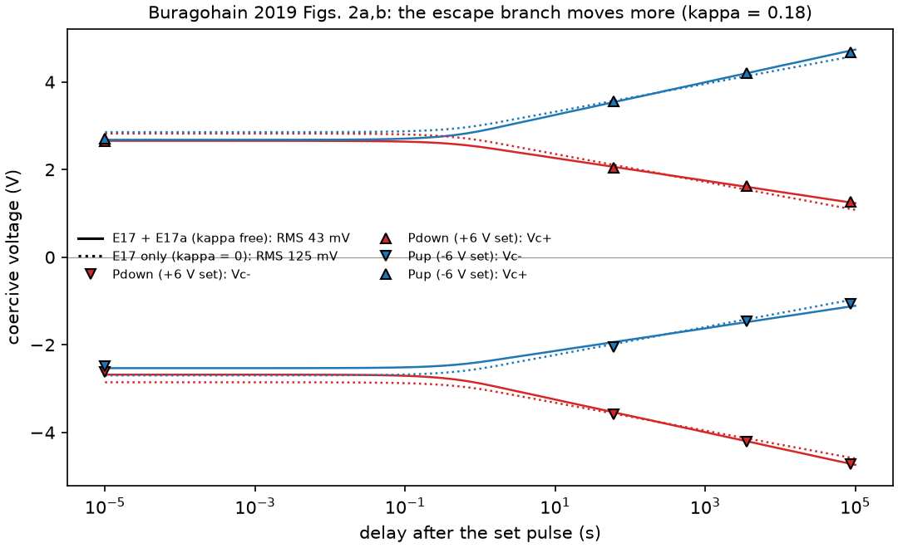
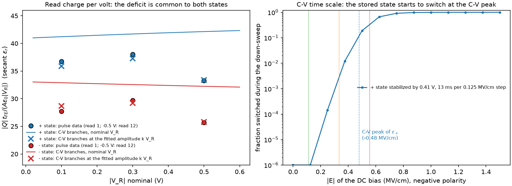
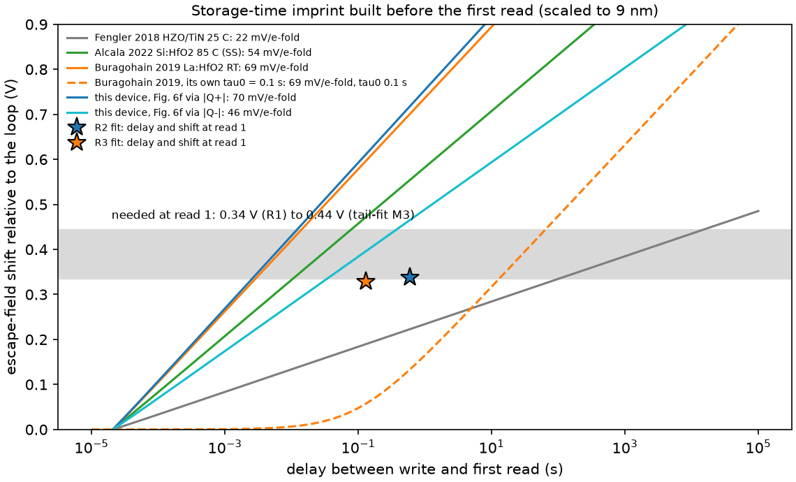
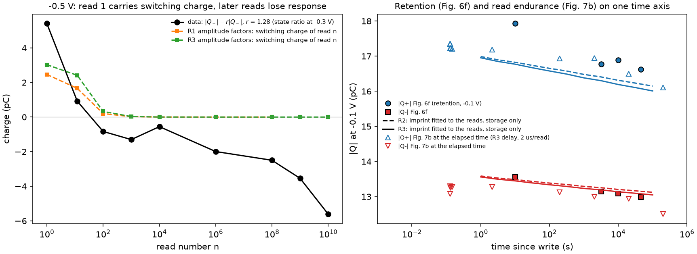

**English** | [繁體中文](read-imprint-r2.zh-TW.md)

# Read disturb and imprint dynamics (round 2): mechanisms, model and a test on Mukherjee IEDM 2023

Research note. The first round, [tail-fit](tail-fit.md), found that the read endurance of Mukherjee IEDM 2023 Fig. 7 can only be reproduced if the stored state being read is about 0.41–0.44 V harder to switch than the state in the P–V loop (a constant shift Δ); [fatigue-imprint](fatigue-imprint.md) added an imprint of 12 log-spaced time constants (E17). This round answers five questions, mechanisms and distinguishing predictions first (section 2), data second (section 4):

1. Can the constant Δ be replaced by imprint dynamics — a part built during the write plus logarithmic growth? How much shift can build up between the write and the first read?
2. What is the 4.6 pC drop in the first 12 reads at −0.5 V?
3. Why do the curved 10 kHz C–V branches and the linear CMW of the 500 ns reads contradict each other?
4. Is the decline after 10⁸ reads read-stress pinning or imprint that keeps growing during the reads?
5. The asymmetric movement of the two coercive voltages.

All computations are in [`examples/read_imprint_r2_study.py`](../../examples/read_imprint_r2_study.py); the numbers come from the [`read_imprint_r2.json`](read_imprint_r2.json) it writes. The model gains only two terms, both off by default (section 3).

## Conclusions at a glance

| Question | Conclusion | Status |
|---|---|---|
| 1. Δ from imprint dynamics | Fast imprint during the write also happens in the loop and does not contribute to Δ; Δ comes from storage time beyond the loop age (21 µs). A dynamic-imprint fit (delay 0.1–0.6 s, escape branch 31–35 mV/e-fold) is slightly better than a constant Δ (χ²/point 1.78 vs 2.03) | reproduced, but the delay is a fitted value; needs imprint growing from about 1 µs |
| 2. Drop in the first 12 reads at −0.5 V | Only in \|Q₊\|. Read 1 carries about 5 pC of switching charge (0.3 % of the polarization), which disappears afterwards; soft-region and reversible-response explanations are ruled out by the charge budget | size and decay time reproduced; the model's incubation makes read 2 the largest, the data trend makes read 1 the largest |
| 3. Curved C–V vs linear reads | The ratio of the two states agrees with the C–V; the difference is a factor common to both states (0.87, 0.90, 0.80 at −0.1, −0.3, −0.5 V), most likely the actual read amplitude. With these factors the C–V branches need no change; the C–V peak of ε₊ sits at the onset of switching on the ms time scale | reproduced; the cause of 0.80 at −0.5 V is not confirmed |
| 4. Decline after 10⁸ reads | Retention shows that time alone lowers both states, but a single log spectrum cannot produce the knee at 10⁸; the ratio of the two declines cannot decide | not resolved; experiments listed |
| 5. Asymmetric shift | New optional term E17a (κ): fit to Buragohain2019 gives κ = 0.18 ± 0.02, RMS 125 → 43 mV | reproduced |

## 1. Data

Public papers only; digitized data are in [`data/literature/`](../../data/literature/) with a header giving source, figure, device and "digitized, approx.". Three new files:

| File | Content | How it was read |
|---|---|---|
| `mukherjee2023_iedm_fig7_qplus_qminus.csv` | Fig. 7b–d, \|Q₊\| and \|Q₋\| vs read number (−0.1, −0.3, −0.5 V) | median of the red / blue pixels (markers and the authors' trend line) in 0.25-decade bins of the 600 dpi page; axes calibrated on the grid lines |
| `mukherjee2023_iedm_fig6f_retention.csv` | Fig. 6f retention: stored only, one read each at 10 s–4.5×10⁴ s (−0.1 V, t_PW = 1 µs) | same, ±0.2 decade per cluster |
| `buragohain2019_acsami_fig2ab_branch_vc.csv` | Buragohain 2019 Figs. 2a,b: Vc₋ and Vc₊ of both stored states after 10 µs, 1 min, 1 h, 24 h | digitized in the fatigue-imprint study; branch roles added |

The first round had only the CMW (Fig. 7e). The separate \|Q₊\| and \|Q₋\| are the most important new constraint of this round: the reads (negative voltage) push only the + state toward switching; the − state never switches, so \|Q₋\| is a control that carries the reversible response alone.

**The paper also tells us the actual read amplitude.** The −100 mV read of Fig. 6c settles at about −90 mV in the plotted waveform, the C–V conversion of Fig. 6d corresponds to about 83 mV, and Fig. 7 labels its voltages "V_R ~ −100/−300/−500 mV". Section 4.2 fits this amplitude instead of assuming the nominal value.

## 2. Mechanism notes (before fitting)

For each question: candidate mechanisms, literature basis and the predictions that tell them apart. The literature column cites only what was actually read (section 7); "inference" marks our own reasoning, not a statement of a paper.

### 2.1 Question 1: why is the stored state harder to switch than the state in the loop?

**Candidates.**

- **Charge injection and trapping during storage (interface screening model).** When the polarization charge is not fully screened by the electrode, a strong field across the non-ferroelectric passive layer injects electrons that are trapped at the ferroelectric/passive-layer interface; the trapped charge sets up an internal field that stabilizes the stored state. If the injection current falls exponentially with the trapped charge, the shift grows as ln t [Buragohain2019 summarizing Grossmann 2002 and Tagantsev–Gerra 2006, second-hand]. In HZO the carriers are taken to be electrons trapped in deep oxygen-vacancy states, with an in-situ activation energy of 0.08–0.10 eV [Fengler2018].
- **Fast ("fluid") imprint during the write.** During the write the applied field lowers the interface barrier and electrons enter the first trap state by Schottky emission or direct tunnelling [Buragohain2019 p. 4]; 50–300 ns writes move the switching-current peaks by about 0.5–0.6 V (20 nm film, probed 10 µs later) [Buragohain2019 Fig. 3b]. The same paper states that a sub-threshold opposite bias accelerates conventional imprint (SI Fig. S7; SI not read, main-text statement only).
- **Domain pinning / seed inhibition.** Trapped charge or defects deactivate reversed nucleation seeds and raise the activation field for leaving the stored state [Kim2024, abstract only; local imprint in Fengler2018].
- **Role of the MoOx and Nb₂O₅ interface layers (inference).** This device has a 2 nm metal-oxide layer on each side of the ferroelectric [Mukherjee2023 Fig. 2a]. They are the passive layers: a more pronounced interface layer means a larger depolarization field and a stronger drive for injection; the high effective work function of MoOx makes the electrodes asymmetric (the loop centre V_imp ≈ 0.4 V [Mukherjee2023 Fig. 4]). Oxygen vacancies and variable valence (Mo, Nb) of the oxide layers may provide traps, but we found no trap data for this stack, so we use this only as a reason why the imprint rate of this device may exceed that of TiN/HZO, not to set a number.

**The key geometric point: the loop itself consists of freshly written states.** Δ is measured relative to the −0.54 V peak of the 50 µs triangular loop. In the loop the + state is written at +1.35 V, then passes through the high field at +2.7 V, and is switched about 21 µs later at −0.54 V. Whatever charge injection happens at high field during a write (fluid imprint) has also happened to the state in the loop; unless the write pulse is much longer than the high-field part of the loop, it cancels in Δ. **Δ can only come from storage time beyond 21 µs**, i.e. from the delay d between the write and the first read:

$$
\Delta(d)\approx V_{0,esc}\left[\ln\!\left(1+\frac{d}{\tau_0}\right)-\ln\!\left(1+\frac{t_L}{\tau_0}\right)\right],\qquad t_L\approx 21\ \mu\mathrm{s},
$$

where $V_{0,esc}$ is the log slope of the escape branch (the one that switches out of the stored state), the centre slope times $(1+\kappa)$ (question 5). Section 4.1 computes this with the field acceleration E17b: the stronger the acceleration, the more the loop states are imprinted too, and the *smaller* Δ becomes.

**Distinguishing predictions.** Δ grows logarithmically with d; it depends only weakly on the write pulse width; at higher temperature τ₀ shortens and Δ grows. If τ₀ (the time at which the log growth starts) is much longer than t_L — e.g. the 0.1–0.2 s of the fully poled samples of Buragohain2019 — the delay needed becomes tens of seconds or more.

### 2.2 Question 2: the early drop at −0.5 V

**The data rule out half of the candidates at once.** The separate curves show that the drop is **only in \|Q₊\|** (82.8 → 78.5 pC) while \|Q₋\| stays flat (60.4 → 60.6 pC). It belongs to the + state, which the read pushes toward switching; it is not a dielectric change common to both states and not instrument drift.

| Candidate | Prediction for \|Q₊\| | for \|Q₋\| | Verdict |
|---|---|---|---|
| Polarization lost by irreversible switching | losing 4.6 pC of reversible charge needs about 22 % of the polarization reversed, about 350 pC of switching charge in reads 2–12 | unchanged | ruled out (tail-fit section 4.5) |
| Soft regions near switching that contribute to ε₊ and vanish once switched | a domain just below its switching field has at most (1 − 1/√3)P ≈ 0.42P of reversible displacement (Landau double well) against 2P when it switches; losing 4.6 pC of reversible charge needs at least 22 pC of switching charge in reads 1–12 | unchanged | read 1 carries only about 5 pC of excess charge (section 4.4): ruled out |
| **Read 1 contains switching charge that decreases afterwards** | read 1 carries 2P_sA·Δf₁; the classes with the lowest activation field switch completely in read 1, later reads switch less and less | unchanged | compatible with the charge budget: about 0.3 % of the polarization |
| Recoverable switching (switches during the read, switches back at 0 V) | as above (only rise and plateau are integrated) | unchanged | indistinguishable from the previous one in the charge of Fig. 7; the falling edge and the off-time charge would tell |
| Imprint growing between the reads moves the ε₊ branch away from the read voltage | drops | also drops (the ε₋ branch moves away too) | \|Q₋\| is flat, and it needs d ≲ 10 µs, which conflicts with Δ(d) of question 1: not the main cause |

### 2.3 Question 3: curved C–V, linear reads

The C–V ε₊ rises toward its peak at −0.48 MV/cm and ε₋ falls slowly toward negative field; if the reads saw the same branches, \|Q₊\|/\|Q₋\| and CMW/\|V_R\| would both grow with \|V_R\|. The tail-fit study saw only the CMW and found it linear in \|V_R\| (43, 40, 41.8 pC/V).

| Candidate | Prediction | Testable with the separate curves of Fig. 7? |
|---|---|---|
| (a) a slow reversible part (the existing f_rev/τ_r: term (2) split into an instantaneous and a low-pass part) | both parts have the same shape, so \|Q₊\|/\|Q₋\| of a read follows the C–V shape, only smaller | cannot change the ratio of the two states |
| (b) a slow configuration variable: the fast response linearized about a slow configuration y, q₂ = g(y) + g′(y)(V − y) | read 1 (y = 0) sees the linear response with ε±(0); but the mean voltage of the read train pulls y to about V_R/2, and after τ_r/T reads \|Q₊\| rises by 3 % and \|Q₋\| falls by 2.5 % (−0.5 V) | the data move the other way (\|Q₊\| falls, \|Q₋\| flat): ruled out |
| (c) Maxwell–Wagner dispersion of the interface layers (MoOx/Nb₂O₅ plus leakage) | a frequency-dependent factor common to both states | cannot change the ratio; Fig. 6e shows only a common ~5 % change at −0.1 V between 1 µs and 10 ms |
| (d) the C–V peak of ε₊ is the onset of switching on the ms time scale (nucleation during the DC dwell creates walls) | a 500 ns read starts from a stored state without new walls and does not see the peak; the ratio stays at ε₊(0)/ε₋(0) | predicts a ratio independent of the voltage |
| (e) the actual read amplitude is below the nominal one, by a different factor at each voltage | both states scale by the same factor | the non-switching \|Q₋\| measures the factor directly |

### 2.4 Question 4: the decline after 10⁸ reads

The fatigue-imprint study found that read-stress pinning and imprint growing during the reads both describe the CMW decline. The separate \|Q₊\|, \|Q₋\| and the retention data of the same paper give three quantities to compare:

- **Time vs count.** Imprint follows time, pinning follows the read count. Fig. 6f is a storage-only experiment: if its decline (at the same elapsed time) equals the read-endurance decline, no read stress is needed.
- **Ratio of the two declines.** Imprint moves both branches away from the read voltage, so \|ΔQ₊\|/\|ΔQ₋\| is the ratio of the branch slopes at the read voltage (about 1.5 for the C–V branches); pinning removes term (2) of the pinned part, so the ratio is that of term (2) of the two states (about 2.2).
- **Recovery after a rewrite.** Imprint recovers, pinning does not; the paper has no such data.

### 2.5 Question 5: asymmetric coercive voltages

In the branch data of Buragohain2019 the branch that leaves the stored state moves about 1.5 times as much as the other one, and the loop widens. Mechanistically this is the sum of two components: the shift by trapped charge (both branches, same direction and amount), and a hardening that only makes *leaving* the stored state harder (seed inhibition, domain stabilization; the abstract of Kim2024 mentions E_a evolving in each branch, and the grain-boundary screening simulations of Tian2025 give asymmetric shifts [second-hand]). The simplest form moves both switching fields outward by an extra κV_I|σ_I|: the escape branch moves (1+κ) times the centre shift, the other branch (1−κ) times.

Note that Alcala2022 defines imprint as (Ec₊ + Ec₋)/2: one read measures the escape branch and then the return branch, so κ cancels in the average and cannot explain the different SS and NSS slopes.

## 3. Model changes: two optional terms

Both are appended at the end of the parameter table (`imp_kw`, `imp_va`), default 0; off, the code runs its old path: the Python output is bit-identical (test `test_imprint_without_new_terms_is_unchanged` and the existing tests), and on the 16 existing ngspice decks the compiled Verilog-A agrees with the build before the change: of 64 non-zero checked quantities 30 are identical and the rest differ by at most 8×10⁻⁷ relative (solver round-off). The changes are confined to the imprint and reversible-branch code; the wake-up and fatigue code is untouched.

**E17a: branch asymmetry (`imp_kw` = κ).** On top of the centre shift $-V_I\sigma_I$ of E17, both switching fields move outward by

$$
w=\kappa V_I\left(\sqrt{\sigma_I^2+e^2}-e\right),\qquad e=10^{-3},
$$

i.e. the + rate uses $u-w$ and the − rate $-u-w$ ($u$ is the drive of E1). For a stored + state with σ_I > 0 the escape (−) branch moves by $(1+\kappa)V_I\sigma_I$ and the return branch by $(1-\kappa)V_I\sigma_I$. The peaks of the reversible branches sit near the switching fields, so the branch distance $V_s$ gets $w/\rho$ as well. The reversal gates of h still use the centre drive $u$. The square-root smoothing keeps the Verilog-A derivative continuous at σ_I = 0.

**E17b: field acceleration (`imp_va` = V_a).** Every imprint rate is multiplied by $\cosh(\rho V/V_a)$ (argument capped at 80):

$$
\tau_j\dot\sigma_j=\cosh\!\left(\frac{\rho V}{V_a}\right)(x_t-\sigma_j).
$$

It stands for charge injection during write pulses and under bias (section 2.1): a symmetric, phenomenological form of an injection current that grows exponentially with field (Schottky, tunnelling) for either polarity. The cycle-averaged `cycle_history` builds its per-period affine map on the accelerated time $\int\cosh(\rho V/V_a)\,dt$ and agrees with direct integration (test).

**Read sequence.** [`read_disturb.read_sequence_dynamic`](../../src/fe_models/read_disturb.py) lets the imprint of each stored state grow with its imprint time after the write: the write pulse, a delay d, then one period T per read (accelerated time when E17b is on). Read n uses a card built from σ_I at that time (`imprint_card`); the switching part is relative to the loop's own imprint σ_L (the activation fields were calibrated on the loop), the reversible part relative to the imprint of the C–V states (taken 0.3 s old). Checks: with imprint off it equals `read_sequence` (relative 10⁻⁶); with a saturated imprint it equals `read_sequence` with a constant Δ; the first 6 reads agree with a step-by-step `nm.step` integration to < 0.3 %.

**Verilog-A and ngspice.** [`fecap_nls.va`](../../spice/fecap_nls.va) carries the same two terms; the new deck `spice/tests/imprint_r2.cir` (κ = 0.3, V_a = 0.6 V: +3 V write, 1 ms storage, −0.6 V read, ±1.8 V partial switching) agrees with Python to 0.015 µC/cm² (tolerance 0.05); all 78 checks of the 17 decks pass.

## 4. Tests and fits

Ordered by dependence: question 5 gives κ, question 3 gives the read amplitude, questions 1 and 2 use both in a joint fit, question 4 compares the fit with the retention data.

### 4.1 Question 5: branch coercive voltages of Buragohain 2019

Two stored states, four delays, two branches: 16 points. Model: the 12 log-spaced states of E17 (τ_I1 free, τ_I2 = 10⁸ s), the 5 ms set pulse counted as imprint time, plus four baseline voltages at 10 µs.

| Fit | Parameters | RMS | κ |
|---|---|---|---|
| E17 + E17a | 7 | **43 mV** | **0.18 ± 0.02** |
| E17 only (κ = 0) | 6 | 125 mV | — |

The digitizing uncertainty is about ±0.1 V, so the κ = 0 fit is outside it and the κ = 0.18 fit inside. Other parameters: V_I = 2.6 V, τ_I1 = 0.5 s, log slope of the centre shift 0.137 V/e-fold (20 nm), consistent with the 0.126–0.129 V obtained from Fig. 2c in the fatigue-imprint study. This device shows no growth before 0.1 s (τ_I1 ≈ 0.5 s; see the next section for the consequence).

### 4.2 Question 3: curved C–V, linear reads

The separate \|Q₊\| and \|Q₋\| expressed as secant permittivity per volt (nominal V_R; read 12 at −0.5 V, because read 1 carries switching charge, section 4.4):

| | −0.1 V | −0.3 V | −0.5 V |
|---|---|---|---|
| \|Q₊\|/\|Q₋\| (data) | 1.33 | 1.28 | 1.30 |
| \|Q₊\|/\|Q₋\| (C–V branches, secant) | 1.25 | 1.28 | 1.31 |
| secant ε, + state (data / C–V) | 36.7 / 41.2 | 38.0 / 41.7 | 33.3 / 42.1 |
| secant ε, − state (data / C–V) | 27.7 / 32.9 | 29.7 / 32.6 | 25.7 / 32.2 |

The **ratio** of the two states agrees with the C–V branches within ±0.08 at all three voltages, which is the uncertainty of the digitizing and of the 7-point C–V fit; the real difference is a **factor common to both states**: about 0.84–0.89, 0.91 and 0.79 at −0.1, −0.3 and −0.5 V. Even the non-switching − state loses 20 % at −0.5 V. So what the tail-fit study saw as "linear CMW, curved C–V" is mostly not a state-dependent curvature but a common factor.

The most direct explanation is candidate (e): the actual read amplitude is below the nominal one. The 0.87 at −0.1 V agrees with the waveform of Fig. 6c (−100 mV settling at about −90 mV). Fitting the three amplitude factors with the reversible part fixed to the C–V branches and a constant Δ (fit R1) brings χ²/point of the 21 × 2 points down from 185 (R0, nominal amplitude) to **2.0**, with a CMW RMS of 0.87 pC, as good as the tail-fit M3 (0.80 pC) — but without changing the C–V at all (M3 had to move the ε₊ peak to +0.1 MV/cm, raising the C–V RMS from 1.43 to 2.42). The fitted factors are k = 0.87, 0.90, 0.80.

The other candidates:

- (b) The linearized slow-configuration form predicts \|Q₊\| rising by 3 % and \|Q₋\| falling by 2.5 % during the read train (−0.5 V); the data have \|Q₊\| falling and \|Q₋\| flat. Ruled out.
- (a) and (c) cannot change the ratio of the two states — and the ratio needs no change.
- (d) Simulating the DC sweep of the C–V (13 ms per 0.125 MV/cm step) with the stabilized card of tail-fit M2: the stored + state has switched 1 % at −0.35 MV/cm, 10 % at −0.44 MV/cm and half at −0.58 MV/cm. **The C–V peak of ε₊ (−0.48 MV/cm) sits right at the onset of switching on the ms time scale.** This supports reading the rising side of the C–V peak as a contribution of nucleation and new domain walls, which a 500 ns read starting from a wall-free stored state does not see. With the present amplitude uncertainty, however, the read data cannot resolve the small effect of (d) on the ratio.

**Conclusion.** The "curved C–V vs linear reads" contradiction is mostly a read-amplitude issue; with amplitude factors the C–V-fitted branches describe the reads and the branch distortion of the first-round M3 is no longer needed. The factor 0.80 at −0.5 V is clearly below the 0.90 at −0.3 V, which does not look like a single amplifier gain; the actual −0.3 and −0.5 V read waveforms of the paper would be needed to confirm it.

### 4.3 Question 1: origin and size of Δ

**Imprint built during the write cancels in Δ.** E17b gives σ_L in the loop (±2.7 V, 50 µs triangle, switching at +1.35 V and −0.54 V, periodic state) and σ after a 1 µs, 2.7 V write and a delay d (per volt of V_I, time constants 10⁻⁷–10⁸ s):

| V_a | σ_L | d = 1 ms | d = 0.1 s | d = 10 s |
|---|---|---|---|---|
| no acceleration | 0.147 | +0.134 | +0.273 | +0.401 |
| 0.5 V | 0.252 | +0.031 | +0.168 | +0.295 |
| 0.3 V | 0.343 | −0.010 | +0.078 | +0.205 |
| 0.2 V | 0.454 | −0.003 | +0.004 | +0.095 |

The table gives "stored state minus loop". The stronger the field acceleration, the more the loop state is imprinted during its high-field part and the *smaller* the difference. Fast imprint can contribute to Δ only if the write pulse is much longer (or stronger) than the high-field part of the loop; the paper does not give the write pulse width, and the cycling waveform of Fig. 3a is labelled 200 ns and 600 ns — if the write uses the same pulse, it is shorter than the high-field part of the loop (several µs). **Δ has to be built by storage time beyond 21 µs.**

**How long a delay is needed.** The amplitude correction of R1 lowers the shift needed from 0.41–0.44 V to 0.34 V (at −0.5 V the read is only about −0.40 V, a weaker drive). Delays needed for a log law starting at τ₀ = 1 µs (growth from the loop age on):

| Source of the slope (scaled to 9 nm, escape branch ×(1+κ)) | V_0,esc | Δ = 0.34 V | Δ = 0.44 V |
|---|---|---|---|
| Fengler2018 TiN/HZO, 25 °C | 22 mV/e-fold | 127 s | 3.2 h |
| Fengler2018, 125 °C | 29 mV/e-fold | 2.8 s | 82 s |
| Alcala2022 Si:HfO₂ SS, 85 °C | 54 mV/e-fold | 12 ms | 70 ms |
| Buragohain2019 La:HfO₂, RT | 65–72 mV/e-fold | 2–4 ms | 9–19 ms |
| this device, Fig. 6f retention via \|Q₊\| | 70 mV/e-fold | 3 ms | 11 ms |
| this device, Fig. 6f retention via \|Q₋\| | 46 mV/e-fold | 38 ms | 0.33 s |

With each paper's own τ₀ (Fengler 25 °C about 1 s, Buragohain 0.07–0.18 s) the delays become tens of seconds to months. The retention slopes assume that the decline of Fig. 6f is entirely the imprint moving the C–V branches away from the read voltage, converted with the branch slopes at −0.087 V (\|Q₊\| and \|Q₋\| differ by a factor 1.5, which shows how far the branch shape or this assumption can be trusted).

**Joint fit with dynamic imprint.** Replacing the constant Δ with E17 + E17a (κ = 0.18 fixed, τ_I2 = 10⁸ s) and fitting V_I, τ_I1, the delay d and the three amplitude factors to the separate \|Q₊\|, \|Q₋\|:

| Fit | Data | Parameters | χ²/point | CMW RMS | Result |
|---|---|---|---|---|---|
| R1 constant Δ | n ≤ 10⁸ (42 points) | 4 | 2.03 | 0.87 pC | Δ = 0.34 V |
| **R2 dynamic imprint** | n ≤ 10⁸ | 6 | **1.78** | **0.74 pC** | d = 0.60 s, τ_I1 = 0.4 µs, V_0,esc = 31 mV/e-fold; 0.338 V relative to the loop at read 1 |
| R3 dynamic imprint | all n (58 points) | 6 | 2.44 | 0.90 pC | d = 0.13 s, V_0,esc = 35 mV/e-fold; 0.329 V |

**Conclusions.**

- The constant Δ can be replaced by imprint dynamics, with a slightly better fit: the shift needed builds up by log growth within 0.1–0.6 s after the write, at 31–35 mV/e-fold (escape branch, 9 nm) — between HZO/TiN (22) and La:HfO₂ and the device's own retention (46–72).
- This requires the log growth to start at about 1 µs (the fit gives τ_I1 ≈ 0.4 µs). The fully poled 5 ms writes of Buragohain2019 show no growth before 0.1 s; the same paper sees τ₀ ≤ 10 µs in partially switched, freshly reversed regions [digitized Fig. 3c]. Which case applies to this device cannot be decided from the paper's data.
- A delay of 0.1–0.6 s is a plausible order of magnitude for switching from the write to the read sequence, but the paper does not state it; it is a fitted value, not a check.
- Fast imprint during the write is not the answer: it acts on the loop states as well (table above). E17b was therefore not used in the fits of this round; it remains an optional term for pulse-width and bias-accelerated imprint.

### 4.4 Question 2: the early drop at −0.5 V

With the state ratio r = 1.28 at −0.3 V (the ratio of the two states without switching, section 4.2) as the reversible part of the + state, the excess is switching charge:

| Read | 1 | 12 | 100 | 10³ | 10⁶ | 10⁸ | 10¹⁰ |
|---|---|---|---|---|---|---|---|
| \|Q₊\| − r\|Q₋\| (pC) | **+5.4** | +0.9 | −0.8 | −1.3 | −2.0 | −2.5 | −5.6 |

- Read 1 carries about 5 pC more, i.e. 0.34 % of the polarization reversed; read 12 only about 1 pC; after 100 reads the excess is negative, i.e. the + state starts to lose response (cumulative switching and imprint moving the branches away).
- The soft-region bound: losing 4.3 pC of reversible charge needs at least 20 pC of switching charge in reads 1–12; read 1 of the data has only 5.4 pC more. Ruled out.
- Switching charge per read in the model (R1, R3): 2.5–3.0 pC at read 1, 1.7–2.4 pC at read 12, 0.2–0.3 pC at read 100. The decay time (about 100 reads) is that of the data, the distribution is not: the model's read 1 is too small and read 12 too large. The reason is the Weibull incubation (β = 2.07): h does not relax between reads (the gate is centred at V_imp), so the hazard per read first rises and the model's maximum is at read 2 (about 4.7 pC). Centring the gate of h at 0 V makes almost no difference. Single points scatter by about ±3 pC, so the difference shows only in the trend line.

**Conclusion.** The drop in the first 12 reads is the switching charge of read 1 (about 0.3 % of the polarization reversed) disappearing in later reads, not a change of the reversible response — consistent with the paper's statement that −0.5 V causes partial polarization reversal. The model gets the size and the decay time right; to make read 1 the largest it needs a small group with β ≤ 1 (soft regions without incubation, e.g. grains that already hold reversed seeds) or full relaxation of h between reads. The data (single-point scatter ±3 pC) cannot settle this yet. Recoverable switching (switching during the read, back at 0 V) and irreversible switching give the same signal in the charge of Fig. 7; the falling edge and the off-time charge would separate them.

### 4.5 Question 4: the decline after 10⁸ reads

**Imprint with a single log spectrum cannot produce the knee of the data.** R3 includes the points beyond 10⁸: its decline starts at about 10⁵–10⁶ reads (about 1 s) at a logarithmic rate, while the data at −0.1 and −0.3 V stay flat to about 10⁸ reads and then fall faster than logarithmically; at −0.5 V and 10¹⁰ reads the data are at 69.6 pC, the model at 72.5 pC. A log-uniform distribution of time constants can only give a fixed slope.

**Comparison with retention (storage only).** Fig. 6f has slopes of −0.36 pC/decade (\|Q₊\|) and −0.16 pC/decade (\|Q₋\|) between 10 s and 4.5×10⁴ s. The imprint fitted to the reads predicts for the same retention experiment −0.17 / −0.09 (R2) and −0.19 / −0.10 pC/decade (R3): half the data. Placing the points of Fig. 7b on the elapsed-time axis (R3 delay plus 2 µs per read): between 10 s and 200 s the read-endurance \|Q₊\| falls by only about 0.25 pC, where the retention rate would give about 0.5 pC; only after 10⁸ reads do the two slopes become similar. In the paper these are separate measurements (Fig. 6f uses t_PW = 1 µs and its \|Q₊\| is about 0.7 pC higher), possibly on different devices.

**Ratio of the two declines.**

| | Data | Imprint prediction | Pinning prediction |
|---|---|---|---|
| −0.1 V, 10⁸ → 10¹¹ | 1.34 | 1.50 | 2.15 |
| −0.3 V, 10⁸ → 10¹¹ | 1.79 | 1.47 | 2.31 |
| retention (storage only, −0.1 V) | 2.31 | 1.50 | — |

The storage-only retention gives 2.3, exactly the "pinning" value, although retention has no read stress. The ratio test is therefore limited by the shape of the C–V branches near 0 V (a 7-point Lorentzian fit) and cannot decide.

**Conclusion.** These public data still cannot separate the two mechanisms. What is established: (1) the retention data show that time alone lowers both states in this device, at a rate comparable to the read endurance beyond 10⁸, so part of the late decline needs no read stress; (2) the shape of the read endurance — flat before 10⁸ reads, steeper after — cannot come from imprint with a single log spectrum; it needs a second, slower component (onset 10²–10³ s) or a pinning that accumulates with the read count (a stretched law has a knee by construction). The distinguishing experiments are in section 6.

## 5. Tried and not adopted

| Approach | Result |
|---|---|
| Fast imprint during the write (E17b) to produce Δ | the high-field part of the loop imprints as well; Δ becomes smaller (table of section 4.3) |
| Linearized slow configuration q₂ = g(y) + g′(y)(V − y) to explain C–V vs reads | the read train pulls y to about V_R/2; predicts \|Q₊\| up and \|Q₋\| down, opposite to the data; not put into the model |
| The existing slow reversible part f_rev/τ_r | same shape, cannot change the ratio of the two states; in tail-fit M5 τ_r also ran to its bound |
| Refitting the reversible branches as in M3 of round 1 | not needed with the read-amplitude factors; the C–V keeps its own fit |
| A single log spectrum fitted to all read counts (R3) | cannot produce the knee at 10⁸; χ²/point rises from 1.78 to 2.44 |
| Centring the gate of h at 0 V (h relaxes between reads) | the distribution of the early switching charge hardly changes |
| κ to explain the SS/NSS slope ratio 1.5 of Alcala2022 | κ cancels in (Ec₊ + Ec₋)/2; impossible |
| The ratio of the two declines to separate pinning and imprint | storage-only retention also gives the "pinning" ratio; the test is limited by the branch shape |

## 6. Data still missing

All of these can be measured directly; ordered by their impact on this study:

1. **The actual waveforms of the −0.3 and −0.5 V reads**: the amplitude factors are the largest correction of R1–R3 (Δ from 0.44 to 0.34 V), and only −0.1 V is backed by a waveform in the paper.
2. **The delay between the write and the first read, the read period (or off time) and the write pulse width**: the test of Δ(d) and the conversion between time and read count depend on them; varying the delay (e.g. 1 ms, 1 s, 100 s) is the most direct test that Δ comes from storage imprint.
3. **Retention and read endurance on the same device**, and endurance at a fixed read count with different read periods: separates time (imprint) from count (pinning).
4. **Rewrite and read again after 10¹¹ reads**: imprint recovers, pinning does not.
5. **The charge of the falling edge and the off time of a read**: separates recoverable from irreversible partial switching (question 2).
6. **The dependence of the C–V on the ac amplitude and the sweep rate**: if the ε₊ peak changes with the dwell time or the ac amplitude, that supports "the peak is the onset of switching on the ms scale" (candidate (d) of question 3).
7. **Temperature**: thermal activation of τ₀ makes Δ grow with temperature (the structure of Fengler2018), another prediction of the imprint explanation.

The device card [`spice/params/mukherjee2023.inc`](../../spice/params/mukherjee2023.inc) is not updated in this round: the amplitude factors and the delay belong to the measurement, not to the device; the dynamic imprint is calibrated relative to the loop, and writing it into the card would move the loop peaks of the card (which its tests check). To reproduce the read endurance in a circuit, use `imp_v = 0.87–0.98 V`, `imp_t1 ≈ 4×10⁻⁷ s`, `imp_t2 = 10⁸ s`, `imp_kw = 0.18`, and recalibrate the activation fields on "the state 21 µs old in the loop".

## 7. References and what was read

| Key | Reference | Read |
|---|---|---|
| Mukherjee2023 | S. Mukherjee et al., IEDM 2023, doi:10.1109/IEDM45741.2023.10413879 | full text (4 pp.); Figs. 2–7 viewed, Figs. 6f and 7b–d digitized |
| Buragohain2019 | P. Buragohain et al., ACS Appl. Mater. Interfaces 11, 35115 (2019), doi:10.1021/acsami.9b11146 | full accepted manuscript (TU Dresden); Figs. 2, 3; SI not read (S4, S7 from the main text only) |
| Fengler2018 | F. P. G. Fengler et al., J. Appl. Phys. 123, 204101 (2018), doi:10.1063/1.5026424 | self-archived full text; Fig. 3 |
| Alcala2022 | R. Alcala et al., IEEE J. Electron Devices Soc. 10, 907 (2022), doi:10.1109/JEDS.2022.3198138 | full text; Figs. 5, 7; imprint definition Eq. 2 |
| Tian2025 | H. Tian, J. Yang, M. Liu, arXiv:2512.13748 | full text; figures not viewed |
| Kim2024 | T. Kim, J. A. del Alamo, D. Antoniadis, IEEE TED 71, 6620 (2024) | abstract only |

Second-hand only: Grossmann et al., J. Appl. Phys. 92, 2680/2688 (2002) and Tagantsev & Gerra, J. Appl. Phys. 100, 051607 (2006) (via Buragohain2019). The Alessandri 2018/2019 kinetics are those collected in the tail-fit study.
