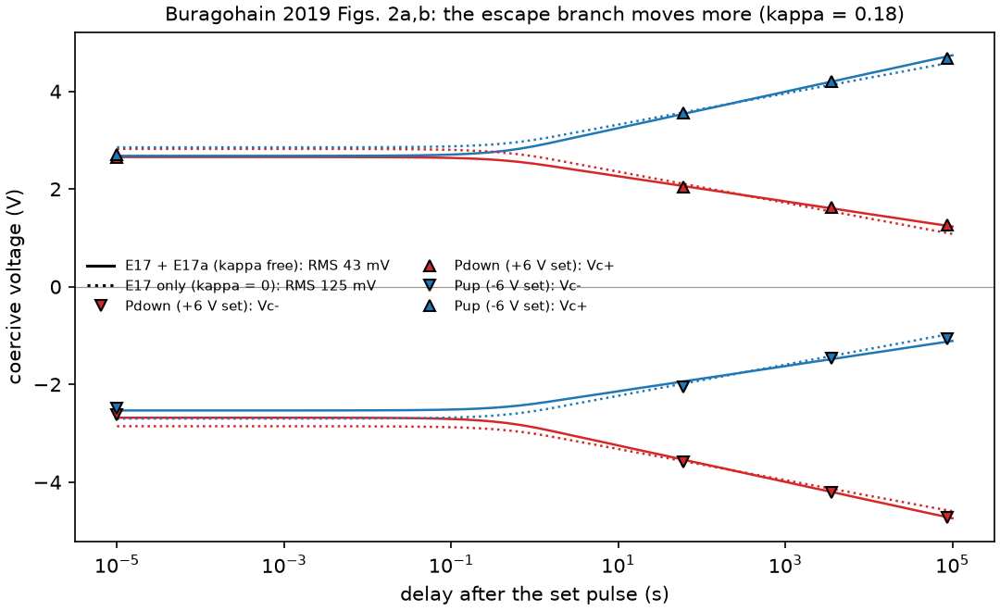
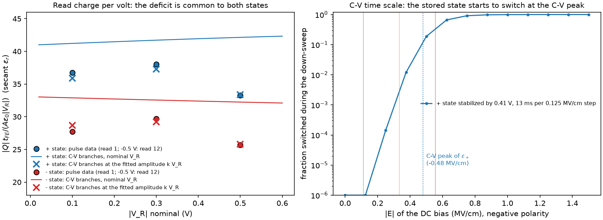
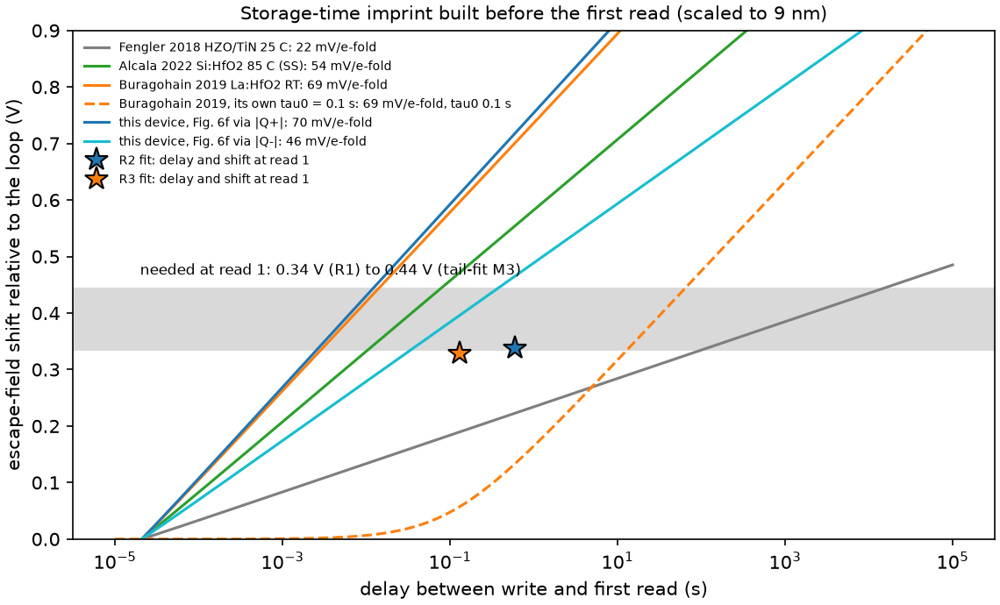
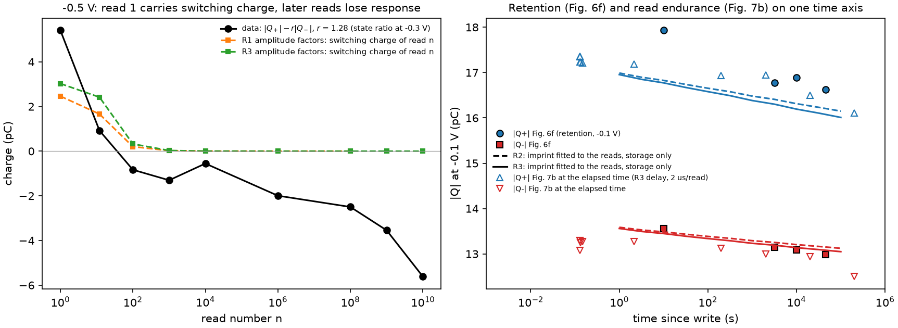

[English](read-imprint-r2.md) | **繁體中文**

# 讀取擾動與 imprint 動態（第二輪）：機制、模型與 Mukherjee IEDM 2023 的檢驗

研究筆記。第一輪的 [tail-fit](tail-fit.zh-TW.md) 發現，要重現 Mukherjee IEDM 2023 Fig. 7 的讀取耐久，被讀取的儲存態必須比迴線中的狀態難翻約 0.41–0.44 V（常數 Δ）；[fatigue-imprint](fatigue-imprint.zh-TW.md) 加入了 12 個對數分布時間常數的 imprint（E17）。這一輪回答五個問題，順序是先講機制與可區分的預測（第 2 節），再用資料檢驗（第 4 節）：

1. 常數 Δ 能否換成 imprint 的動態：寫入當下建立的部分加上對數時間增長？寫入到第一次讀取之間能建立多大的偏移？
2. −0.5 V 前 12 次讀取下降的 4.6 pC 是什麼？
3. 10 kHz C–V 的曲率與 500 ns 讀取的線性 CMW 為何互相矛盾？
4. 10⁸ 次讀取後的下降是讀取應力的釘住，還是讀取期間 imprint 繼續增長？
5. 兩個矯頑電壓的不對稱移動。

計算全部在 [`examples/read_imprint_r2_study.py`](../../examples/read_imprint_r2_study.py)，數字取自它寫出的 [`read_imprint_r2.json`](read_imprint_r2.json)。新的模型項只有兩個，都預設關閉（第 3 節）。

## 結論一覽

| 問題 | 結論 | 狀態 |
|---|---|---|
| 1. Δ 換成 imprint 動態 | 寫入當下的快速 imprint 在迴線中同樣發生，對 Δ 沒有貢獻；Δ 來自迴線年齡（21 µs）之後的儲存時間。動態 imprint 擬合（延遲 0.1–0.6 s、逃逸支 31–35 mV/e-fold）比常數 Δ 略好（χ²/點 1.78 對 2.03） | 對上，但延遲是擬合值；需要 imprint 從約 1 µs 就開始增長 |
| 2. −0.5 V 前 12 次下降 | 只發生在 \|Q₊\|。第 1 次讀取含約 5 pC 的切換電荷（0.3 % 極化），之後消失；軟區與可逆響應的解釋被電荷預算排除 | 量級與衰減時間對上；模型的潛伏讓第 2 次最大，資料趨勢是第 1 次最大 |
| 3. C–V 曲率對讀取線性 | 兩態之比與 C–V 一致；差異是兩個態共同少掉的比例（−0.1、−0.3、−0.5 V 依序 0.87、0.90、0.80），最可能是讀取的實際振幅。放進振幅比例後 C–V 分支不需修改；C–V 的 ε₊ 峰落在 ms 時間尺度的切換起點 | 對上；−0.5 V 的 0.80 原因未確認 |
| 4. 10⁸ 次後的下降 | 保持力顯示時間本身就會讓兩態下降，但單一對數譜給不出 10⁸ 的轉折；兩態下降比無法判別 | 未分辨；列出所需實驗 |
| 5. 不對稱平移 | 新選用項 E17a（κ）：Buragohain2019 擬合 κ = 0.18 ± 0.02，RMS 125 → 43 mV | 對上 |

## 1. 資料

只用公開論文；讀圖數據放在 [`data/literature/`](../../data/literature/)，檔頭寫明出處、圖號、元件與「digitized, approx.」。這一輪新增三個檔案：

| 檔案 | 內容 | 讀圖方式 |
|---|---|---|
| `mukherjee2023_iedm_fig7_qplus_qminus.csv` | Fig. 7b–d 的 \|Q₊\| 與 \|Q₋\| 對讀取次數（−0.1、−0.3、−0.5 V） | 600 dpi 頁面上紅、藍像素在每 0.25 個十倍區間的中位數（點與作者的趨勢線）；格線校正座標 |
| `mukherjee2023_iedm_fig6f_retention.csv` | Fig. 6f 的保持力：只存放、在 10 s–4.5×10⁴ s 各讀一次（−0.1 V，t_PW = 1 µs） | 同上，每群點 ±0.2 個十倍 |
| `buragohain2019_acsami_fig2ab_branch_vc.csv` | Buragohain 2019 Fig. 2a,b：兩個儲存態在 10 µs、1 min、1 h、24 h 後的 Vc₋、Vc₊ | fatigue-imprint 研究時讀的數據，補上分支角色的說明 |

第一輪只有 CMW（Fig. 7e）。分開的 \|Q₊\|、\|Q₋\| 是這一輪最重要的新約束：被讀取時會被推向切換的是 + 態（負讀取電壓），− 態完全不會切換，所以 \|Q₋\| 是純可逆響應的對照組。

**原文同時告訴我們讀取脈衝的實際振幅**：Fig. 6c 的 −100 mV 讀取在示波波形上停在約 −90 mV，Fig. 6d 用 C–V 換算的電荷相當於約 83 mV；Fig. 7 的標示也寫「V_R ~ −100/−300/−500 mV」。第 4.2 節把這一點當成要擬合的量，而不是假設讀取電壓等於標稱值。

## 2. 機制筆記（擬合之前）

每個問題列出候選機制、文獻依據與可以區分它們的預測。文獻欄只寫實際讀過的部分（第 7 節）；「推論」表示文獻沒有直接說、是我們的推理。

### 2.1 問題 1：儲存態為什麼比迴線裡的狀態難翻

**候選機制。**

- **儲存時間的電荷注入與捕獲（介面屏蔽模型）。** 極化電荷沒有被電極完全屏蔽時，非鐵電的被動層裡有強電場，把電子注入並捕獲在鐵電／被動層介面；捕獲電荷形成內建場，穩定所存的狀態。若注入電流隨已捕獲的電荷指數下降，平移量 ∝ ln t [Buragohain2019 整理 Grossmann 2002、Tagantsev–Gerra 2006，轉引]。HZO 的載子被認為是被氧空缺深能階捕獲的電子，原位活化能 0.08–0.10 eV [Fengler2018]。
- **寫入期間的快速（fluid）imprint。** 寫入脈衝時，外加電場降低介面能障，電子以 Schottky 發射或直接穿隧注入第一個陷阱態 [Buragohain2019 p. 4]；50–300 ns 的寫入就能讓切換電流峰移動約 0.5–0.6 V（20 nm，10 µs 後量）[Buragohain2019 Fig. 3b]。同一篇文獻也說，小於切換門檻的反向偏壓會加速一般的 imprint（SI Fig. S7，SI 未讀，只依正文）。
- **Domain pinning／種子抑制。** 捕獲電荷或缺陷讓反向成核點失活，提高逃離所存狀態的活化場 [Kim2024 只讀摘要；Fengler2018 的局部 imprint]。
- **MoOx 與 Nb₂O₅ 介面層的作用（推論）。** 這個元件的鐵電層兩側各有 2 nm 的金屬氧化物層 [Mukherjee2023 Fig. 2a]。它們就是被動層：介面層越明顯，去極化場越大，注入的驅動力越強；MoOx 的高有效功函數造成兩電極不對稱（V_imp ≈ 0.4 V 的迴線中心就是由此而來 [Mukherjee2023 Fig. 4]）。氧化物層本身的氧空缺與可變價態（Mo、Nb）可能提供陷阱，但我們沒有讀到針對這個堆疊的陷阱資料，所以只把它當成「這個元件的 imprint 速率可能高於 TiN/HZO」的理由，不拿來定數值。

**關鍵的幾何觀察：迴線本身也是「剛寫入的狀態」。** Δ 是相對於 50 µs 三角波迴線的 −0.54 V 峰量的。在迴線裡，+ 態在 +1.35 V 寫入後，還要經過 +2.7 V 的高場，約 21 µs 之後才在 −0.54 V 被翻轉。所以寫入當下的高場注入（fluid imprint），迴線中的狀態也同樣經歷過；只要寫入脈衝沒有比迴線的高場段長很多，這部分在 Δ 中相消。**Δ 只能來自 21 µs 之後的儲存時間**，也就是寫入到第一次讀取之間的延遲 d：

$$
\Delta(d)\approx V_{0,esc}\left[\ln\!\left(1+\frac{d}{\tau_0}\right)-\ln\!\left(1+\frac{t_L}{\tau_0}\right)\right],\qquad t_L\approx 21\ \mu\mathrm{s},
$$

其中 $V_{0,esc}$ 是逃逸分支（離開所存狀態的那一支）的對數斜率，等於中心平移的斜率乘上 $(1+\kappa)$（問題 5）。第 4.1 節用 E17b 的場加速直接算出：場加速越強，迴線中的狀態被 imprint 得越多，Δ 反而變小。

**可區分的預測。** Δ 隨 d 對數增加；與寫入脈衝寬度只有弱關係；溫度升高時 τ₀ 縮短、Δ 變大。若 τ₀（imprint 開始對數增長的時間）比 t_L 長很多，例如 Buragohain2019 完全極化樣品的 0.1–0.2 s，所需的 d 會長到數十秒以上。

### 2.2 問題 2：−0.5 V 前 12 次的下降

**資料先排除一半的候選。** 分開的曲線顯示，這段下降**只發生在 \|Q₊\|**（82.8 → 78.5 pC），\|Q₋\| 持平（60.4 → 60.6 pC）。所以它和被讀取推向切換的 + 態有關，不是兩個態共同的介電變化，也不是儀器漂移。

| 候選 | 對 \|Q₊\| 的預測 | 對 \|Q₋\| 的預測 | 判斷 |
|---|---|---|---|
| 不可逆切換造成的極化損失 | 要掉 4.6 pC 的可逆電荷，需翻轉約 22 % 的極化，切換電荷約 350 pC 會出現在第 2–12 次讀取裡 | 不變 | 排除（tail-fit 第 4.5 節的電荷預算） |
| 接近切換的軟區對 ε₊ 的貢獻，被翻轉後消失 | 一個 domain 在切換場前的可逆位移最多是 (1 − 1/√3)P ≈ 0.42P（Landau 雙井），切換時則是 2P；要失去 4.6 pC 可逆電荷，前 12 次至少要有 22 pC 的切換電荷 | 不變 | 資料第 1 次讀取的多餘電荷只有約 5 pC（第 4.4 節）：排除 |
| **第 1 次讀取含切換電荷，之後遞減** | 第 1 次讀取多出切換電荷 2P_sA·Δf₁；活化場最低的類別在第 1 次就切完，之後每次切換越來越少 | 不變 | 與電荷預算相容：只需約 0.3 % 的極化 |
| 會回切的可恢復切換（讀取時翻、0 V 時回切） | 同上（只積分上升與平台） | 不變 | 與上一項在 Fig. 7 的電荷上無法區分；要看下降沿與關閉期間的電荷 |
| 讀取期間 imprint 增長使 ε₊ 分支遠離讀取電壓 | 下降 | 也下降（ε₋ 分支同樣遠離） | \|Q₋\| 不變，且需要 d ≲ 10 µs，與問題 1 的 Δ(d) 衝突：排除為主因 |

### 2.3 問題 3：C–V 的曲率與讀取的線性

C–V 的 ε₊ 往 −0.48 MV/cm 的峰上升，ε₋ 往負場緩降；如果讀取看到的是同樣的分支，\|Q₊\|/\|Q₋\| 應隨 \|V_R\| 增加，CMW/\|V_R\| 也應增加。tail-fit 只看 CMW，發現它對 \|V_R\| 是線性的（43、40、41.8 pC/V）。

| 候選 | 預測 | 能否用 Fig. 7 的分開曲線檢驗 |
|---|---|---|
| (a) 慢的可逆分量（模型既有的 f_rev/τ_r：第 (2) 項分成瞬時與低通兩部分） | 兩部分形狀相同，所以讀取的 \|Q₊\|/\|Q₋\| 與 C–V 的形狀一致，只是幅度變小 | 改變不了兩態之比 |
| (b) 慢的組態變數：快響應對慢組態 y 線性化，q₂ = g(y) + g′(y)(V − y) | 第 1 次讀取 y = 0，看到 ε±(0) 的線性響應；但讀取串的平均電壓會把 y 拉到約 V_R/2，τ_r/T 次讀取後 \|Q₊\| 升 3 %、\|Q₋\| 降 2.5 %（−0.5 V） | 資料方向相反（\|Q₊\| 降、\|Q₋\| 不變）：排除 |
| (c) 介面層的 Maxwell–Wagner 色散（MoOx/Nb₂O₅ 加漏電） | 頻率依賴的共同比例，兩態相同 | 改變不了兩態之比；Fig. 6e 在 −0.1 V、1 µs–10 ms 之間只有約 5 % 的共同變化（作者稱為弱依賴） |
| (d) C–V 的 ε₊ 峰屬於 ms 時間尺度的切換起點（DC 停留時開始成核、產生域壁） | 500 ns 讀取從沒有新域壁的儲存態出發，看不到峰；兩態之比維持 ε₊(0)/ε₋(0) | 預測兩態之比與電壓無關 |
| (e) 讀取脈衝的實際振幅小於標稱值，且各電壓比例不同 | 兩態按同一比例縮小 | 用不會切換的 \|Q₋\| 直接量出比例 |

### 2.4 問題 4：10⁸ 次之後的下降

fatigue-imprint 發現「讀取應力的釘住」與「讀取期間的 imprint 增長」都能描述 CMW 的下降。分開的 \|Q₊\|、\|Q₋\| 與原文的保持力圖給出三個可以比較的量：

- **時間對次數。** imprint 依時間，釘住依次數。Fig. 6f 是只存放、不連續讀取的實驗：如果它的下降速率（換成同樣的經過時間）和讀取耐久的下降相同，就不需要讀取應力。
- **兩態下降之比。** imprint 讓兩個分支都遠離讀取電壓，\|ΔQ₊\|/\|ΔQ₋\| 等於兩分支在讀取電壓的斜率比（C–V 分支約 1.5）；釘住讓被釘住的部分失去第 (2) 項，比值等於兩態第 (2) 項之比（約 2.2）。
- **重寫後的恢復。** imprint 可恢復、釘住不會；原文沒有這個數據。

### 2.5 問題 5：兩個矯頑電壓不對稱

Buragohain2019 的分支數據顯示，離開所存狀態的那一支移動約 1.5 倍於另一支，迴線同時變寬。機制上這是兩個成分的和：捕獲電荷造成的平移（兩支同向、等量），加上只讓「逃離所存狀態」變難的硬化（種子抑制、domain 穩定化；Kim2024 摘要提到 E_a 在兩支各自演化，Tian2025 的晶界屏蔽模擬也給出不對稱 [轉引]）。最簡單的寫法是讓兩個切換場都再向外移 κV_I|σ_I|：逃逸支移動 (1+κ) 倍的中心平移，另一支 (1−κ) 倍。

要注意，Alcala2022 的 imprint 定義是 (Ec₊ + Ec₋)/2：一次讀取裡先後量到的是逃逸支與回切支，κ 在平均中相消，所以 κ 不能解釋 SS 與 NSS 斜率不同。

## 3. 模型修改：兩個選用項

兩項都加在參數表尾端（`imp_kw`、`imp_va`），預設 0，關閉時程式走原本的路徑：Python 輸出逐位元相同（測試 `test_imprint_without_new_terms_is_unchanged`，既有測試全部原樣通過），Verilog-A 在原有 16 組 ngspice 電路上與修改前的編譯結果比較，64 個非零的檢查量中 30 個完全相同，其餘相對差 ≤ 8×10⁻⁷（求解器的捨入）。修改集中在 imprint 與可逆分支的程式段，沒有動到 wake-up、fatigue 的程式。

**E17a：分支不對稱（`imp_kw` = κ）。** 在 E17 的中心平移 $-V_I\sigma_I$ 之外，兩個切換場再向外移

$$
w=\kappa V_I\left(\sqrt{\sigma_I^2+e^2}-e\right),\qquad e=10^{-3},
$$

也就是 + 方向的速率用 $u-w$、− 方向用 $-u-w$（$u$ 是 E1 的驅動）。對 σ_I > 0 的儲存 + 態，逃逸支（− 方向）移動 $(1+\kappa)V_I\sigma_I$，回切支 $(1-\kappa)V_I\sigma_I$。可逆分支的峰就在切換場附近，所以分支距離 $V_s$ 同樣加上 $w/\rho$。h 的反轉閘門仍用中心驅動 $u$。平方根的平滑讓 Verilog-A 的導數在 σ_I = 0 連續。

**E17b：場加速（`imp_va` = V_a）。** 每一個 imprint 狀態的速率乘上 $\cosh(\rho V/V_a)$（引數上限 80）：

$$
\tau_j\dot\sigma_j=\cosh\!\left(\frac{\rho V}{V_a}\right)(x_t-\sigma_j).
$$

這代表寫入脈衝與偏壓下的電荷注入（第 2.1 節）。它是對稱的唯象形式：注入電流隨電場指數增加（Schottky、穿隧），兩個極性一樣。週期平均的 `cycle_history` 用「加速後的時間」$\int\cosh(\rho V/V_a)\,dt$ 建每週期的仿射映射，與直接積分一致（測試）。

**讀取序列。** [`read_disturb.read_sequence_dynamic`](../../src/fe_models/read_disturb.py) 讓每個儲存態的 imprint 隨「寫入後的 imprint 時間」增長：寫入脈衝、延遲 d、之後每次讀取一個週期 T（E17b 打開時用加速後的時間）。第 n 次讀取用該時刻的 σ_I 建卡（`imprint_card`），切換部分相對於迴線自己的 imprint σ_L（活化場是在迴線上校正的），可逆部分相對於 C–V 量測時狀態的 imprint（取 0.3 s 大的狀態）。驗證：imprint 關閉時與 `read_sequence` 相同（相對 10⁻⁶），imprint 飽和時與常數 Δ 的 `read_sequence` 相同，前 6 次讀取與逐步 `nm.step` 積分相差 < 0.3 %。

**Verilog-A 與 ngspice。** [`fecap_nls.va`](../../spice/fecap_nls.va) 加入同樣的兩項；新電路 `spice/tests/imprint_r2.cir`（κ = 0.3、V_a = 0.6 V，+3 V 寫入、1 ms 存放、−0.6 V 讀取、±1.8 V 部分切換）與 Python 的最大電荷差 0.015 µC/cm²（容許 0.05）；全部 17 組電路 78 項檢查通過。

## 4. 檢驗與擬合

順序依賴關係排：問題 5 給出 κ，問題 3 給出讀取振幅，問題 1、2 用兩者做聯合擬合，問題 4 用擬合結果與保持力比較。

### 4.1 問題 5：Buragohain 2019 的分支矯頑電壓

兩個儲存態、四個延遲、兩支，共 16 點。模型：E17 的 12 個對數狀態（τ_I1 自由、τ_I2 = 10⁸ s），5 ms 寫入算進 imprint 時間，加上四個 10 µs 時的基準電壓。

| 擬合 | 參數 | RMS | κ |
|---|---|---|---|
| E17 + E17a | 7 | **43 mV** | **0.18 ± 0.02** |
| 只有 E17（κ = 0） | 6 | 125 mV | — |

讀圖誤差約 ±0.1 V，所以 κ = 0 的擬合超出誤差，κ = 0.18 的落在誤差內。其餘參數：V_I = 2.6 V、τ_I1 = 0.5 s，中心平移的對數斜率 0.137 V/e-fold（20 nm），與 fatigue-imprint 由 Fig. 2c 得到的 0.126–0.129 V 一致。這個元件在 0.1 s 之前看不到增長（τ_I1 ≈ 0.5 s，見下一節的影響）。

### 4.2 問題 3：C–V 曲率與讀取的線性

用分開的 \|Q₊\|、\|Q₋\| 換算成每伏特的割線介電常數（標稱 V_R；−0.5 V 用第 12 次，因為第 1 次含切換電荷，見 4.4）：

| | −0.1 V | −0.3 V | −0.5 V |
|---|---|---|---|
| \|Q₊\|/\|Q₋\|（資料） | 1.33 | 1.28 | 1.30 |
| \|Q₊\|/\|Q₋\|（C–V 分支，割線） | 1.25 | 1.28 | 1.31 |
| + 態割線 ε（資料／C–V） | 36.7 / 41.2 | 38.0 / 41.7 | 33.3 / 42.1 |
| − 態割線 ε（資料／C–V） | 27.7 / 32.9 | 29.7 / 32.6 | 25.7 / 32.2 |

兩個態的**比值**在三個電壓下與 C–V 分支的預測相差不到 ±0.08，這是讀圖與 7 點 C–V 擬合的不確定度範圍；真正的差異是**兩個態一起少掉的比例**：−0.1、−0.3、−0.5 V 分別約 0.84–0.89、0.91、0.79。−0.5 V 不會切換的 − 態也少了 20 %。所以 tail-fit 看到的「CMW 線性、C–V 彎曲」主要不是態相關的曲率，而是一個共同比例。

這個比例最直接的解釋是候選 (e)：讀取脈衝的實際振幅低於標稱值。−0.1 V 的 0.87 與原文 Fig. 6c 的波形（−100 mV 停在約 −90 mV）相符。把三個振幅比例當成參數、可逆部分固定為 C–V 分支、常數 Δ（擬合 R1），21 點 × 2 態的 χ²/點從 185（R0，標稱振幅）降到 **2.0**，CMW 的 RMS 0.87 pC，與 tail-fit 的 M3（0.80 pC）相當，但 C–V 完全不用改（M3 必須把 ε₊ 峰移到 +0.1 MV/cm，C–V 的 RMS 從 1.43 變成 2.42）。擬合出的比例 k = 0.87、0.90、0.80。

其他候選的檢驗：

- (b) 慢組態的線性化形式預測 \|Q₊\| 在讀取串中上升 3 %、\|Q₋\| 下降 2.5 %（−0.5 V）；資料是 \|Q₊\| 下降、\|Q₋\| 持平。排除。
- (a)、(c) 都改變不了兩態之比，而兩態之比本來就不需要改。
- (d) 用 tail-fit M2 的穩定化卡模擬 C–V 的直流掃描（每 0.125 MV/cm 停 13 ms），儲存的 + 態在 −0.35 MV/cm 已切換 1 %、−0.44 MV/cm 切換 10 %、−0.58 MV/cm 切換一半：**C–V 的 ε₊ 峰（−0.48 MV/cm）正好落在 ms 時間尺度的切換起點**。這支持把 C–V 峰的上升段看成成核與域壁產生的貢獻，500 ns 的讀取從沒有新域壁的狀態出發，看不到它。但在目前的振幅不確定度下，讀取資料無法再分辨 (d) 對兩態比值的小影響。

**結論。** 「C–V 曲率與讀取線性互相矛盾」大部分是讀取振幅的問題；放進振幅比例後，C–V 擬合的分支就能描述讀取，第一輪的 M3 分支扭曲不再需要。−0.5 V 的比例 0.80 明顯低於 −0.3 V 的 0.90，這不像單一的放大器增益，原因還不清楚；需要原文 −0.3、−0.5 V 讀取的實際波形才能確認。

### 4.3 問題 1：Δ 的來源與大小

**寫入當下的 imprint 在 Δ 中相消。** 用 E17b 直接計算迴線（±2.7 V、50 µs 三角波，切換點設在 +1.35 V 與 −0.54 V，算到週期穩態）中的 σ_L，和 1 µs、2.7 V 寫入後延遲 d 的 σ（每伏特 V_I 的值，時間常數 10⁻⁷–10⁸ s）：

| V_a | σ_L | d = 1 ms | d = 0.1 s | d = 10 s |
|---|---|---|---|---|
| 無加速 | 0.147 | +0.134 | +0.273 | +0.401 |
| 0.5 V | 0.252 | +0.031 | +0.168 | +0.295 |
| 0.3 V | 0.343 | −0.010 | +0.078 | +0.205 |
| 0.2 V | 0.454 | −0.003 | +0.004 | +0.095 |

表中是「儲存態減迴線」的差。場加速越強，迴線中的狀態被高場段 imprint 得越多，差反而越小。所以快速 imprint 只有在寫入脈衝比迴線的高場段長得多（或強得多）時才會貢獻 Δ；原文沒有給寫入脈衝寬度，Fig. 3a 的循環波形標示 200 ns 與 600 ns，若寫入用同樣的脈衝，它比迴線的高場段（數 µs）短。**Δ 要靠 21 µs 之後的儲存時間建立。**

**需要多長的延遲。** R1 的振幅修正把需要的偏移從 0.41–0.44 V 降到 0.34 V（−0.5 V 實際只有約 −0.40 V，驅動弱了）。對數律、τ₀ = 1 µs（從迴線年齡就開始增長）時所需的延遲：

| 斜率來源（換算到 9 nm，逃逸支 ×(1+κ)） | V_0,esc | Δ = 0.34 V | Δ = 0.44 V |
|---|---|---|---|
| Fengler2018 TiN/HZO，25 °C | 22 mV/e-fold | 127 s | 3.2 h |
| Fengler2018，125 °C | 29 mV/e-fold | 2.8 s | 82 s |
| Alcala2022 Si:HfO₂ SS，85 °C | 54 mV/e-fold | 12 ms | 70 ms |
| Buragohain2019 La:HfO₂，RT | 65–72 mV/e-fold | 2–4 ms | 9–19 ms |
| 本元件 Fig. 6f 保持力，由 \|Q₊\| | 70 mV/e-fold | 3 ms | 11 ms |
| 本元件 Fig. 6f 保持力，由 \|Q₋\| | 46 mV/e-fold | 38 ms | 0.33 s |

若 τ₀ 取各文獻自己的值（Fengler 25 °C 約 1 s、Buragohain 0.07–0.18 s），延遲變成數十秒到數月。保持力的斜率是假設 Fig. 6f 的下降全來自 imprint 讓 C–V 分支遠離讀取電壓，用 C–V 分支在 −0.087 V 的斜率換算（\|Q₊\| 與 \|Q₋\| 給的值差 1.5 倍，表示分支形狀或這個假設只準到這個程度）。

**動態 imprint 的聯合擬合。** 把常數 Δ 換成 E17 + E17a（κ = 0.18 固定、τ_I2 = 10⁸ s），擬合 V_I、τ_I1、延遲 d 與三個振幅比例；資料是分開的 \|Q₊\|、\|Q₋\|：

| 擬合 | 資料 | 參數 | χ²/點 | CMW RMS | 結果 |
|---|---|---|---|---|---|
| R1 常數 Δ | n ≤ 10⁸（42 點） | 4 | 2.03 | 0.87 pC | Δ = 0.34 V |
| **R2 動態 imprint** | n ≤ 10⁸ | 6 | **1.78** | **0.74 pC** | d = 0.60 s、τ_I1 = 0.4 µs、V_0,esc = 31 mV/e-fold；第 1 次讀取時相對迴線 0.338 V |
| R3 動態 imprint | 全部 n（58 點） | 6 | 2.44 | 0.90 pC | d = 0.13 s、V_0,esc = 35 mV/e-fold；0.329 V |

**結論。**

- 常數 Δ 可以換成 imprint 的動態，而且擬合略好：需要的偏移在寫入後 0.1–0.6 s 由對數增長建立，斜率 31–35 mV/e-fold（逃逸支，9 nm），介於 HZO/TiN（22）與 La:HfO₂、本元件保持力（46–72）之間。
- 前提是 imprint 從約 1 µs 就開始對數增長（擬合得到 τ_I1 ≈ 0.4 µs）。Buragohain2019 完全極化的 5 ms 寫入在 0.1 s 前看不到增長；但同一篇在部分切換、剛翻轉的區域看到 τ₀ ≤ 10 µs [Fig. 3c 的讀圖]。本元件屬於哪一種，原文的資料無法判斷。
- 延遲 0.1–0.6 s 對於「寫入後切換到讀取序列」的量測是合理的量級，但原文沒有寫，這是擬合值，不是驗證。
- 寫入期間的快速 imprint 不是答案：它同樣作用在迴線的狀態上（上表）。所以 E17b 在這一輪沒有用於擬合，保留作為脈衝寬度、偏壓加速 imprint 的選用項。

### 4.4 問題 2：−0.5 V 的前期下降

用 −0.3 V 的態比值 r = 1.28（不切換時兩態之比，4.2 節）估計 + 態的可逆部分，多出來的就是切換電荷：

| 讀取次數 | 1 | 12 | 100 | 10³ | 10⁶ | 10⁸ | 10¹⁰ |
|---|---|---|---|---|---|---|---|
| \|Q₊\| − r\|Q₋\|（pC） | **+5.4** | +0.9 | −0.8 | −1.3 | −2.0 | −2.5 | −5.6 |

- 第 1 次讀取多出約 5 pC，相當於翻轉 0.34 % 的極化；第 12 次只剩約 1 pC；100 次之後變成負的，也就是 + 態開始失去響應（累積切換與 imprint 讓分支遠離）。
- 軟區機制的下限：要讓可逆電荷少 4.3 pC，前 12 次至少要有 20 pC 的切換電荷；資料第 1 次只多 5.4 pC。排除。
- 模型（R1、R3）的每次切換電荷：第 1 次 2.5–3.0 pC、第 12 次 1.7–2.4 pC、第 100 次 0.2–0.3 pC。衰減的時間尺度（約 100 次）和資料一樣，但前後分配不同：模型的第 1 次偏小、第 12 次偏大。原因是 Weibull 的潛伏（β = 2.07）：h 在讀取之間不鬆弛（閘門中心在 V_imp），每次讀取的危險率先上升，模型的最大值落在第 2 次（約 4.7 pC）。把 h 的閘門中心改成 0 V 幾乎沒有差別。單點的散布約 ±3 pC，所以這個差異在單點上看不出來，只在趨勢線上。

**結論。** 前 12 次的下降是第 1 次讀取的切換電荷（約 0.3 % 的極化翻轉）在後續讀取中消失，不是可逆響應改變。它符合原文的說法：−0.5 V 造成部分極化反轉。模型能給出正確的量級與衰減時間；要讓第 1 次最大，需要 β ≤ 1 的一小群（沒有潛伏的軟區，例如已有反向種子的晶粒），或讀取間 h 的完全鬆弛。資料（單點散布 ±3 pC）還不足以定這一點。可恢復的切換（讀取時翻、0 V 回切）和不可逆切換在 Fig. 7 的電荷上給同樣的訊號，要靠下降沿與關閉期間的電荷區分。

### 4.5 問題 4：10⁸ 次之後的下降

**單一對數譜的 imprint 給不出資料的轉折。** R3 把 10⁸ 之後的點也納入擬合：模型的下降從約 10⁵–10⁶ 次（約 1 s）就以對數速率開始，−0.1、−0.3 V 的資料卻持平到約 10⁸ 次，之後比對數更陡；−0.5 V 在 10¹⁰ 時資料 69.6 pC、模型 72.5 pC。對數均勻的時間常數分布本身就只會給一個固定斜率。

**與保持力（只存放）比較。** Fig. 6f 在 10 s–4.5×10⁴ s 的斜率是 \|Q₊\| −0.36、\|Q₋\| −0.16 pC/decade。用讀取擬合出的 imprint 預測同一個保持力實驗：R2 −0.17 / −0.09、R3 −0.19 / −0.10 pC/decade，只有資料的一半。把 Fig. 7b 的點放到經過時間軸（R3 的延遲加每次 2 µs）上：10 s 到 200 s 之間讀取耐久的 \|Q₊\| 只降約 0.25 pC，保持力的速率在同一段應降約 0.5 pC；10⁸ 次之後兩者的斜率才接近。兩個實驗在原文中是不同的量測（Fig. 6f 用 t_PW = 1 µs，\|Q₊\| 的絕對值也高約 0.7 pC），可能不是同一顆元件。

**兩態下降之比。**

| | 資料 | imprint 預測 | 釘住預測 |
|---|---|---|---|
| −0.1 V，10⁸ → 10¹¹ | 1.34 | 1.50 | 2.15 |
| −0.3 V，10⁸ → 10¹¹ | 1.79 | 1.47 | 2.31 |
| 保持力（只存放，−0.1 V） | 2.31 | 1.50 | — |

只存放的保持力給出 2.3，這個值剛好是「釘住」的預測，但保持力不可能有讀取應力。所以這個比值測試受 C–V 分支在 0 V 附近的形狀（7 點的 Lorentz 擬合）限制，不能用來判別。

**結論。** 這組公開資料仍然分不出兩種機制。可以確定的是：(1) 保持力顯示這個元件只靠時間就會讓兩個態一起下降，速率與 10⁸ 次之後的讀取耐久相當，所以後期下降不需要讀取應力也能有一部分；(2) 讀取耐久在 10⁸ 次以前持平、之後轉陡的形狀，單一對數譜的 imprint 給不出來，需要第二個較慢的成分（起始時間 10²–10³ s），或依讀取次數累積的釘住（拉伸指數律本來就有轉折）。能區分的實驗見第 6 節。

## 5. 試過但沒有採用的做法

| 做法 | 結果 |
|---|---|
| 用 E17b 的寫入期間快速 imprint 產生 Δ | 迴線的高場段也會 imprint，Δ 反而變小（4.3 節的表） |
| 慢組態的線性化形式 q₂ = g(y) + g′(y)(V − y) 解釋 C–V 與讀取 | 讀取串會把 y 拉到約 V_R/2，預測 \|Q₊\| 上升、\|Q₋\| 下降，與資料相反；沒有寫進模型 |
| 既有的 f_rev/τ_r 慢可逆分量 | 形狀不變，改變不了兩態之比；tail-fit 的 M5 中 τ_r 也撞到上限 |
| 第一輪 M3 的可逆分支重擬合 | 改用讀取振幅比例後不再需要；C–V 保持原來的擬合 |
| 單一對數譜擬合全部讀取次數（R3） | 給不出 10⁸ 的轉折，χ²/點從 1.78 升到 2.44 |
| 把 h 的閘門中心改成 0 V（讀取間 h 鬆弛） | 前期每次切換電荷的分配幾乎不變 |
| 用 κ 解釋 Alcala2022 的 SS／NSS 斜率比 1.5 | (Ec₊ + Ec₋)/2 中 κ 相消，不可能 |
| 以兩態下降比區分釘住與 imprint | 只存放的保持力也給出「釘住」的比值，測試受分支形狀限制 |

## 6. 還缺什麼數據

以下都能直接從量測得到，按對本研究的影響排序：

1. **−0.3、−0.5 V 讀取的實際波形**：振幅比例是 R1–R3 最大的修正（Δ 由 0.44 降到 0.34 V），目前只有 −0.1 V 有原文波形佐證。
2. **寫入到第一次讀取的延遲、讀取週期（或關閉時間）與寫入脈衝寬度**：Δ(d) 的檢驗、時間與次數的換算都靠它們；改變延遲（例如 1 ms、1 s、100 s）是 Δ 來自儲存 imprint 最直接的檢驗。
3. **同一顆元件的保持力與讀取耐久**，以及固定讀取次數、改變讀取週期的耐久：分辨時間（imprint）與次數（釘住）。
4. **10¹¹ 次讀取後重寫再讀**：imprint 會恢復，釘住不會。
5. **讀取下降沿與關閉期間的電荷**：分辨可恢復與不可逆的部分切換（問題 2）。
6. **C–V 的交流振幅與掃描速率依賴**：若 ε₊ 峰隨停留時間或交流振幅改變，支持「峰是 ms 時間尺度的切換起點」（問題 3 的候選 (d)）。
7. **溫度**：τ₀ 的熱活化會讓 Δ 隨溫度增加（Fengler2018 的結構），是 imprint 解釋的另一個預測。

元件卡 [`spice/params/mukherjee2023.inc`](../../spice/params/mukherjee2023.inc) 這一輪沒有更新：振幅比例與延遲是量測條件，不是元件參數；動態 imprint 是相對於迴線校正的，直接寫進卡會改變卡的迴線峰（卡的測試以它為準）。要在電路中重現讀取耐久，用 `imp_v = 0.87–0.98 V`、`imp_t1 ≈ 4×10⁻⁷ s`、`imp_t2 = 10⁸ s`、`imp_kw = 0.18`，並把活化場重新校正到「迴線中 21 µs 大的狀態」。

## 7. 參考文獻與讀過的範圍

| 代號 | 文獻 | 讀過的範圍 |
|---|---|---|
| Mukherjee2023 | S. Mukherjee et al., IEDM 2023, doi:10.1109/IEDM45741.2023.10413879 | 全文 4 頁；Fig. 2–7 看圖，Fig. 6f、7b–d 讀圖 |
| Buragohain2019 | P. Buragohain et al., ACS Appl. Mater. Interfaces 11, 35115 (2019), doi:10.1021/acsami.9b11146 | TU Dresden 接受稿全文；Fig. 2、3；SI 未讀（S4、S7 只依正文） |
| Fengler2018 | F. P. G. Fengler et al., J. Appl. Phys. 123, 204101 (2018), doi:10.1063/1.5026424 | 作者自存版全文；Fig. 3 |
| Alcala2022 | R. Alcala et al., IEEE J. Electron Devices Soc. 10, 907 (2022), doi:10.1109/JEDS.2022.3198138 | 全文；Fig. 5、7；imprint 定義 Eq. 2 |
| Tian2025 | H. Tian, J. Yang, M. Liu, arXiv:2512.13748 | 全文文字；圖未看 |
| Kim2024 | T. Kim, J. A. del Alamo, D. Antoniadis, IEEE TED 71, 6620 (2024) | 只讀摘要 |

只經轉引：Grossmann et al., J. Appl. Phys. 92, 2680/2688 (2002) 與 Tagantsev & Gerra, J. Appl. Phys. 100, 051607 (2006)（經 Buragohain2019）。Alessandri 2018/2019 的動力學沿用 tail-fit 的整理。
