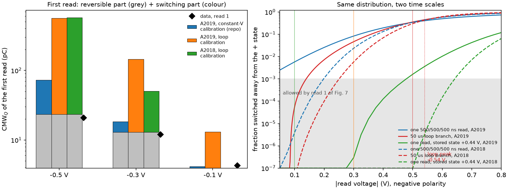
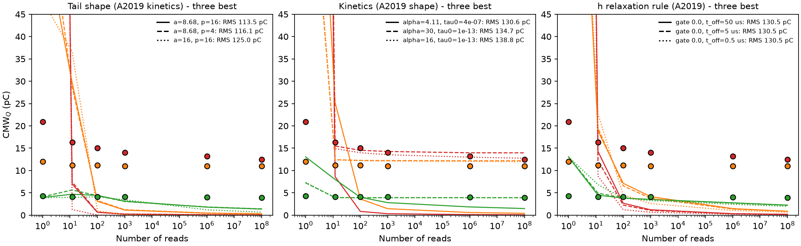
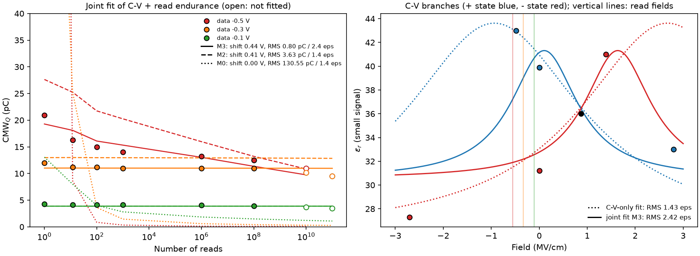
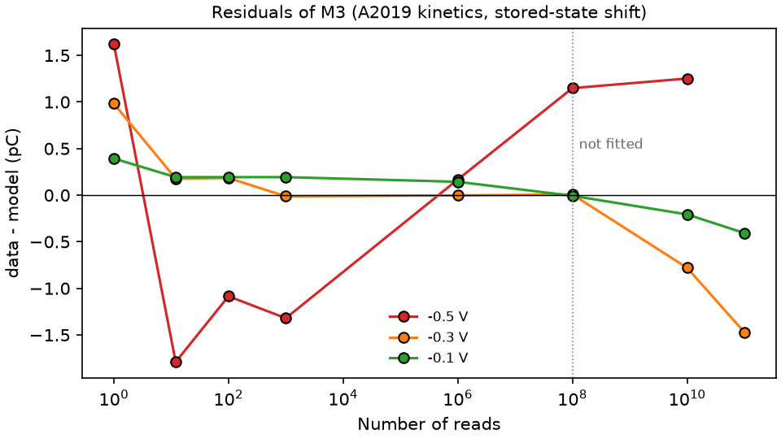
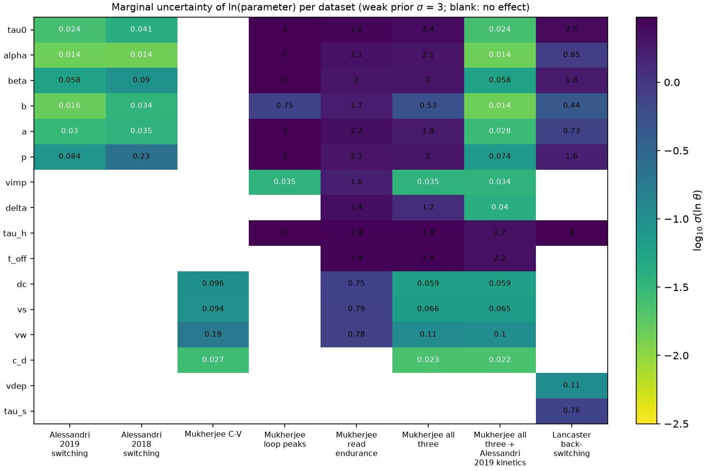

# Read disturb and the low-field tail: why the model over-predicts the first reads of Mukherjee IEDM 2023, Fig. 7

中文版（主要版本）：[tail-fit.zh-TW.md](tail-fit.zh-TW.md). All numbers come from [`tail_fit.json`](tail_fit.json), written by [`examples/tail_fit_study.py`](../../examples/tail_fit_study.py); the read-sequence calculation is the new module [`src/fe_models/read_disturb.py`](../../src/fe_models/read_disturb.py).

## 1. Question

In the literature comparison (`docs/literature_comparison.json`) the model matches the read endurance of Mukherjee IEDM 2023, Fig. 7 at −0.1 V. At −0.3 V and −0.5 V the first read switches far too much (−0.5 V: model 124 pC, data 20.9 pC), and after about 10⁶ reads the stored state is almost gone, while the data stay at 11–13 pC. This note answers three questions:

- Where does the extra charge come from: the low-field tail (Dagum a·p), τ₀, the Weibull β, the h reset rule, the imprint centre, or the off-time assumption?
- Which parameters does each dataset actually constrain?
- Is there a physically justified change that reproduces both the C–V and the read endurance?

## 2. Data

| Dataset | Content | Role here |
|---|---|---|
| Alessandri 2019 (TED), 2018 (EDL) | switching curves regenerated from the published NLS fits (5 voltages × 14 widths) | identifiability and τ₀ profile only (Dagum refits); kinetics τ₀, α, β and the distribution shape come from here and are **not fitted to the Mukherjee device** |
| Mukherjee IEDM 2023 C–V (Fig. 5a, 7 points) | small-signal ε_r(E) of the two states | fitted: reversible branches (c_d, ΔC, V_s, V_w; crossing fixed at 0.87 MV/cm) |
| Mukherjee IEDM 2023 P–V loop | the two switching-current peaks of the 50 µs triangle, +1.35 V and −0.54 V (digitized) | fitted: activation-field scales b⁺, b⁻; loop centre V_imp = 0.405 V |
| Mukherjee IEDM 2023 read endurance (Fig. 7) | CMW_Q(n) at V_R = −0.1, −0.3, −0.5 V, 500/500/500 ns trapezoids | fitted: the 18 points with n ≤ 10⁸; the drop after 10⁸ is outside the model and only plotted |
| Lancaster 2022 back-switching (12 points) | polarization loss after a write | identifiability only (V_dep, τ_s from literature_comparison) |

Assumed because the paper does not give them: the off time between reads, t_off = 0.5 µs (5 and 50 µs also tested), and the delay from write to the first read (the shift below is an effective value at read time).

## 3. Method

**Read sequence.** `read_disturb.read_sequence` returns the charge of read n (n up to 10¹¹) on both stored states. Each read is a trapezoid (rise t_R, plateau t_PW, fall t_F) followed by t_off at 0 V. As in Fig. 7, only the rise and the plateau are integrated:

Q_n = P_s (x̄_end of plateau − x̄_before) + q_rev(V_R, x̄_end of plateau), CMW_Q = |Q(+) − Q(−)|.

With V_imp = +0.405 V, both the negative reads and 0 V between reads drive only the + → − direction, so each class needs only its accumulated hazard Λ. One read adds (h + a)^β − h^β, where a = ∫R dt over the pulse. Between reads h relaxes with the model's gated rule; the gate is centred on V_imp by default, and 0 V is tested for comparison. The internal field at 0 V keeps pushing h. The first 300 reads are summed exactly; after that, h follows its closed form and the hazard is summed with the Euler–Maclaurin rule. The first 8 reads agree within 0.3 % with a direct step-by-step integration (`tests/test_read_disturb.py`).

**Loop calibration.** Half a period of the ±2.7 V, 50 µs triangle is integrated with `nm.march` (backward Euler; the same E3/E3b as the Verilog-A). The peak of the switching current is located after a 30 mV Gaussian smoothing, refined by a parabola, and b⁻, b⁺ are scaled until the peaks sit at −0.54 V and +1.35 V. The closed form `nm.step` is deliberately not used here. When the drive reverses while |u| is still below the reset threshold |V_imp| + 0.1 V, it carries the old |h| into the new direction, which E3b does not do (Section 7).

**Joint fits.** Weighted least squares: C–V residuals / 1 ε, read residuals / 0.5 pC (the digitizing scale). Kinetics (τ₀, α, β, Dagum shape) are fixed to Alessandri 2019 (or 2018).

**Identifiability.** For each dataset, J = ∂(residual/noise)/∂ln θ is evaluated at a reference point. A weak prior σ(ln θ) = 3 is added to the Fisher matrix, and the marginal uncertainties are reported. A marginal σ near 3 means the dataset carries no information on that parameter.

## 4. Results

### 4.1 Decomposition of the first read

| | −0.5 V | −0.3 V | −0.1 V |
|---|---|---|---|
| data (read 1) | 20.9 pC | 12.0 pC | 4.3 pC |
| reversible part (C–V fit, x̄ = ±1) | 23.4 | 13.0 | 3.9 |
| switching part, A2019, loop-calibrated | 542 (34 % switched) | 132 (8.3 %) | 9.2 (0.58 %) |
| switching part, A2018, loop-calibrated | 548 (35 %) | 37 (2.4 %) | 0.006 |
| switching part, A2019, old constant-voltage calibration | 49 (3.1 %) | 5.3 (0.34 %) | 0.2 |

The first read in the data is essentially reversible. CMW_Q/|V_R| = 43, 40 and 41.8 pC/V, close to the 41 pC/V that follows from the zero-field ε difference. So the first read leaves room for at most about 1 pC of switching charge, a switched fraction of about 10⁻³. All of the model's excess is switching charge; its reversible part is only 1–2.5 pC too high.

The 124 pC of `literature_comparison.py` differs from the 71.9 pC here (same constant-voltage calibration) because of the pulse: that script uses a 1 µs rectangle, this study the 500/500/500 ns trapezoid with rise and plateau only. The calibration method matters more. The constant-voltage approximation (12.5 µs at the peak voltage) gives a b scale of 0.797, while integrating the real triangle gives 0.556 (b = 0.986 MV/cm). On the triangle, h starts from zero only once the drive crosses the reset threshold (V < −0.1 V), so the effective switching time is about 1 µs. A lower activation field is then needed to put the peak at −0.54 V, the distribution moves down, and a read switches even more.

### 4.2 Root cause: one distribution, two time scales

In terms of the internal drive u = V − V_imp, the read field and the loop-peak field differ by only 4.4 % (−0.905 V vs. −0.945 V). With Alessandri's kinetics (τ₀ = 387 ns, α = 4.1), the rate on the microsecond scale is already close to its maximum 1/τ₀ and hardly depends on the field. With the width of the distribution (a ≈ 8.7, about 20 % in log field), a distribution that switches half the film at −0.54 V in the loop switches a third of it in one 1.5 µs read. The right panel shows both curves for the same card. The fraction switched by one read (blue) meets the loop branch (red) near |V| ≈ 0.5 V, while the data require the blue curve to stay below 10⁻³ at 0.5 V (grey band).

The tail shape plays no part in this conflict, and the scans below show that kinetics and the h rule cannot remove it either.

### 4.3 Alternatives without a shift (all fail)

| Change | Range scanned | read RMS (18 points) | Comment |
|---|---|---|---|
| none (A2019, loop-calibrated) | — | 130.6 pC | baseline |
| low-field tail and core width | a = 8.7–64, p = 1.14–16 (tail exponent a·p = 10–1024), recalibrated at each point | 113.5–133.6 pC | a steeper tail lowers the first read at −0.3 V from 144 to 38–65 pC, but −0.5 V stays at 500–585 pC: the read switches the core of the distribution, not the tail |
| kinetics | α = 4.1–30, τ₀ = 387 ns to 10⁻¹³ s | 134.7–167.3 pC | steep kinetics keep the state alive at large n (−0.3 V still 12 pC at 10⁸ reads) but make the first read worse (−0.5 V: 586–721 pC), because the loop peak is pushed closer to the threshold |
| h relaxation rule | gate at V_imp or 0 V, t_off = 0.5–50 µs | 130.5 pC | no effect on the first read; it only changes the accumulation between 10 and 10⁸ reads |

The kinetics are also pinned by the Alessandri data. Refitting (b, a, p, α) with τ₀ held at smaller values raises the A2019 RMS from 0.0022 (387 ns) to 0.048 (100 ns), 0.079 (10 ns) and 0.107 (10⁻¹³ s, where α drops to 0.53); A2018 goes from 0.0003 to 0.022–0.088. A rate that falls steeply below the coercive field therefore conflicts with those two devices. It could only be a Mukherjee-specific assumption, and even then it does not rescue the first read.

### 4.4 A stabilizing shift of the stored state

What remains is that the + state being read is harder to switch than the + state in the loop. A constant stabilizing shift, V_imp → V_imp − s₀Δ (s₀ = stored state), is fitted in the read model:

| Model | Δ | read RMS | C–V RMS | read RMS per voltage (−0.5 / −0.3 / −0.1 V) |
|---|---|---|---|---|
| M0 A2019, C–V-only reversible part, no shift | 0 | 130.6 pC | 1.43 ε | 219 / 55 / 4.2 |
| M1 as M0, reversible part refitted, no shift | 0 | 126.5 | 4.84 (parameters at bounds) | 213 / 50 / 3.7 |
| M2 A2019, C–V-only reversible part, Δ fitted | 0.413 V | 3.63 | 1.43 | 6.0 / 1.8 / 0.2 |
| M3 A2019, reversible part refitted + Δ | 0.438 V | 0.80 | 2.42 | 1.3 / 0.4 / 0.2 |
| M4 A2018 kinetics, reversible part refitted + Δ | 0.414 V | 1.32 | 2.39 | 2.2 / 0.4 / 0.2 |
| M5 M3 + slow reversible fraction (f_rev, τ_r) | 0.438 V | 0.83 | 2.12 | 1.3 / 0.5 / 0.3 |
| M6 M3 with the branches moving with the shift | 0.427 V | 0.76 | 3.57 | 1.2 / 0.5 / 0.4 |

Every fit with a shift gives Δ = 0.41–0.44 V (0.46–0.49 MV/cm at 9 nm), whichever kinetics (A2019 or A2018) are used and however the reversible part is treated. With the kinetics taken from Alessandri 2019, the marginal uncertainty is σ(ln Δ) = 0.04. With the shift, −0.3 V stays at 11 pC from read 1 to read 10⁸, −0.5 V declines slowly from 19 to 11 pC, and −0.1 V no longer switches.

M2 and M3 differ in the reversible part. In the data the first read is linear in V_R at all three voltages (43, 40, 41.8 pC/V). The C–V branches rise toward the ε⁺ peak at −0.48 MV/cm, so their integral is super-linear: the C–V-only branches give 39.3, 43.2 and 46.7 pC/V. M3 matches both only by moving the ε⁺ peak from −0.94 to +0.1 MV/cm, so its C–V shape is worse (RMS 2.42, peaks misplaced). M2 keeps the C–V, at the cost of reading 6–9 pC too high at −0.5 V during the first 10³ reads. M5 lets part of the reversible charge be slow; τ_r runs to its 50 µs bound and the read RMS does not improve. Such a slow part would also no longer be quasi-static in the 10 kHz C–V, so it is only a fit knob and is not adopted. M6 moves the branches with the shift: the read RMS drops slightly, but the C–V gets worse.

The residuals have structure. At −0.5 V the model is 1.6 pC low at read 1 and 1–1.8 pC high from read 12 to 10³, so its decline is too smooth. After 10⁸ reads (not fitted) the data at −0.3 and −0.1 V drop and the model does not.

### 4.5 Charge budget: the drop over the first 12 reads at −0.5 V is not switching

Assume, as in this model and in any model where the reversible read-out is proportional to the remaining polarization, that the reversible CMW scales with (1 + x̄)/2. The drop from 20.9 pC (read 1) to 16.3 pC (read 12) then means the + state lost 22 %. The switching charge of that loss would be integrated during reads 2–12, about 32 pC per read, yet the data show 16–18 pC. So the drop cannot be irreversible switching, and no parameter set of this model class reproduces it. Possible sources:

- the reads change the reversible response of the + state (for example, soft near-switching regions switch first and carry more of ε⁺ than of P);
- recoverable switching that relaxes back between reads;
- digitizing error.

The separate Q₊ and Q₋ curves of Fig. 7 are needed to tell these apart.

### 4.6 What each dataset constrains

- **Alessandri 2019 / 2018 switching** fix τ₀, α, β, b and a well (σ(ln θ) ≈ 0.01–0.09); the A2018 tail p is weaker (0.23). These constrain the two W/HZO devices, not the Mukherjee device.
- **Mukherjee C–V** constrains only the reversible part (ΔC and V_s ≈ 0.1, V_w 0.19, c_d 0.03) and says nothing about switching.
- **Mukherjee loop peaks** fix V_imp (0.035) and one combination involving b (0.75); τ₀, α, β and the shape remain free.
- **Mukherjee read endurance alone** gives σ = 1.6–2.8 for every switching parameter: it constrains only combinations. Its weakest direction is τ_h together with t_off (σ ≈ 2400): the relaxation of h between reads is not constrained at all, which is why the h rule does not change the conclusion.
- **Mukherjee, all three together** fix b (0.53) and the reversible part, but Δ still has 1.2. **Assuming the kinetics are those of Alessandri 2019** brings Δ to 0.04 and b to 0.014. The value of Δ therefore rests on transferring the kinetics from the Alessandri device.
- **Lancaster back-switching** informs V_dep (0.11) and b (0.44), τ_s weakly (0.76), and τ₀ not at all.

## 5. What is and isn't explained

Explained:

- The first-read over-prediction is entirely switching charge, neither the reversible part nor the tail shape. With Alessandri's kinetics, a read field only 4.4 % below the loop-peak field switches the core of the distribution.
- The collapse at large n has the same cause; the h rule and t_off only change details between 10 and 10⁸ reads.
- A stored-state stabilization of about 0.41–0.44 V fixes the first read and the stability up to 10⁸ reads (RMS from 131 to 0.8–3.6 pC).

Not explained:

- The 4.6 pC drop over the first 12 reads at −0.5 V (the charge budget rules out switching).
- The drop after 10⁸ reads at −0.1 and −0.3 V (if both states drop together it is unrelated to switching; it belongs to the fatigue / charge-trapping line).
- The conflict between the curvature of the 10 kHz C–V and the linear 500 ns pulse CMW (Section 4.4).
- The time dependence of Δ: it should build up after the write, while only an effective constant at read time is fitted here.

## 6. Recommendation

1. **No change to the model equations on this branch.** None of the tail shape, the kinetics, the h rule or f_rev/τ_r is supported by the data: the first three leave RMS ≥ 113 pC, and the last is only a fit knob for the reversible part. `fecap_nls.va` and `nls_multidomain.py` are unchanged.
2. **The physically supported fix is the imprint of the stored state.** The literature describes how charge redistribution while a polarization state is stored strengthens that state and weakens the opposite one, shifting the hysteresis along the voltage axis. The effect is stronger in woken-up films, and its time dependence is linear at short times and logarithmic at long times (HfO₂ book, Ch. 9.2; the imprint test of Fengler 2017). This is what E17 on the `research/fatigue-imprint` branch implements (V_imp − V_I·mean(σ_I)).
   - After merging, replace the constant Δ of this study by the E17 state at each read, include the time between write and reads, and fit Fig. 7 again. `read_sequence(..., stored_shift=...)` and `tail_fit_study.py` serve as the test bench.
   - The open point is the time scale: 0.41–0.44 V (≈ 0.47 MV/cm) must already be in place at the first read, and the paper does not give the write-to-read delay. Compare it with the imprint time data collected on that branch. If it is clearly too large for a short delay, this stack (with MoOx/Nb₂O₅ interface layers) may need its own parameters.
3. **Device card** [`spice/params/mukherjee2023.inc`](../../spice/params/mukherjee2023.inc): reversible branches fitted to the C–V, b⁺/b⁻ fitted to the loop peaks, everything else from Alessandri 2019. It reproduces the C–V and the loop (the ngspice and Python peaks are both at −0.538 V with 16 classes) but **not** the read endurance, as the card states.
4. **Follow-ups** (not done on this branch):
   - Fix `nm.step()`, which reuses the old h under a reversed drive below the reset threshold (Section 7).
   - Re-read the position and width of the loop's switching-current peaks: Δ is measured relative to −0.54 V, and the width would constrain the distribution directly.
   - Take from the paper the off time between reads, the delay from write to the first read, and the separate Q₊ and Q₋ curves of Fig. 7 (to test Section 4.5).

## 7. Note: an inconsistency in `nm.step()`

When the drive reverses but |u| is still below u_x = |V_imp| + 0.1 V, the closed form of `step()` uses the old direction's |h| as progress in the new direction. E3b (`rhs`, `simulate`, `march`, Verilog-A) uses h⁺ = max(h, 0) and h⁻ = max(−h, 0), so the old progress gives no hazard in the new direction. Minimal reproducer: `generic_card(vimp=0.3, mul_ea=0.4)`, a 1.5 V write for 20 µs, then a hold at −0.05 V (|u| = 0.35 < 0.4). After 1 µs, `step` has switched 7.8 % and `simulate` 0. On slow triangular loops it makes the switching start early: for the same card, the − peak computed with `step` is near −0.53 V and with E3/E3b near −0.88 V. All loops in this study use `march`. The read sequences are not affected, since the drive does not change direction during and between reads.

## References

The Alessandri, Mukherjee and Lancaster papers enter only through the values already collected in `data/literature/` (sources in the CSV headers). The last three items were read for this study and are used in the discussion.

- [Alessandri2018] C. Alessandri et al., IEEE Electron Device Lett. 39, 1780 (2018); [Alessandri2019] C. Alessandri et al., IEEE Trans. Electron Devices 66, 3527 (2019).
- [Mukherjee2023IEDM] S. Mukherjee et al., IEDM 2023, doi:10.1109/IEDM45741.2023.10413879.
- [Lancaster2022] S. Lancaster et al., Front. Nanotechnol. 4, 939822 (2022).
- F. Fengler, M. H. Park, T. Schenk, M. Pešić, U. Schroeder, "Field cycling behavior of ferroelectric HfO₂-based capacitors", Ch. 9.2 of U. Schroeder, C. S. Hwang, H. Funakubo (eds.), *Ferroelectricity in Doped Hafnium Oxide* (Woodhead, 2019): direction and time dependence of the stored-state imprint.
- F. P. G. Fengler et al., "Domain pinning: comparison of hafnia and PZT based ferroelectrics", Adv. Electron. Mater. 3, 1600505 (2017): imprint test after wake-up.
- H. Mulaosmanovic, S. Slesazeck, "Polarization switching in HfO₂-based devices", Ch. 9.1 of the same book: classical nucleation gives τ = τ₀ exp[α/(k_BT V²)], a Merz-type exponent of 2; used here only to note that α is not fixed by theory.
