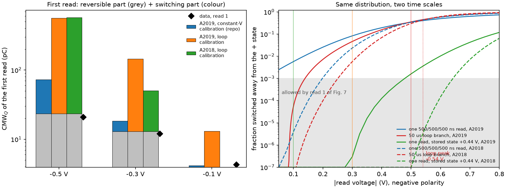
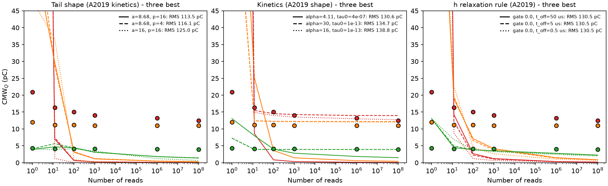
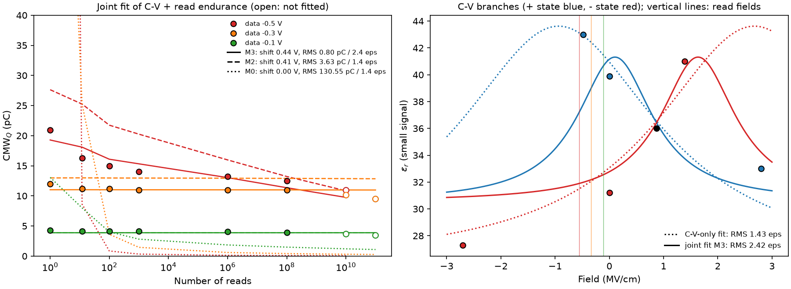
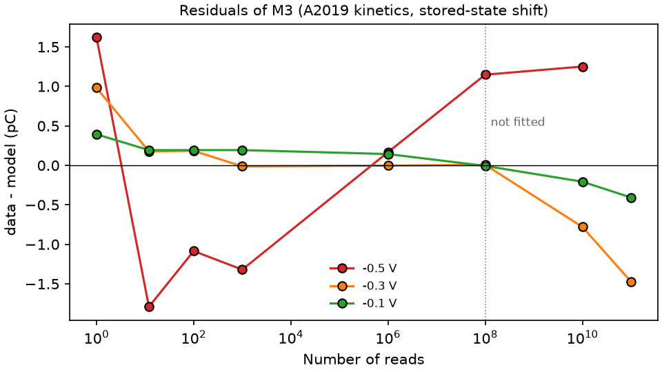
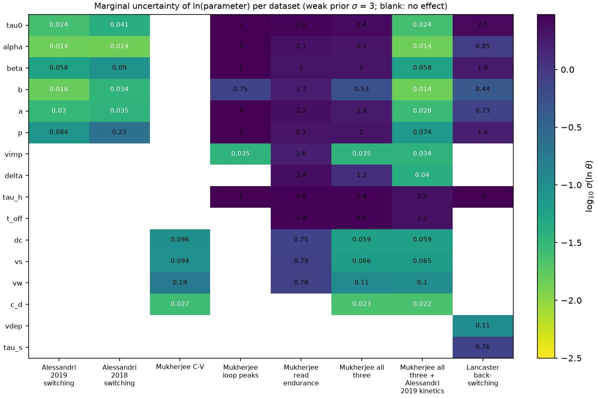

# 讀取擾動與低場尾端：模型為何高估 Mukherjee IEDM 2023 Fig. 7 的前幾次讀取

English version: [tail-fit.md](tail-fit.md)。計算全部在 [`examples/tail_fit_study.py`](../../examples/tail_fit_study.py)，數字取自它寫出的 [`tail_fit.json`](tail_fit.json)；讀取序列的計算在新模組 [`src/fe_models/read_disturb.py`](../../src/fe_models/read_disturb.py)。

## 1. 問題

文獻比較（`docs/literature_comparison.json`）中，模型在 Mukherjee IEDM 2023 Fig. 7 的讀取耐久上，−0.1 V 對得上，−0.3 V 與 −0.5 V 的第一次讀取卻切換太多（−0.5 V：模型 124 pC，資料 20.9 pC），而且讀到 10⁶ 次以後狀態幾乎全毀，資料卻維持在 11–13 pC。這份筆記要回答三件事：

- 多出來的電荷從哪裡來？是低場尾端（Dagum 的 a·p）、τ₀、Weibull β、h 的重設規則、imprint 中心，還是讀取間隔的假設？
- 每一組資料實際上約束了哪些參數？
- 有沒有一組物理上站得住、能同時解釋 C–V 與讀取耐久的修改？

## 2. 資料

| 資料 | 內容 | 本研究中的角色 |
|---|---|---|
| Alessandri 2019 (TED)、2018 (EDL) | 由論文公布的 NLS 擬合式重算的切換曲線（5 個電壓 × 14 個脈寬） | 只用於可辨識性與 τ₀ 剖面（重新擬合 Dagum 參數）；動力學 τ₀、α、β 與分布形狀由此取得，**不對 Mukherjee 元件擬合** |
| Mukherjee IEDM 2023 C–V（Fig. 5a，7 點） | 兩個極化態的小訊號 ε_r(E) | 擬合：可逆分支（c_d、ΔC、V_s、V_w；交叉點固定在 0.87 MV/cm） |
| Mukherjee IEDM 2023 P–V 迴線 | 50 µs 三角波兩個切換電流峰：+1.35 V、−0.54 V（讀圖） | 擬合：兩個方向的活化場尺度 b⁺、b⁻；迴線中心 V_imp = 0.405 V |
| Mukherjee IEDM 2023 讀取耐久（Fig. 7） | CMW_Q(n)，V_R = −0.1、−0.3、−0.5 V，梯形 500/500/500 ns | 擬合：n ≤ 10⁸ 的 18 點；10⁸ 之後的下降不在模型範圍內，只畫出、不擬合 |
| Lancaster 2022 回切（12 點） | 寫入後的極化損失 | 只用於可辨識性（V_dep、τ_s 沿用 literature_comparison 的擬合值） |

未知而必須假設的量：讀取之間的關閉時間 t_off（論文未給，取 0.5 µs，另測 5、50 µs）、寫入到第一次讀取的延遲（論文未給；下文的穩定化偏移是「讀取時」的有效值）。

## 3. 方法

**讀取序列。** `read_disturb.read_sequence` 對兩個儲存態計算第 n 次讀取的電荷，n 可到 10¹¹。每次讀取是梯形（上升 t_R、平台 t_PW、下降 t_F），之後在 0 V 停 t_off；和 Fig. 7 一樣，只積分上升與平台的電荷：

Q_n = P_s (x̄_平台末 − x̄_讀前) + q_rev(V_R, x̄_平台末)，CMW_Q = |Q(+) − Q(−)|。

在 V_imp = +0.405 V 的元件上，負向讀取與讀取間的 0 V 都只驅動「把 + 態翻成 − 態」的方向，所以每個 class 只需要累積危險率 Λ：一次讀取的貢獻是 (h + a)^β − h^β，a 是脈衝期間的 ∫R dt；讀取間 h 依模型的 gated 規則鬆弛（閘中心預設為 V_imp，也可改成 0 V 比較），並繼續被 0 V 下的內建場推動。前 300 次逐次加總，之後用 h 的封閉形式加 Euler–Maclaurin 求和；前 8 次和以 `nm.step` 細分時間步的直接積分比對，誤差小於 0.3%（`tests/test_read_disturb.py`）。

**迴線校正。** 以 `nm.march`（後向 Euler，與 E3/E3b 和 Verilog-A 同一組方程）積分 ±2.7 V、50 µs 三角波的半週期，取切換電流的峰（30 mV 高斯平滑後拋物線內插），再調整 b⁻、b⁺ 使兩峰落在 −0.54 V 與 +1.35 V。這裡刻意不用封閉形式 `nm.step`：反向驅動仍低於重設門檻 |u| < |V_imp| + 0.1 V 時，`step` 會把舊方向的 |h| 帶到新方向，E3b 不會（見第 7 節）。

**聯合擬合。** 加權最小平方：C–V 殘差 / 1 ε，讀取殘差 / 0.5 pC（讀圖不確定度的量級）。動力學（τ₀、α、β、Dagum 形狀）固定為 Alessandri 2019（或 2018）的值。

**可辨識性。** 每組資料在參考點計算 J = ∂(殘差/雜訊)/∂ln θ，費雪矩陣加上 σ(ln θ) = 3 的弱先驗後取邊際不確定度。邊際 σ 接近 3 表示該資料對這個參數沒有資訊。

## 4. 結果

### 4.1 第一次讀取的拆解

| | −0.5 V | −0.3 V | −0.1 V |
|---|---|---|---|
| 資料（第 1 次） | 20.9 pC | 12.0 pC | 4.3 pC |
| 可逆部分（C–V 擬合，x̄ = ±1） | 23.4 | 13.0 | 3.9 |
| 切換部分，A2019，迴線校正 | 542（翻轉 34%） | 132（8.3%） | 9.2（0.58%） |
| 切換部分，A2018，迴線校正 | 548（35%） | 37（2.4%） | 0.006 |
| 切換部分，A2019，舊的定電壓校正 | 49（3.1%） | 5.3（0.34%） | 0.2 |

資料的第一次讀取幾乎就是可逆部分：CMW_Q/|V_R| = 43、40、41.8 pC/V，與 0 V 的 ε 差換算的 41 pC/V 一致，所以第一次讀取最多容許約 1 pC 的切換電荷（約翻轉 10⁻³）。模型多出來的全是切換電荷，可逆部分只多 1–2.5 pC。

`literature_comparison.py` 的 124 pC 與這裡的 71.9 pC（同一個定電壓校正）差在讀取波形：前者用 1 µs 矩形，這裡用 500/500/500 ns 梯形並只算上升加平台。更重要的是校正方式：用 12.5 µs 定電壓近似時 b 的縮放是 0.797，用真正的三角波積分是 0.556（b = 0.986 MV/cm）。三角波上 h 要等驅動越過重設門檻（V < −0.1 V）才從零開始累積，有效作用時間只有約 1 µs，所以要更低的活化場才能讓峰落在 −0.54 V；分布因此更低，讀取切換更多。

### 4.2 根本原因：同一個分布、兩個時間尺度

讀取場與迴線峰值場在內部驅動 u = V − V_imp 上只差 4.4%（−0.905 V 對 −0.945 V）。Alessandri 的動力學 τ₀ = 387 ns、α = 4.1 在微秒尺度已接近最大速率 1/τ₀，速率對場幾乎不敏感；加上分布寬度（a ≈ 8.7，對數場寬約 20%），迴線在 −0.54 V 翻一半，同一個分布在 1.5 µs 的讀取裡就會翻掉三成。右圖畫出同一張卡的兩條曲線：一次讀取翻掉的比例（藍）與迴線分支（紅）在 |V| ≈ 0.5 V 交會，而資料要求藍線在 0.5 V 時低於 10⁻³（灰帶）。

這個矛盾和尾端形狀無關，下一節的掃描顯示它也不是動力學參數或 h 規則能解決的。

### 4.3 不加偏移的替代方案（全部失敗）

| 修改 | 掃描範圍 | 讀取 RMS（18 點） | 說明 |
|---|---|---|---|
| 無（A2019，迴線校正） | — | 130.6 pC | 基準 |
| 低場尾端與核心寬度 | a = 8.7–64，p = 1.14–16（尾端指數 a·p = 10–1024），每點重新校正 | 113.5–133.6 pC | 尾端變陡把 −0.3 V 第一次讀取從 144 降到 38–65 pC，但 −0.5 V 仍有 500–585 pC：被翻掉的是分布中心，不是尾端 |
| 動力學 | α = 4.1–30，τ₀ = 387 ns–10⁻¹³ s | 134.7–167.3 pC | 陡的動力學讓長讀取次數穩定（−0.3 V 在 10⁸ 次仍有 12 pC），但第一次讀取更糟（−0.5 V：586–721 pC），因為迴線峰被推到更接近臨界場 |
| h 鬆弛規則 | 閘中心 V_imp 或 0 V，t_off = 0.5–50 µs | 130.5 pC | 第一次讀取完全不受影響；只改變 10–10⁸ 次之間的累積 |

此外，動力學在 Alessandri 資料上是被約束住的：把 τ₀ 固定在較小值重新擬合 (b, a, p, α)，A2019 的 RMS 從 0.0022（387 ns）升到 0.048（100 ns）、0.079（10 ns）、0.107（10⁻¹³ s，此時 α 降到 0.53）；A2018 從 0.0003 升到 0.022–0.088。換句話說，「讓速率在亞矯頑場下陡降」與這兩個元件的切換曲線衝突，只能當作 Mukherjee 元件特有的假設，而且即使允許也救不了第一次讀取。

### 4.4 儲存態的穩定化偏移

剩下的解釋是：被讀取的 + 態比迴線中的 + 態更難翻。以 V_imp → V_imp − s₀Δ（s₀ 為儲存態）表示一個常數穩定化偏移，在讀取模型中擬合 Δ：

| 模型 | Δ | 讀取 RMS | C–V RMS | 每個電壓的讀取 RMS（−0.5 / −0.3 / −0.1 V） |
|---|---|---|---|---|
| M0 A2019，C–V 擬合的可逆部分，無偏移 | 0 | 130.6 pC | 1.43 ε | 219 / 55 / 4.2 |
| M1 同上，可逆部分重擬合，無偏移 | 0 | 126.5 | 4.84（參數撞到邊界） | 213 / 50 / 3.7 |
| M2 A2019，C–V 擬合的可逆部分，擬合 Δ | 0.413 V | 3.63 | 1.43 | 6.0 / 1.8 / 0.2 |
| M3 A2019，可逆部分重擬合 + Δ | 0.438 V | 0.80 | 2.42 | 1.3 / 0.4 / 0.2 |
| M4 A2018 動力學，可逆部分重擬合 + Δ | 0.414 V | 1.32 | 2.39 | 2.2 / 0.4 / 0.2 |
| M5 M3 + 慢可逆分量（f_rev、τ_r） | 0.438 V | 0.83 | 2.12 | 1.3 / 0.5 / 0.3 |
| M6 M3，可逆分支隨偏移移動 | 0.427 V | 0.76 | 3.57 | 1.2 / 0.5 / 0.4 |

所有含 Δ 的擬合都給出 Δ = 0.41–0.44 V（9 nm 時約 0.46–0.49 MV/cm），與動力學取 A2019 或 A2018、可逆部分怎麼處理無關。在動力學沿用 Alessandri 2019 的前提下，Δ 的邊際不確定度 σ(ln Δ) = 0.04。有了 Δ，−0.3 V 從第 1 次到 10⁸ 次都維持在 11 pC，−0.5 V 從 19 pC 緩降到 11 pC，−0.1 V 不再切換。

M2 與 M3 的差別在可逆部分。資料的第一次讀取在三個電壓下都是線性的（43、40、41.8 pC/V），而 C–V 分支往 −0.48 MV/cm 的 ε⁺ 峰上升，積分後是超線性的（只擬合 C–V 的分支給 39.3、43.2、46.7 pC/V）。M3 把 ε⁺ 峰從 −0.94 移到 +0.1 MV/cm 才同時對上兩者，所以 C–V 的形狀變差（RMS 2.42，峰位不對）。M2 保留 C–V，代價是 −0.5 V 在前 10³ 次高 6–9 pC。M5 讓一部分可逆電荷變慢，τ_r 跑到上限 50 µs，讀取 RMS 沒有改善；這個分量在 10 kHz 的 C–V 也不再是準靜態，所以只能算擬合旋鈕，不採用。M6 讓分支隨偏移移動，讀取 RMS 小幅下降，但 C–V 更差。

殘差有結構：−0.5 V 時模型在第 1 次低 1.6 pC、第 12–10³ 次高 1–1.8 pC，模型的下降太平滑；10⁸ 之後（未擬合）−0.3、−0.1 V 的資料下降，模型沒有。

### 4.5 電荷預算：−0.5 V 前 12 次的下降不是切換

如果可逆的 CMW 和 (1 + x̄)/2 成正比（本模型與任何「讀出量正比於剩餘極化」的模型都是如此），CMW 從第 1 次的 20.9 pC 掉到第 12 次的 16.3 pC，代表 + 態損失 22%。這些極化翻轉時的電荷會在第 2–12 次讀取中被積分進去，平均每次約 32 pC，資料卻只有 16–18 pC。所以這段下降不可能是不可逆切換，在這個模型類別裡無法重現。可能的來源包括：讀取改變了 + 態的可逆響應（例如接近切換的軟區先翻轉，它們對 ε⁺ 的貢獻比對 P 的貢獻大）、會回切的可恢復切換、或讀圖誤差。要分辨這些，需要 Fig. 7 分開的 Q₊、Q₋ 曲線。

### 4.6 每組資料約束了什麼

- **Alessandri 2019 / 2018 的切換曲線**：τ₀、α、β、b、a 都被定得很好（σ(ln θ) 約 0.01–0.09）；A2018 的尾端 p 較弱（0.23）。它們約束的是那兩個 W/HZO 元件，不是 Mukherjee 元件。
- **Mukherjee C–V**：只約束可逆部分（ΔC、V_s 約 0.1，V_w 0.19，c_d 0.03），對切換沒有資訊。
- **Mukherjee 迴線峰**：只定出 V_imp（0.035）與 b 的一個組合（0.75）；τ₀、α、β、形狀都無法單獨決定。
- **Mukherjee 讀取耐久**：單獨看時每個切換參數的 σ 都在 1.6–2.8：它只約束組合。最弱的方向是 τ_h 與 t_off（σ ≈ 2400）：讀取之間的 h 鬆弛完全沒有被約束，這也是 h 規則不影響結論的原因。
- **Mukherjee 三組合併**：b（0.53）與可逆部分被定住，Δ 仍有 1.2；**再假設動力學與 Alessandri 2019 相同**，Δ 降到 0.04、b 0.014。Δ 的數值因此依賴「動力學可以從 Alessandri 元件移植」這個假設。
- **Lancaster 回切**：V_dep（0.11）與 b（0.44）有資訊，τ_s 0.76，τ₀ 沒有。

## 5. 解釋了什麼、沒解釋什麼

已解釋：

- 第一次讀取的高估全部來自切換電荷，不是可逆部分，也不是尾端形狀：在 Alessandri 的動力學下，讀取場離迴線峰值場只有 4.4%，分布中心就會被翻掉。
- 長讀取次數的崩潰同樣是這個原因；h 規則與 t_off 只改變 10–10⁸ 次之間的細節。
- 一個約 0.41–0.44 V 的儲存態穩定化偏移同時修好第一次讀取與 10⁸ 次內的穩定性（RMS 從 131 降到 0.8–3.6 pC）。

未解釋：

- −0.5 V 前 12 次的 4.6 pC 下降（電荷預算排除切換）。
- 10⁸ 次之後 −0.1、−0.3 V 的下降（兩個態同時下降的話與切換無關；屬於疲勞或電荷捕獲那條研究線）。
- 10 kHz C–V 的曲率與 500 ns 脈衝的線性 CMW 之間的矛盾（第 4.4 節）。
- Δ 的時間相依：它應該在寫入後隨時間建立，這裡只擬合了讀取時的有效常數。

## 6. 建議

1. **這個分支不修改模型方程式。** 尾端形狀、動力學、h 規則與 f_rev/τ_r 都沒有被資料支持：前三者 RMS ≥ 113 pC，後者只是可逆部分的擬合旋鈕。`fecap_nls.va` 與 `nls_multidomain.py` 不變。
2. **物理上站得住的修正是儲存態的 imprint。** 文獻指出，儲存某個極化態時，電荷重新分布會強化該態、弱化相反態，使遲滯沿電壓軸移動；對已喚醒的薄膜更明顯，時間相依先線性、後對數（HfO₂ 專書 Ch. 9.2；Fengler 2017 的 imprint 試驗）。這正是 `research/fatigue-imprint` 分支的 E17（V_imp − V_I·mean(σ_I)）要做的事。合併後，請把本研究的常數 Δ 換成 E17 在每次讀取時的狀態，連同寫入到讀取的時間，一起擬合 Fig. 7；`read_sequence(..., stored_shift=...)` 與 `tail_fit_study.py` 可以直接當測試台。需要確認的是時間尺度：0.41–0.44 V（≈0.47 MV/cm）必須在第一次讀取前就已建立，而寫入到第一次讀取的延遲論文沒有給；這個量要和該分支收集的 imprint 時間資料比較，若在短延遲下明顯偏大，可能需要此堆疊（MoOx/Nb₂O₅ 介面層）專屬的參數。
3. **元件卡** [`spice/params/mukherjee2023.inc`](../../spice/params/mukherjee2023.inc)：可逆分支擬合 C–V、b⁺/b⁻ 擬合迴線峰，其餘沿用 Alessandri 2019。它重現 C–V 與迴線（ngspice 與 Python 的峰都在 −0.538 V），但**不**重現讀取耐久；卡內已註明。
4. **後續工作**（不在本分支處理）：
   - 修正 `nm.step()` 在低於重設門檻的反向驅動下沿用舊 h 的問題（見第 7 節）。
   - 重新讀取迴線切換電流峰的位置與寬度：Δ 是相對於 −0.54 V 量的，峰寬則能直接約束分布寬度。
   - 從論文取得讀取的關閉時間、寫入到第一次讀取的延遲，以及 Fig. 7 分開的 Q₊、Q₋（用來檢驗第 4.5 節）。

## 7. 附記：`nm.step()` 的不一致

`step()` 的封閉形式在驅動方向反轉、但 |u| 仍低於 u_x = |V_imp| + 0.1 V 時，把舊方向的 |h| 當成新方向的進度；E3b（`rhs`、`simulate`、`march`、Verilog-A）用 h⁺ = max(h, 0)、h⁻ = max(−h, 0)，舊方向的進度對新方向沒有危險率。最小重現：`generic_card(vimp=0.3, mul_ea=0.4)`，以 1.5 V 寫入 20 µs 後保持在 −0.05 V（|u| = 0.35 < 0.4），1 µs 後 `step` 翻轉 7.8%，`simulate` 為 0。它會讓用 `step` 積分的慢三角波提早切換：同一張卡，以 `step` 算出的 − 方向峰約在 −0.53 V，用 E3/E3b 則在 −0.88 V。本研究的迴線一律改用 `march`；讀取序列不受影響，因為讀取與讀取間的驅動方向不變。

## 參考文獻

Alessandri、Mukherjee、Lancaster 三篇只使用 `data/literature/` 中已整理的數值（出處見各 CSV 檔頭）；後三項是本研究讀過、用於討論的文獻。

- [Alessandri2018] C. Alessandri et al., IEEE Electron Device Lett. 39, 1780 (2018)；[Alessandri2019] C. Alessandri et al., IEEE Trans. Electron Devices 66, 3527 (2019)。
- [Mukherjee2023IEDM] S. Mukherjee et al., IEDM 2023, doi:10.1109/IEDM45741.2023.10413879。
- [Lancaster2022] S. Lancaster et al., Front. Nanotechnol. 4, 939822 (2022)。
- F. Fengler, M. H. Park, T. Schenk, M. Pešić, U. Schroeder, "Field cycling behavior of ferroelectric HfO₂-based capacitors", Ch. 9.2 of U. Schroeder, C. S. Hwang, H. Funakubo (eds.), *Ferroelectricity in Doped Hafnium Oxide* (Woodhead, 2019)：儲存態 imprint 的方向與時間相依。
- F. P. G. Fengler et al., "Domain pinning: comparison of hafnia and PZT based ferroelectrics", Adv. Electron. Mater. 3, 1600505 (2017)：喚醒後的 imprint 試驗。
- H. Mulaosmanovic, S. Slesazeck, "Polarization switching in HfO₂-based devices", Ch. 9.1 of the same book：古典成核理論給出 τ = τ₀ exp[α/(k_BT V²)]，即 Merz 型指數 2；本研究只用它說明 α 不是由理論固定的。
