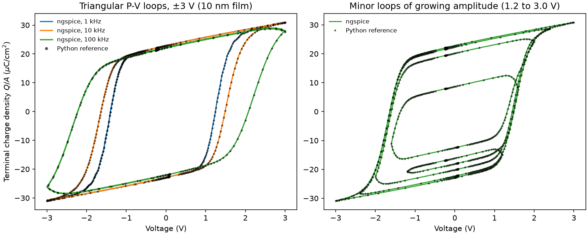
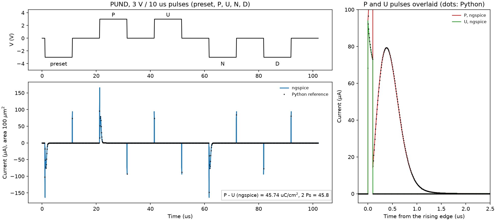
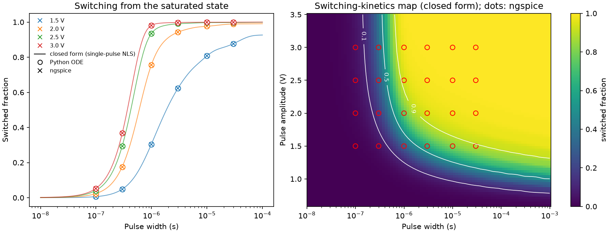
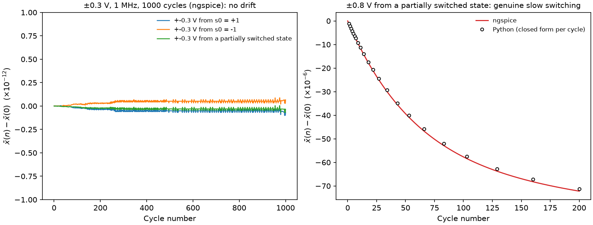
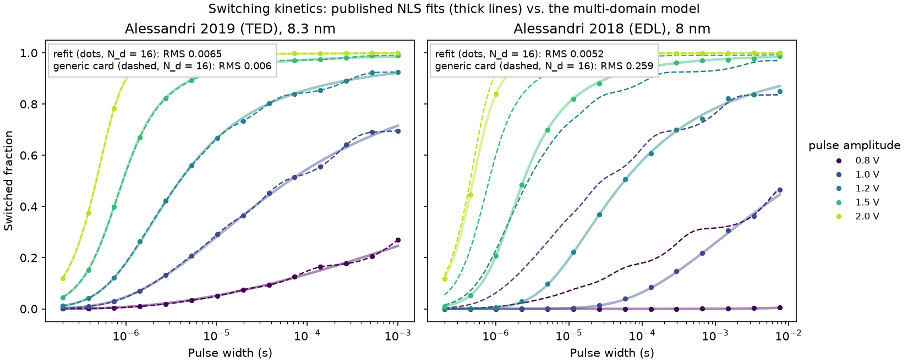
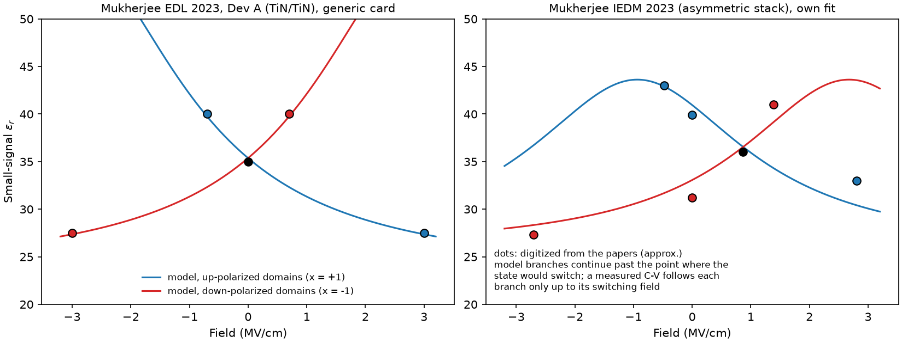
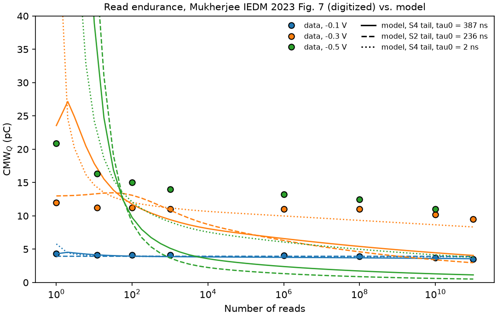
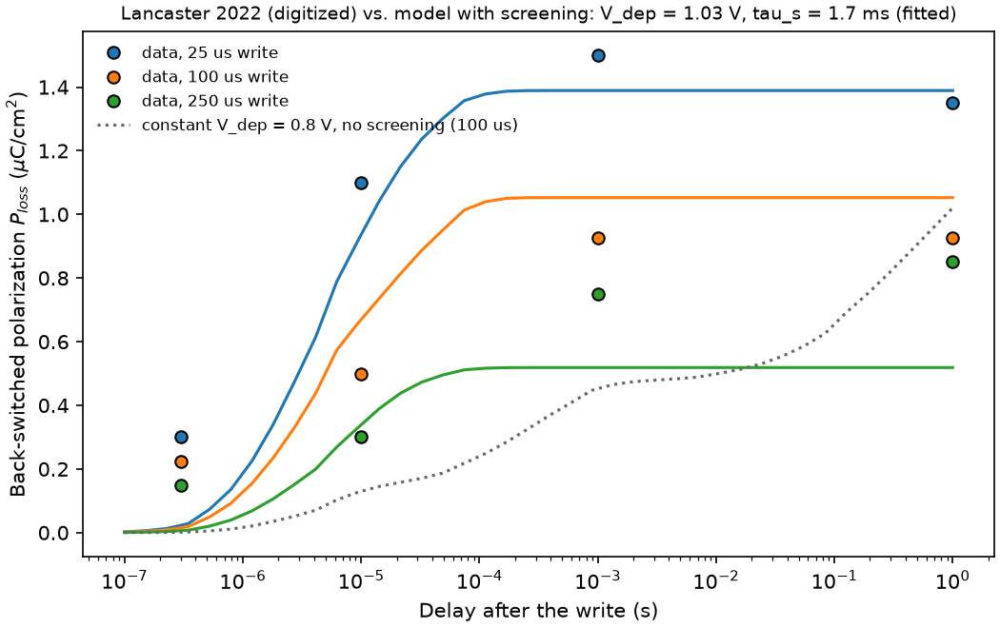
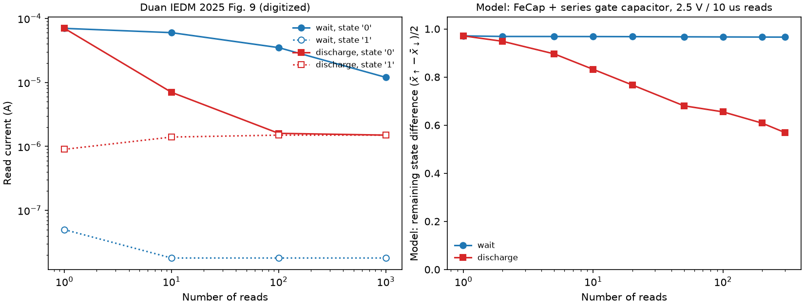

# `fecap_nls` — Verilog-A ferroelectric capacitor model (dynamic multi-domain NLS)

A compact model of an HfO₂-type ferroelectric capacitor for circuit simulation.
It describes finite-pulse switching, accumulation under repeated sub-coercive
pulses, the absence of artificial drift under small symmetric signals, a
state-dependent reversible (butterfly) response, imprint, optional
back-switching, leakage and temperature coefficients.

* **Verified with:** OpenVAF-Reloaded 24.0.2 (Windows/UCRT build) and ngspice 47
  on Windows 11. Every testbench in [`tests/`](tests/) is compared with the
  Python reference [`src/fe_models/nls_multidomain.py`](../src/fe_models/nls_multidomain.py);
  the numbers are in [Verification](#verification).
* **Not tested:** HSPICE, Spectre, Xyce, Qucs-S or any other simulator (see
  [Other simulators](#other-simulators)).
* **Parameters:** a generic card built from published fits
  ([`params/generic.inc`](params/generic.inc)). It is not fitted to any
  particular device.
* **How the model was derived:** [docs/model-derivation.md](../docs/model-derivation.md)
  (English) · [docs/model-derivation.zh-TW.md](../docs/model-derivation.zh-TW.md) (繁體中文).

| ngspice (lines) vs. Python reference (dots) | |
|---|---|
|  |  |
|  |  |

## Contents

- [Files](#files)
- [Quick start (ngspice)](#quick-start-ngspice)
- [Terminals and instance line](#terminals-and-instance-line)
- [Model structure](#model-structure)
- [Equations](#equations)
- [Parameters](#parameters)
- [Numerical notes](#numerical-notes)
- [Other simulators](#other-simulators)
- [Verification](#verification)
- [Comparison with published data](#comparison-with-published-data)
- [Changes required by the real compiler and simulator](#changes-required-by-the-real-compiler-and-simulator)
- [Limitations](#limitations)
- [References](#references)

## Files

| File | Content |
|---|---|
| `fecap_nls.va` | The model (module `fecap_nls`), commented block by block |
| `params/generic.inc` | `.model fecap_generic fecap_nls ...` with the source of every value; generated by `fe_models.nls_multidomain.spice_model_card()` |
| `build_osdi.py` | Compiles `fecap_nls.va` to `build/fecap_nls.osdi` with OpenVAF (and links with LLVM lld when the Windows build of OpenVAF has no linker) |
| `tests/*.cir` | ngspice testbenches (generated by `compare_ngspice.py --write-decks`) |
| `compare_ngspice.py` | Builds the model if needed, runs every deck, compares with the Python reference, writes `build/out/results.json` |
| `build/` | Compiled library and simulator output (not in git) |

## Quick start (ngspice)

**1. Compile** the Verilog-A file into an OSDI library (ngspice ≥ 39 loads OSDI).

On Linux or macOS OpenVAF links the library itself (this path was not tested here):

```bash
openvaf-r -o spice/build/fecap_nls.osdi spice/fecap_nls.va        # or: python spice/build_osdi.py
```

On Windows the UCRT build of OpenVAF-Reloaded 24.0.2 compiled the model but
stopped with `error: linker not found` and left the object files behind. They
were linked with LLVM lld (any MinGW-w64 / LLVM-MinGW toolchain provides
`ld.lld`, `libucrtbase.a`, `libkernel32.a` and the compiler-rt builtins);
`build_osdi.py` does this automatically when told where the tools are:

```powershell
$env:OPENVAF = "C:\path\to\openvaf-r.exe"
$env:LLD = "C:\path\to\ld.lld.exe"
$env:MINGW_LIBDIR = "C:\path\to\mingw\lib"                       # libucrtbase.a, libkernel32.a
$env:CLANG_RT_BUILTINS = "C:\path\to\libclang_rt.builtins-x86_64.a"
python spice/build_osdi.py              # FE_ND = 16  -> spice/build/fecap_nls.osdi
python spice/build_osdi.py --nd 64      # FE_ND = 64  -> spice/build/fecap_nls_nd64.osdi
```

The manual equivalent of the link step is

```bash
ld.lld -m i386pep --shared --entry= -o fecap_nls.osdi fecap_nls.o* --export-all-symbols \
       -L <mingw-lib> -lucrtbase -lkernel32 <libclang_rt.builtins-x86_64.a>
```

**2. Use it in a netlist.** OSDI devices start with `N`; the library is loaded
with `pre_osdi` in a `.control` block (relative paths are relative to the
netlist):

```spice
* minimal PUND-like example
.include params/generic.inc
.temp 25
.options method=gear reltol=1e-4
N1 p 0 qm fecap_generic s0=-1 area=1e-10
V1 p 0 pwl(0 0 0.1u 3 10.1u 3 10.2u 0 20u 0 20.1u 3 30.1u 3 30.2u 0 40u 0)
.control
pre_osdi build/fecap_nls.osdi
tran 10n 40u
meas tran q_after_P find v(qm) at=20u
meas tran q_after_U find v(qm) at=40u
.endc
.end
```

`v(qm)` is the terminal charge density in µC/cm² (here it goes from −22.9 to
about +22.9). A model card with different values is written the usual way, for
example `.model fe_fast fecap_nls tau0=50n vimp=0`; parameters that are not
given take the defaults of `fecap_nls.va`, which equal the generic card.

**3. Run the testbenches and the comparison** (from the repository root):

```bash
NGSPICE=/path/to/ngspice_con python spice/compare_ngspice.py            # all decks
NGSPICE=/path/to/ngspice_con python spice/compare_ngspice.py pund leakage
ngspice_con -b spice/tests/pund.cir      # a single deck; writes pund.dat into the current directory
```

## Terminals and instance line

```
N<name> <p> <n> <qm> <model> [s0=<-1..1>] [area=<m^2>] [sg0=<-1..1>]
```

| Terminal | Meaning |
|---|---|
| `p`, `n` | Capacitor terminals. $V = V(p,n) > 0$ drives the polarization toward +. The current into `p` is $I = A\,[\mathrm{d}(P+q_{rev})/\mathrm{d}t + J_L(V)]$. |
| `qm` | Monitor output. $V(qm)$ = terminal charge density $P + q_{rev}$ in µC/cm² (1 V ≙ 1 µC/cm²), driven by an ideal source inside the model; leave it open. At 0 V (with $y = 0$) it equals the remanent polarization $P_s\bar x$, so the mean state is $\bar x = V(qm)/(100\,P_s)$ with $P_s$ in C/m². Reading the charge directly avoids integrating the current. |

Instance parameters: `s0` (initial state of every domain class, default −1),
`area` (m², default 1×10⁻¹⁰), `sg0` (initial screening state as a fraction of
`s0`, default 0). All other parameters are model parameters.

## Model structure

| Quantity | Nodes | Meaning |
|---|---|---|
| $s_k$, $k = 1..N_d$ | `sn[k]` | switching state of domain class $k$, from −1 (all down) to +1 (all up) |
| $h_k$ | `hn[k]` | signed nucleation progress of class $k$ (only used for $\beta > 1$) |
| $y$ | `yn` | low-pass filtered voltage (slow part of the reversible response) |
| $\sigma$ | `gn` | screening state (only active when $V_{dep} \ne 0$) |

$N_d$ = `FE_ND` (compile-time, default 16), so the model has $2N_d + 2 = 34$
internal nodes plus the monitor branch. Each state obeys $\mathrm{d}X/\mathrm{d}t = f(X)$,
written as `I(node) <+ 1e-6*(ddt(V(node)) - f)`. During a static analysis (and
at the transient operating point) every state is pinned to its initial value:
$s_k = s_0$, $h_k = 0$, $y = V$, $\sigma = s_0\,\mathrm{sg0}$.

## Equations

Symbols are listed in [Parameters](#parameters). Units are SI (V, m, s, C/m², F/m², A/m²).
The derivation and the reasons for each choice are in
[docs/model-derivation.md](../docs/model-derivation.md).

**(E4) Domain classes.** Activation fields follow a Dagum distribution (a
generalized beta of the second kind with $q = 1$), whose quantile has a closed form:

$$G(E) = \left[1 + (E/b)^{-a}\right]^{-p} \quad\Longleftrightarrow\quad E(q) = b\left[q^{-1/p} - 1\right]^{-1/a}.$$

The quantile axis is sampled on a logit grid $y = \ln[q/(1-q)]$ with cell edges
$y_j = y_m \sinh(a_g\xi_j)/\sinh a_g$, $\xi_j$ uniform on $[-1, 1]$; the outer
edges are moved to $q = 0$ and $q = 1$, the weights are $w_k = q_{j+1} - q_j$ and
class $k$ uses the mid-point quantile $q_k$. Its activation voltages are

$$V_{a,k}^{\pm} = E^{\pm}(q_k)\, t_{fe}\, m_E\,[1 + c_E (T - T_0)].$$

**(E5) Mean state and polarization.**

$$\bar x = \sum_k w_k s_k, \qquad P = P_s\, m_P\,[1 + c_P (T - T_0)]\,\bar x .$$

**(E1) Drive seen by class k.**

$$u_k = \rho V - V_{dep}(\bar x - \sigma) - V_{imp} - \delta_k, \qquad \delta_k = s_b \ln\frac{\phi_k}{1-\phi_k},\ \ \phi_k = \mathrm{frac}(0.618\ldots\,k).$$

**(E2) One-directional Merz-type rates** ($\tau = \tau_0[1 + c_\tau(T - T_0)]$):

$$R_k^{+} = \frac{1}{\tau}\exp\left[-\left(\frac{V_{a,k}^{+}}{u_k}\right)^{\alpha}\right]\ (u_k > 0), \qquad R_k^{-} = \frac{1}{\tau}\exp\left[-\left(\frac{V_{a,k}^{-}}{|u_k|}\right)^{\alpha}\right]\ (u_k < 0),$$

and zero otherwise. A rate whose exponent is below −60 is set to exactly zero.

**(E3) Switching states (Weibull hazard).** With $h_k^{+} = \max(h_k, 0)$ and $h_k^{-} = \max(-h_k, 0)$,

$$\frac{\mathrm{d}s_k}{\mathrm{d}t} = r_k^{+}(1 - s_k) - r_k^{-}(1 + s_k), \qquad r_k^{\pm} = \beta R_k^{\pm}\,(h_k^{\pm})^{\beta-1}.$$

$(h^{\pm})^{\beta-1}$ is replaced by a linear function below $h = 10^{-6}$ so that its
slope at $h = 0$ stays finite. For $\beta = 1$, $r^{\pm} = R^{\pm}$.

**(E3b) Progress variable.**

$$\frac{\mathrm{d}h_k}{\mathrm{d}t} = R_k^{+}\left[1 - \left(\frac{h_k^{+}}{h_m}\right)^{4}\right] - R_k^{-}\left[1 - \left(\frac{h_k^{-}}{h_m}\right)^{4}\right] - \frac{h_k}{\tau_h^{eff}} + \frac{1}{\tau_x}\left[G(u_k - u_x)\,h_k^{-} - G(-u_k - u_x)\,h_k^{+}\right],$$

$$\tau_h^{eff} = \tau_h\left[1 + \left(\frac{V - V_{imp}}{V_g}\right)^{4}\right], \qquad G(z) = \tfrac12\left[1 + \tanh(z/w_x)\right], \qquad u_x = |V_{imp}| + 0.1\ \mathrm{V},$$

with $h_m = 5$ (argument capped at 6), $V_g = 0.1$ V, $w_x = 10$ mV, $\tau_x = 0.1$ ns.
Under a constant drive from a saturated state $h_k = R_k t$, so (E3) gives the
single-pulse NLS form $f(t) = \sum_k w_k\{1 - \exp[-(R_k t)^\beta]\}$.

**(E7) Low-pass voltage and (E12) screening state.**

$$\tau_r \frac{\mathrm{d}y}{\mathrm{d}t} = V - y, \qquad \tau_s \frac{\mathrm{d}\sigma}{\mathrm{d}t} = \bar x - \sigma .$$

**(E6) Reversible charge.** Two branches (integrated Lorentzians):

$$g_{\uparrow}(V) = \Delta C\, V_w\left[\arctan\frac{V - V_i + V_s}{V_w} - \arctan\frac{-V_i + V_s}{V_w}\right], \qquad g_{\downarrow}(V) = \Delta C\, V_w\left[\arctan\frac{V - V_i - V_s}{V_w} - \arctan\frac{-V_i - V_s}{V_w}\right],$$

$\bar g = (g_\uparrow + g_\downarrow)/2$, $g_d = (g_\uparrow - g_\downarrow)/2$, $k_C = 1 + c_C(T - T_0)$:

$$q_{rev} = k_C\left\{C_d V + f_{rev}\left[\bar g(V) + \bar x\, g_d(V)\right] + (1 - f_{rev})\left[\bar g(y) + \bar x\, g_d(y)\right]\right\} + \left[C_w(1 - \bar x^2) + C_r\right] y .$$

**(E8) Terminal current.**

$$I = A\,\frac{\mathrm{d}}{\mathrm{d}t}\left[P + q_{rev}\right] + A\, J_L(V, T).$$

**(E9) Leakage** (one parameter set for each polarity; $V_{th} = k_BT/q$,
$E_s = \sqrt{(V/t_{fe})^2 + E_0^2}$, $\beta_S = \sqrt{q/(4\pi\varepsilon_0\varepsilon_{op})}$,
$\Delta = 1/V_{th,0} - 1/V_{th}$, exponents capped at 80):

$$J_L = G_\Omega V e^{\phi_\Omega\Delta} + \tanh\frac{V}{V_{th}}\left[\sigma_{PF} E_s e^{\phi_t\Delta} e^{2\beta_S(\sqrt{E_s} - \sqrt{E_0})/V_{th}} + J_S\left(\frac{T}{T_0}\right)^2 e^{\phi_b\Delta}\left(e^{\beta_S(\sqrt{E_s} - \sqrt{E_0})/V_{th}} - 1\right) + J_T e^{-E_T/E_s}\right].$$

The three bracketed terms are Poole–Frenkel, Schottky and an effective
trap-assisted-tunnelling form. Only ohmic + Poole–Frenkel are on by default.

## Parameters

Reference keys refer to [References](#references). "Digitized" values were read
off published figures and are approximate.

| Symbol | `.va` name | Unit | Default | Meaning | Source |
|---|---|---|---|---|---|
| $A$ | `area` | m² | 1e-10 | capacitor area (instance) | illustrative (10 µm × 10 µm) |
| $t_{fe}$ | `tfe` | m | 1e-08 | ferroelectric thickness | illustrative; 8–10 nm is typical of the cited HZO films [Alessandri2018, Alessandri2019] |
| $T_0$ | `t0` | K | 298.15 | reference temperature | 25 °C (convention) |
| $s_0$ | `s0` | 1 | −1 | initial state of every class (instance) | instance setting |
| — | `sg0` | 1 | 0 | initial screening state, $\sigma(0) = s_0\,\mathrm{sg0}$ (instance) | 0 = cycled film (average of both states) |
| $P_s$ | `ps` | C/m² | 0.229 | saturation polarization | $P_R$ = 22.9 µC/cm², Table I of [Alessandri2019] (W/HZO 8.3 nm/W) |
| $b^+$ | `emp` | V/m | 1.775e8 | Dagum scale of the activation field (+ direction) | Dagum fit to the GB2 $g(E'_a)$ of [Alessandri2019] Table I ($a$ = 12.1, $b$ = 1.79 MV/cm, $p$ = 0.691, $q$ = 0.633) |
| $b^-$ | `emn` | V/m | 1.775e8 | Dagum scale, − direction | same as `emp` ([Alessandri2019] does not separate polarities) |
| $a^+$ | `ap` | 1 | 8.68 | Dagum shape (core width), + direction | same Dagum fit |
| $a^-$ | `an` | 1 | 8.68 | Dagum shape, − direction | same Dagum fit |
| $p$ | `pt` | 1 | 1.136 | Dagum shape; low-field tail $G \approx (E/b)^{ap}$ | same Dagum fit; tail exponent $ap$ = 9.9 (the [Alessandri2018] distribution gives about 87) |
| $\alpha$ | `alpha` | 1 | 4.11 | Merz-type exponent | [Alessandri2019] Table I; 3.7–5.5 in [Alessandri2018, AlessandriIEDM2018] |
| $\beta$ | `beta` | 1 | 2.07 | Weibull exponent (nucleation incubation) | [Alessandri2019] Table I; 2.06 in [Alessandri2018]; 2 in [Jo2007] |
| $\tau_0$ | `tau0` | s | 3.87e-7 | attempt time ($\tau_\infty$ of the Merz-type law) | [Alessandri2019] Table I (387 ns); 236 ns in [Alessandri2018]; strongly device dependent |
| $\tau_h$ | `tau_h` | s | 3.7e-6 | relaxation time of $h$ without drive | geometric mean of 1.7 µs and 8.3 µs, the single-exponential times implied by γ = 0.55 (1 µs off) and 0.3 (10 µs off) in Eq. 14 of [Alessandri2019] |
| $V_{imp}$ | `vimp` | V | −0.08 | built-in (imprint) voltage; loop centre | $V_{OS}$ = 80 mV in [Alessandri2019] ($V_{FE} = V_A + V_{OS}$) |
| $\rho$ | `rho` | 1 | 1 | voltage division $C_i/(C_i + C_f)$ by an interface layer | 1 = no interface layer (limit of the charge balance in [Tian2025]) |
| $V_{dep}$ | `vdep` | V | 0 | depolarization voltage (back-switching) | off by default; a fit to [Lancaster2022] gives about 1 V (see below) |
| $\tau_s$ | `tau_s` | s | 1e-4 | screening time constant | illustrative; inactive while `vdep` = 0; the fit to [Lancaster2022] gives 1.7 ms |
| $s_b$ | `sb` | V | 0 | spread of per-class offsets $\delta_k$ | off by default |
| $C_d$ | `c_d` | F/m² | 0.02055 | (1) linear dielectric capacitance ($\varepsilon_r \approx 23$ at 10 nm) | fit of one Lorentzian branch to C–V values digitized from Fig. 2 (Dev A, TiN/TiN) of [Mukherjee2023EDL]; width from Fig. 5a of [Mukherjee2023IEDM] |
| $\Delta C$ | `dcap` | F/m² | 0.03023 | (2) peak height of each reversible branch | same fit |
| $f_{rev}$ | `frev` | 1 | 1 | instantaneous fraction of term (2) | placeholder; the time scale is unresolved ([Baigol2026] vs. [Mukherjee2023IEDM]) |
| $C_w$ | `c_w` | F/m² | 0 | (3) reversible domain-wall capacitance, weighted $(1 - \bar x^2)$ | off by default |
| $V_w$ | `vw` | V | 2.236 | half width of each branch | 2.24 MV/cm × 10 nm, fit to Fig. 5a of [Mukherjee2023IEDM] (digitized) |
| $V_s$ | `vs` | V | 3.006 | distance of each branch peak from $V_i$ | same fit as `c_d` (3.0 MV/cm × 10 nm) |
| $V_i$ | `vi` | V | 0 | crossing voltage of the two branches | ≈ 0 for symmetric electrodes ([Mukherjee2023EDL] Dev A) |
| $C_r$ | `c_r` | F/m² | 0 | state-independent slow capacitance | off by default |
| $\tau_r$ | `tau_r` | s | 1e-7 | low-pass time constant of $y$ | inactive while `frev` = 1 and `c_w` = `c_r` = 0; order of magnitude from the > 2 MHz roll-off in [Baigol2026] (inference) |
| $G_\Omega$ | `g_oh` | A/m²/V | 1e-4 | ohmic leakage conductance | low-voltage end of the 0–2 V leakage range in Fig. 6a of [Fehlings2025b] (digitized) |
| $\phi_\Omega$ | `phi_oh` | eV | 0 | activation energy of $G_\Omega$ | placeholder (no source found) |
| $\sigma_{PF}^\pm$ | `spf_p`, `spf_n` | S/m | 4.8e-12 | Poole–Frenkel prefactor | scaled so that $J$(2 V) = 0.1 A/m², the upper end of Fig. 6a of [Fehlings2025b] (digitized) |
| $\phi_t^\pm$ | `phit_p`, `phit_n` | eV | 0.68 | Poole–Frenkel trap depth | $\phi_{tr,fe}$ = 0.68 eV, Table 1 of [Fehlings2024] (model fit, W/HZO 9.8 nm/W) |
| $\varepsilon_{op}$ | `eps_op` | 1 | 70 | permittivity in the barrier lowering | $\varepsilon_{fe}$ = 70 as used in the PF term of [Fehlings2024] |
| $J_S^\pm$ | `js_p`, `js_n` | A/m² | 0 | Schottky prefactor at $T_0$ | off by default |
| $\phi_b^\pm$ | `phib_p`, `phib_n` | eV | 0.48 | Schottky barrier | illustrative; inactive while $J_S$ = 0 |
| $J_T^\pm$ | `jt_p`, `jt_n` | A/m² | 0 | trap-assisted tunnelling prefactor | off by default |
| $E_T^\pm$ | `et_p`, `et_n` | V/m | 1e9 | TAT characteristic field | illustrative; inactive while $J_T$ = 0 |
| $E_0$ | `e0_leak` | V/m | 1e6 | field regularization near 0 V | numerical (10 mV across 10 nm) |
| $c_E$ | `tc_ea` | 1/K | 0 | temperature coefficient of the activation field | placeholder (no quantitative source found) |
| $c_P$ | `tc_ps` | 1/K | 0 | temperature coefficient of $P_s$ | placeholder |
| $c_\tau$ | `tc_tau` | 1/K | 0 | temperature coefficient of $\tau_0$ | placeholder |
| $c_C$ | `tc_c` | 1/K | 0 | temperature coefficient of terms (1)+(2) | placeholder |
| $m_P$ | `mul_ps` | 1 | 1 | multiplier on $P_s$ (variation / fatigue hook) | hook |
| $m_E$ | `mul_ea` | 1 | 1 | multiplier on the activation field (variation hook) | hook |
| $N_d$ | `FE_ND` (macro) | 1 | 16 | number of domain classes | numerical |
| $y_m$ | `y_max` | 1 | 9 | depth of the logit grid (smallest $q \approx 1.2\times10^{-4}$) | numerical |
| $a_g$ | `grid_a` | 1 | 1.5 | sinh stretching of the grid | numerical |
| — | `bnd` | 1 | 0.1 | maximum state change per time step requested through `$bound_step` | numerical |

**About $\tau_0$.** An earlier draft of this model used $\tau_0$ = 2 ns
together with the [Alessandri2019] distribution. That combination does not
reproduce the paper's own switching curves: refitting the distribution with
$\tau_0$ fixed at 1–3 ns leaves an RMS error of about 0.09 in switched
fraction, against 0.002 at the published 387 ns (and $\beta = 1$ cannot fit the
curves either, RMS 0.036). The public card therefore uses 387 ns. Devices with
much faster switching (for example [Baigol2026]) need their own $\tau_0$ and
distribution.

## Numerical notes

* **Use Gear integration** (`.options method=gear`). The reversal reset in
  (E3b) has a 0.1 ns time constant; a method that is not L-stable can ring
  there and produce false accumulation. As a second guard the model calls
  `$bound_step` so that no state changes by more than `bnd` = 0.1 per step and,
  while a reset is in progress, the step stays below 0.2 ns.
* **Step count.** Because of `$bound_step`, the number of time points is set by
  the switching activity, not by `reltol`: the PUND deck gave the same charges
  to 5 digits for `reltol` = 1e-3, 1e-4 and 1e-5. Repeated reversals of
  partially switched classes are the expensive case (about 700 steps per cycle
  for ±0.8 V cycles from a partially switched state).
* **Small currents.** With small areas the leakage current is far below the
  default `abstol` = 1 pA, and ngspice then reports it only to that accuracy
  (65 % relative error near 0 V in our first leakage run). The leakage deck uses
  `.options abstol=1e-20 gmin=1e-25`; do the same whenever sub-pA currents matter.
* **Initial state.** The states are pinned during any static analysis and at
  the transient operating point; `.ic` is not needed. A `.dc` sweep therefore
  always uses the `s0` state (no hysteresis in DC). In an `.ac` analysis the
  states are frozen, so the small-signal capacitance is $\partial q_{rev}/\partial V$
  of the bias state.
* **Number of classes.** $N_d$ = 16 resolves charges and switched fractions to
  about 1 % (Python: RMS 0.0065 in switched fraction against the continuous
  distribution, see [Comparison](#comparison-with-published-data)). The loss
  per cycle under repeated reads is a step function of the cycle count for
  small $N_d$ because the tail switches class by class; use `-D FE_ND=64` (or
  the closed forms in the Python module) for slopes versus cycle count.
* **Reading the state.** Measure `v(qm)` at 0 V instead of integrating the
  current; the integral accumulates the step error over many pulses.

## Other simulators

The model is plain Verilog-A (analog block, electrical arrays with a `genvar`
loop, `ddt`, `$bound_step`, `analysis()`, `$abstime`, `$temperature`). It
compiled with OpenVAF-Reloaded without warnings and ran in ngspice 47.
**HSPICE, Spectre, Xyce and Qucs-S were NOT tested.** Points to check there:

* how the simulator handles `analysis("static")` and `$abstime` at the
  transient operating point (the states must start at `s0`);
* whether its default bypass or charge-tolerance settings (for example
  HSPICE `BYPASS`, `RELQ`) hide the small per-step state changes of long
  read sequences — compare a run with tightened tolerances;
* the `(*type="instance"*)` attribute on `area`, `s0`, `sg0`;
* the internal node count ($2N_d + 2$) for large arrays.

## Verification

`python spice/compare_ngspice.py` with ngspice 47 and the library compiled by
OpenVAF-Reloaded 24.0.2. All 57 checks in 12 decks pass; the table lists the main ones.
The Python reference integrates the same equations with SciPy's Radau method
(`rtol` = 1e-8) on the same piecewise-linear stimulus. Charges are densities
in µC/cm² ($2P_s$ = 45.8); "x" is the mean state $\bar x$.

| Deck | Stimulus | Quantity | ngspice | Python | Difference | Tolerance |
|---|---|---|---|---|---|---|
| `pund` | preset, P, U, N, D at 3 V, 10 µs pulses | Q/A at the end of each gap | −22.8455 / 22.8995 / 22.9000 / −22.8455 / −22.8654 | same | ≤ 1.2e-5 | 0.02 |
| | | P − U switched charge | 45.744 | 2 $P_s$ = 45.8 | 0.056 | 0.92 (2 %) |
| | | max \|ΔQ/A\| over the waveform | | | 0.010 | 0.05 |
| | | charge balance $\lvert\int I\,dt - A\Delta Q - \int I_L dt\rvert / 2P_sA$ | | | 4.1e-4 | 1e-3 |
| `loop_1k` / `loop_10k` / `loop_100k` | ±3 V triangle | $V_c^+$, up sweep (V) | 1.2452 / 1.4882 / 2.0779 | 1.2452 / 1.4882 / 2.0779 | ≤ 1e-5 | 0.01 |
| | | $V_c^-$, down sweep (V) | −1.3997 / −1.6395 / −2.2271 | −1.3989 / −1.6407 / −2.2335 | ≤ 0.0064 | 0.01 |
| | | max \|ΔQ/A\| over the loop | | | ≤ 0.0014 | 0.5 |
| `minor` | triangles 1.2 → 3.0 V | max \|ΔQ/A\| | | | 0.0028 | 0.5 |
| `switching` | 24 pulses: 1.5–3.0 V × 0.1–30 µs from −1 | max \|Δf\| (switched fraction) | | | 1.8e-4 | 2e-3 |
| | | Python ODE vs. single-pulse NLS closed form | | | 0.0061 (edge effect) | 0.02 |
| `small_signal` | ±0.3 V, 1 MHz, 1000 cycles from +1, −1, and $\bar x$ = 0.511 | \|Δx\| after 1000 cycles | ≤ 6.5e-14 | 0 | | 1e-9 |
| `slow_accumulation` | ±0.8 V, 1 MHz, 200 cycles from $\bar x$ = 0.511 | Δx | −7.22e-5 | −7.12e-5 | 1.4 % | 5 % |
| `reversible` | ±0.67 V reads and a 1.8 V partial switch, $f_{rev}$ = 0.5, $C_w$, $C_r$ on | max \|ΔQ/A\| | | | 0.0054 | 0.02 |
| `backswitch` | 3 V write, 1 ms at 0 V, $V_{dep}$ = 1 V, $\tau_s$ = 100 µs | back-switched charge | 0.2616 | 0.2614 | 1.1e-4 | 0.02 |
| `temperature` | 85 °C, all four temperature coefficients non-zero | max \|ΔQ/A\| | | | 0.0033 | 0.05 |
| `leakage` | DC sweep −3…3 V at 25 °C and 85 °C | max relative \|ΔI\| | | | 7e-10 | 1e-6 |

The Python reference itself is covered by `tests/test_nls_multidomain.py`
(33 tests): weights and grid, one-directional rates, bounded states, the
reduction to the single-pulse NLS form under a constant field (ODE vs. closed
form within 2e-4) and to the continuous NLS integral (within 1e-4 for a dense
grid), closed forms vs. ODE for pulse trains, PUND and bipolar cycles, time-step
convergence of a fixed-grid integrator, no drift for ±26 mV and ±0.3 V signals
(10⁶ cycles in closed form, 20 cycles by ODE), convergence of genuine
accumulation with $N_d$, the butterfly branches and the $f_{rev}$ split,
passivity for $f_{rev}$ < 1, charge conservation in a series-resistor circuit
(error < 1e-4 of $2P_sA$), and three deliberately broken versions of the model
that the checks must catch (see the derivation article).
`tests/test_spice_ngspice.py` runs all decks above when ngspice and the model
library are available and is skipped otherwise.

## Comparison with published data

No open raw datasets of HZO switching kinetics, PUND or P–V were found, so the
comparisons use values from the papers: published fit formulas, or points
digitized from figures (approximate). The values are in
[`data/literature/`](../data/literature/) with the full citation and figure in
each file header; [`examples/literature_comparison.py`](../examples/literature_comparison.py)
produces the figures and `docs/literature_comparison.json`. The figures use the
Python reference; the ngspice model reproduces it to 2e-4 in switched fraction
(table above).

| | |
|---|---|
|  |  |
|  |  |

* **Switching kinetics** ([Alessandri2019], [Alessandri2018]; curves computed
  from the published GB2 fits, 0.8–2.0 V, 200 ns to 1 ms / 7.6 ms). *Fitted:*
  the Dagum parameters of the generic card are a fit to the [Alessandri2019]
  curves. The Dagum form represents the published GB2 with an RMS error of
  0.0022 in switched fraction (continuous distribution) and 0.0065 with
  $N_d$ = 16; the same refit for [Alessandri2018] gives 0.0003 / 0.0052. The
  generic card applied unchanged to the [Alessandri2018] device misses by RMS
  0.26: the two devices differ mainly in the low-field tail (exponent $ap$ ≈ 10
  vs. ≈ 87), which is exactly the part that sets accumulation under repeated
  sub-coercive pulses.
* **Reversible C–V branches** ([Mukherjee2023EDL] Fig. 2 Dev A,
  [Mukherjee2023IEDM] Fig. 5a; digitized). *Fitted:* three parameters to the
  symmetric Dev A points with the width from the IEDM fit (RMS 0.23 in
  $\varepsilon_r$; these are the card values), and four parameters to the seven
  IEDM points of the asymmetric stack (RMS 1.5 in $\varepsilon_r$). The
  two-branch form reproduces the crossing point and the asymmetric butterfly;
  it does not reproduce the steep switching-side flank of the measured peaks,
  because a measured branch ends where that state switches.
* **Read endurance** ([Mukherjee2023IEDM] Fig. 7, 10¹ to 10¹¹ reads at −0.1,
  −0.3, −0.5 V; digitized). *Not fitted* except the activation-field scale,
  which is set so that the model's 50 µs P–V loop has the device's coercive
  voltage. At −0.1 V the model agrees within 0.2 pC RMS (this is the C–V fit).
  At −0.3 and −0.5 V the model switches far more than the device during the
  first reads (−0.5 V, first read: 124 pC with the [Alessandri2019] tail vs.
  20.9 pC measured) and then decays too far; the steep [Alessandri2018] tail is
  closer (RMS 3.5 pC at −0.3 V and 17 pC at −0.5 V for $n \le 10^8$). An
  illustrative $\tau_0$ = 2 ns brings the −0.3 V values for $n \ge 10^2$
  within about 2 pC of the data but makes the first read much worse (−0.5 V:
  407 pC). The model has no mechanism for the
  drop of both states after about 10⁸ reads at −0.1 and −0.3 V. Conclusion:
  sub-coercive read disturb is set by the low-field tail and by $\tau_0$, and
  pulse-switching data taken above 0.8 V do not determine them; they must be
  measured on the device of interest.
* **Back-switching** ([Lancaster2022] Figs. 3–4, 25/100/250 µs writes at
  3.5 V on 11 nm HZO; digitized). *Fitted:* $V_{dep}$ = 1.03 V and $\tau_s$ =
  1.7 ms (two parameters, twelve points, RMS 0.19 µC/cm²). With screening the
  loss saturates and is smaller for longer writes, as in the data; a constant
  $V_{dep}$ without screening keeps growing with delay. The model saturates
  about a decade earlier than the data and underestimates the loss after
  250 µs writes (0.52 vs. 0.75–0.85 µC/cm²).
* **Series-capacitor reads** ([Duan2025] Fig. 9; qualitative only, nothing
  fitted). With the paper's area ratio 0.83, a 10 nm gate dielectric
  ($\varepsilon_r$ = 20 assumed) and 2.5 V / 10 µs reads, the model loses the
  state difference steadily when the floating node is discharged after every
  read (0.97 → 0.57 after 300 reads) and keeps it when the node is left
  floating (0.97 → 0.966), the same ordering as the measured read currents.
  The mechanism in the model: without discharge, the charge left by the
  previous switching lowers the voltage across the capacitor in the next read.
  

## Changes required by the real compiler and simulator

The model existed before this release only as source checked by a hand-written
parser and solver. Compiling it with OpenVAF-Reloaded and running it in
ngspice showed:

1. **Initial state at the transient operating point.** The draft pinned the
   states with `analysis("static")`. ngspice/OSDI does not report
   `analysis("static")` during the operating point of a transient analysis, so
   the state equations were left without a DC condition: "singular matrix:
   check node sn[1]", gmin and source stepping failed, and the states started
   near 0 instead of `s0` (a PUND deck that should start at +3.38 fC started at
   −0.145 fC). A probe module confirmed the flags: `.op` gives static = 1;
   the transient operating point gives static = 0 and tran = 1. Fix:
   `if (analysis("static") || $abstime <= 0.0)`. After the fix every deck
   starts from `s0` without warnings.
2. **Leakage exponent caps.** The Python reference caps the two leakage
   exponentials at $e^{80}$; the draft did not. The caps were added so that both
   implementations are identical (they only matter beyond physical fields).
3. **Interface.** `area`, `s0` and `sg0` became instance parameters
   (`(*type="instance"*)`), so one model card serves capacitors of different
   size and state; the monitor output changed from fC to µC/cm² so that it does
   not depend on the area. The default $\tau_0$ and area changed with the
   parameter card (see [Parameters](#parameters)).
4. **Toolchain, not model:** the Windows build of OpenVAF-Reloaded needs an
   external linker (see [Quick start](#quick-start-ngspice)).

Everything else — electrical arrays indexed by a `genvar`, `$bound_step`,
unconditional `ddt` on internal nodes, `analysis()`, `$abstime`,
`$temperature` — compiled unchanged. The physics (E1–E12) is identical to the
reference implementation; `tests/test_nls_multidomain.py` checks that the
default values and numerical constants in the `.va` file equal those of the
Python module.

## Limitations

| Not described | Consequence |
|---|---|
| Wake-up and fatigue | The model represents one fixed cycling state. $m_P$ (`mul_ps`) and $m_E$ (`mul_ea`) are hooks for a slow state, not implemented. Measured read endurance shows a simultaneous drop of both states after about 10⁸ reads [Mukherjee2023IEDM] that the model does not have. |
| Logarithmic-time imprint | Long storage shifts the coercive voltage by up to hundreds of mV [Tian2025, Buragohain2019]; the single screening time $\tau_s$ cannot follow a logarithmic law. |
| Mechanism of the reversible response | Only the terminal $C(V, \text{state})$ is modelled; dielectric softening, electrode depletion, interface traps and domain walls are not separated. Extrapolation to other thicknesses, electrodes or frequencies is not guaranteed; $f_{rev}$ only parametrizes the unresolved time scale. |
| Off-time dependence of accumulation | [Alessandri2019] leaves the form of the relaxation factor open, and one exponential cannot match both of its points (1.7 and 8.3 µs). |
| Stochastic switching of single grains | The model gives the mean over many grains. Small capacitors contain few grains (20 grains in about 40 × 40 nm² [AlessandriIEDM2018, Alessandri2019]); the spread of tail switching can exceed the mean signal and needs a Monte Carlo version. |
| Extrapolation | The cited switching data start at 200 ns and 0.8 V. Rates below about 0.8 V and switching faster than 200 ns are extrapolations; measurements there are validations, not fit data. |
| Polarization-dependent resistance | The sub-300 ps response reported in [Baigol2026] is not included. |
| Phase changes, antiferroelectric-like pinching | Not described; at elevated temperature thin films can show double-peaked loops [Afroze2026]. |
| Temperature | The linear temperature coefficients are placeholders (0) because no quantitative source was found; only the leakage has an Arrhenius dependence. |
| Long storage in the opposite state | With $V_{dep}$ on and $\sigma$ starting from $s_0$, the model predicts a large loss within 1 ms after the write; this is not supported by data, so $\sigma$ starts at 0 (a cycled film) by default and should be used only for short-term back-switching. |
| Small $\beta$ | The linearization of $h^{\beta-1}$ below $10^{-6}$ is negligible for $\beta \gtrsim 1.8$; near $\beta = 1$ it underestimates tail accumulation. |
| Interface layer | $\rho \ne 1$ is implemented but not validated. |

## References

Only papers whose content was read (full text or the parts listed) are cited.

- [Jo2007] J. Y. Jo et al., Phys. Rev. Lett. 99, 267602 (2007).
- [Alessandri2018] Alessandri et al., IEEE Electron Device Lett. 39, 1780 (2018), doi:10.1109/LED.2018.2872124.
- [AlessandriIEDM2018] Alessandri, Pandey, Seabaugh, IEDM 2018, doi:10.1109/IEDM.2018.8614607.
- [Alessandri2019] Alessandri et al., IEEE Trans. Electron Devices 66, 3527 (2019), doi:10.1109/TED.2019.2922268.
- [Deng2020] Deng et al., VLSI Technology 2020, doi:10.1109/VLSITechnology18217.2020.9265014.
- [Wong2005] Wong, Tsang, Shin, J. Appl. Phys. 98, 074101 (2005), doi:10.1063/1.2060950.
- [Mulaosmanovic2018] Mulaosmanovic, Mikolajick, Slesazeck, ACS Appl. Mater. Interfaces 10, 23997 (2018), doi:10.1021/acsami.8b08967.
- [Buragohain2019] Buragohain et al., ACS Appl. Mater. Interfaces 11, 35115 (2019), doi:10.1021/acsami.9b11146.
- [Clima2022] Clima et al., IEEE Trans. Electron Devices 69, 5345 (2022), doi:10.1109/TED.2022.3194822.
- [Lancaster2022] Lancaster et al., Front. Nanotechnol. 4, 939822 (2022), doi:10.3389/fnano.2022.939822.
- [Mukherjee2023EDL] Mukherjee et al., IEEE Electron Device Lett. 44, 1092 (2023), doi:10.1109/LED.2023.3278599.
- [Mukherjee2023IEDM] Mukherjee et al., IEDM 2023, doi:10.1109/IEDM45741.2023.10413879.
- [Fehlings2024] Fehlings et al., "Heracles" compact model, arXiv:2410.07791 (v2).
- [Fehlings2025a] Fehlings et al., arXiv:2508.08973.
- [Fehlings2025b] Fehlings et al., arXiv:2511.21267 (v2).
- [Tian2025] Tian, Yang, Liu, arXiv:2512.13748.
- [Duan2025] Duan et al., "Towards Scalable 3D Integration of 2T-nC FeRAM with Hundreds of Layer Stacking", IEDM 2025.
- [Liang2026] Liang, Kezer, Heron, arXiv:2604.05328.
- [Afroze2026] Afroze et al., arXiv:2604.20698.
- [Baigol2026] Baigol et al., arXiv:2606.03677.
